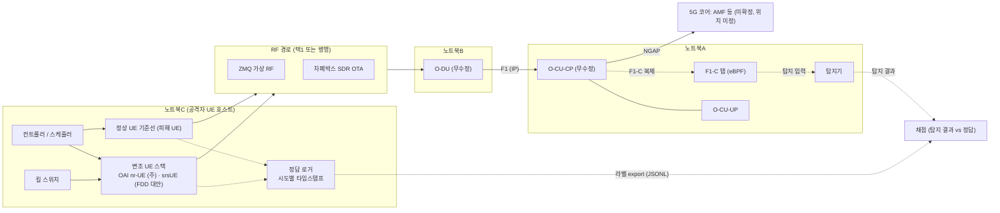
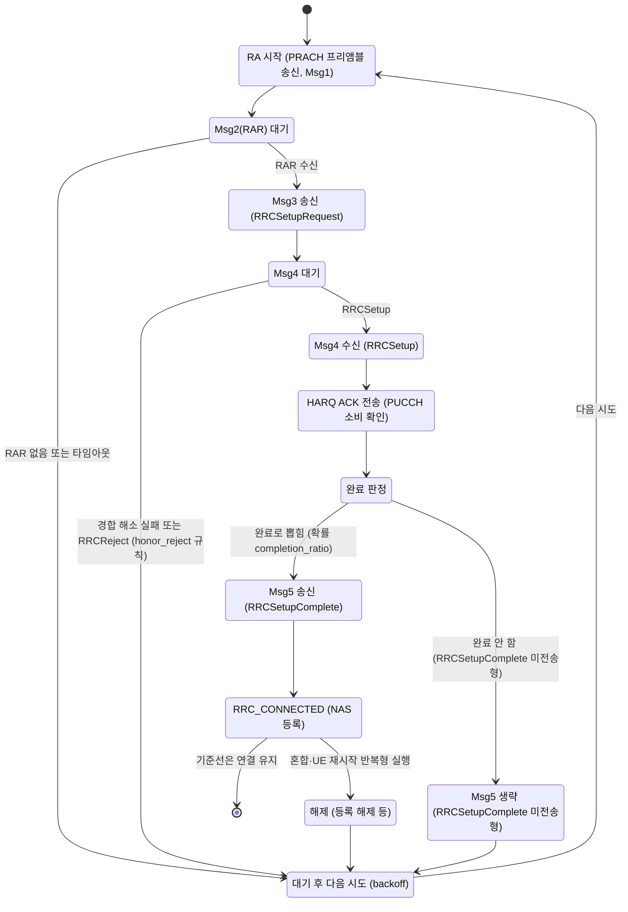
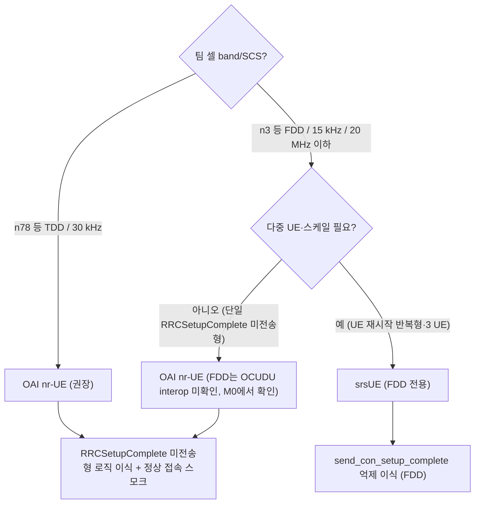

# RRCSetupComplete 미전송형 RSS 재현기 설계

| 항목 | 내용 |
|---|---|
| 갱신 | 2026-10-30 |
| 문서 역할 | RRCSetupComplete 미전송형 RRC(Radio Resource Control, 무선 자원 제어) 시그널링 스톰(RSS, RRC Signaling Storm) **재현기**의 아키텍처·동작·노브·실행 기록·단계 계획을 정한다. 코드가 아니라 설계 문서다. |
| 선행 지식 | [rss-theory.md](rss-theory.md) §2~§6을 먼저 읽는다. 5G 접속 절차(§2), 시그널링 스톰의 정의와 절차 기반 설명형 이름(§3), RRCSetupComplete 미전송형의 진행 과정(§4), 조작 파라미터(§5), 고갈 동역학(§6)을 알고 있다고 전제한다. |
| 관련 문서 | [rss-theory.md](rss-theory.md)(원리·OCUDU 수치의 단일 출처), [rss-landscape.md](rss-landscape.md)(변종·논문·공개 도구), [methodology.md](methodology.md)(실험 시나리오·관측 경계·합격 기준), [tool-survey.md](tool-survey.md)(정상 UE 연결 경로·공격 코드 재사용 범위). |

## 요약

본 문서는 팀의 O-RAN(Open RAN) 기지국 침입 탐지·대응(IDS/IPS, 침입 탐지/방지 시스템) 테스트베드에서 탐지기를 검증하기 위한 **RRCSetupComplete 미전송형 RSS 재현기**를 어떻게 만들지 설계한다. 여기서 RRC(Radio Resource Control, 무선 자원 제어)는 단말과 기지국 사이의 연결을 맺고 관리하는 제어 프로토콜이고, RRCSetupComplete 미전송형은 3GPP 공식 공격 분류명이 아니라 표준 메시지명과 중단 지점을 나타내는 설명형 이름으로, 단말(UE, User Equipment)이 기지국(gNB, next generation NodeB)과 무선 연결을 맺는 절차를 중간까지만 진행하고 마지막 완료 메시지(`RRCSetupComplete`)를 일부러 보내지 않아 기지국이 할당한 자원을 보유 시간 동안 붙잡아 두는 공격이다 [[1](#ref1), §2.3][[1](#ref1), §3][[1](#ref1), §4]. 설계 목표는 "강한 공격"이 아니라 **입력 파라미터가 통제되고 시도마다 정답이 기록되는 재현기**다 [[2](#ref2)]. 재현기는 공격자 UE 한 대와 정상 UE 기준선을 같은 셀에 두고, 시도 간격·완료율·초기 식별자 같은 노브를 바꿔가며 공격을 반복 재현한 뒤, 분석기 운영자가 자신의 관측값과 맞출 수 있도록 시도별 라벨을 JSONL(JSON Lines, 한 줄에 JSON 객체 하나씩 쓰는 형식)로 내보낸다 [[3](#ref3), §4]. 베이스는 OCUDU 공식 튜토리얼이 정상 접속 사례를 문서화한 OAI(OpenAirInterface)의 5G 단말 프로그램 nr-UE(NR은 New Radio, 5G 무선 접속 기술)를 1차로 하고, FDD(Frequency Division Duplex, 주파수 분할 이중화) 셀에서는 srsUE를 대안으로 둔다 [[4](#ref4)][[5](#ref5)]. 기지국 소프트웨어인 OCUDU(팀이 쓰는 srsRAN 계열 오픈소스 CU(Central Unit, 중앙 장치)/DU(Distributed Unit, 분산 장치))는 수정하지 않으며, 모든 실행은 RF(Radio Frequency, 무선 주파수) 차폐 박스 안에서만 수행한다 [[2](#ref2)]. OAI `2026.w38` UE와 OCUDU 26.10 분리 CU/DU의 ZMQ 정상 접속·RRCSetupComplete 미전송형 개입·미완료 상태 압력·label v1은 실행으로 확인했고, 차폐 OTA(Over-The-Air, 실제 무선) 경로는 미확인이다. 정적 CSI-DTX RLF20 설정은 RRCSetupComplete 미전송형 컨텍스트를 조기 해제했지만 셀 전체에 항상 적용되므로, 탐지 결과가 호출하는 동적 actuator가 확인되기 전까지 RRCSetupComplete 미전송형은 탐지 검증과 정적 hardening 시나리오로만 보고한다 [[3](#ref3), §6].

## 1. 서론

### 1.1 이 문서가 푸는 설계 문제

[rss-theory.md](rss-theory.md)는 RRCSetupComplete 미전송형 공격이 **왜** gNB 자원을 붙잡는지(원리)를, [rss-landscape.md](rss-landscape.md)는 세상에 공개된 공격 코드·논문이 **무엇을 제공하고 무엇이 비는지**(지형)를, [methodology.md](methodology.md)는 실험을 **어떤 시나리오로 어떻게 관측·채점할지**(방법론)를 다룬다. 이 문서는 그 셋을 받아, 실제로 만들 **재현기 한 대의 설계**를 정한다. 구체적으로는 재현기의 구성 요소(§3), 한 번의 접속 시도가 거치는 상태(§4), 실험자가 돌릴 수 있는 조절 손잡이(노브, §5), 어떤 소프트웨어를 기반으로 삼을지(§6), 그 소프트웨어의 어디를 고칠지(§7), 실행마다 무엇을 기록할지(§8), 어떤 순서로 만들고 검증할지(§9)를 정한다.

### 1.2 "재현기"란 무엇이고 왜 통제가 중요한가

재현기(reproducer)는 공격을 **재현**하는 도구다. 공격을 최대한 세게 걸어 기지국을 쓰러뜨리는 것이 목적이 아니라, **같은 조건을 반복해서 똑같이 만들어 낼 수 있고, 그 조건을 숫자로 바꿔가며 조절할 수 있는** 도구라는 뜻이다. 비유하면, 자동차 에어백을 시험할 때 쓰는 충돌 시험 장치와 같다. 목표는 차를 가장 심하게 부수는 것이 아니라, **같은 속도·같은 각도로 반복 충돌시켜** 센서가 매번 제대로 작동하는지 확인하는 것이다. 다만 이 비유는 "충돌 세기"만 바꾸는 시험 장치와 달리, 우리 재현기는 세기 외에도 시도 간격·완료율·식별자 정책 같은 **여러 축**을 독립적으로 조절한다는 점에서 한계가 있다.

본 프로젝트가 강한 공격이 아니라 통제 가능한 재현기를 설계 목표로 삼는 데에는 세 가지 이유가 있다.

첫째, 팀의 역할 분담상 이 서브태스크는 **탐지·대응기를 검증할 수 있는 통제된 스톰 재현기**를 만드는 것이다 [[2](#ref2)]. 탐지기가 RRCSetupComplete 미전송형 미완료 접속을 잡아내는지 확인하려면, 공격이 언제 시작되고 어느 시도가 미완료였는지에 대한 **정답(ground truth)**이 재현기 쪽에 기록되어 있어야 한다. 세기만 센 공격은 이 정답을 주지 못한다.

> "강한 공격"이 아니라 **"파라미터가 통제되는 재현기"**가 설계 목표다. [[2](#ref2)]

둘째, 탐지 성능은 조건에 따라 달라지므로 조건을 **바꿔가며** 측정해야 한다. 시도 간격을 바꾸면 초당 요청 수가 달라지고, 완료율을 바꾸면 미완료 접속의 비율이 달라진다. 이런 변수를 손잡이로 노출해야 탐지기의 동작 범위를 재현 가능하게 측정할 수 있다 [[3](#ref3), §5].

셋째, 공격이 정상 UE에 주는 영향과 탐지 시각을 **대조군과 비교**해야 한다. 재현기는 같은 셀에 정상 UE 기준선을 함께 띄워, RRCSetupComplete 미전송형이 정상 UE의 접속률과 지연에 주는 영향을 측정하는 대조군으로 쓴다 [[3](#ref3), §2].

### 1.3 범위

이 재현기는 1차로 **RRCSetupComplete 미전송형**만 다룬다. 단말이 기지국에 처음 접속할 때 쓰는 4-step RA(Random Access, 랜덤 액세스)는 메시지 네 개를 주고받는 절차이고, 그 네 메시지를 Msg1~Msg4라 부른다. Msg4는 기지국이 연결 설정 정보(`RRCSetup`)를 내려보내는 메시지이고, 그 뒤 단말이 보내는 `RRCSetupComplete`를 논문들은 "Msg5"라 줄여 부른다. "Msg5"는 3GPP 표준 용어가 아니다 [[1](#ref1), §2.5][[1](#ref1), §2.6]. RRCSetupComplete 미전송형은 Msg4를 받고 HARQ(Hybrid Automatic Repeat reQuest) ACK(수신 확인)까지 보낸 뒤 `RRCSetupComplete`를 생략한다 [[1](#ref1), §4]. RRCSetupComplete 미전송형의 친척인 RRCSetupRequest 후 중단형(Msg3 직후 재시작)를 포함한 설명형 이름의 정의는 [rss-theory.md](rss-theory.md) §3에 있다.

UE 재시작 반복형은 등록까지 정상 완료한 뒤 UE를 재시작해 접속을 반복하는 변종이다 [[7](#ref7), §3]. UE 재시작 반복형은 그 자체로 RSS 변종이지만, 이 재현기에서는 탐지기가 완료된 접속의 반복을 RRCSetupComplete 미전송형으로 오인하는지, 곧 오경보를 내는지 확인하는 비교 시나리오로 쓴다 [[3](#ref3), §2][[3](#ref3), §6]. [methodology.md](methodology.md)는 이 역할을 '대조군'이라 부르지만 [[3](#ref3), §2], 이 문서에서는 같은 셀의 정상 UE 기준선(§3)과 구별하려고 '비교 시나리오'라 쓴다.

gNB는 수정하지 않고 UE 측만 변조하며, 모든 실행은 RF 차폐 박스 안에서 팀 자체 장비를 대상으로만 한다 [[2](#ref2)]. 코어 측 공격은 RRCSetupComplete 미전송형이 코어에 닿지 않으므로 범위 밖이다(§2). 핸드오버(연결된 단말이 다른 셀로 옮겨 가는 절차 [[8](#ref8), §9.2.3.1])·페이징(망이 대기 중인 단말을 호출하는 절차 [[8](#ref8), §9.2.5])·NAS(Non-Access Stratum, 단말–코어 사이 제어 계층) 등록 폭주는 RRCSetupComplete 미전송형과 다른 절차를 쓰는 변종이므로 1차 범위에서 뺀다(변종 분류는 [[7](#ref7), §3]). F1·CU 경계 직접 주입은 실제 무선 구간(Uu, 단말–기지국 무선 인터페이스)을 거치지 않으므로 뺀다(§2).

RRCSetupComplete 미전송형을 구현한 공개 코드로는 `5gattacks/5g-rrc-storm`이 있다. 이것은 구형 OAI 커밋에 고정된 OAI 패치이고, 라이선스 파일이 없다 [[9](#ref9)]. 이 설계는 그 패치를 참고하되 현행 OAI 위에서 다시 구현한다(§7).

이 문서의 근거는 소스 판독(OAI tag `2026.w40` = `f8f7695` [[6](#ref6)], OCUDU `440cdbb` dev [[10](#ref10)], srsRAN_4G `bef8680` [[11](#ref11)])과 1차 논문이다. srsUE의 5G NR 기능도 저장소 이름과 달리 srsRAN_4G 저장소에 들어 있다(`srsue/src/stack/rrc_nr/`) [[11](#ref11)]. OCUDU 사실은 dev `440cdbb`에서 판독했고, 그중 핵심 항목만 main `920f88c`와 대조해 같음을 확인했다(줄 번호는 다름) [[1](#ref1), §8]. 팀 설치 커밋에서 다시 확인해야 한다 [[1](#ref1), §8]. 실행 검증은 하지 않았다.

## 2. 목표·비목표·제약

RRCSetupComplete 미전송형이 붙잡는 자원이 **인증 전** 자원이라는 사실이 이 절의 제약 대부분을 결정한다. 한 번의 접속 시도에서 UE가 Msg3(`RRCSetupRequest`, 연결 설정 요청)를 보내면, DU는 이 단말용 UE 컨텍스트와 C-RNTI(Cell RNTI. RNTI는 Radio Network Temporary Identifier, 무선 구간 임시 단말 식별자), 그리고 단말 전용 상향 제어 자원을 미리 떼어 준다 [[1](#ref1), §4]. 이 전용 자원은 PUCCH(Physical Uplink Control Channel, 단말이 ACK 같은 짧은 제어 신호를 올리는 상향 제어 채널)로 보내는 SR(Scheduling Request, 보낼 데이터가 있다는 요청)·CSI(Channel State Information, 채널 상태 보고) 자원과, PUCCH와 별개인 SRS(Sounding Reference Signal, 상향 채널 측정용 기준 신호) 자원이다 [[8](#ref8), §5.3.3][[8](#ref8), §5.3.5.1][[1](#ref1), §2.3]. 이 자원은 셀마다 개수가 유한해서, DU가 동시에 수용할 수 있는 단말 수의 상한을 정한다 [[1](#ref1), §8].

DU는 Msg3에 담긴 `RRCSetupRequest`를 F1(CU–DU 사이 인터페이스)의 Initial UL RRC Message Transfer 메시지(UL은 상향, 곧 단말→기지국 방향)에 실어 중앙 장치의 제어평면(CU-CP, CU Control Plane)으로 넘긴다. 그러면 CU-CP에는 UE 컨텍스트(F1AP(F1 Application Protocol) ID 포함)와, `RRCSetupComplete`를 기다리는 RRC 설정 절차(타이머 포함)가 생긴다 [[1](#ref1), §4]. `RRCSetupComplete`가 없으면 이 자원은 구현이 정한 보유 시간까지 해제되지 않는다 [[1](#ref1), §4]. 그리고 `RRCSetupComplete`가 없으면 CU가 코어의 접속·이동성 관리 기능(AMF, Access and Mobility Management Function)으로 NGAP(NG Application Protocol) `InitialUEMessage`를 보내지 않으므로, **RRCSetupComplete 미전송형은 코어가 보지 못한다** [[1](#ref1), §2.7]. 그래서 코어를 겨냥한 수단은 모두 비목표가 된다.

표 1은 재현기의 목표·비목표·제약과 실행 전 점검, 그리고 게이트 분리를 정리한 것이다. "게이트 분리"는 탐지 검증과 대응 폐루프 검증을 별도의 합격 기준으로 둔다는 뜻이다. 표에 나오는 **도달점(reach)**은 한 시도가 접속 절차의 어느 단계까지 갔는지를 뜻한다. 예를 들어 RAR(Random Access Response, 랜덤 액세스 응답 = Msg2)을 못 받음, Msg4 ACK까지 감, Msg5를 생략함, NAS 등록까지 감 같은 값이고, 전체 목록은 §8의 `actual_reach`에 있다.

표 1. RRCSetupComplete 미전송형 재현기의 목표·비목표·제약

| 구분 | 내용 |
|---|---|
| **목표** | (a) RRCSetupComplete 미전송형(Msg4 수신·HARQ ACK 후 `RRCSetupComplete` 생략)을 재현하고 시도별 도달점을 기록한다. (b) 시도 간격·완료율·초기 식별자를 통제한다. (c) 분석기 운영자에게 시각 라벨을 export한다 [[2](#ref2)][[3](#ref3), §4]. |
| **비목표** | 최대 처리율·셀 다운, 핸드오버/페이징/NAS 등록 폭주, F1/CU 경계 직접 주입은 다루지 않는다. 합성 Msg3 생성기(예: RAID 논문의 Scapy(패킷 생성 파이썬 라이브러리) 생성기)는 실제 Uu를 거치지 않으므로 범위 밖이다 [[7](#ref7), §6]. |
| **제약** | **gNB(OCUDU) 무수정** — UE 측만 변조한다. 차폐박스 안, 팀 장비 대상, 외부망 금지다 [[2](#ref2)]. 5gattacks 공개 패치(§1.3)의 재시도 간격은 빌드 시 고정되는 상수라, 런타임 노브와 라벨은 우리가 새로 만든다 [[9](#ref9)]. |
| **실행 전 점검** | 차폐 닫힘, 차폐 밖 누설 스캔, 송신 이득 ≤ 팀 상한, 실험 대역의 외부 사용 여부, 차폐 안 단말이 모두 팀 소유인지(대상 단말 목록)를 매 실행 전에 확인한다. 결과는 per-run `safety_check`에 남기고(§8), 하나라도 미충족이면 실행하지 않는다 [[2](#ref2)]. |
| **게이트 분리** | **탐지 검증**과 **대응 폐루프 검증**은 별도 합격 기준이다 [[3](#ref3), §6]. CSI-DTX RLF20 정적 설정은 p5 ZMQ에서 RRCSetupComplete 미전송형을 조기 해제했지만 탐지기가 호출한 actuator가 아니다(§10). 동적 대응 수단이 확인되기 전까지 RRCSetupComplete 미전송형은 탐지 검증과 정적 hardening 시나리오다. |

## 3. 아키텍처

재현기는 노트북 세 대에 걸쳐 있다. 공격자 UE를 띄우는 노트북C, O-DU가 도는 노트북B, 그리고 O-CU와 near-RT RIC(near-Real-Time RAN Intelligent Controller, 준실시간 RAN 지능형 제어기)·eBPF 탭·탐지·대응이 함께 도는 노트북A다. 노트북C와 B 사이는 RF 차폐 구간이고, 노트북B와 A는 IP 망 위의 F1으로 연결된다 [[2](#ref2)]. O-DU·O-CU는 O-RAN 규격 명칭으로 부른 DU·CU이며, CU는 다시 제어평면(CU-CP)과 사용자평면(CU-UP, CU User Plane)으로 나뉜다 [[1](#ref1), §2.2].

재현기를 돌리기 전에 코어와 CU-UP가 갖춰져 있어야 한다. OCUDU CU-CP는 연결된 AMF가 하나도 없거나 CU-UP가 하나도 없으면 `RRCSetupRequest`를 받아도 연결을 허용하지 않고 거부한다 [[1](#ref1), §8][[12](#ref12), L83]. 따라서 실험 전에 5G 코어(미확정, Open5GS 등 [[2](#ref2)])와 CU-UP를 반드시 연결해야 하며, 그렇지 않으면 RRCSetupComplete 미전송형 시도조차 시작되지 않는다(추론). 정상 UE 기준선의 접속과 `completion_ratio`>0 시도의 NAS 등록도 이 코어에서 일어난다(§4 지점 3). 코어를 어느 노트북에 둘지는 아직 정해지지 않았다 [[2](#ref2)].

그림 1은 이 구성을 보여준다. 왼쪽 노트북C 안에서 컨트롤러가 변조 UE와 정상 UE 기준선을 함께 몰고, 모든 시도의 시각을 정답 로거가 남긴다. 가운데 RF 경로는 ZMQ(ZeroMQ 가상 RF)와 차폐박스 SDR(Software-Defined Radio) OTA 중 하나를 택하거나 병행한다. 노트북B의 O-DU는 F1으로 노트북A의 O-CU-CP와 이어지고, 노트북A는 F1 제어평면(F1-C)을 eBPF(리눅스 커널 안에서 작은 프로그램을 실행해 패킷·함수 호출을 관측하는 기술)로 탭(복제 관측)해 탐지기에 넣는다. 화살표를 따라 읽으면, 공격은 UE에서 RF 경로를 거쳐 DU로 들어가고, 정답 라벨과 탐지 결과는 채점 단계에서만 만난다.



그림 1. 재현기 아키텍처. 실선은 신호·제어 흐름이고, 점선은 기록·관측 데이터의 흐름(정답 기록, F1-C 복제, 탐지 입력, 채점)이다. 정답 라벨은 탐지기의 입력이 아니라 채점에만 쓰인다. 노트북 배치는 [[2](#ref2)]을 따르고, CU-UP는 O-CU에 포함된다고 보고 노트북A에 그렸다(가정). 코어의 위치는 미정이다.

정답 라벨을 채점에만 쓰는 이유는 다음과 같다. 팀 프로젝트는 상용 블랙박스 CU를 전제로 한다 [[2](#ref2)]. 탐지기가 정답 라벨이나 OCUDU 내부 로그를 입력으로 쓰면, 운용 환경에서는 얻을 수 없는 정보로 답을 맞히게 되어 성능이 부풀려진다 [[3](#ref3), §4].

각 구성 요소의 역할은 다음과 같다.

- **컨트롤러/스케줄러**: 시나리오·시작/종료·노브를 UE에 전달한다. 1차에는 실행 시작 인자로, 후속에는 실행 도중 OAI telnet으로 바꾼다(§5) [[13](#ref13)].
- **변조 UE 스택**: OAI nr-UE가 주 베이스이고(§6), FDD 셀이면 srsUE가 대안이다 [[5](#ref5)].
- **RF 경로**: ZMQ 가상 RF는 전파 대신 무선 신호의 디지털 샘플을 ZeroMQ(메시지 전송 라이브러리) 소켓으로 주고받아 UE와 gNB를 잇는 방식이다 [[14](#ref14)]. 반복·스케일에는 ZMQ가, 통합 데모에는 차폐 OTA가 유리하며 둘을 병행할 수 있다. **다만 OCUDU의 OAI UE 경로는 이 ZMQ 드라이버를 쓰고 [[4](#ref4)], 드라이버는 UE의 안테나를 gNB의 안테나에 1:1로 매핑하며, 시작한 뒤에는 장치 추가·재접속이 불가능하다** [[14](#ref14)].

  > "You cannot reconnect a device once the simulation has started. The simulation has to be restarted from scratch in order to add devices or restart a process." [[14](#ref14), L15]
  > (번역) 시뮬레이션이 시작된 뒤에는 장치를 다시 연결할 수 없다. 장치를 추가하거나 프로세스를 재시작하려면 시뮬레이션 전체를 처음부터 다시 시작해야 한다.

  따라서 OCUDU의 ZMQ 경로에는 UE 한 대만 붙는다. 여러 UE를 붙이려면 gNB의 하향 신호를 각 UE에 복사해 주고 각 UE의 상향 신호를 합쳐 넘기는 중계 프로세스, 곧 **브로커**가 필요하다 [[15](#ref15), §3]. UE 프로세스를 재시작하는 UE 재시작 반복형은 gNB까지 다시 띄워야 할 수 있다(추론, [[14](#ref14)]). OAI 자체 RF 시뮬레이터(rfsim)는 서버 한 개가 최대 250개 연결을 받도록 정의돼 있지만 [[16](#ref16), L55], 서버 역할은 OAI gNB(또는 eNB)가 맡는 OAI 전용 경로이고 [[17](#ref17), L66], OCUDU 공식 OAI UE 경로는 ZMQ다 [[4](#ref4)]. 그래서 rfsim의 250 클라이언트는 OCUDU 실험에 쓸 수 없다(추론).
- **정상 UE 기준선**: 같은 셀에 정상 접속해, RRCSetupComplete 미전송형이 정상 UE 접속률·지연에 주는 영향을 재는 대조군이다. 이 문서에서 **피해 UE**는 정상 UE 기준선과 같은 대상, 곧 공격의 영향을 받는 정상 단말을 뜻한다. 거부·실패 뒤 재접속은 UE 구현에 맡기지 않고 **컨트롤러가 주기적으로 다시 건다**(§5 `honor_reject`) [[6](#ref6)]. 상용폰의 재시도 수단은 미정이고, 피해 UE 구현(OAI·srsUE·상용폰)은 per-run에 기록한다.
- **정답 로거**: UE 측 시도별 도달점(§2)을 남긴다(§8). 탐지기 입력과는 **분리**하고 채점에만 쓴다 [[3](#ref3), §4].
- **라벨 export**: 분석기 운영자가 자기 F1 탭 결과와 `tc_rnti`·`ue_identity`·시각으로 맞출 수 있게 JSONL로 넘긴다(필드 뜻은 §8).
- **킬 스위치**: 안전 최대 지속시간을 넘기거나 수동 신호가 오면 공격 UE를 즉시 정상/종료로 되돌린다.

## 4. 시도 단위 상태 기계

한 "시도(attempt)"는 RA 한 주기다. 표준상 한 MAC(Medium Access Control, 매체 접근 제어) 엔티티에는 **동시에 하나의 RA만** 진행될 수 있다 [[18](#ref18), §5.1.1].

> "there is only one Random Access procedure ongoing at any point in time in a MAC entity" [[18](#ref18), §5.1.1]
> (번역) 한 MAC 엔티티에서는 어느 시점에도 랜덤 액세스 절차가 하나만 진행된다.

이 제약 때문에 단일 UE 인스턴스의 속도는 RA 한 주기로 묶이고, 시도율을 더 올리려면 여러 인스턴스가 필요하다(§5 `num_ue_instances`). 그림 2는 한 시도가 거치는 상태를 나타낸다. 단말은 PRACH(Physical Random Access Channel, 물리 랜덤 액세스 채널. RACH는 Random Access Channel)로 프리앰블(preamble, Msg1)을 보내고, RAR(Msg2)을 받은 뒤 Msg3을 보내고, Msg4를 기다린다. 여러 단말이 같은 프리앰블을 고를 수 있으므로, Msg4로 누가 접속할지 확정하는 경합 해소(contention resolution) 단계를 거친다 [[1](#ref1), §2.5]. gNB는 Msg4 대신 연결 거부 메시지 `RRCReject`를 보낼 수도 있다 [[1](#ref1), §2.6]. 정상 UE와 공격 UE의 경로는 "완료 판정" 지점에서 갈라지고, RRCSetupComplete 미전송형은 `RRCSetupComplete`(Msg5)를 생략한 뒤 다음 시도로 돌아간다. 상태 이름의 RRC_CONNECTED와 RRC_IDLE은 단말의 RRC 상태로, 각각 연결이 맺어진 상태와 연결 없이 대기하는 상태다 [[1](#ref1), §2.4].



그림 2. 시도 단위 상태 기계. 왼쪽 위에서 시작해 RA → Msg2 → Msg3 → Msg4 → ACK → 완료 판정으로 내려가며, 판정에서 정상(M5)과 RRCSetupComplete 미전송형(SKIP)이 갈린다.

설계상 중요한 세 지점이 있다.

**지점 1 — `ACK` 전이는 "PUCCH 소비 확인" 뒤에 두는 편이 안전하다.** 먼저 ACK가 왜 중요한지 설명한다. Msg4를 받은 단말은 경합 해소에 성공해야 HARQ ACK를 보낸다 [[1](#ref1), §2.5][[18](#ref18), §5.3.2.2]. OAI gNB의 경합 해소 타이머는 Msg2 송신부터 Msg4 ACK 수신까지 돌고, 그 안에 ACK가 오지 않아 만료되면 곧바로 해제를 요청한다 [[1](#ref1), §7]. 실제로 KAUST 연구진의 RRC 스톰 실증 논문 [[19](#ref19)]은 ACK가 없으면 gNB가 임시 컨텍스트를 곧 해제해 미완료 연결이 쌓이지 않았다고 보고했다 [[19](#ref19), §V-B]. 그래서 RRCSetupComplete 미전송형 공격 UE도 ACK만은 반드시 보내야 한다.

OAI UE의 MAC은 Msg4를 받으면 ACK를 실을 PUCCH 송신을 미리 예약해 둔다. `prepare_msg4_msgb_feedback`가 송신할 슬롯을 `ra_pucch`에 기록하고 [[20](#ref20), L1155], 실제 물리 계층 전달은 그 슬롯이 왔을 때 `nr_ue_pucch_scheduler`가 한다 [[21](#ref21), L1818]. 슬롯(slot)은 NR 무선 프레임(10 ms)을 나눈 시간 단위이고, 길이는 부반송파 간격에 따라 달라진다 [[8](#ref8), §5.1]. 이 예약은 RRC가 `RRCSetup`을 보기 전에 이미 준비된다. 한편 OAI UE의 RRC 타이머는 새 무선 프레임마다, 곧 10 ms마다 한 번씩 검사된다. 이 한 번의 검사를 tick이라 부른다 [[6](#ref6), L3358][[22](#ref22), L166]. 공개 패치의 공격 타이머는 첫 tick에서 만료되도록 설정돼 있으므로 [[9](#ref9), 보관 패치 L280], Msg4 수신 뒤 0~10 ms 사이 어디서든 만료될 수 있다(코드 판독). 만료로 새 RA가 시작되면 `reset_ra`의 `memset(ra, 0, …)`이 [[20](#ref20), L1184] RA 상태를 0으로 지우면서 대기 중인 `ra_pucch`도 함께 지운다 [[23](#ref23), L365]. 그래서 w40 코드상 RRC tick이 ACK PUCCH 슬롯보다 먼저 오면 ACK가 유실될 **수 있다**(코드 판독, 빈도 미측정) [[21](#ref21), L2571]. 다만 KAUST는 같은 10 ms 타이머로 OTA 축적에 성공했고, 불안정하다고 한 것은 **타이머 없는 즉시 재시작**이었다 [[19](#ref19), §V-B].

> "After Msg3, the attacker still had to receive Msg4 and acknowledge it at the lower layer … this immediate restart was unreliable … Thus, we added a short timer after receiving Msg4 and before triggering the next RACH attempt." [[19](#ref19), §V-B]
> (번역) Msg3 다음에도 공격자는 Msg4를 받고 하위 계층에서 ACK를 보내야 했다. 즉시 재시작은 불안정했기 때문에, Msg4를 받은 뒤 다음 RACH 시도를 걸기 전에 짧은 타이머를 두었다.

따라서 공격 타이머가 만료되어도 ACK PUCCH가 실제로 송신된 뒤에야 다음 RA를 시작하게 막는 장치, 곧 **PUCCH 소비 게이팅**을 안전장치로 두고, 유실 여부는 M2 단계에서 측정한다(§9).

**지점 2 — `완료 판정`에서 완료율 노브로 Msg5 송신/생략을 가른다**(§5 `completion_ratio`). RRCSetupComplete 미전송형 순수 실행은 항상 생략하고, 완료율 1(정상)·혼합 실행은 비율대로 섞는다. **혼합 실행**은 `completion_ratio`를 0과 1 사이로 두어 완료 시도와 생략 시도를 섞는 실행이다.

**지점 3 — Msg5를 보낸 시도는 RRC_IDLE로 돌아와야 다음 시도가 된다.** 단말은 RRC_IDLE 상태에서만 새 RRC 연결 설정을 시작하기 때문이다 [[24](#ref24), §5.3.3.2].

> "The UE initiates the procedure when upper layers request establishment of an RRC connection while the UE is in RRC_IDLE and it has acquired essential system information" [[24](#ref24), §5.3.3.2]
> (번역) 단말은 RRC_IDLE 상태에서 상위 계층이 RRC 연결 수립을 요청하고 필수 시스템 정보를 얻은 경우에 이 절차를 시작한다.

Msg5를 보낸 경로는 NGAP `InitialUEMessage`와 NAS 등록을 만들므로 RRCSetupComplete 미전송형의 '코어 미도달' 전제가 깨진다 [[1](#ref1), §2.7]. 그래서 코어에 가입자 IMSI(International Mobile Subscriber Identity, SIM에 저장된 가입자 영구 식별자)를 등록해야 하고, 라벨은 `registered`로 따로 단다(§8). 연결 해제(release) 수단 후보는 다음 세 가지이고, 소요 시간은 모두 미측정이다.

- (a) **UE 발신 등록 해제** — OAI telnet `deregistration` 명령이다 [[13](#ref13), L238]. 등록 성공이 전제이고, 정상 절차라면 코어가 release를 건다(실행 미확인). **1차 선택**이다.
- (b) **UE만 RRC_IDLE로** — telnet `force_rlf` [[13](#ref13), L236]는 RLF(Radio Link Failure, 무선 링크 실패)를 강제로 일으키는 명령이다. 무선 구간 보안(AS 보안, AS는 Access Stratum)과 추가 제어·데이터 베어러(SRB2(Signalling Radio Bearer 2)·DRB(Data Radio Bearer))가 모두 갖춰지기 전이면 UE는 곧바로 RRC_IDLE로 가고, 모두 갖춰진 뒤면 연결을 되살리는 재수립(re-establishment)을 시도한다(`handle_rlf_detection`) [[6](#ref6), L3654]. gNB·코어 쪽 컨텍스트는 자기 타이머까지 남아 또 하나의 미완료 점유가 되므로 별도 라벨이 필요하다.
- (c) **OCUDU inactivity 해제 대기** — CU-CP `inactivity_timer`의 기본값은 120초다 [[10](#ref10), L530][[1](#ref1), §8]. 적용 조건은 미확인이고, 반복 실험에는 너무 느리다.

## 5. 노브 정의

노브(knob)는 실험자가 돌릴 수 있는 조절 손잡이다. 이 절은 각 노브가 **공격의 무엇을 바꾸는지**를 [rss-theory.md](rss-theory.md) §2~§6에서 배운 말로 먼저 설명하고, 표 2에 범위·기본값·구현 위치·관측 방법을 모은다. 설정값과 실제 측정값은 반드시 분리한다. 용어는 이렇게 고정한다. **실행 시작 인자**는 프로세스를 띄울 때 주는 값, **실행 중 변경**은 실행 도중 OAI telnet 등으로 바꾸는 값이다. 공개 5gattacks 패치의 재시도 간격은 **빌드 시 상수**라 둘 다 아니다 [[3](#ref3), §5]. 1차에는 최소 제어만 붙이고, RRCSetupComplete 미전송형이 성립한 뒤 나머지를 붙인다.

각 노브가 바꾸는 것을 말로 풀면 다음과 같다.

- **`scenario`** — 어떤 실험을 돌릴지 고른다. baseline(정상 접속), RRCSetupComplete 미전송형, RRCSetupRequest 후 중단형(MAC-confirmed Msg3 뒤 중단), UE 재시작 반복형이고, RRCResume 반복형·PRACH 반복형은 후속이다. 각 시나리오의 뜻은 [rss-theory.md](rss-theory.md) §3에 있다.
- **`start`/`stop`** — 공격을 켜고 끈다. 시작·종료 시각이 모든 라벨의 기준점이 된다.
- **`max_duration_s`** — 안전을 위한 최대 지속 시간이다. 이 시간을 넘기면 킬 스위치가 공격 UE를 되돌린다.
- **`honor_reject`** — gNB가 접속을 거부(`RRCReject`)했을 때 그 거부를 **지킬지** 정한다. 정상 UE라면 거부 안에 든 `waitTime`만큼 기다렸다가(단말 측 타이머 T302) 다시 시도한다 [[24](#ref24), §5.3.15.2]. true면 그 규칙을 지키고, false면 무시하고 즉시 다시 건다(공격성 실험 전용). 이 설계는 기본값을 true로 둔다. 근거는 다음 추론이다(추론). 거부를 지키는 공격 UE는 표준을 따르는 단말도 낼 수 있는 부하를 재현하므로, 탐지기가 표준을 지키는 공격도 잡는지 확인할 수 있다. 거부를 무시하는 UE는 정상 UE보다 더 공격적이므로, false 실행은 별도 라벨로 비교한다.
- **`reject_backoff_ms`** — `waitTime`이 없을 때 거부 뒤 얼마나 기다렸다가 다시 걸지를 정한다. OCUDU 기본 설정은 `RRCReject`에 `waitTime`을 넣지 않으므로(아래 "거부 뒤 동작" 참조) 이 값이 실제 재시도 간격을 정한다.
- **`attempt_interval`(= 목표 Msg3/s)** — 한 시도와 다음 시도 사이의 간격, 즉 초당 접속 시도 수(요청률 R)를 정한다. 고갈 조건 `R × T_hold ≥ N_cap`에서 R이 바로 이 값이다 [[1](#ref1), §6]. 여기서 R은 초당 미완료 시도 수, T_hold는 미완료 시도 하나가 gNB 자원을 붙잡는 보유 시간, N_cap은 DU가 동시에 수용할 수 있는 단말 수 상한이다. 포화·거부가 적은 구간에서는 동시에 붙잡힌 자원이 대략 R × T_hold개이므로, 이 값이 N_cap 이상이면 정상 UE가 들어갈 자리가 없다 [[1](#ref1), §6]. 기본 설정의 OCUDU에서 단일 UE가 이 조건에 닿는지는 §9에서 계산한다. 단, **설정 간격과 실제 Msg3/s는 다르다**(아래 "관측 분리 원칙").
- **`completion_ratio`** — 전체 시도 중 몇 할을 `RRCSetupComplete`까지 **정상 완료**시킬지 정한다. 0이면 모두 생략(순수 RRCSetupComplete 미전송형), 1이면 모두 완료(정상). 완료된 시도는 NAS 등록과 release까지 가므로 코어 가입자 등록이 필요하다(§4 지점 3).
- **`identity_policy`** — Msg3에 싣는 초기 UE 식별자를 매 시도 새로 뽑을지, 고정할지, 특정 5G-S-TMSI(코어가 단말에 배정한 임시 식별자)로 둘지 정한다 [[1](#ref1), §2.6]. **이 노브는 OCUDU의 수락/거부를 바꾸지 않고 탐지기가 보는 특징(동일 식별자 반복 여부)만 바꾼다**(아래 "identity 주의").
- **`num_ue_instances`** — 동시에 띄우는 공격 UE 프로세스 수다. 한 MAC은 RA를 하나만 돌리므로(§4), 시도율을 더 올리려면 이 값을 키운다. 단 ZMQ 1:1 제약 때문에 OCUDU 경로에서는 브로커(§3) 없이 다중 UE가 안 된다(§10).

표 2. RRCSetupComplete 미전송형 재현기 노브. "도입"은 1차/후속 구현 시점, "구현 위치"는 OAI nr-UE(`f8f7695`) 기준이다.

| 이름 | 단위 | 범위 | 기본값 | 도입 | 구현 위치 (OAI nr-UE, `f8f7695`) | 관측 방법 (설정값 vs 실측) |
|---|---|---|---|---|---|---|
| `scenario` | enum | 구현값: `baseline`·`A`·`A_early`·`A_no_ack`(아래 호환 매핑). 후속 설명형 이름: UE 재시작 반복형·RRCResume 반복형·PRACH 반복형 | `A` | 구현됨 | 컨트롤러 → UE 실행 시작 인자 | UE·CU 실제 도달점 라벨 |
| `start`/`stop` | — | — | — | 1차 | 컨트롤러; 후속은 telnet(아래 주) | 로그 시각 |
| `max_duration_s` | s | 1~ | 안전값 | 1차 | 컨트롤러 킬 스위치 | 실제 종료 시각 |
| `honor_reject` | bool | — | **true** | 1차 | `nr_rrc_process_rrcreject` [[6](#ref6), L2439]에 재시도 예약 추가. true: `waitTime`이 있으면 T302(=`waitTime`) 만료 뒤, 없으면 `reject_backoff_ms` 뒤 재시도. false: 즉시 재시도 | `RRCReject` 수신 수, `waitTime` 유무·값, 거부~다음 PRACH 실측 간격 |
| `reject_backoff_ms` | ms | 100~수천 | 1000 (임시, 팀 결정) | 1차 | 컨트롤러 → `handle_t300_expiry` 재호출 | 위와 같음 |
| `attempt_interval` | ms / req·s⁻¹ | 슬롯~수백 ms | PUCCH 소비 후 | 후속 | `attack_rach_timer`(`rrc_defs.h` 구조체 [[25](#ref25), L142], `rrc_timers_and_constants.c` tick [[22](#ref22), L166]) → `handle_t300_expiry` [[6](#ref6), L3849] | 설정 간격 vs **실측 Msg3/s**: UE `nr_Msg3_transmitted` 타임스탬프 + DU `total_prach_preambles`/scheduler metrics |
| `completion_ratio` | 0~1 | 0=전부 생략 | 0 (RRCSetupComplete 미전송형) | 후속 | rrcSetup case [[6](#ref6), L2508]에서 `nr_rrc_process_rrcsetup` 호출 여부 분기. Msg5를 보낸 시도는 등록·release까지 간다(§4 지점 3) | 의도 비율 vs 실제 Msg5 송신 수(`rrc_ue_generate_RRCSetupComplete` [[6](#ref6), L2284]). 0보다 크면 코어 가입자 등록이 필요하고 NGAP 이벤트가 생긴다 |
| `identity_policy` | enum | fresh_random·fixed_random·fixed_tmsi | fresh_random | 후속 | `nr_rrc_ue_prepare_RRCSetupRequest` [[6](#ref6), L374]: `rv[]`=`taus()` 재생성 여부 + `fiveG_S_TMSI` [[6](#ref6), L1858]. fixed_tmsi는 팀 소유 피해 UE의 TMSI만, 별도 run 라벨 | F1 `RRCSetupRequest`의 ue-Identity 디코드 |
| `num_ue_instances` | 개 | 1~ | 1 | 후속(UE 재시작 반복형·스케일) | 다중 `nr-uesoftmodem` 프로세스, `--uicc0.imsi` 구분 | ZMQ 1:1 제약으로 OCUDU 경로는 브로커 없이는 다중 UE 미지원(§10) |

**거부 뒤 동작(OCUDU 기본 + OAI w40).** OCUDU는 `rrc_reject_wait_time_s`를 설정하지 않으면 `RRCReject`에 `waitTime`을 넣지 않는다 [[1](#ref1), §8]. OAI w40 UE는 `waitTime`이 없으면 T302를 시작하지 않고 `"Error: waitTime should be always included"` 경고 로그만 남기며 MAC을 `UE_BARRED`로 리셋한다. 접속 실패를 상위에 알리는 부분은 TODO다 [[6](#ref6), L2439]. 그 뒤 UE가 스스로 다시 RA를 거는 경로는 코드에서 찾지 못했다(미확인). OAI의 자체 동작에 기대면 포화 직후 실행이 조용히 멈출 수 있고, OAI UE를 피해 UE로 쓰면 '정상 UE 접속 실패'가 UE 구현의 산물이 될 수 있다. 그래서 공격 UE와 정상 UE 모두 **재시도는 컨트롤러가 건다**. per-run에 OCUDU `rrc_reject_wait_time_s`(unset 또는 값)와 피해 UE 구현을 기록한다(§8).

**관측 분리 원칙.** `attempt_interval`은 **설정값과 실제 Msg3/s가 다르다**. 한 시도는 PRACH 기회(PRACH 구성이 정하는, 프리앰블을 보낼 수 있는 시점)를 기다리고, RAR을 정해진 창(window) 안에서 기다리고, Msg4와 그 HARQ ACK를 기다려야 끝난다 [[1](#ref1), §2.5]. 그래서 설정 간격을 아무리 줄여도 실제 속도는 이 대기들의 합으로 묶인다(추론). 이 가운데 `ra-ContentionResolutionTimer`(경합 해소 타이머, OCUDU 기본 64 ms [[26](#ref26), L116])는 OCUDU 앱 설정(YAML/CLI)으로 바꿀 수 없다 [[1](#ref1), §8]. KAUST가 채움 시간에서 추정하고 관측 속도로 보고한 단일 UE 속도는 약 25/s(시도당 약 40 ms)다 [[19](#ref19), §VI-A][[19](#ref19), §VI-B].

> "selected empirically based on the observed attacker rate (about 25 requests per second, i.e., 40 ms per request)" [[19](#ref19), §VI-B]
> (번역) (완화용 100 ms 타이머 값은) 관측된 공격자 속도(초당 약 25회 요청, 즉 요청당 40 ms)를 바탕으로 경험적으로 골랐다.

**identity 주의.** fresh-random이 **이미 기본값**이다. Msg3는 `randomValue`(39-bit 난수) 또는 `ng-5G-S-TMSI-Part1`만 싣고, **IMSI(`--uicc0.imsi`)는 Msg3에 들어가지 않는다**. IMSI 계열 가입자 식별자는 Msg3가 아니라 Msg5에 실려 가는 NAS 등록 메시지로 처음 올라간다 [[1](#ref1), §5]. 순수 RRCSetupComplete 미전송형은 Msg5·등록에 도달하지 않으므로 `fiveG_S_TMSI`가 `UINT64_MAX`로 남아 매 시도 새 random을 쓴다 [[6](#ref6), L1858]. OCUDU CU-CP는 이 값의 **중복을 검사하지 않는다**. 초기 identity를 저장하는 분기에는 이 값을 기존 단말과 대조하는 코드가 없고, `randomValue` 분기에는 다음 TODO 주석만 있다 [[27](#ref27), L89–L98].

> "// TODO: communicate with NGAP" [[27](#ref27), L97]

그래서 같은 식별자를 반복해도 수락·거부가 달라지지 않는다(코드 판독). 따라서 identity 정책은 **OCUDU 수락/거부를 바꾸지 않고 탐지기 특징(동일 identity 반복)만 바꾼다**. **Blind DoS**는 Msg3의 ue-Identity에 피해 단말의 5G-S-TMSI를 넣어 그 단말의 연결을 방해하는 표적 공격이다 [[7](#ref7), §3]. `fixed_tmsi`로 실재 UE의 TMSI를 재사용하면 RRCSetupComplete 미전송형이 이 표적 Blind DoS로 바뀐다 [[7](#ref7), §3]. 용량을 고갈시키는 RRCSetupComplete 미전송형과 달리 특정 단말을 노리므로, 기본에서 제외하고 **팀 소유 피해 UE의 TMSI만** 별도 run 라벨과 §2 실행 전 점검 아래에서 쓴다.

**실행 중 변경 주입처(후속).** OAI는 UE telnet CLI 서버 `telnetsrv_ciUE.c`의 `cicmds[]`에 [[13](#ref13), L232] `force_rlf`·`force_crnti_ra`·`deregistration` 등 실행 중 명령 선례가 있다. 다만 (a) telnet 서버는 **기본 빌드에 포함되지 않아** `--build-lib telnetsrv`로 따로 빌드하고, 실행할 때 `--telnetsrv` 옵션을 줘야 한다 [[28](#ref28), L4][[28](#ref28), L25]. (b) 기존 핸들러는 인스턴스 0만 건드린다(`get_NR_UE_rrc_inst(0)`, `get_mac_inst(0)`) [[13](#ref13), L143][[13](#ref13), L154]. telnet 서버는 등록된 변수를 get/set 명령으로 읽고 쓰는 기능을 제공하고 [[29](#ref29), L3], `telnetsrv_ciUE.c`의 변수 표 `civars[]`는 현재 비어 있다 [[13](#ref13), L245]. 그래서 이 빈 `civars[]`에 int 변수(interval/enable)를 등록해 get/set으로 노출하는 쪽이 새 명령보다 가볍다(추론). 어느 쪽이든 1회 재빌드가 필요하다(추론).

## 6. 베이스 선택

"베이스(base)"는 변조의 토대가 될 UE 소프트웨어다. 그림 3은 팀 셀의 주파수 대역(band)과 SCS(Subcarrier Spacing, 부반송파 간격), 이중화 방식, 다중 UE 필요 여부에 따라 베이스를 고르는 결정 트리다. 이중화 방식은 상향과 하향을 시간으로 나누는 TDD(Time Division Duplex, 시분할 이중화)와 주파수로 나누는 FDD 두 가지이고, n78은 3.5 GHz 대역의 TDD 대역 번호다 [[4](#ref4)]. 그림의 interop은 상호운용성, 곧 서로 다른 구현이 표준대로 맞물려 동작하는지를 뜻한다.



그림 3. 베이스 선택 결정 트리. 셀이 TDD면 OAI nr-UE로 가고, FDD이면서 다중 UE 스케일이 필요하면 srsUE를 쓴다.

다중 UE 갈래에서 srsUE를 고르는 이유는 공식 srsRAN의 3 UE ZMQ 브로커가 srsUE용으로 공개되어 있고 [[15](#ref15), §3], OAI UE와 이 브로커의 동작은 확인되지 않았기 때문이다(§10).

- **권장: OAI nr-UE.** OCUDU 공식 OAI UE 튜토리얼이 OAI `2026.w25` 이상·n78 TDD·ZMQ 정상 접속을 문서화한다 [[4](#ref4)]. RRCSetupComplete 미전송형 개입점이 모두 현행 코드에 매핑되고(§7), **프로세스 안에서 RA를 다시 거는 경로**가 내장돼 있다(`handle_t300_expiry` [[6](#ref6), L3849] → `nr_mac_start_ra` [[30](#ref30), L2043] → `nr_ue_ul_scheduler`의 `init_RA` [[21](#ref21), L2571]). `handle_t300_expiry`는 원래 정상 UE의 T300(단말이 `RRCSetupRequest`를 보낸 뒤 `RRCSetup`을 기다리는 단말 측 타이머 [[24](#ref24), §7.1.1])이 만료됐을 때 호출되는 함수로, 새 `RRCSetupRequest`를 준비하고 MAC에 RA 시작을 요청한다 [[6](#ref6), L3849]. 재현기는 공격 타이머가 만료될 때 이 함수를 그대로 불러 다음 시도를 만든다. 그래서 프로세스 재시작이 필요 없다. 이 점이 중요한 이유는 두 가지다. 프로세스 재시작에는 시도 간격보다 훨씬 긴 시간이 들고(추론), ZMQ 경로는 시작한 뒤 재접속이 안 되기 때문이다 [[14](#ref14)].
- **srsUE: FDD 전용 대안.** srsUE NR SA(Standalone, LTE(4G) 도움 없이 5G만으로 동작하는 모드)는 15 kHz SCS·FDD·20 MHz 이하이고 핸드오버를 지원하지 않는다 [[5](#ref5)]. 개입점은 `send_con_setup_complete`를 억제하고(`rrc_nr.cc:686`, 호출부 `rrc_nr_procedures.cc:356`) `setup_request_proc`(`rrc_nr_procedures.cc:182`)를 다시 도는 것이다 [[11](#ref11)]. **단, srsUE에는 재시도 루프가 내장돼 있지 않아 RRCSetupComplete 미전송형 전체가 커스텀 코드다.**
- **공개된 공격 코드 세 건은 참고물일 뿐이다.** `5gattacks/5g-rrc-storm`은 구형 OAI `92980ceb`에 고정됐고 라이선스가 없다 [[9](#ref9)]. `salam-ai-learning/5g-rrc-storm-attack`은 Firecell 계열 'v3.3.0' 코드베이스(`fc_*` 함수가 들어 있는 OAI 파생본으로, 업스트림 OAI 태그가 아니다) 위에 RRCSetupRequest 후 중단형을 구현했다 [[31](#ref31)][[7](#ref7), §5.1]. 5GSEC `nr.attack.v2.1.0`의 BTS(Base Transceiver Station, 기지국) depletion은 Msg5와 등록 요청까지 보낸 뒤 인증 단계에서 응답하지 않고 멈추는 **NAS 단계 변종이라 RRCSetupComplete 미전송형이 아니다** [[7](#ref7), §3][[7](#ref7), §5.1]. 그 노브는 실행 시작 인자뿐이고, `--rrc-911` 등 다수 인자가 NR 코드에 연결돼 있지 않으며, `establishmentCause`(Msg3에 실리는 접속 이유 필드 [[1](#ref1), §2.6])는 `mo_Signalling`으로 하드코딩돼 있다 [[32](#ref32)][[7](#ref7), §5.1].

## 7. 수정 지점 (OAI nr-UE, `f8f7695` = 2026.w40)

RRCSetupComplete 미전송형의 핵심은 `nr_rrc_ue_decode_ccch`의 **rrcSetup case 두 줄 교체**다. 5gattacks 패치는 구형 커밋 기준이라 기계적으로 적용하면 컴파일되지 않는다 — 약 다섯 곳의 UE 편집을 **재구현**하는 일이다 [[9](#ref9)]. 표 3은 그 지점과 주의점을 정리한다.

표 3. OAI nr-UE(`f8f7695`) RRCSetupComplete 미전송형 수정 지점

| # | 지점 | 목적 | 위험·주의 |
|---|---|---|---|
| 1 | `nr_rrc_ue_decode_ccch` rrcSetup case [[6](#ref6), L2508] | `nr_rrc_process_rrcsetup` 호출을 완료율에 따라 건너뜀 → Msg5·`RRC_CONNECTED` 진입 생략 | `nr_rrc_process_rrcsetup`는 Msg5 송신 [[6](#ref6), L2436] + CONNECTED 전이 + NAS에 연결 수립을 알리는 표시(indication)를 함께 한다. 분기만 넣고 함수는 보존한다 |
| 2 | 타이머 struct [[25](#ref25), L142] + tick [[22](#ref22), L166] | `attack_rach_timer` 추가, 만료 시 `handle_t300_expiry` 호출 → 다음 시도 | 만료를 **PUCCH 소비 뒤**로 게이팅하는 안전장치(§4). 고정 10 ms는 코드상 ACK 유실 가능(미측정), KAUST는 10 ms로 OTA 성공 [[19](#ref19), §V-B]. T300/T302와 구별 |
| 3 | `nr_rrc_process_rrcreject` [[6](#ref6), L2439] | 거부 뒤 재시도 예약: `waitTime`이 있으면 T302 만료 뒤, 없으면 `reject_backoff_ms` 뒤(§5). `honor_reject=false`면 즉시 | OCUDU 기본은 `waitTime`이 없어 원래 코드로는 재시도가 보장되지 않는다(§5). 즉시 재시도는 공격성 실험 전용 |
| 4 | `nr_rrc_ue_prepare_RRCSetupRequest` [[6](#ref6), L374] | identity 정책(rv 재생성/고정, TMSI 주입) | IMSI는 Msg3에 없음(§5). fixed_tmsi는 표적 DoS — 팀 소유 UE만, 분리한다 |
| 5 | RA 재시작 경로(수정 아님, 재사용): `handle_t300_expiry` [[6](#ref6), L3849] → `nr_mac_start_ra` [[30](#ref30), L2043] → `init_RA` [[21](#ref21), L2571] | 프로세스 안에서 PRACH/Msg3 재시작 | `reset_ra`의 `memset` [[20](#ref20), L1184]이 `ra_pucch` 소거(#2 유실 가능성의 근원) |
| 6 | **RRCSetupRequest 후 중단형(구현됨)**: MAC scheduler의 실제 Msg3 handoff를 기록해 RRC로 전달한 뒤 camped-idle reset | Msg4를 기다리지 않는 변종 | p5 G2에서 UE TC-RNTI↔CU 요청 10/10, capacity-96 G35에서 정상 probe 11/11 DU 자원 거절 |

**옮기지 않는 것.** 5gattacks 패치는 UE만이 아니라 OAI gNB 코드도 바꾼다. gNB가 상향 신호 두절(UL failure)을 판정한 뒤 단말 해제를 요청하기까지의 대기 상수 `UL_FAILURE_TIMEOUT`(단위 ms)을 30000→5000으로, 해제 요청 뒤 자동 해제까지의 유예 상수 `UL_FAILURE_REQ_GRACE`(단위 ms)를 10000→1000으로 바꾼다 [[9](#ref9), 보관 패치 L124–L127][[33](#ref33), L4159][[33](#ref33), L4168]. 따라서 패치의 gNB 부분까지 적용한 실험은 OAI 기본값과 다른 gNB에서 수행된 것이 된다(추론). KAUST 논문의 대기 시간 5초가 이 상수였을 가능성과 그 한계는 [tool-survey.md](tool-survey.md) §4에 정리돼 있다 [[15](#ref15), §4]. 이 gNB 상수 변경(`gNB_scheduler_primitives.c`)과 USRP(SDR 장비) `.conf`·gNB 로그 훅은 **OCUDU 무수정 원칙 [[2](#ref2)]에 따라 이식하지 않는다** [[9](#ref9)]. 구형 패치의 `nr_ra_procedures.c` Msg3 버퍼 해제는 현행 OAI에서 `init_RA`/`nr_ra_succeeded`가 이미 자동 flush하므로 1:1 포팅 대상이 아니다(동작은 테스트로 결정) [[20](#ref20), L1052].

## 8. 실행 기록·라벨 스키마

[methodology.md](methodology.md) §5 및 구현된 [라벨 계약 v1](rss-storm/docs/LABEL-CONTRACT.ko.md)과 정렬한다 [[3](#ref3), §5]. 실행기는 **per-run 메타데이터 1건 + per-event raw 정답 N건**을 먼저 남긴다. 종료 뒤 exporter가 raw 이벤트를 `(run_id, ue, seq)`로 묶어 **per-attempt 정답 1건**으로 정규화한다. raw 정답과 정규화 정답은 탐지기 입력에서 분리한다.

**per-run** (`run.json`, 실행 1건당 객체 1개)

현재 label v1은 과거 증거 재생 호환성 때문에 `scenario="A"`를 RRCSetupComplete 미전송형,
`scenario="A_early"`를 RRCSetupRequest 후 중단형, `scenario="A_no_ack"`를
RRCSetup HARQ-ACK 억제형의 기계 값으로 보존한다. 새 문서와 사용자 화면에서는 설명형
이름을 쓰고, 이 값들은 기존 JSON을 읽을 때만 호환 이름으로 해석한다.

```json
{
  "schema_version": "rss.run.v1",
  "type": "run",
  "run_id": "X2026W40001",
  "scenario": "A",
  "rf_path": "zmq",
  "ue_base": "oai-nr 1c2f4d3c",
  "ocudu_commit": "440cdbb",
  "gnb_config_profile": "default",
  "cell": {"band": "n78", "scs_khz": 30, "bw_mhz": 20, "tdd": "6D3U", "two_step_ra": false},
  "gnb_cfg": {
    "t300_ms": null,
    "guard_ms": null,
    "rrc_reject_wait_time_s": "unset",
    "prach_config_index": null,
    "ra_con_res_timer_ms": null,
    "du_upper_bound_ues": null
  },
  "knobs": {
    "attempt_interval_ms": null,
    "completion_ratio": 0.0,
    "identity_policy": "fresh_random",
    "honor_reject": true,
    "reject_backoff_ms": 1000,
    "num_ue": 1
  },
  "normal_ue": {"impl": "oai", "retry": "controller"},
  "radio": {"tx_gain_db": null, "position": "P1", "mobility": "static", "ue_rsrp_dbm": null},
  "clock_sync": {
    "method": "unmeasured",
    "offset_ns": null,
    "uncertainty_ns": null,
    "evidence_sha256": null
  },
  "capture_loss_pct": null,
  "safety_check": {
    "shield_closed": true,
    "shield_scan_dbm": null,
    "tx_gain_cap_db": null,
    "band_clear": true,
    "devices": ["team-ue-1"],
    "operator": "<이름>"
  },
  "t_start_ns": 1791882000000000000
}
```

**raw event** (`attempts.jsonl`, 이벤트 1건당 1줄)

```json
{"type":"rss_event","run_id":"X2026W40001","ue":0,"seq":17,"t_ns":1791882034828000000,"event":"msg4_rx","msg5_action":"skipped"}
{"type":"rss_event","run_id":"X2026W40001","ue":0,"seq":17,"t_ns":1791882034832000000,"event":"msg4_ack_scheduled"}
```

**normalized attempt** (`ground_truth.jsonl`, 시도 1건당 1줄)

```json
{"schema_version":1,"type":"attempt","source":"ue_ground_truth","run_id":"X2026W40001","attempt_id":"X2026W40001:0:17","ue":0,"seq":17,"intended_reach":"msg5_skip","actual_reach":"msg5_skip","msg4_ack_state":"scheduled","du_ack_state":"unknown","msg5_action":"skipped","canonical_a_ue":true,"canonical_a":null,"canonical_a_evidence":"du_ack_not_joined"}
```

스키마의 각 부분은 다음과 같이 읽는다.

- `gnb_config_profile`: `default` 또는 설정만 바꾼 포화 프로필 이름(§9 M1b)이다. `gnb_cfg`는 설치본의 로드된 설정과 DU 기동 CONFIG 로그에서 채운다. 예시의 `null`은 '아직 읽지 않음', `"unset"`은 미설정이다. 기본값의 출처는 [rss-theory.md](rss-theory.md) §8이다 [[1](#ref1), §8].
- `cell.tdd`: 팀 셀의 TDD 하향/상향 슬롯 패턴을 줄여 쓴 값이다. 예시의 `6D3U`는 OCUDU 앱 기본 TDD 패턴(10 슬롯 주기 중 하향 6 슬롯, 상향 3 슬롯, 나머지 한 슬롯은 하향 심볼 8개를 담는 혼합 슬롯 [[34](#ref34), L783])을 이 문서가 임의로 줄여 쓴 표기다. 실제 기록은 설치본 설정 파일의 표기를 따른다.
- `gnb_cfg.prach_config_index`: PRACH 기회의 배치를 정하는 설정 번호이고 [[24](#ref24), §6.3.2 RACH-ConfigGeneric], OCUDU는 지정하지 않으면 상향 슬롯에 맞게 자동으로 정한다 [[34](#ref34), L1272]. PRACH 설정은 최대 시도율의 상한이 되므로 [[1](#ref1), §5] 실행마다 기록한다.
- `gnb_cfg.du_upper_bound_ues`: DU 기동 CONFIG 로그의 `upper-bound on the number of UEs` 값, 곧 N_cap 추정치다 [[1](#ref1), §8].
- `cell.two_step_ra`: OCUDU는 2-step RA를 선택 설정으로 지원한다(`du_high_config.h`의 `std::optional<two_step_info> two_step` [[34](#ref34), L1330], 기본 미설정). 켜져 있으면 Msg 번호 체계와 RRCSetupComplete 미전송형 개입 지점이 달라진다.
- **로컬 조인 키.** `seq`는 UE별 순번이므로 `(run_id, ue, seq)`만 한 시도의 raw 이벤트를 묶는다. 이벤트가 없다는 사실을 ACK·송신 실패의 증거로 바꾸지 않는다.
- **RRCSetupComplete 미전송형 판정.** `msg4_ack_scheduled` + `msg5_action=skipped`는 `canonical_a_ue=true`인 UE scheduler 후보다. DU의 같은 시도 HARQ ACK가 조인되기 전 `canonical_a`는 `null`이다. `msg4_ack_withheld`이면 `msg4_no_ack`/`false`, ACK 양성 이벤트가 없는 과거 `msg5_skip`은 `msg4_ack_unknown`/`null`이다. `msg5_submitted`는 PDCP 제출 증거이며 gNB 수신 증거가 아니다.
- **F1·DU 조인 키.** 시도 간격이 수십 ms라 시계 오차가 수 ms만 나도 시각만으로 F1 메시지와 1:1로 맞추기 어렵다. 가능한 경우 `tc_rnti`(RAR에서 받은 임시 식별자 TC-RNTI(Temporary C-RNTI), RRC가 보관 [[6](#ref6), L2183])와 `ue_identity`(Msg3의 39-bit 전체)를 함께 남긴다. OCUDU DU는 이 RNTI를 F1 Initial UL RRC Message Transfer의 C-RNTI로 싣는다 [[35](#ref35), L61]. RNTI는 재사용될 수 있으므로 `(tc_rnti, ue_identity, 시각 창)`으로 맞춘다.
- **시각.** 시각은 UE 호스트의 epoch ns 정수 하나로 통일하고 `clock_sync`에 방법·offset·uncertainty·증거 SHA-256을 둔다. offset이나 uncertainty가 없으면 호스트 간 latency는 `null`/`unscorable`이다.
- **물리 변수.** `ta_cmd`는 UE가 이미 파싱하는 RAR의 TA(Timing Advance) 명령이다. TA는 gNB가 단말과의 거리에 맞춰 상향 송신 시점을 얼마나 조정할지 RAR로 알려 주는 값이다 [[18](#ref18), §6.2.3]. KAUST는 TA가 단말을 식별할 만큼 정밀하지는 않지만 비슷한 거리에서 온 요청을 묶을 수 있다고 보고, TA 구간(버킷)별 미완료 연결 수로 의심 구간을 골라 완화했다 [[19](#ref19), §IV-B][[19](#ref19), §VI-B]. 같은 자리의 공격자는 매 시도 비슷한 TA를 받을 것이므로(추론) `ta_cmd`는 탐지 특징 후보로 기록한다. 다만 정지 단말도 TA가 몇 값 사이에서 흔들린다는 보고가 있다 [[7](#ref7), §4.3]. gNB 측 TA·RSSI(Received Signal Strength Indicator, 수신 신호 세기)는 DU 로그·탐지 쪽 값이다. 송신 이득·위치·이동 여부와 UE가 잰 RSRP(Reference Signal Received Power, 기준 신호 수신 전력)는 per-run `radio`에 두고, 캡처 손실은 분석기 운영자가 `capture_loss_pct`에 채운다 [[7](#ref7), §7 R6][[3](#ref3), §5].
- 정답 훅: Msg3 `nr_Msg3_transmitted` [[20](#ref20), L966], Msg4 수신 rrcSetup case [[6](#ref6), L2508], **Msg4 ACK scheduler 예약/억제 `nr_ue_pucch_scheduler`** [[21](#ref21), L1818], 경합 해소 성공 `nr_ra_succeeded` [[20](#ref20), L1052], Msg5 PDCP 제출 `nr_rrc_process_rrcsetup` 경로 [[6](#ref6), L2284], 재시도 `handle_t300_expiry` [[6](#ref6), L3849]. UE 예약은 DU ACK 자체가 아니다.
- 탐지기에는 F1/eBPF 텔레메트리만 주고 `run.json`·raw/normalized 정답·OCUDU 진단 로그는 채점 전까지 분리해 SHA-256으로 봉인한다 [[3](#ref3), §4]. 탐지·대응·효과 출력은 [라벨 계약 v1](rss-storm/docs/LABEL-CONTRACT.ko.md)을 따른다.

## 9. 단계별 구현·검증 계획

[methodology.md](methodology.md) §6 합격 기준과 정렬한다 [[3](#ref3), §6]. 각 단계는 **앞 단계가 검증된 뒤**에 진행한다.

**M1을 M1a와 M1b로 나눈 이유.** (추론) KAUST가 관측한 단일 공격 UE 속도 약 25 요청/s [[19](#ref19), §VI-B]에 OCUDU 기본 보유 시간 약 2 s(`t300` 1000 ms + CU-CP guard 1000 ms) [[1](#ref1), §8]를 곱하면 동시 점유는 약 50개다. 이는 30 kHz TDD 기본 패턴에서 추정한 DU 상한 약 96 [[1](#ref1), §8]보다 작다. 즉 기본 설정에서는 단일 UE로 포화가 나지 않을 수 있다. 25/s는 OAI gNB·OTA 조건의 값이고 96은 계산 과정이 기록되지 않은 이전 추정치이므로 [[1](#ref1), §8], OCUDU 설치본에서는 둘 다 다를 수 있다(미확인). 그래서 M1a는 기본 설정에서 RRCSetupComplete 미전송형 성립만 확인하고, M1b는 포화를 일부러 만든다.

M1b의 (ii) 설정 프로필이 효과가 있는 이유는 다음과 같다. SIB1(System Information Block 1)은 gNB가 셀 안의 모든 단말에게 주기적으로 방송하는 기본 시스템 정보로, 초기 접속에 필요한 정보를 담는다 [[8](#ref8), §7.3.1]. T300 값도 SIB1의 `ue-TimersAndConstants`에 실려 방송된다 [[24](#ref24), §6.2.2][[24](#ref24), §6.3.2]. T300은 단말 타이머지만 [[1](#ref1), §2.6], OCUDU CU-CP는 이 T300 값에 `rrc_procedure_guard_time_ms`를 더한 시간만큼 `RRCSetupComplete`를 기다린다 [[1](#ref1), §8]. 따라서 SIB1의 `t300`을 규격 최댓값 2000 ms(ASN.1(메시지 형식 정의 표기법) 표기 `ms2000` [[24](#ref24), §6.3.2])로 올리거나 guard를 늘리면, gNB 소스를 고치지 않고도 보유 시간 T_hold가 늘어난다(추론). 한편 DU가 동시에 수용할 수 있는 단말 수 상한은 SR·CSI·SRS 자원 수 가운데 가장 작은 값으로 정해지므로 [[1](#ref1), §8], SR·CSI 자원을 줄이면 N_cap이 내려간다(추론). 둘 다 `R × T_hold ≥ N_cap`에 더 쉽게 닿게 만든다.

표 4는 M0부터 M5까지의 산출과 검증 가능한 합격 기준이다.

표 4. 단계별 구현·검증 계획

| 단계 | 산출 | 합격 기준 (검증 가능) |
|---|---|---|
| **M0 interop 스모크** | 무변조 UE ↔ OCUDU 정상 접속 | OAI w38·OCUDU 26.10 분리 CU/DU의 ZMQ 정상 접속·PDU·ping은 통과했다. 남은 게이트는 §2 실행 전 점검과 팀 셀 band/SCS/대역폭(BW)·2-step RA 여부·커밋을 고정한 **차폐 OTA**다. |
| **M1a RRCSetupComplete 미전송형 성립 (기본 설정)** | §7 #1~#5 편집을 적용한 UE, 단일 인스턴스 | Msg4 ACK 후 Msg5 생략 → CU 미완료 절차 생성~해제와 DU 자원 점유가 관측됨. 동시 점유 `N ≈ R × T_hold`를 측정하고 DU 기동 CONFIG 로그의 `upper-bound on the number of UEs`와 비교해 포화 여부를 기록. **포화가 안 나도 실패가 아니다**(한 MAC은 RA 하나뿐이라 단일 UE로는 상한에 못 미칠 수 있음, 계산은 위 문단, 수치는 [rss-theory.md](rss-theory.md) §6·§8 [[1](#ref1), §6]). 단순 Msg3/s 상승은 성공이 아님 |
| **M1b 포화 시험** | (i) 다중 UE 인스턴스(OTA는 SDR 여러 대, ZMQ는 브로커 — §10) 또는 (ii) gNB 소스는 그대로 두고 **설정만 바꾼 프로필**: SIB1 `t300` 최대 ms2000, `rrc_procedure_guard_time_ms` 증가, SR·CSI 자원·주기 축소 등 | 포화 시 정상 UE 접속 실패·지연이 컨트롤러 재시도 기준으로 관측됨. (ii)는 per-run `gnb_config_profile`로 기본 설정 실행과 구분해 보고한다 [[3](#ref3), §6] |
| **M2 rate 제어** | `attempt_interval` 노브 | 설정 간격 대비 실측 Msg3/s를 기록. **Msg4 ACK 실제 전달 수 / RRCSetup 수신 수**를 측정해 ACK 유실을 확인. 포화 조건 `R × T_hold ≥ N_cap` 점검 [[1](#ref1), §6] |
| **M3 완료율·identity** | `completion_ratio`·`identity_policy` | 의도 완료율 vs 실제 Msg5 수. Msg5 송신 시도는 `registered`·release까지 라벨(코어 가입자 준비). identity 정책이 **수락/거부를 안 바꾸고** 탐지 특징만 바꿈을 F1 디코드로 확인 |
| **M4 UE 재시작 반복형 비교** | 정상 UE 재시작·접속 반복 | 각 시도 Msg4·Msg5·NAS 도달점으로 라벨. 정상 고부하와 구별. 다중 UE 시 ZMQ 제약 선확인(§10) |
| **M5 분석기 연동** | JSONL 라벨 export | exporter와 fail-closed 검증은 구현·실기 통과했다. 남은 일은 분석기 F1 탭이 RRCSetupComplete 미전송형의 개별 메시지·release를 포착해 `tc_rnti`·`ue_identity`로 조인하고, 캡처 손실·시계 오차와 정상/UE 재시작 반복형 부하 오경보를 기록하는 것이다. |

대응 폐루프 [[3](#ref3), §6]는 팀이 **설치본에서 실제 가능한 조치 인터페이스**를 지정한 뒤 별도로 평가한다. 기존 E2/core 경로가 RRCSetupComplete 미전송형에 닿지 않는 이유와 p5 ZMQ에서 검증한 정적 CSI-DTX RLF hardening은 [대응 경로 감사](rss-storm/docs/RESPONSE-PATH-AUDIT.ko.md)에 분리했다. 이는 외부 탐지기가 호출한 조치가 아니므로, M1~M5의 RRCSetupComplete 미전송형 결과는 **탐지 검증과 정적 hardening 실험**으로만 보고한다.

## 10. 리스크·열린 결정

표 5는 남은 리스크와, 그 리스크를 누가 언제 결정·확인할지를 정리한다. ZMQ와 차폐 OTA, 정적 hardening과 탐지기가 호출하는 동적 대응을 구분한다.

표 5. 리스크와 열린 결정

| 리스크 | 내용 | 누가 결정/확인 |
|---|---|---|
| **[최우선] interop** | OAI w38 nr-UE ↔ OCUDU 26.10 분리 CU/DU의 ZMQ 정상 접속과 RRCSetupComplete 미전송형 개입은 실측했다. 차폐 OTA·팀 실물 장비 상호운용은 **실행 미검증**이다 [[4](#ref4)] | M0 OTA에서 실측 |
| **OCUDU 보유시간·상한** | 기본 ZMQ에서 CU 절차 4,438건·DU 피크 96/96과 release를 관측했고, RLF20 단일 UE 직렬 런에서는 F1 Release Request/Command/Complete 각 단계 집계가 20건씩 일치했다. 다만 시도별 ID 조인 증거는 아니고, ZMQ 시간 왜곡 때문에 wall-clock 수명을 OTA로 일반화하지 않으며, 차폐 OTA의 보유시간·자원 회수 시각은 미측정이다 | DU 기동 CONFIG 로그 + OTA 측정 |
| **단일 UE 포화 미달** | 한 MAC은 RA 하나뿐이라 [[18](#ref18), §5.1.1] 기본 설정에서 단일 UE의 `R × T_hold`(약 50)가 DU 셀 상한(약 96)에 못 미칠 수 있다(추론, 계산은 §9). 그래서 M1을 기본 설정(M1a)과 포화 시험(M1b)으로 나눴다. M1b의 설정 변경 프로필은 gNB 소스를 건드리지 않지만 기본 셀이 아니므로 `gnb_config_profile`로 라벨하고 따로 보고한다 | M1a 측정 후 팀 결정 |
| **ZMQ 다중 UE** | OAI ZMQ 드라이버는 시작 후 장치 추가·재접속이 불가능하다 [[14](#ref14)]. GNU Radio broker로 OAI UE 5개와 별도 일반 witness를 실행했지만, 15회 대조군에서 5/5 fast sync 5회·0/5 timeout 10회로 시작과 서비스 품질이 불안정했다. 정상 사용자 DoS 증거로 쓰지 않는다 | 스케일 실험 전 baseline gate |
| **RRCReject 뒤 정지** | OCUDU 기본 `RRCReject`에는 `waitTime`이 없고 [[1](#ref1), §8], OAI w40 UE는 그 경우 T302를 걸지 않으며 자체 재시도 경로도 확인되지 않았다 [[6](#ref6), L2439]. 컨트롤러 재시도로 우회하고 `rrc_reject_wait_time_s`를 기록 | M1a에서 확인 |
| **RRCSetupRequest 후 중단형 점유** | p5에서 구현·실측 완료. 기본 capacity-96에서는 CSI-DTX RLF가 약 2.86초에 해제해 probe가 연결됐고, capacity 불변 hold32 실험 프로필의 G35에서는 probe 11/11이 DU 자원 부족으로 거부됐다. 같은 프로세스 ZMQ 결과이며 OTA는 미검증 | OTA에서 독립 witness 재검증 |
| **DU 거부 단계 가시성** | 수립 가능 수 고갈 후 DU가 UE 생성을 거부하면 F1 Initial UL RRC도 E2SM-KPM(E2 Service Model – Key Performance Measurement, near-RT RIC가 E2 인터페이스로 gNB에서 받는 성능 카운터 [[1](#ref1), §2.8])의 `ConnEstabAtt`(RRC 연결 수립 시도 수)도 안 나감 → **F1 탭·KPM에 안 보이고 DU 로그/scheduler metrics에만** 보임 [[1](#ref1), §8] | 분석기 운영자와 공유 |
| **동적 actuator 부재** | 정적 CSI-DTX RLF20은 RRCSetupComplete 미전송형을 조기 해제했지만 셀 전체에 항상 적용된다. CU-CP의 UE별 FIFO 때문에 탐지 후 CU release가 진행 중 Setup을 앞지를 수 없고 [[36](#ref36), L17], 기존 E2 slice·handover와 core 경로도 RRCSetupComplete 미전송형에 닿지 않는다. 근거는 표 아래와 [대응 경로 감사](rss-storm/docs/RESPONSE-PATH-AUDIT.ko.md)에 있다 | 팀 조치 인터페이스 지정 |
| **5gattacks 라이선스** | LICENSE 없음, private testbed 전용 명시. 포크·재배포 전 저자 허가·인용 필요 [[9](#ref9)]. salam 포크는 Firecell 계열 [[31](#ref31)] | 법적 검토 |
| **베이스 band 결정** | OAI(TDD는 공식 튜토리얼 근거 [[4](#ref4)], FDD는 OCUDU interop 미확인)·srsUE(FDD 전용 [[5](#ref5)]) 선택이 팀 셀 설정에 의존 | 팀 셀 확정 |

**동적 actuator 부재의 근거.** 정적 CSI-DTX RLF20 경로와 별개로, OCUDU CU-CP는 UE 하나에 대한 작업을 도착 순서대로 하나씩 처리한다.

> "Async FIFO task scheduler for a single UE managed by the CU-CP." [[36](#ref36), L17]
> (번역) CU-CP가 관리하는 단일 UE를 위한 비동기 FIFO(선입선출) 작업 스케줄러.

그래서 탐지기가 이 UE를 해제하라고 요청해도, 그 `release` 요청은 이미 진행 중인 RRC 설정 절차가 타임아웃으로 끝난 뒤에야 실행된다(추론). 즉 조기 해제 효과가 없다. 진행 중 트랜잭션을 앞질러 취소하는 경로는 DU가 시작하는 release뿐이다(코드 판독).

둘째, 표준에 있는 다른 부하 제어 수단도 무수정 OCUDU에서 찾지 못했다. UAC(Unified Access Control) barring은 gNB가 방송하는 차단 정보에 따라 단말이 스스로 특정 접속 범주의 시도를 막는 표준 기능이고 [[8](#ref8), §7.4][[24](#ref24), §5.3.14.1], NGAP Overload Start는 AMF가 gNB에 그 AMF로 향하는 시그널링 부하를 줄이라고 알리는 절차다 [[38](#ref38), §8.7.7.1]. OCUDU `440cdbb` 저장소 검색에서는 UAC barring 설정과 NGAP Overload Start 처리를 찾지 못했다 [[37](#ref37)]. CU-CP의 수용 검사는 AMF·CU-UP 연결만 보고 `establishmentCause`는 보지 않으므로 [[12](#ref12), L83][[1](#ref1), §8], 접속 이유로 거르는 필터도 없다. 덧붙여 UAC는 단말이 지켜야 효과가 있고, Overload Start는 AMF 방향 부하를 줄이는 절차라서, 둘 다 코어에 닿지 않고 규칙을 따르지 않는 RRCSetupComplete 미전송형 공격 UE에는 직접 맞지 않는다(추론).

셋째, 공개된 완화 연구 가운데 KAUST와 StormShield(OAI gNB와 FlexRIC(오픈소스 near-RT RIC)을 확장해 RRCSetupComplete 미전송형을 탐지·차단한 2026년 연구 [[7](#ref7), §4.1])는 모두 gNB를 수정했다 [[7](#ref7), §8]. Bogucka 등(상용 Amarisoft 소프트웨어 기지국 CU/DU를 API 래퍼로 제어한 연구 [[7](#ref7), §4.1])은 gNB 소스를 고치지 않은 것으로 읽혀(논문이 수정 여부를 명시하지 않으므로 추론이다) 벤더 API 경로에 가장 가까운 선례다. 그러나 차단을 어떻게 집행했는지는 서술되지 않았고, 저속·완료 접속 시나리오여서 RRCSetupComplete 미전송형 미완료 컨텍스트 차단의 근거가 되지 않는다 [[7](#ref7), §4.1][[7](#ref7), §8].

## 참고문헌

<a id="ref1"></a>[1] 내부 문서, [rss-theory.md](rss-theory.md) §2~§8(OCUDU 수치의 단일 출처는 §8).

<a id="ref2"></a>[2] 내부 문서, [AGENTS.md](AGENTS.md) '팀 프로젝트', '내 서브태스크: RRC signaling storm 재현 도구' 및 '작업 원칙'.

<a id="ref3"></a>[3] 내부 문서, [methodology.md](methodology.md) §2·§4·§5·§6.

<a id="ref4"></a>[4] OCUDU, "OAI UE tutorial," accessed 2026-10-13. https://docs.ocudu.org/tutorials/oaiue/

<a id="ref5"></a>[5] srsRAN, "srsUE 5G SA tutorial," accessed 2026-10-13. https://docs.srsran.com/projects/project/en/latest/tutorials/source/srsUE/source/index.html

<a id="ref6"></a>[6] OAI source, tag 2026.w40 (f8f7695), openair2/RRC/NR_UE/rrc_UE.c. https://gitlab.eurecom.fr/oai/openairinterface5g/-/blob/2026.w40/openair2/RRC/NR_UE/rrc_UE.c (L374 `nr_rrc_ue_prepare_RRCSetupRequest`, L1858 `fiveG_S_TMSI`, L2183 rnti 보관, L2284 `rrc_ue_generate_RRCSetupComplete`, L2436 Msg5 송신, L2439 `nr_rrc_process_rrcreject`, L2508 rrcSetup case, L3358 프레임마다 RRC 타이머 처리, L3654 `handle_rlf_detection`, L3849 `handle_t300_expiry`)

<a id="ref7"></a>[7] 내부 문서, [rss-landscape.md](rss-landscape.md) §3·§4.1·§4.3·§5.1·§6·§7·§8.

<a id="ref8"></a>[8] 3GPP TS 38.300 V16.22.0, "NR; NR and NG-RAN Overall description; Stage-2," ETSI, 2026. https://www.etsi.org/deliver/etsi_ts/138300_138399/138300/16.22.00_60/ts_138300v162200p.pdf

<a id="ref9"></a>[9] 5gattacks, "5g-rrc-storm," accessed 2026-10-13 (보관 공격 패치 [sources/5gattacks_storm-attack.patch](sources/5gattacks_storm-attack.patch): L124–L127 gNB UL failure 상수, L280 `attack_rach_timer` 설정). https://github.com/5gattacks/5g-rrc-storm

<a id="ref10"></a>[10] OCUDU source, commit 440cdbb, apps/units/o_cu_cp/cu_cp/cu_cp_unit_config.h#L530 (`inactivity_timer = 120`). https://gitlab.com/ocudu/ocudu/-/blob/440cdbbee077e97e824db285bf227c15c84bd0bb/apps/units/o_cu_cp/cu_cp/cu_cp_unit_config.h#L530

<a id="ref11"></a>[11] srsRAN_4G source, commit bef8680, srsue/src/stack/rrc_nr/rrc_nr.cc (L686 `send_con_setup_complete`), rrc_nr_procedures.cc (L182 `setup_request_proc`, L356 호출부). https://github.com/srsran/srsRAN_4G/blob/master/srsue/src/stack/rrc_nr/rrc_nr.cc

<a id="ref12"></a>[12] OCUDU source, commit 440cdbb, lib/cu_cp/cu_cp_controller/cu_cp_controller.cpp#L83 (`request_ue_setup`: AMF·CU-UP 연결 수 검사). https://gitlab.com/ocudu/ocudu/-/blob/440cdbbee077e97e824db285bf227c15c84bd0bb/lib/cu_cp/cu_cp_controller/cu_cp_controller.cpp#L83

<a id="ref13"></a>[13] OAI source, tag 2026.w40 (f8f7695), common/utils/telnetsrv/telnetsrv_ciUE.c. https://gitlab.eurecom.fr/oai/openairinterface5g/-/blob/2026.w40/common/utils/telnetsrv/telnetsrv_ciUE.c#L232 (L143 `force_rlf`의 `get_NR_UE_rrc_inst(0)`, L154 `get_mac_inst(0)`, L232 `cicmds[]`, L236 `force_rlf`, L238 `deregistration`, L245 빈 `civars[]`)

<a id="ref14"></a>[14] OAI source, tag 2026.w40 (f8f7695), radio/zmq/README.md (Architecture, Limitations, Simple 1-to-1 antenna mapping). https://gitlab.eurecom.fr/oai/openairinterface5g/-/blob/2026.w40/radio/zmq/README.md#L13

<a id="ref15"></a>[15] 내부 문서, [tool-survey.md](tool-survey.md) §3·§4.

<a id="ref16"></a>[16] OAI source, tag 2026.w40 (f8f7695), radio/rfsimulator/simulator.cpp#L55 (`MAX_FD_RFSIMU 250`). https://gitlab.eurecom.fr/oai/openairinterface5g/-/blob/2026.w40/radio/rfsimulator/simulator.cpp#L55

<a id="ref17"></a>[17] OAI source, tag 2026.w40 (f8f7695), radio/rfsimulator/README.md#L66 (UE는 접속, eNB/gNB는 `serveraddr server`). https://gitlab.eurecom.fr/oai/openairinterface5g/-/blob/2026.w40/radio/rfsimulator/README.md#L66

<a id="ref18"></a>[18] 3GPP TS 38.321 V16.18.0, "NR; Medium Access Control (MAC) protocol specification," ETSI, 2025. https://www.etsi.org/deliver/etsi_ts/138300_138399/138321/16.18.00_60/ts_138321v161800p.pdf

<a id="ref19"></a>[19] A. Abou Hasna and A. El Falou, "Experimental Validation and Mitigation of RRC Storm Attacks in 5G Cellular Networks," KAUST, arXiv:2608.16441v2, 2026. https://arxiv.org/html/2608.16441

<a id="ref20"></a>[20] OAI source, tag 2026.w40 (f8f7695), openair2/LAYER2/NR_MAC_UE/nr_ra_procedures.c. https://gitlab.eurecom.fr/oai/openairinterface5g/-/blob/2026.w40/openair2/LAYER2/NR_MAC_UE/nr_ra_procedures.c (L966 `nr_Msg3_transmitted`, L1052 `nr_ra_succeeded`, L1155 `prepare_msg4_msgb_feedback`, L1184 `reset_ra` memset)

<a id="ref21"></a>[21] OAI source, tag 2026.w40 (f8f7695), openair2/LAYER2/NR_MAC_UE/nr_ue_scheduler.c. https://gitlab.eurecom.fr/oai/openairinterface5g/-/blob/2026.w40/openair2/LAYER2/NR_MAC_UE/nr_ue_scheduler.c#L1818 (L1818 `nr_ue_pucch_scheduler`, L2571 `init_RA`)

<a id="ref22"></a>[22] OAI source, tag 2026.w40 (f8f7695), openair2/RRC/NR_UE/rrc_timers_and_constants.c#L166 (`nr_rrc_handle_timers` tick). https://gitlab.eurecom.fr/oai/openairinterface5g/-/blob/2026.w40/openair2/RRC/NR_UE/rrc_timers_and_constants.c#L166

<a id="ref23"></a>[23] OAI source, tag 2026.w40 (f8f7695), openair2/LAYER2/NR_MAC_UE/mac_defs.h#L365 (`ra_pucch`). https://gitlab.eurecom.fr/oai/openairinterface5g/-/blob/2026.w40/openair2/LAYER2/NR_MAC_UE/mac_defs.h#L365

<a id="ref24"></a>[24] 3GPP TS 38.331 V16.21.0, "NR; Radio Resource Control (RRC); Protocol specification," ETSI, 2025. https://www.etsi.org/deliver/etsi_ts/138300_138399/138331/16.21.00_60/ts_138331v162100p.pdf

<a id="ref25"></a>[25] OAI source, tag 2026.w40 (f8f7695), openair2/RRC/NR_UE/rrc_defs.h#L142 (`NR_UE_Timers_Constants_s` 구조체, `attack_rach_timer` 추가 지점). https://gitlab.eurecom.fr/oai/openairinterface5g/-/blob/2026.w40/openair2/RRC/NR_UE/rrc_defs.h#L142

<a id="ref26"></a>[26] OCUDU source, commit 440cdbb, include/ocudu/ran/prach/rach_config_common.h#L116 (`ra_con_res_timer{64}` ms). https://gitlab.com/ocudu/ocudu/-/blob/440cdbbee077e97e824db285bf227c15c84bd0bb/include/ocudu/ran/prach/rach_config_common.h#L116

<a id="ref27"></a>[27] OCUDU source, commit 440cdbb, lib/rrc/ue/rrc_ue_message_handlers.cpp (L89–L98 초기 identity 분기, L97 "TODO: communicate with NGAP"). https://gitlab.com/ocudu/ocudu/-/blob/440cdbbee077e97e824db285bf227c15c84bd0bb/lib/rrc/ue/rrc_ue_message_handlers.cpp#L97

<a id="ref28"></a>[28] OAI source, tag 2026.w40 (f8f7695), common/utils/telnetsrv/DOC/telnetusage.md (L4 기본 미빌드·`--build-lib telnetsrv`, L25 `--telnetsrv`). https://gitlab.eurecom.fr/oai/openairinterface5g/-/blob/2026.w40/common/utils/telnetsrv/DOC/telnetusage.md#L4

<a id="ref29"></a>[29] OAI source, tag 2026.w40 (f8f7695), common/utils/telnetsrv/DOC/telnetgetset.md#L3 (변수 get/set). https://gitlab.eurecom.fr/oai/openairinterface5g/-/blob/2026.w40/common/utils/telnetsrv/DOC/telnetgetset.md#L3

<a id="ref30"></a>[30] OAI source, tag 2026.w40 (f8f7695), openair2/LAYER2/NR_MAC_UE/config_ue.c#L2043 (`nr_mac_start_ra`). https://gitlab.eurecom.fr/oai/openairinterface5g/-/blob/2026.w40/openair2/LAYER2/NR_MAC_UE/config_ue.c#L2043

<a id="ref31"></a>[31] salam-ai-learning, "5g-rrc-storm-attack (storm_attack)," accessed 2026-10-13. https://github.com/salam-ai-learning/5g-rrc-storm-attack

<a id="ref32"></a>[32] 5GSEC, "OAI-5G (nr.attack.v2.1.0)," accessed 2026-10-13. https://github.com/5GSEC/OAI-5G/tree/nr.attack.v2.1.0

<a id="ref33"></a>[33] OAI source, tag 2026.w40 (f8f7695), openair2/LAYER2/NR_MAC_gNB/gNB_scheduler_primitives.c (L4159–L4160 `UL_FAILURE_REQ_GRACE`·`UL_FAILURE_TIMEOUT` 정의, L4168–L4169 단위 주석; 5gattacks 패치의 변경 대상, 이식 금지). https://gitlab.eurecom.fr/oai/openairinterface5g/-/blob/2026.w40/openair2/LAYER2/NR_MAC_gNB/gNB_scheduler_primitives.c#L4159

<a id="ref34"></a>[34] OCUDU source, commit 440cdbb, apps/units/flexible_o_du/o_du_high/du_high/du_high_config.h (L783–L794 `tdd_ul_dl_pattern_unit_config` 기본값, L1272 `prach_config_index`, L1330 `std::optional<two_step_info> two_step`). https://gitlab.com/ocudu/ocudu/-/blob/440cdbbee077e97e824db285bf227c15c84bd0bb/apps/units/flexible_o_du/o_du_high/du_high/du_high_config.h#L1330

<a id="ref35"></a>[35] OCUDU source, commit 440cdbb, lib/f1ap/du/ue_context/f1c_du_bearer_impl.cpp#L61 (Initial UL RRC의 `c_rnti`). https://gitlab.com/ocudu/ocudu/-/blob/440cdbbee077e97e824db285bf227c15c84bd0bb/lib/f1ap/du/ue_context/f1c_du_bearer_impl.cpp#L61

<a id="ref36"></a>[36] OCUDU source, commit 440cdbb, lib/cu_cp/ue_manager/ue_task_scheduler_impl.h#L17 ("Async FIFO task scheduler for a single UE managed by the CU-CP"). https://gitlab.com/ocudu/ocudu/-/blob/440cdbbee077e97e824db285bf227c15c84bd0bb/lib/cu_cp/ue_manager/ue_task_scheduler_impl.h#L17

<a id="ref37"></a>[37] OCUDU source, commit 440cdbb, 저장소 전체 검색('uac', 'overload'; 2026-10-13, `lib/`에는 해당 처리 없음, 'overload'는 `include/ocudu/ran/cause/` 원인 코드 정의에만 등장). https://gitlab.com/ocudu/ocudu/-/tree/440cdbbee077e97e824db285bf227c15c84bd0bb

<a id="ref38"></a>[38] 3GPP TS 38.413 V16.18.0, "NG-RAN; NG Application Protocol (NGAP)," ETSI, 2026. https://www.etsi.org/deliver/etsi_ts/138400_138499/138413/16.18.00_60/ts_138413v161800p.pdf
