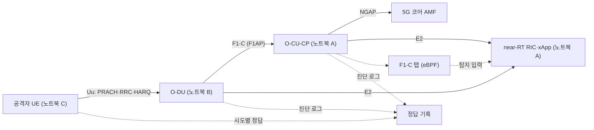
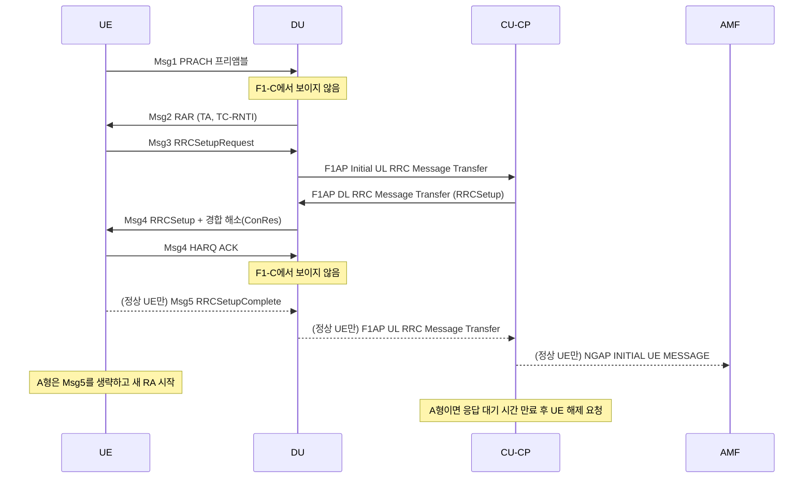
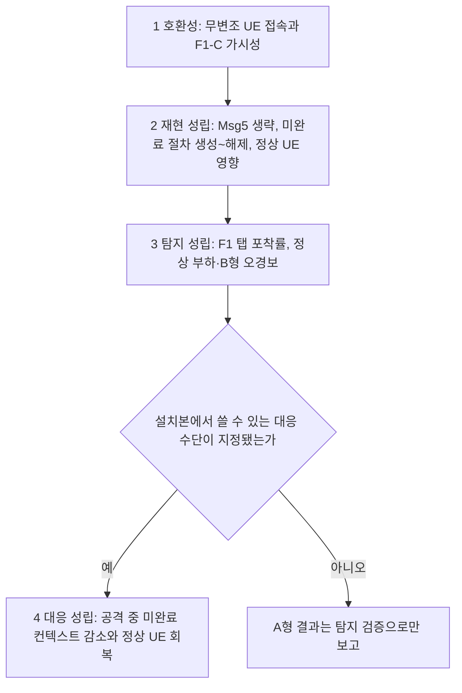

# RSS 재현 실험 방법론

| 항목 | 내용 |
|---|---|
| 갱신 | 2026-10-13 |
| 문서 역할 | 단말이 접속 절차를 일부러 끝내지 않는 행동을 반복해 기지국 자원을 묶어 두는 공격, 곧 RRC 시그널링 스톰(RSS)을 RF 차폐 테스트베드에서 재현할 때 무엇을 입력하고, 무엇을 정답으로 기록하며, 어떻게 합격을 판정할지 정한다. 기지국(OCUDU) 소스는 수정하지 않는다 |
| 재현기 완료 조건 | 재현기에 요청한 절차와 실제 도달점(한 번의 접속 시도가 실제로 어느 메시지까지 진행됐는가)을 구분해 반복 재현하고, 정상 단말 영향·팀 텔레메트리·조치 결과와 대조할 수 있는 시각 기록을 남긴다 |
| 선행 지식 | [rss-theory.md](rss-theory.md) §2–§4(5G 접속의 기초, 시그널링 스톰의 정의와 시나리오 이름, A형 공격의 진행 과정). 처음 읽는 독자를 위해 이 문서의 §1.2에 최소 배경을 두었다 |
| 관련 문서 | [rss-theory.md](rss-theory.md)(원리, OCUDU 수치의 단일 출처는 §8), [tool-survey.md](tool-survey.md)(정상 UE 연결 경로와 공개 공격 코드), [design.md](design.md)(재현기 설계), [rss-landscape.md](rss-landscape.md)(변종·논문·도구) |
| 검증 상태 | 규격·논문·소스 코드를 직접 열어 판독한 결과다. 실제 장비나 가상 RF에서 실행해 확인한 항목은 없다 |

## 요약

본 문서는 팀의 O-RAN(Open RAN, 개방형 무선 접속망) 기지국 침입 탐지·대응(IDS/IPS, 침입 탐지/방지 시스템) 테스트베드에서, 공격자 단말(UE, User Equipment) 쪽 RRC 시그널링 스톰(RSS, RRC Signaling Storm) 재현기를 어떤 실험으로 검증할지 정한다. RRC(Radio Resource Control, 무선 자원 제어)는 단말과 기지국이 연결을 맺고 관리하는 제어 프로토콜이고 [1, §III-A], 시그널링 스톰은 망 자원이 감당할 수 있는 양을 넘어서는 제어 신호 과부하를 말한다 [1, §III]. 핵심 질문은 재현기가 의도한 공격 절차를 실제로 어디까지 수행했는지를, 탐지기의 입력과 섞지 않은 정답(실제로 일어난 일을 확정하는 기록)으로 남길 수 있느냐는 것이다. 이를 위해 3GPP(3rd Generation Partnership Project, 이동통신 표준화 단체)의 기술 규격(TS, Technical Specification), 공개 논문, 팀이 쓰는 오픈소스 기지국 소프트웨어 OCUDU의 소스(커밋 `440cdbb`)와 공개 공격 패치를 읽고, 실험 시나리오·관측 경계·실행 기록 항목·단계별 합격 기준을 정의했다. 1차 대상인 A형(본 프로젝트가 붙인 시나리오 이름)은 단말이 접속 절차의 네 번째 메시지(Msg4)를 받고 수신 확인까지 보낸 뒤, 연결 완료 메시지 `RRCSetupComplete`를 보내지 않고 접속을 처음부터 다시 시도하는 행동이며, 그 메시지는 일부만 기지국 내부의 CU–DU 제어 인터페이스(F1-C)에 보이고 5G 코어의 접속 관리 기능(AMF)에는 전혀 보이지 않는다. 팀은 소스를 고칠 수 없는 상용 기지국을 전제로 F1 메시지를 엿보는 방식으로 탐지하려 하므로, 실험에서는 실제로 일어난 일을 UE·DU·OCUDU 진단 로그로 따로 확정하고(정답) 탐지기에는 F1-C 탭에서 얻는 데이터만 준다(탐지 입력). 합격 판정은 호환성 → 재현 성립 → 탐지 성립 → 대응 성립의 네 관문으로 나누며, A형에 닿는 대응 수단이 확인되기 전까지 A형 결과는 탐지 검증으로만 보고한다. 또 OCUDU 소스 판독으로, Msg4를 기다리지 않고 재시작하는 변형(A-early)도 OCUDU에서는 A형과 비슷한 시간 동안 자원을 붙잡을 수 있다는 점과, 가장 먼저 걸리는 한도가 CU 전체가 아니라 DU 셀별 수립 가능 단말 수라는 점을 확인했다. 이 모든 내용은 문헌과 소스 판독에 근거하며 실제 장비에서 실행해 검증하지 않았다.

## 1. 서론

### 1.1 이 문서의 역할과 질문

RAN(Radio Access Network, 무선 접속망)은 단말과 코어망 사이의 기지국 구간을 말하고, vRAN(virtualized RAN)은 기지국 기능(CU·DU, §1.2)을 가상화해 소프트웨어로 돌리는 형태다 [1, §II]. 팀 프로젝트는 상용 vRAN의 클로즈드 CU를 전제로, 기지국 소스를 고치지 않고 eBPF 텔레메트리 위에서 near-RT RIC 기반의 탐지→대응 폐루프를 만드는 것이다 [2, '팀 프로젝트']. 클로즈드 CU는 벤더가 소스를 공개하지 않아 우리가 고칠 수 없는 CU를 말한다. 그래서 기지국 내부를 고치는 대신 기지국 밖에서 메시지를 엿보는 방식이 필요하다. 텔레메트리는 운영 중인 시스템에서 자동으로 수집하는 관측 데이터이고, 폐루프(closed loop)는 탐지 결과가 대응 조치를 자동으로 일으키고 그 효과를 다시 관측해 확인하는 순환 구조다. eBPF(extended Berkeley Packet Filter)는 운영체제 커널 안에서 사용자가 작성한 프로그램을 실행하는 기술이다. TeleRAN은 eBPF로 커널 수준의 셀룰러 패킷 필터를 만들었고, eBPF 검증기(verifier)로 커널 안정성을 보장한다고 설명한다 [3, Abstract], [3, §I]. near-RT RIC은 §1.2에서 설명한다.

사용자가 맡은 서브태스크는 그 폐루프를 시험할 공격자 UE 쪽 RSS 재현기이며, 설계 목표는 "강한 공격"이 아니라 "파라미터가 통제되는 재현기"로 정해져 있다 [2, '내 서브태스크']. 재현기가 이 목표를 달성했는지 판단하려면, 재현기가 무엇을 했는지와 탐지기가 무엇을 보았는지를 서로 독립적으로 기록하고 비교할 실험 규칙이 필요하다. 이 문서는 그 규칙을 정한다.

이 문서가 답하는 질문은 네 가지다. 첫째, 어떤 실험 시나리오를 어떤 목적으로 돌리는가(§2). 둘째, A형 절차의 각 메시지가 규격상 무엇이고 어느 인터페이스에서 보이는가(§3, §4). 셋째, 재현기는 최소한 무엇을 제어하고 무엇을 기록해야 하는가(§5). 넷째, 어떤 조건을 만족해야 각 단계를 통과했다고 말할 수 있는가(§6).

### 1.2 이 문서를 읽기 위한 최소 배경

이 절은 [rss-theory.md](rss-theory.md) §2–§4의 내용을 이 문서에 필요한 만큼만 요약한다 [4, §2–§4]. 처음 읽는 독자는 이 절의 용어를 이해한 뒤 §1.3으로 넘어가면 된다.

**단말, 기지국, 코어.** UE(User Equipment, 단말)는 휴대폰이나 모뎀처럼 망에 접속하는 쪽이다. gNB(next generation NodeB, 5G 기지국)는 단말과의 무선 구간을 담당하고, NG 인터페이스로 5G 코어에 연결된다. 코어에서 제어 신호는 AMF(Access and Mobility Management Function, 접속·이동성 관리 기능)가, 사용자 데이터는 UPF(User Plane Function, 사용자평면 기능)가 받는다 [5, §4.1]. gNB와 AMF 사이의 제어 인터페이스는 NG-C이고, 그 위의 응용 계층 프로토콜이 NGAP(NG Application Protocol)이다 [5, §4.3.1.2]. 단말과 AMF 사이의 제어 계층은 NAS(Non-Access Stratum)이며, 인증·이동성 관리·보안 제어 같은 기능을 맡는다 [5, §4.4.2].

통신 흐름은 두 종류로 나뉜다. 제어평면(control plane)은 연결을 맺고 관리하는 신호를, 사용자평면(user plane)은 실제 데이터를 나른다. 규격은 두 평면의 프로토콜 스택을 따로 정의한다 [5, §4.4.1–§4.4.2]. 이 문서가 다루는 A형은 연결 설정 도중에 멈추므로 제어평면 안에서만 일어난다(추론, §3).

**무선 프로토콜 계층.** 단말과 gNB 사이의 무선 구간도 계층으로 나뉜다. PHY(물리 계층)는 실제 무선 신호를 다루고, 그 위의 계층 2는 MAC(Medium Access Control), RLC(Radio Link Control), PDCP(Packet Data Convergence Protocol), SDAP(Service Data Adaptation Protocol)로 나뉜다 [5, §6.1]. MAC은 단말들 사이의 전송 기회 배정(스케줄링)과 HARQ 재전송을 맡는다 [5, §6.2.1]. RLC는 분할과 재전송(ARQ)을 [5, §6.3.2], PDCP는 암호화·무결성 보호와 헤더 압축을 [5, §6.4.1], SDAP는 사용자 데이터 흐름(QoS 흐름)을 무선 베어러에 매핑하는 일을 맡는다 [5, §6.5]. 제어평면에서는 이 위에 RRC가 있고, 다시 그 위에 NAS가 있다 [5, §4.4.2]. TCP/IP에 비유하면 PHY·MAC이 링크 계층에 가깝다. 다만 링크 안에 재전송(RLC)과 암호화(PDCP)를 하는 계층이 따로 있다는 점에서 이 비유는 맞지 않는다(본 문서의 비유).

셀룰러 망에서는 단말이 아무 때나 송신하지 못한다. gNB의 MAC 스케줄러가 시간·주파수 자원을 단말들에게 배정하고, 단말은 스케줄링 채널로 받은 배정(grant)에 따라서만 보낸다 [5, §10.1]. 단말에서 기지국으로 가는 방향을 상향링크(uplink, UL), 반대 방향을 하향링크(downlink, DL)라 한다. 시간 축은 10 ms 프레임, 1 ms 서브프레임, 그리고 그 안의 슬롯(slot)으로 나뉜다 [5, §5.1]. 단말이 보내는 상향 제어 정보는 PUCCH(Physical Uplink Control Channel)로 전송된다 [5, §5.3.3].

**CU·DU·F1.** 5G 규격은 gNB를 두 논리 노드로 나눌 수 있게 한다. CU(Central Unit, 중앙 장치)는 RRC·SDAP·PDCP를, DU(Distributed Unit, 분산 장치)는 RLC·MAC·PHY 계층을 담당하며, 둘 사이의 인터페이스가 F1이다 [6, §3.1]. CU 중 제어평면 부분인 CU-CP(CU Control Plane)는 RRC를 호스팅하고 DU와의 제어 인터페이스인 F1-C를 종단한다 [6, §3.1]. 사용자평면 부분인 CU-UP(CU User Plane)는 CU-CP와 E1 인터페이스로 연결된다 [6, §6.1.2]. F1 인터페이스의 시그널링 프로토콜이 F1AP(F1 Application Protocol)이다 [7, §1]. O-RAN은 같은 분리 구조를 O-CU·O-DU·O-RU로 부른다. O-DU는 기저대역 처리를, O-RU(O-RAN Radio Unit, 무선 장치)는 무선 신호와 디지털 신호 사이의 변환을 맡으며, 이들은 near-RT RIC(near-Real-Time RAN Intelligent Controller)에 연결된다 [1, §II]. 팀 테스트베드는 공격자 UE(노트북 C), O-DU(노트북 B), O-CU·RIC·eBPF·대응기(노트북 A)를 F1(IP)로 잇는 분리형 구성이다 [2, '팀 프로젝트']. 이 분리가 이 문서에서 중요한 이유는 CU와 DU 사이의 F1 링크가 기지국 소스를 고치지 않고도 RRC 메시지를 엿볼 수 있는 지점이기 때문이다. TeleRAN은 소스 수정 없이 F1AP 메시지를 추출했다고 보고했다 [3, Abstract], [3, §III].

**RRC와 연결 설정.** RRC는 단말과 gNB 사이의 연결을 맺고 관리하는 제어 프로토콜이며, 단말마다 상태 기계를 두고 연결의 설정·해제를 관리한다 [1, §III-A]. RRC 연결 설정은 단말의 `RRCSetupRequest`, 망의 `RRCSetup`, 단말의 `RRCSetupComplete` 세 메시지로 이루어지고, 망이 `RRCReject`로 거절할 수도 있다 [8, §5.3.3.1]. 이 절차는 첫 NAS 메시지를 단말에서 망으로 전달하는 데에도 쓰인다 [8, §5.3.3.1]. RRC 상태에는 `RRC_IDLE`, `RRC_CONNECTED`, `RRC_INACTIVE`가 있다. `RRC_INACTIVE`는 단말과 gNB가 연결 문맥을 보관한 채 쉬는 상태라 적은 메시지로 `RRC_CONNECTED`에 돌아갈 수 있다 [1, §III-A]. §2의 C 시나리오가 이 복귀 절차(resume)를 다룬다.

단말과 망이 연결 성립을 판단하는 시점은 서로 다르다. 정상 단말은 `RRCSetup`을 받으면 곧바로 `RRC_CONNECTED`로 들어가고 `RRCSetupComplete`를 만든다 [8, §5.3.3.4]. 반면 망은 `RRCSetupComplete`를 받은 뒤에야 AMF에 첫 메시지인 `INITIAL UE MESSAGE`를 보낸다 [6, §8.1]. OCUDU CU-CP도 `RRCSetup`을 보낸 뒤 응답 대기 트랜잭션을 열어 두고 [9, L54–L60], `RRCSetupComplete`를 처리한 다음에야 NGAP 메시지를 보낸다 [9, L123–L126]. 그 사이 gNB는 이 연결을 위해 자원과 UE 컨텍스트를 잡아 둔다 [10, §III]. A형은 바로 이 대기 구간을 노린다. 그리고 `RRCSetupComplete`를 보내지 않는 시도는 코어에 전혀 보이지 않는다(§3).

**랜덤 액세스와 Msg 번호.** 아직 배정받은 자원이 없는 단말이 기지국에 처음 말을 거는 절차가 RA(Random Access, 랜덤 액세스)다. 단말은 RRC 메시지를 보내기 전에 RA로 상향링크 동기와 첫 무선 자원을 얻는다 [10, §II-A]. 4-step RA에서 Msg1은 PRACH(Physical Random Access Channel)로 보내는 프리앰블이다. 프리앰블은 셀이 미리 알려 둔 신호 패턴 중 단말이 무작위로 고른 하나이므로, 여러 단말이 같은 프리앰블을 고를 수 있다 [10, §II-A]. Msg2는 RAR(Random Access Response, 랜덤 액세스 응답)로 시간 보정값(TA, Timing Advance), 상향 전송 배정, TC-RNTI(Temporary C-RNTI)를 담는다 [10, §II-A]. RNTI(Radio Network Temporary Identifier)는 무선 구간에서 단말을 가리키는 임시 식별자다. Msg3은 `RRCSetupRequest`를 싣고, 이 메시지에는 초기 UE identity로 5G-S-TMSI(망이 할당한 임시 단말 식별자)의 일부나 임의값(randomValue)이 들어간다 [10, §II-A]. Msg4는 `RRCSetup`을 싣는 동시에 같은 프리앰블을 고른 단말들 사이의 경합 해소(contention resolution, ConRes)를 수행하고, 단말에 C-RNTI(Cell RNTI)를 할당한다 [10, §II-A].

경합 해소는 gNB가 Msg3에서 받은 내용을 Msg4의 경합 해소 식별자(UE Contention Resolution Identity)로 되돌려 보내는 방식이다. 단말은 이 값이 자기가 보낸 Msg3과 일치할 때만 경합에서 이긴 것으로 판단한다 [11, §5.1.5]. HARQ(Hybrid Automatic Repeat reQuest)는 MAC 계층의 오류 정정 재전송 기능이다 [5, §6.2.1]. 규격은 단말이 경합 해소 메시지를 성공적으로 받으면 HARQ 수신 확인(ACK)을 보내도록 하며 [10, §V-B], 단말 MAC은 경합 해소가 성공한 경우에만 Msg4에 대한 HARQ ACK를 만든다 [11, §5.3.2.2]. 이 구조는 Ethernet(CSMA/CD)처럼 여럿이 무작위로 시도하다 충돌하면 해소하는 방식과 닮았다. 다만 보내기 전에 채널을 감지하지 않고, 충돌 여부를 송신 중이 아니라 Msg4의 식별자 대조로 사후에 판정한다는 점이 다르다(본 문서의 비유). 논문들은 `RRCSetupComplete`를 "Msg5"라고 부르지만 이는 문헌의 약칭이다 [10, §II-A]. 5G 무선 규격인 NR(New Radio)에는 4-step 외에 2-step RA도 있다 [11, §5.1.1].

**단말 타이머.** T300은 단말이 `RRCSetupRequest`를 보낼 때 시작하고 `RRCSetup`이나 `RRCReject`를 받으면 멈추는 단말 측 타이머다 [8, §7.1.1]. T302는 `RRCReject`에 `waitTime`이 들어 있을 때 단말이 그 값으로 시작하는 재시도 대기 타이머다 [8, §5.3.15.2]. 둘 다 망 쪽 타이머가 아니다.

**RSS와 A형.** 시그널링 스톰은 일반적으로 망 자원을 넘어서는 제어 신호 과부하를 뜻한다 [1, §III]. KAUST 논문은 RA 절차를 악용해 완료되지 않는 접속 시도를 대량으로 만들면 gNB 자원이 소모되고 정상 사용자가 접속하지 못하는 시그널링 스톰이 생긴다고 설명한다 [10, Abstract]. A형은 이 중 본 프로젝트가 붙인 실험 시나리오 이름이며 표준 용어가 아니다 [4, §3]. A형 UE는 Msg4까지 받고 `RRCSetupComplete`를 보내지 않은 채 새 RA를 시작한다 [10, §V-B]. 그러면 gNB는 완료되지 않을 연결을 위해 자원과 UE 컨텍스트를 잡아 두게 되는데, KAUST는 이 상태를 "half-open connection"이라고 부른다 [10, §III]. 여기서 UE 컨텍스트는 gNB가 한 단말의 연결 시도를 추적하려고 잡아 두는 메모리와 예약 자원을 말한다 [10, §II-A].

이것이 서비스 거부가 되는 이유는 gNB가 동시에 유지할 수 있는 컨텍스트 수에 한도가 있기 때문이다.

> "If the attacker repeats this process, the number of half-open connections grows until the gNB reaches its supported UE capacity. At that point, new legitimate UEs may be rejected because the gNB cannot allocate additional UE contexts." [10, §III]
> (번역) 공격자가 이 과정을 반복하면 half-open 연결 수가 gNB가 지원하는 UE 용량에 이를 때까지 늘어난다. 그 시점부터는 gNB가 UE 컨텍스트를 더 할당할 수 없어 새 정상 UE가 거절될 수 있다.

한 미완료 컨텍스트가 생성돼 해제될 때까지 남아 있는 시간을 보유시간(T_hold)이라 한다. 공격 시도율을 R(초당 시도 수), gNB가 동시에 유지할 수 있는 컨텍스트 한도를 N_cap이라 하면, R × T_hold ≥ N_cap일 때 한도가 가득 찬다(포화) [4, §6]. 포화 조건의 유도와 한도가 차기까지 걸리는 채움 시간은 [rss-theory.md](rss-theory.md) §6에서 다룬다 [4, §6].

**near-RT RIC·E2·KPM.** near-RT RIC은 10 ms–1초 시간 규모로 RAN을 관리·제어하며, 그 위에서 xApp이라는 응용이 동작한다 [1, §II]. xApp은 E2 인터페이스를 통해 E2 노드(O-CU·O-DU 같은 기지국 구성 요소)로부터 측정값을 받고, 이를 바탕으로 제어 동작을 계산한다 [1, §II]. E2SM-KPM(E2 Service Model – Key Performance Measurement)은 near-RT RIC이 E2 노드의 성능 측정값을 구독하는 서비스 모델이다 [12]. E2SM-RC(E2 Service Model – RAN Control)는 RIC이 E2 노드에 제어 동작을 요청하는 서비스 모델이며, OCUDU는 이를 제한적으로 지원한다(§6) [13, 'Limitations'], [14, L71–L74]. 팀의 탐지·대응기는 near-RT RIC과 eBPF 텔레메트리를 같은 노트북(노트북 A)에 두고 동작하는 것을 목표로 한다 [2, '팀 프로젝트'].

그림 1은 위 요소들이 팀 테스트베드에서 어떻게 연결되는지와(Uu는 단말–기지국 사이 무선 인터페이스), 이 문서가 구분하는 "정답 기록"과 "탐지 입력"이 각각 어디에서 나오는지를 보여 준다. 탭(tap)은 링크를 지나는 메시지를 수동적으로 복사해 보는 관측 지점이다. 실선은 프로토콜 인터페이스이고, 점선은 기록이나 관측 데이터의 흐름이다.



그림 1. 팀 테스트베드 구성과 정답 기록·탐지 입력의 분리. 구성은 [2, '팀 프로젝트'], 분리 원칙은 §4를 따른다.

### 1.3 주요 자료와 현재 선택

이 문서가 자주 인용하는 자료는 다음과 같다.

- **KAUST 논문 [10].** King Abdullah University of Science and Technology(KAUST)의 Abou Hasna와 El Falou가 2026년에 공개한 논문이다. OAI로 A형 공격을 구현해 SDR(Software-Defined Radio) 두 대와 상용 폰으로 구성한 실제 무선 테스트베드에서 검증했고, gNB에서 동작하는 TA 기반 완화 기법을 제안했다 [10, Abstract], [10, §IV-B], [10, §V-A]. 에뮬레이션 환경에서 관찰한 내용도 함께 보고한다 [10, §V-B].
- **Nguyen 등 [15].** 2025년 논문으로, OAI gNB와 OAI UE를 RF 시뮬레이터로 연결한 환경에서 [15, §III-C] RRC 메시지 수의 비율로 스톰을 탐지하는 방법을 제안하고 xApp 카운터로 평가했다 [15, §VI], [15, §VII-A].
- **UCD 데모 [16].** University College Dublin NetsLab 연구진이 srsRAN·Open5GS·FlexRIC과 GNU Radio ZeroMQ 다중화기로 다중 UE 공격과 xApp 기반 탐지를 시연한 데모다 [16, Abstract].
- **5gattacks [17].** A형을 구현한 OAI UE 패치를 공개한 GitHub 저장소다. 그 재사용 범위는 [tool-survey.md](tool-survey.md) §4에 정리되어 있다 [18, §4].
- **TeleRAN [3].** 기지국 소스를 고치지 않고 eBPF로 F1AP·NGAP 메시지를 추출하는 텔레메트리 시스템이다 [3, Abstract].
- **OAI와 OCUDU.** OAI(OpenAirInterface)는 UE, gNB, 코어 구성 요소를 모두 구현한 오픈소스 5G 소프트웨어다 [10, §V-A], [15, §III-C]. OCUDU는 팀이 gNB로 쓰는 srsRAN 계열 오픈소스 CU/DU다 [2, '팀 프로젝트'].

**현재 선택.** 본 프로젝트는 Msg4 수신·HARQ ACK 뒤 `RRCSetupComplete`를 생략하는 A형을 먼저 검증하기로 정했다 [2, '확정/파악된 것']. 이 선택은 KAUST가 OAI 기반 실제 무선(OTA, Over-The-Air) 실험에서 얻은 결과 [10, §V–§VI]를 OCUDU에 그대로 옮길 수 있다는 뜻이 아니다. 또 A형에 적용할 수 있는 무수정 대응 경로가 아직 확인되지 않았으므로 [2, '대응은 별도 성립 조건'], 본 문서는 탐지 검증과 대응 폐루프 검증을 별도의 합격 기준으로 둔다(§6). 구현 베이스와 공개물의 실제 범위는 [tool-survey.md](tool-survey.md)에 정리되어 있다 [18].

### 1.4 범위와 읽는 법

모든 공격 재현은 RF 차폐 박스 안에서 팀 자체 장비만을 대상으로 하며, 외부 망은 쓰지 않는다 [2, '작업 원칙']. 공격은 UE 쪽만 변조하고 OCUDU gNB는 수정하지 않는다 [2, '작업 원칙']. 본문에서 "(추론)"은 인용한 사실에서 우리가 이끌어 낸 판단을, "(미확인)"은 근거를 아직 확인하지 못한 항목을, "(코드 판독, 실행 미검증)"은 소스를 읽어 얻었지만 실행으로 확인하지 않은 동작을 뜻한다. "(본 문서의 비유)"는 출처에 없는, 이해를 돕기 위한 이 문서 자체의 비유다. OCUDU의 구체적인 기본값과 상한은 [rss-theory.md](rss-theory.md) §8을 단일 출처로 삼고, 이 문서에서는 다시 적지 않는다 [4, §8]. 이전 판과 달라진 점(KAUST가 보고한 A-early 실패의 범위, OCUDU에서 A-early가 자원을 점유할 가능성, OCUDU에서 먼저 걸리는 용량 한도, 초기 UE identity 노브의 실제 효과, 재수립 반복의 범위 판단)은 [rss-landscape.md](rss-landscape.md) 부록 A에 모았다 [19, 부록 A].

## 2. 실험 시나리오와 범위

표 1의 A/B/C/D는 표준이 정한 상호 배타적인 "RSS 유형"이 아니라 본 프로젝트가 붙인 실험 이름이다 [4, §3]. 문헌도 시그널링 스톰을 단말 사칭, 가짜 기지국, 단말 재부팅, 수다스러운 앱 등 위협 모델 단위로 나눈다 [1, §III-B]. 같은 시나리오 안에서도 시도마다 도달점이 다를 수 있다. 예컨대 아래 B 시나리오처럼 UE를 재시작할 때, 재시작 시점이 Msg3 직후인지 Msg5 이후인지에 따라 기지국이 보는 메시지가 달라진다(추론). 그래서 본 문서는 각 실행에서 재현기에 *요청한 동작*과 *실제 도달점*을 따로 기록하도록 한다. RRC 연결 설정의 메시지 순서 자체는 TS 38.331이 정의한다 [8, §5.3.3].

표 1은 시나리오별로 UE에 주는 입력, 실행마다 확인할 도달점과 관측 항목, 팀 프로젝트에서의 용도를 정리한다. 도달점은 한 번의 접속 시도가 실제로 어느 메시지까지 진행됐는가(예: Msg3까지, Msg4 ACK까지, Msg5까지)를 말한다. 행은 우선순위 순이다. 본 프로젝트는 A형을 1차 대상으로 정했고 [2, '확정/파악된 것'], 본 문서는 이에 맞춰 정상 기준선과 A를 1차 범위로, C와 D를 후속 후보와 대조군으로 둔다.

표 1. 실험 시나리오와 용도

| 시나리오 | UE 측 입력 | 실행마다 확인할 도달점·관측 항목 | 팀 프로젝트에서의 용도 |
|---|---|---|---|
| **정상 기준선** | 정상 접속·등록, 필요하면 정상 해제 | `RRCSetupComplete`, 정상 UE 서비스 | RF·코어·F1 텔레메트리가 건강한지 확인 |
| **A — 완료 생략** | 4-step RA, `RRCSetup` 수신과 Msg4 HARQ ACK 뒤 `RRCSetupComplete` 생략 | CU-CP의 미완료 절차와 DU UE 컨텍스트의 생성·해제 | F1 메시지 기반 탐지의 1차 시험. OCUDU에서의 효과는 현장 검증 대상 |
| **A-early — Msg3 뒤 재시작** | Msg4를 기다리지 않고 새 RA 시작 | Msg3 이후 실제 컨텍스트 수명 | Nguyen 실험의 방식 [15, §V-A]. KAUST는 자기 구현에서 이 방식으로는 축적되지 않았다고 보고했다(아래 본문) [10, §V-B]. OCUDU에서는 CU 타임아웃까지 DU 자원을 잡을 가능성이 코드상 있다(코드 판독, 실행 미검증) [4, §8]. A의 성공 근거로 합치지 않는다 |
| **B — UE 재시작·접속 반복** | 정상 UE 프로세스 재시작, 또는 완료된 접속·해제 반복 | 각 시도의 Msg4·Msg5·NAS 도달 여부 | 정상 고부하와 다른 접속 폭주를 구별하는 대조군. UCD 데모는 다수 srsUE(srsRAN 프로젝트의 오픈소스 UE)의 재부팅 반복이 PRACH 프리앰블과 `RRCSetupRequest`를 반복시킨다고만 서술한다 [16, §III-B] |
| **C — `RRC_INACTIVE` resume** | 망이 suspend한(`RRC_INACTIVE`로 보낸) UE의 `RRCResumeRequest` 반복 [8, §6.2.2] | suspend 설정, resume 성공·실패 | 후속 후보. 네트워크의 지원·설정과 UE 동작이 먼저 필요 |
| **D — Msg3 전 RA 부하** | PRACH/RA 시도 | RRC 메시지 없이 DU 부하가 생기는지 | PHY/MAC 관측 경계의 대조군. CU의 F1 RRC 메시지만으로 포착된다고 주장하지 않음 |

C 행의 메시지 방향에 유의해야 한다. 단말이 보내는 것은 중단된 연결의 재개를 요청하는 `RRCResumeRequest`이고, `RRCResume`은 망이 단말에게 보내는 응답이다 [8, §6.2.2], [8, §5.3.13.1].

**A-early에 대한 KAUST 서술의 범위.** KAUST가 A-early로는 컨텍스트가 축적되지 않았다고 쓴 대목은 실제 무선(OTA)에 한정된 서술이 아니라 자기 구현 전체에 대한 서술이다 [10, §V-B].

> "Prior work describes the attack as repeatedly cycling through Msg1, Msg2, and Msg3 without waiting for Msg4 […]. In our implementation, this was not sufficient. ... In an emulated setup, restarting the RACH procedure from the RRC layer immediately after receiving Msg4 was sufficient. However, on the real radio testbed, this immediate restart was unreliable because the lower layers did not always have enough time to complete the Msg4 acknowledgment." [10, §V-B]
> (번역) 선행 연구는 Msg4를 기다리지 않고 Msg1–Msg3을 반복하는 공격으로 서술하지만, 우리 구현에서는 이것으로 충분하지 않았다. … 에뮬레이션 환경에서는 Msg4 수신 직후 RRC 계층에서 RACH를 다시 시작해도 충분했다. 그러나 실제 무선 테스트베드에서는 하위 계층이 Msg4 ACK를 끝낼 시간이 항상 충분하지 않아 이 즉시 재시작이 불안정했다.

(인용문 안의 '[…]'은 원문의 참고문헌 번호를 생략한 것이다.) 이 인용에는 세 가지 방식이 나온다. 첫째, 선행 연구가 서술한 A-early는 Msg4를 기다리지 않는다. 둘째, KAUST가 에뮬레이션에서 쓴 '직후 재시작'은 Msg4는 받았지만 HARQ ACK가 나가기 전에 재시작될 수 있는 방식으로, A-early와 A형 사이에 있다. 셋째, KAUST는 실제 무선에서 Msg4 수신 뒤 짧은 타이머를 두어 ACK가 나갈 시간을 확보함으로써 A형을 만들었다 [10, §V-B]. 즉 KAUST가 에뮬레이션과 실제 무선을 구분한 대목은 A-early가 아니라 둘째 방식에 대한 것이다 [10, §V-B].

**OCUDU에서의 A-early(코드 판독, 실행 미검증).** A-early를 A의 성공 근거에서 분리하는 원칙은 유지한다. 다만 그 이유는 "KAUST에서 실패했으니 OCUDU에서도 실패한다"가 아니다. 두 gNB 구현은 Msg4 ACK가 오지 않을 때 다르게 동작한다. KAUST에 따르면 OAI gNB는 이때 임시 컨텍스트를 곧 해제한다(§3) [10, §V-B], [4, §7]. 반면 OCUDU 스케줄러는 경합 해소 MAC 제어 요소(ConRes CE, Control Element)가 ACK되기 전에 타이머가 만료되면 해당 UE의 스케줄링만 멈춘다(코드 판독, 실행 미검증) [20, L434], [4, §8].

> "// Timeout before ConRes CE could be ACKed: deactivate UE." [20, L434]
> (번역) ConRes CE가 ACK되기 전에 타임아웃되면 UE를 비활성화한다.

여기서 비활성화(deactivate)는 스케줄러가 그 UE의 논리 채널을 끄고 HARQ 재전송을 취소한다는 뜻이다 [21, L36–L46]. DU가 배정한 컨텍스트와 전용 자원을 반납한다는 뜻은 아니다 [4, §8]. [rss-theory.md](rss-theory.md) §8은 이 경로에서 DU manager나 CU에 알리는 경로를 찾지 못했고, DU 컨텍스트와 전용 자원이 CU 타임아웃 뒤의 F1 해제 때 풀린다고 정리한다 [4, §8]. 따라서 OCUDU에서는 A-early도 A와 비슷한 시간 동안 자원을 점유할 가능성이 있다(코드 판독, 실행 미검증) [4, §7–§8]. 이 때문에 KAUST의 A-early 실패를 OCUDU의 기대치로 옮기지 않으며, A-early의 실제 점유 시간은 OCUDU에서 따로 측정한다(추론).

**구현 범위 밖의 절차.** 본 문서는 핸드오버, 페이징, NAS 등록 폭주, E2/F1 인터페이스에 메시지를 직접 쏟아붓는 공격을 현재의 단일 셀 UE 재현기의 구현 범위 밖으로 둔다. 재현기 설계도 핸드오버·페이징·NAS 등록 폭주와 F1/CU 경계 직접 주입을 비목표로 정했다 [22, §2]. 핸드오버는 연결 중인 단말을 다른 셀로 옮기는 절차이고 [5, §9.2.3.1], 페이징은 망이 `RRC_IDLE`·`RRC_INACTIVE` 단말을 호출하는 절차다 [5, §9.2.5]. 특히 srsUE는 5G SA(Standalone, LTE 도움 없이 5G만으로 동작하는 모드)에서 핸드오버를 지원하지 않는다고 공식 문서에 명시되어 있다 [23, 'Limitations'].

**재수립 반복은 범위 재검토 대상.** RRC 재수립(re-establishment)은 `RRC_CONNECTED` 단말이 무선 링크 실패 등으로 연결을 잃었을 때 그 연결을 이어 가려고 요청하는 절차다 [8, §5.3.7.1–§5.3.7.2]. 요청 식별자 `ReestabUE-Identity`에는 이전 연결의 C-RNTI, 그 셀의 PCI(Physical Cell ID, 물리 셀 식별자), 그리고 `shortMAC-I`가 들어간다 [8, §6.2.2]. `shortMAC-I`는 재수립 때 단말을 식별·검증하는 16비트 값으로, 이전 셀의 AS(Access Stratum, 무선 접속 계층) 보안 설정으로 계산한다 [8, §6.3.2].

재수립 반복은 다수 단말이나 별도 인프라 없이 변조 UE 하나로 만들 수 있다는 점에서 다른 범위 밖 항목과 성격이 다르다 [19, §3]. 3GPP의 CIoT(Cellular Internet of Things, 셀룰러 사물인터넷) 보안 연구 보고서는 이 위협을 핵심 이슈로 명시한다.

> "After As security activation, IoT devices can be used maliciously to send a large number of signalling or user plane packets to gNB, for example, send massive RRC signalling or UP data such as, RRC re-establishment/RRC resume/User plane packets etc. to cause gNB exhaust the process resource to make the gNB deny service." [24, §5.5.2]
> (번역) AS 보안이 활성화된 뒤에도 IoT(사물인터넷) 단말이 악의적으로 RRC 재수립·resume 같은 대량의 시그널링이나 사용자 평면 데이터를 gNB에 보내 처리 자원을 고갈시키고 서비스를 거부하게 만들 수 있다.

같은 보고서의 Solution #7은 한 단말이 망의 지시를 무시하고 재수립을 반복하는 절차를 서술하고, 이런 단말이 집단으로 움직이면 gNB RRC 자원이 고갈될 수 있다고 덧붙인다 [24, §6.7.1]. 다만 보고서는 이 핵심 이슈에 대해 규범 작업이 필요 없다고 결론지었다 [24, §7.5].

OCUDU에서 이 절차를 특히 조심해야 하는 이유는 다음과 같다. OCUDU CU-CP는 DU가 새 UE를 수용하지 못해 DU-to-CU RRC 컨테이너(§4)를 비워 보낸 경우, 재수립 요청에 적힌 (PCI, C-RNTI)로 기존 UE를 찾아 그 UE의 해제를 요청하고 새 요청은 거절한다 [25, L119–L140]. 이 분기에서는 `shortMAC-I`를 확인하는 코드가 보이지 않는다(코드 판독, 실행 미검증) [25, L124–L140]. 따라서 A형으로 DU 자원이 가득 찬 상태에서 누군가 정상 UE의 (PCI, C-RNTI)를 담은 재수립 요청을 보내면, 그 정상 UE가 해제될 수 있다(추론, 미확인). 본 문서는 재수립 반복을 아직 구현 범위에 넣지 않지만, 위 근거로 범위를 재검토할 후보로 표시한다. 정상 UE를 끊을 가능성이 있으므로, 범위에 넣는다면 별도 라벨과 안전 절차가 필요하다(추론).

## 3. A형 절차: 규격과 논문 표기

이 절은 A형이 규격상 어떤 메시지들로 이루어지는지와, 논문의 Msg 번호가 규격 용어와 어떻게 대응하는지를 정리한다. 아래 Msg 번호는 4-step RA를 사용한 두 OAI 논문 [10, §II-A], [15, §V-A]의 약칭이다. NR에는 2-step RA도 있으므로 [11, §5.1.1], 팀 셀에서 2-step RA가 켜져 있으면 이 번호 체계와 A형의 개입 지점이 달라진다(추론). `RRCSetupComplete`를 "Msg5"라고 부르는 것도 실험의 편의 표기일 뿐 별도의 5-step RA 표준 절차가 있다는 뜻이 아니다.

> "The connection then moves to the next stage, where authentication with the core network starts through messages such as RRCSetupComplete, often referred to as Msg5 in the literature." [10, §II-A]
> (번역) 연결은 다음 단계로 넘어가 RRCSetupComplete 같은 메시지로 코어 인증을 시작하는데, 이 메시지를 문헌에서는 흔히 Msg5라고 부른다.

그림 2는 A형 한 번의 시도를 시간 순서로 보여 준다. 실선은 A형 시도에서 실제로 오가는 메시지이고, 점선은 정상 UE에서만 이어지는 메시지다. 노트는 F1-C에서의 가시성과 A형의 분기를 적었다. 메시지 이름의 UL·DL은 상향·하향링크(§1.2)다. DU는 MAC·PHY를 호스팅하고 [6, §3.1] F1AP는 RRC 메시지를 Initial UL RRC Message Transfer, DL RRC Message Transfer, UL RRC Message Transfer로 실어 나르므로 [7, §8.4], RRC 메시지를 담지 않는 Msg1·Msg2·HARQ ACK는 F1-C에 나타나지 않는다(추론).



그림 2. A형 한 번의 시도와 F1-C 가시성. 메시지 이름은 [6, §8.1], [7, §8.4], OCUDU의 해제 동작은 [9, L41–L66]을 따른다.

**Msg4 ACK가 필요했던 이유.** KAUST는 OAI 실험에서 공격 UE가 Msg4를 받고 하위 계층 ACK까지 보내야 미완료 컨텍스트가 축적됐다고 보고했다. 그 이유는 ACK가 없으면 OAI gNB가 임시 컨텍스트를 곧바로 해제하기 때문이다.

> "Otherwise, the gNB quickly releases the temporary context, and half-open connections do not accumulate." [10, §V-B]
> (번역) 그렇지 않으면 gNB가 임시 컨텍스트를 빠르게 해제해 half-open 연결이 쌓이지 않는다.

그래서 KAUST는 실제 무선 환경에서 Msg4 수신 뒤 짧은 타이머를 두어 ACK가 나갈 시간을 확보한 다음 Msg5를 생략했다 [10, §V-B]. KAUST는 이 동작이 경합 해소 메시지를 성공적으로 받았을 때 HARQ ACK를 보내도록 한 규격과 일치한다고 설명한다 [10, §V-B], [11, §5.3.2.2]. OCUDU가 같은 상황에서 다르게 동작할 수 있다는 점은 §2에서 다뤘다.

**"half-open"은 gNB 쪽 상태를 가리키는 말이다.** KAUST의 "half-open connection"은 gNB가 완료되지 않을 연결을 위해 자원과 컨텍스트를 잡고 있는 상태를 설명하는 말이다 [10, §III]. UE의 공식 RRC 상태 이름이 아니다. 규격상 정상 UE는 `RRCSetup`을 받으면 T300을 멈추고 `RRC_CONNECTED`로 들어간다 [8, §5.3.3.4]. A형 UE는 변조된 UE이므로 이 상태 전이를 따르지 않는다. KAUST의 공격 UE는 Msg5를 보내지 않고 유휴 상태와 비슷한 동작으로 돌아가, 새로 만든 임의 identity로 곧바로 RACH를 다시 시작한다 [10, §V-B]. T302는 `RRCReject`에 `waitTime`이 있을 때만 시작하는 재시도 대기 타이머다 [8, §5.3.15.2]. 따라서 T300이나 T302를 "gNB의 완료 대기 타이머"라고 부르지 않는다. 망 쪽 대기 시간은 규격에 전용 타이머가 없고 구현이 정한다 [10, §III].

> "However, the 3GPP specifications do not define a dedicated timer for this exact waiting period. Therefore, in this paper, we treat this timer as an implementation-dependent behavior ..." [10, §III]
> (번역) 그러나 3GPP 규격은 이 대기 시간을 위한 전용 타이머를 정의하지 않는다. 그래서 이 논문은 이 타이머를 구현에 따라 달라지는 동작으로 다룬다.

TCP를 아는 독자에게는 SYN flood가 가장 가까운 비유다. 서버가 SYN-ACK를 보낸 뒤 마지막 ACK를 기다리며 반쯤 열린 연결을 붙잡아 두듯, gNB는 `RRCSetup`을 보낸 뒤 `RRCSetupComplete`를 기다리며 컨텍스트를 붙잡는다(본 문서의 비유이며 KAUST 원문에는 없다). 비유가 맞지 않는 지점도 세 가지 있다. 첫째, 이 대기 시간은 규격에 정의되지 않고 구현이 정한다 [10, §III]. 둘째, gNB 쪽에서는 메모리뿐 아니라 단말별 전용 무선 자원(SR·CSI·SRS, §6)까지 묶인다 [4, §4], [26, L201]. 셋째, 한 UE의 MAC은 동시에 RA를 하나만 진행하므로 [11, §5.1.1], 한 UE 인스턴스의 시도율은 RA 한 번의 주기에 묶인다. 시도율을 더 올리려면 UE 인스턴스를 늘려야 한다(추론).

**OCUDU에서의 대기와 해제.** OCUDU CU-CP의 RRC 설정 절차는 응답 대기 시간을 `t300 + rrc_procedure_guard_time_ms`로 계산한다 [9, L41]. 여기서 `t300`은 셀이 SIB1(System Information Block 1, 셀이 방송하는 초기 접속용 시스템 정보 [10, §II-A])로 단말에게 알려 주는 T300 설정값이다 [27, L93]. OCUDU는 이 단말 타이머 값에 여유 시간(guard)을 더해 망 쪽 대기 시간을 정할 뿐이며, T300이 망 타이머가 되는 것은 아니다 [8, §7.1.1]. 시간 안에 응답이 없으면 실패 원인을 `no_reply`로 기록하고 UE 해제를 **요청**한다 [9, L63–L66]. 두 값의 기본값과 해제 이후 DU 쪽 동작은 [rss-theory.md](rss-theory.md) §8에 있다 [4, §8]. 실제 DU/F1 자원 해제 시각, 상한, 거부 지점은 팀 설치본에서 측정해야 한다(미확인).

**A형은 AMF에 닿지 않는다.** OCUDU는 `RRCSetupComplete`를 처리한 뒤에야 NGAP `InitialUeMessage`를 보낸다 [9, L126]. 이는 `RRCSetupComplete` 수신 뒤에 `INITIAL UE MESSAGE`를 AMF로 보내도록 한 규격 흐름과 같다 [6, §8.1]. 따라서 AMF가 A형의 미완료 시도를 직접 보고 차단한다는 가정은 성립하지 않는다.

## 4. 관측 가능성: 재현기 정답과 탐지 입력

이 절은 같은 사건을 누가 어디에서 볼 수 있는지 정리하고, 그중 무엇을 실험의 정답(ground truth)으로, 무엇을 탐지기의 입력으로 쓸지 정한다. 정답은 재현기와 OCUDU 내부 로그처럼 "실제로 무슨 일이 일어났는지"를 확정하는 기록이며, 탐지 결과를 채점하는 기준이다. 탐지 입력은 탐지기가 운용 환경에서 실제로 받을 수 있는 데이터다. 팀 프로젝트는 소스를 고칠 수 없는 벤더 CU를 전제로 eBPF 텔레메트리만으로 관측하므로 [2, '팀 프로젝트'], 운용 중인 탐지기는 기지국 내부 진단 로그 대신 F1 탭에 기대게 된다(추론). 둘을 섞으면 탐지기가 운용 중에는 볼 수 없는 정보로 평가받게 되어 성능이 부풀려진다(추론).

**F1-C에서 보이는 것.** TS 38.473 §8.4는 F1-C의 초기 상향 RRC 전달, 하향·상향 RRC 전달 절차를 정의한다 [7, §8.4]. 초기 상향 전달 메시지에는 DU가 할당한 C-RNTI가 들어가고, CU는 UE별 F1AP 식별자(gNB-CU UE F1AP ID)를 할당한다 [6, §8.1]. 이 메시지의 DU-to-CU RRC 컨테이너는 DU가 그 UE를 위해 만든 무선 설정(셀 그룹 설정, `CellGroupConfig`)을 CU에 넘기는 필드다 [7, §8.4.1.2]. 규격은 DU가 이 컨테이너를 넣지 않으면 DU가 그 UE를 서비스할 수 없다고 보고 CU가 그 UE를 거절하도록 권고한다(should).

> "If neither the DU to CU RRC Container IE nor the Sidelink Configuration Container IE in the Sidelink Relay Configuration IE is included in the INITIAL UL RRC MESSAGE TRANSFER, the gNB-CU should reject the UE under the assumption that the gNB-DU is not able to serve such UE." [7, §8.4.1.2]
> (번역) INITIAL UL RRC MESSAGE TRANSFER에 DU to CU RRC Container IE도, (사이드링크 중계용) Sidelink Configuration Container IE도 없으면, gNB-CU는 gNB-DU가 그 UE를 서비스할 수 없다고 가정하고 UE를 거절하는 것이 바람직하다(should).

OCUDU CU-CP도 컨테이너가 비어 있으면 "DU is not able to serve the UE"라는 경고와 함께 거절 메시지(rrcReject)를 보낸다고 기록하고 UE 해제를 요청한다 [25, L79–L85]. 따라서 A형이 DU 한도를 채운 뒤에는 F1-C에서 "컨테이너 없는 Initial UL RRC Message Transfer → 거절" 패턴이 보일 수 있으며, 이는 탐지 특징 후보다(추론, 실행 미검증). §2의 재수립 경로도 바로 이 "컨테이너가 빈" 상황에서 실행된다 [25, L124–L126].

TeleRAN은 eBPF 필터와 사용자 공간의 ASN.1(Abstract Syntax Notation One, 3GPP 메시지 형식 표기법) 파서로 F1AP·NGAP 메시지를 추출하는 프로토타입을 제시했고, OAI와 srsRAN에 소스 수정 없이 통합했다고 보고했다 [3, Abstract, §III].

> "We have implemented a prototype of TeleRAN, demonstrating that its seamless integration to two leading open-sourced RAN implementations, OpenAirInterface and srsRAN, with zero source code modification." [3, Abstract]
> (번역) TeleRAN 프로토타입을 구현해, 대표적인 오픈소스 RAN 구현인 OAI와 srsRAN에 소스 수정 없이 통합됨을 보였다.

우리 OCUDU 분리 설치에서 같은 이벤트가 빠짐없이 보이는지는 아직 확인하지 않았다(미확인).

표 2는 신호별로 정답을 어디서 얻고, CU의 F1-C 탭과 기존 E2 KPM이 각각 무엇을 볼 수 있는지를 정리한다. 왼쪽 열에서 오른쪽 열로 갈수록 운용 환경에서 얻기 쉽지만 정보가 거칠어진다.

표 2. 신호별 정답 출처와 탐지 입력 후보

| 신호 | UE·DU·OCUDU 진단 로그: 실험 정답 | CU의 F1-C 탭: 탐지 후보 | 기존 E2 KPM |
|---|---|---|---|
| PRACH·Msg2·Msg4 HARQ ACK·TA/RSSI(Received Signal Strength Indicator, 수신 신호 세기) | UE/DU에서 확인 | **직접 보이지 않음** | 별도 PHY/MAC 지표만 가능 |
| `RRCSetupRequest`·`RRCSetup`·`RRCSetupComplete` | UE 송수신과 gNB 처리를 대조 | F1 RRC 컨테이너와 CU/DU UE ID로 확인 가능성 시험 | `RRC.ConnEstabAtt/Succ`는 CU-CP **노드 집계** |
| 미완료 컨텍스트 해제·정상 UE 실패 | OCUDU 진단 로그와 정상 UE 측정 | F1 release와 메시지 시퀀스는 보조 증거 | 집계값만으로 개별 원인·시각 확정 불가 |
| NGAP 등록·코어 이벤트 | B가 실제로 Msg5 이후까지 진행한 경우만 | NG 관측은 별도 | A의 직접 신호가 아님 |

표의 근거는 다음과 같다. PRACH·Msg2·HARQ ACK가 F1-C에 없는 이유는 §3에서 설명했다. KPM 열은 OCUDU의 E2 지표 문서를 따른다.

> "These metrics are reported at E2 node level only. UE-level granularity and per-PLMN labels are not supported." [12, 'RRC Connections']
> (번역) 이 지표들은 E2 노드 단위로만 보고된다. UE 단위 세분화와 PLMN(사업자 망)별 라벨은 지원하지 않는다.

**KPM의 한계.** OCUDU의 E2 지표에는 RRC 설정 시도·성공 카운터(`RRC.ConnEstabAtt`, `RRC.ConnEstabSucc`)가 이미 있다 [12, 'RRC Connections']. 실패 원인 지표는 `NetworkReject` 하위 지표만 노출한다 [12, 'RRC Connections']. OCUDU는 A형 타임아웃을 `no_reply`로 기록하므로 [9, L65], A형의 직접 원인은 KPM 실패 원인에 나타나지 않는다(추론). 즉 부족한 것은 카운터 자체가 아니라 개별 시도의 순서·식별자·미완료 기간이다. 또 OCUDU의 near-RT RIC 튜토리얼은 KPM 보고 주기에 하한을 둔다.

> "Minimum monitoring period is 1 s" [13, 'Limitations']
> (번역) 최소 모니터링 주기는 1초다.

따라서 Nguyen 논문의 100 ms 미만 탐지 시간 [15, §VII-B]을 우리 시스템에 적용하지 않는다. KPM 기반 탐지는 이 1초 하한에 묶이고, F1 탭 기반 탐지라 해도 그 수치는 OAI RF 시뮬레이터와 모의 카운터 조건에서 나온 것이기 때문이다(아래 'Nguyen 비율 특징의 의미').

**정답과 탐지 입력의 분리.** CU의 F1-C 탭은 PRACH와 HARQ ACK의 정답이 될 수 없다(§3). OCUDU는 계층별 로그와 MAC·RLC 계층, 그리고 NGAP·N3·E1AP·F1AP·E2AP 인터페이스의 패킷 캡처(PCAP)를 출력할 수 있다 [28, 'Logs', 'PCAPs']. 여기서 N3 캡처는 OCUDU 설정상 NG-U(GTP-U) 캡처이며 [29, L206–L207], NG-U는 gNB와 코어의 UPF 사이 사용자평면 인터페이스다 [5, §4.3.1.1]. E1AP는 CU-CP와 CU-UP 사이 E1 인터페이스 [6, §6.1.2]의 응용 프로토콜이고, E2AP는 E2 인터페이스의 응용 프로토콜이다. 본 프로젝트는 이 출력을 **검증용 정답으로만** 사용하고 탐지기 입력과 분리한다. 또 OCUDU에서는 A와 A-early의 CU F1-C 시퀀스가 같을 수 있으므로 [4, §8], 두 시나리오를 F1-C 탭만으로 구별할 수 있다고 가정하지 않고 UE 쪽 정답으로 라벨을 붙인다(추론).

**Nguyen 비율 특징의 의미.** Nguyen 등의 탐지 특징 R1 = N_5 / N_3과 R2 = N_5 / N_4는 각각 Msg5 수를 Msg3 수로, Msg5 수를 Msg4 수로 나눈 비율이다 [15, §VI]. 여기서 N_k는 한 슬라이딩 창 안에서 관측한 Msgk의 개수이며 [15, §VII-B], 앞 문단의 N3 인터페이스와는 무관한 표기다. Nguyen은 R1을 완료된(또는 미완료된) RRC 설정 절차의 비율로 설명하지만 [15, §VI], 실제 계산은 한 창 안의 메시지 수 비율이므로 [15, §VII-B] 시도별 완료율과 같지 않다(추론). Nguyen 스스로 Msg4와 Msg5 사이에 자연스러운 지연이 있다고 적었으므로 [15, §VII-B], 우리가 같은 특징을 쓰려면 Msg4→Msg5 지연, 창 경계, 분모가 0인 창을 처리하는 규칙을 정해야 한다(추론). 논문의 임계값 0.5 [15, §VI], 625 ms 창 [15, §VII-A], 약 90 ms 탐지 [15, §VII-B]는 OAI gNB·UE를 RF 시뮬레이션으로 연결하고 [15, §III-C] 정상 부하를 절단 포아송(truncated Poisson) 분포로 모사한 조건의 결과다 [15, §VII-A].

> "This distribution periodically adds a new number of RRC messages to the counters in the xApp, mimicking normal traffic behavior." [15, §VII-A]
> (번역) 이 분포는 xApp의 카운터에 RRC 메시지 수를 주기적으로 더해 정상 트래픽을 흉내 낸다.

즉 정상 UE를 실제로 접속시킨 실험이 아니다. 또 B형 재시작 중 Msg5까지 간 시도는 R1·R2를 낮추지 않고, Msg5 전에 끊긴 시도는 A형처럼 R1·R2를 낮춘다. 따라서 B형 실행의 비율 값은 시도들의 도달점 분포에 따라 달라진다(추론).

## 5. 재현기의 최소 제어와 실행 기록

**첫 구현에 필요한 제어.** 노브(knob)는 실험자가 조절하는 입력 파라미터다. 본 문서는 첫 구현의 제어를 다음으로 제한한다: 시나리오, 시작·종료, 시도 간격(설정값과 실제 Msg3/s를 분리해 기록), 안전한 최대 지속시간, 정상 UE 기준선. 버스트, 완료 비율, 초기 UE identity 정책은 A가 성립한 뒤에만 추가한다. 이 순서는 재현기 설계의 1차/후속 노브 구분과 같다 [22, §5]. 노브의 형태는 프로세스를 띄울 때 주는 "실행 시작 인자"와 실행 도중 바꾸는 "실행 중 변경"으로 구분한다 [22, §5]. 공개된 5gattacks 공격 패치의 재시도 간격은 둘 중 어느 것도 아닌 **빌드 시 상수**다. 패치는 재시도 타이머를 `nr_timer_setup(&tac->attack_rach_timer, 10, 10)`으로 소스에 고정해 두므로, 간격을 바꾸려면 다시 빌드해야 한다 [17, L280]. 두 인자는 목표값(target) 10과 tick당 증가량(step) 10이므로, 이 타이머는 첫 tick에 만료된다 [4, §5]. KAUST가 추정한 공격 시도율은 약 25회/초(시도당 40 ms)였다 [10, §VI-B]. 런타임 요청률·완료율·identity 노브도 없다 [18, §4].

표 3은 실행마다 남겨야 할 값과 그 목적이다. 각 행은 서로 다른 오류 원인을 가려내기 위한 것이며, 레코드 형식(스키마)은 [design.md](design.md) §8에서 정한다 [22, §8].

표 3. 실행마다 기록할 값

| 실행마다 기록할 값 | 목적 |
|---|---|
| 실행 ID·시나리오·공격/정상 UE·시작/종료 시각, UE/OCUDU 커밋과 로드된 cell·CU·DU 설정 | 조건과 라벨의 재현 |
| UE의 RA 시도, Msg4 수신/ACK, Msg5 송신 여부와 각 시각 | **의도와 실제 도달점** 구분 |
| F1 최초 이벤트, 경보, 조치 요청·ACK, 컨텍스트 감소, 정상 UE 회복 시각 | 탐지→대응 지연을 구간별로 측정 |
| F1/OCUDU 로그의 UE 생성·release·reject, 정상 UE 접속 성공률·지연, 캡처 손실과 시계 오차 | 자원 점유·서비스 영향·측정 오류 구분 |

**TC-RNTI와 초기 UE identity는 다른 변수다.** 재현기가 "시도마다 단말 식별자를 바꾼다"고 할 때, 바뀌는 식별자는 둘로 혼동되기 쉽다. TC-RNTI는 MAC을 호스팅하는 DU가 [6, §3.1] RAR에 담아 주고, UE는 RAR에서 받은 값을 TEMPORARY_C-RNTI로 설정한다 [11, §5.1.4]. 따라서 새 RA를 할 때마다 TC-RNTI가 바뀌는 것은 DU의 할당 결과이지 재현기의 노브가 아니다(추론). 반면 `RRCSetupRequest`의 초기 UE identity는 UE가 고르는 값으로, 규격상 39비트의 `ng-5G-S-TMSI-Part1`이나 39비트의 `randomValue` 중 하나다 [8, §6.2.2]. 이 선택지에 가입자 영구 식별자인 IMSI(International Mobile Subscriber Identity)는 없으므로 IMSI는 Msg3에 실리지 않는다 [8, §6.2.2]. 따라서 A형은 Msg3 단계에서 유효한 가입자 식별자를 요구받지 않는다(추론, [8, §6.2.2]와 A형이 NAS 전에 멈춘다는 §3에 근거).

**초기 UE identity 노브의 실제 효과(코드 판독).** OCUDU CU-CP는 `RRCSetupRequest`의 초기 identity를 UE 컨텍스트에 저장할 뿐, 다른 UE와 중복되는지 검사하지 않는다 [25, L90–L98].

> ```
> case asn1::rrc_nr::init_ue_id_c::types_opts::random_value:
>   context.setup_ue_id = request_ies.ue_id.random_value().to_number();
>   // TODO: communicate with NGAP
>   break;
> ```
> [25, L95–L98]
> (설명) 임의값 identity를 받으면 컨텍스트에 저장하고 끝낸다. 이 분기를 포함한 `handle_rrc_setup_request` 함수(L65–L117) 안에 identity 중복을 검사하거나 그 이유로 거절하는 코드는 없다.

따라서 이 노브는 OCUDU의 수락·거부를 바꾸지 않고 탐지기가 보는 특징만 바꾼다(코드 판독, 실행 미검증). 또 초기 identity를 바꿔도 TA나 RSSI 같은 물리 특징은 사라지지 않는다. TA는 RAR로 전달되는 상향 시간 보정값이며 [10, §II-A], gNB가 수신 신호에서 추정하는 값이라 UE가 직접 고르지 않고 gNB와의 거리를 대략 반영한다 [10, §IV-B].

> "The TA value is useful because it is estimated from the uplink signal received by the gNB and is not directly chosen by the UE." [10, §IV-B]
> (번역) TA 값은 gNB가 받은 상향 신호에서 추정되고 UE가 직접 고르지 않으므로 유용하다.

KAUST의 완화 기법은 공격자를 직접 식별하지 않는다. TA 값이 같은(또는 범위가 같은) 시도들을 한 묶음(버킷)으로 세고, 미완료 연결이 가장 많은 버킷을 의심 대상으로 골라 그 버킷의 새 시도에 짧은 완료 타이머를 적용한다 [10, §IV-B], [10, §V-C]. 같은 버킷에 든 정상 UE도 이 타이머의 영향을 받는다. KAUST 실험에서 공격자와 같은 버킷에 든 상용 폰은 첫 번째 또는 두 번째 시도에 접속했다 [10, §VI-B].

**B형의 라벨.** UE를 의도적으로 재시작하는 B형은 Msg5 이전에 끊길 수도 있다(추론). 따라서 B형은 시나리오 이름이 아니라 각 시도의 실제 도달점으로 라벨링한다.

## 6. 단계별 합격 기준

이 절은 팀 목표에 맞춰 재현기와 폐루프를 네 관문으로 나누어 판정한다. 각 관문은 앞 관문을 통과한 뒤에만 의미가 있으며, 실패하면 그 결과를 기록하고 앞 단계로 돌아간다. 그림 3은 관문의 순서와, 대응 수단이 없을 때 결과를 어떻게 보고하는지를 보여 준다.



그림 3. 단계별 합격 관문. 대응 관문은 대응 수단이 지정된 경우에만 평가한다 [2, '대응은 별도 성립 조건'].

1. **호환성.** 실제 팀 셀의 band·SCS(Subcarrier Spacing, 부반송파 간격)·대역폭·RF 경로와 설치 커밋을 확인한 뒤, 무변조 UE가 정상 접속하고 F1-C 메시지가 보이는지 확인한다. band는 셀이 쓰는 주파수 대역 번호(예: n78)다. 이 확인이 먼저인 이유는 UE 소프트웨어마다 지원하는 셀 설정이 다르기 때문이다. 아래 두 사례처럼 srsUE는 FDD 셀만, OCUDU의 공식 OAI UE 사례는 TDD 셀을 다루므로, 팀 셀이 TDD인지 FDD인지에 따라 쓸 수 있는 UE가 갈린다(추론) [23, 'Limitations'], [30].

   OCUDU의 OAI UE 튜토리얼은 OAI `2026.w25` 릴리스를 기준으로, 그 이전 OAI UE에는 OCUDU와의 상호운용 문제가 있었다고 적는다 [30]. 이 튜토리얼은 n78(3.5 GHz 대역) TDD(시분할 이중화)·30 kHz SCS 셀을 ZMQ(ZeroMQ 가상 RF)로 한 호스트에서 연결한 사례이며, 실제 무선 하드웨어 구성과 다중 UE 사례는 나중에 추가한다고 적고 있다 [30]. ZMQ 가상 RF는 SDR 드라이버 대신 ZeroMQ 기반 RF 드라이버를 써서 gNB와 UE가 TCP 포트로 신호를 주고받게 하는 방식이다 [23, 'ZeroMQ-based Setup']. 따라서 이 사례는 팀의 분리 CU/DU나 차폐 OTA에서의 결과가 아니다.

   srsUE의 5G SA 모드는 15 kHz SCS(즉 FDD, 주파수분할 이중화 대역만), 5·10·15·20 MHz 대역폭으로 제한된다 [23, 'Limitations']. 후보별 세부는 [tool-survey.md](tool-survey.md) §3에 있다 [18, §3].

2. **재현 성립.** A에서 Msg4 ACK 이후 Msg5가 생략되는지, CU의 미완료 절차가 생성되고 해제되는지, DU 자원 점유와 정상 UE 영향이 함께 보이는지 확인한다. 단순히 Msg3/s가 오른 것만으로 "고갈 성공"이라고 부르지 않는다. 축적이 일어나지 않으면 그 결과를 그대로 남기고, 별도의 용량 설정 실험은 원래 설정의 실행과 구분해 기록한다 [22, §9].

   **용량 한도의 출처.** 문헌에 나오는 한도와 시간 수치는 KAUST의 OAI 설정에서 나왔다. KAUST는 OAI gNB의 최대 UE 수를 기본값 16과, 그 테스트베드에서 안정적으로 쓸 수 있었던 최대값 90으로 설정해 공격을 돌렸고, 미완료 연결의 대기 시간은 5초로 설정했다 [10, §VI-A]. 그리고 두 실험의 결과에서 공격 시도율을 약 25회/초로 추정했다 [10, §VI-A].

   > "We first evaluated the attack using the default OAI limit of 16 UEs. ... the gNB reached its maximum capacity after approximately 0.65 seconds. ... The gNB reached its maximum configured capacity after approximately 3.61 seconds." [10, §VI-A]
   > (번역) 먼저 OAI 기본 한도인 16 UE로 공격을 평가했다. gNB는 약 0.65초 뒤 최대 용량에 도달했다. (90 UE 설정에서는) 약 3.61초 뒤 설정된 최대 용량에 도달했다.

   16 ÷ 25 ≈ 0.64초, 90 ÷ 25 = 3.6초이므로, 0.65초와 3.61초는 한도를 시도율로 나눈 채움 시간(T_fill = N_cap / R)이며 보유시간이 아니다 [4, §6]. KAUST의 보유시간에 해당하는 미완료 대기 시간은 별도로 5초였다 [10, §VI-A], [4, §6].

   OCUDU에서 먼저 걸리는 한도는 CU-CP 전체의 UE 상한이 아니라 DU 셀별로 수립할 수 있는 UE 수이며, 그 계산은 셀의 SR·CSI·SRS 자원 중 가장 적은 값에 묶인다 [4, §8], [26, L201]. SR(Scheduling Request)은 단말이 새 상향 전송 자원을 요청하는 신호이고 [11, §5.4.4], CSI(Channel State Information)는 단말이 하향 채널 상태를 추정해 gNB에 되돌려 주는 보고다 [5, §5.2.5.1]. SRS(Sounding Reference Signal)는 gNB가 상향 채널 상태를 추정하도록 단말이 보내는 기준 신호다 [5, §5.3.5.1]. 세 자원은 DU가 UE마다 PUCCH 등에 따로 잡아 주는 전용 자원이므로 셀당 개수가 유한하다 [4, §4].

   > "// The number of supported UEs is bounded by the lowest of the available SR, CSI and SRS resources." [26, L201]
   > (번역) 지원 가능한 UE 수는 사용 가능한 SR, CSI, SRS 자원 중 가장 적은 값으로 제한된다.

   이 식은 상한일 뿐이며 실제 값은 더 낮을 수 있다 [4, §8]. 그 이유로 슬롯당 PUCCH 한도나 SR·CSI 조합이 거론되지만, 이는 이전 판의 판독으로 이번 개정에서 다시 확인하지 않았다(미확인) [4, §8]. 식과 기본값, 거부용 컨텍스트 수(한도가 찬 뒤에도 거절 메시지를 보내려고 따로 남겨 두는 컨텍스트), CU-CP 상한은 [rss-theory.md](rss-theory.md) §8에 있다 [4, §8]. 팀 셀의 실제 값은 DU 기동 로그로 확인한다 [4, §8].

3. **탐지 성립.** F1 탭이 A의 개별 메시지와 해제(release)를 충분히 포착하는지 확인하고, 정상 접속과 B형 재시작 부하에서 오경보를 측정한다. 캡처 손실과 시계 오차를 함께 기록한다. 본 문서는 A-early와 D를 F1 탭의 한계를 확인하는 별도 시험으로 돌리기로 정한다. OCUDU에서 A-early는 F1-C 시퀀스가 A와 같을 수 있고 [4, §8], D는 RRC 메시지가 없어 F1-C RRC 전달 절차에 나타나지 않으므로 [7, §8.4], 이 둘은 F1 탭만으로는 구별·포착되지 않는 경우를 확인하는 시험이다(추론).

4. **대응 성립.** 팀이 **설치본에서 실제로 쓸 수 있는 조치 인터페이스·대상·권한**을 지정해야 한다. 그다음 명령 ACK만이 아니라, 공격이 계속되는 동안 미완료 컨텍스트가 줄고 정상 UE 접속이 회복되는지를 확인해야 한다. OCUDU의 near-RT RIC 튜토리얼은 E2SM-RC 지원 범위를 다음과 같이 적는다.

   > "E2SM-RC service model: Only Control Service Style 2 is supported" [13, 'Limitations']
   > (번역) E2SM-RC 서비스 모델은 제어 서비스 스타일 2만 지원한다.

   소스에 있는 제어 동작은 DU의 슬라이스별 PRB(Physical Resource Block, 무선 자원 블록) 할당 비율(스타일 2) [14, L66–L74]과 CU의 핸드오버 제어 [31, L60–L63]다. 그런데 CU의 핸드오버 제어는 스타일 3 실행기로 등록되어 있다 [32, L55–L57]. 공식 문서와 소스가 어긋나므로, 설치본에서 핸드오버 제어를 실제로 쓸 수 있는지는 확인하지 않았다(미확인). 여기서 슬라이스는 하나의 물리 망을 용도별로 나눈 논리적 망이고, 핸드오버는 §2에서 설명한 셀 이동 절차다.

   두 제어 동작이 A형에 닿는다는 근거도 없다. A형이 붙잡는 것은 단말별 컨텍스트와 전용 상향 제어 자원(SR·CSI·SRS)이고 [4, §4], A형 UE는 데이터 전송 단계나 망이 인정하는 연결 완료 상태에 도달하지 않는다(§3). 그러므로 슬라이스별 데이터 자원 비율이나 연결된 UE의 핸드오버 제어가 미완료 컨텍스트를 줄인다는 근거는 없다(추론, 미확인). 이 인터페이스나 벤더 관리 API(벤더가 장비 운영용으로 제공하는 관리 인터페이스)가 존재한다는 사실만으로 A형 차단을 주장하지 않는다 [2, '대응은 별도 성립 조건']. 코어 쪽 조치는 A형이 멈추는 단계보다 뒤에 있으므로 A형에 직접 닿지 않는다(§3). 조치 수단이 없으면 A의 결과는 **탐지 검증**으로만 보고한다.

**비교 실행의 순서.** 본 문서는 같은 셀 설정에서 표 4의 네 실행을 비교하도록 정한다. 마지막 실행은 정상 고부하에서 탐지기가 오경보를 내거나 정상 UE를 잘못 차단하는지 확인하기 위한 것이다. B형 재시작 반복은 절차 도달점이 다르므로 별도 실행으로 측정한다. 이는 B형을 별도 구현·라벨로 다루기로 한 프로젝트 계획과 같다 [2, '다음 액션'].

표 4. 같은 셀 설정에서 비교할 실행

| 순서 | 실행 | 확인할 것 |
|---|---|---|
| 1 | 정상 기준선 | 정상 UE 서비스와 텔레메트리의 기준값 |
| 2 | A형, 조치 꺼짐 | 미완료 컨텍스트 축적과 정상 UE 영향 |
| 3 | A형, 조치 켜짐 | 조치 뒤 미완료 컨텍스트 감소와 정상 UE 회복 |
| 4 | 다수 정상 UE 동시 접속, 조치 켜짐 | 정상 고부하에서의 오경보·오차단 |

**TeleRAN 결과의 위치.** TeleRAN의 결과는 무수정 OAI/srsRAN에서 F1·NG 텔레메트리를 얻을 수 있다는 근거다 [3, Abstract]. 시그널링 스톰 탐지는 응용 가능성으로 언급될 뿐이며 [3, §IV], OCUDU에서 탐지→대응 폐루프나 상용 블랙박스 CU에서의 효과를 입증한 결과가 아니다 [2, '핵심 사실']. TeleRAN은 현재 평문 인터페이스에서 동작하며, 운용망의 암호화(예: IPsec, IP Security)는 향후 과제로 남겼다 [3, §V]. 따라서 F1/NG 암호화 여부와 실제 NIC(Network Interface Card, 네트워크 카드) 경로도 팀 설치본에서 확인한다.

## 7. 3G 문헌의 위치

Abdelrahman과 Gelenbe의 3G 연구는 3G 표준인 UMTS(Universal Mobile Telecommunications System)에서 RRC 상태의 승격·강등이 제어 신호 부하를 키우는 과정을 마르코프 연쇄로 모델링한 **배경 모델**이다 [33, §I–§II]. 3G 단말은 상향·하향 전송이 생기면 더 많은 대역폭을 쓰는 상태로 올라가고(승격), 쉬는 시간이 비활성 타이머를 넘으면 내려온다(강등) [33, §I]. 이 전환마다 망 자원을 설정·해제하는 시그널링 부담이 생긴다 [33, §II]. 이 연구는 데이터 연결을 반복해서 맺고 끊는 오작동 앱이 일으킨 스톰을 출발점으로 삼는다 [33, §I]. UMTS의 상태 기계를 대상으로 한 모델이므로 NR의 RA/RRC 메시지 순서, A형 UE의 변조 지점, OCUDU 타이머를 제공하지 않는다 [33, §I–§II].

본 문서는 이런 상태 모델 대신 단순 근사만 쓴다. A형 점유를 추정할 때 `평균 미완료 수 ≈ 실제 생성률 × 실제 보유시간`을 쓰되, 포화와 거부가 적은 안정 구간의 근사로만 사용한다 [4, §6]. 이 식은 대기열 이론의 리틀의 법칙(L = λW)과 같은 형태다(본 문서의 비유). 포화 조건과 채움 시간은 [rss-theory.md](rss-theory.md) §6에서 다룬다 [4, §6].

## 참고문헌

[1] A. Tabiban, H. A. Alameddine, M. A. Salahuddin, R. Boutaba, "Signaling Storm in O-RAN: Challenges and Research Opportunities," IEEE Communications Magazine (accepted manuscript), 2024. https://rboutaba.cs.uwaterloo.ca/Papers/Journals/2023/TabibanCommMag23.pdf

[2] 내부 문서, [AGENTS.md](AGENTS.md) — 팀 프로젝트 개요, 서브태스크 목표·결정, 작업 원칙.

[3] H. Wen, V. Yegneswaran, P. Porras, A. Gehani, P. Sharma, Z. Lin, "Towards Bridging the Telemetry Gap for Security Applications in 6G OpenRANs via eBPF," NDSS Workshop on Security and Privacy of Next-Generation Networks (FutureG), 2026. https://www.csl.sri.com/users/gehani/papers/FutureG-2026.eBPF.pdf

[4] 내부 문서, [rss-theory.md](rss-theory.md) — "RRC 시그널링 스톰의 원리" (§2 배경, §3 시나리오 이름, §4 A형 공격의 진행 과정, §5 조작되는 파라미터, §6 고갈 동역학, §7 A형과 A-early, §8 OCUDU 수치의 단일 출처).

[5] 3GPP TS 38.300 V16.22.0, "NR; NR and NG-RAN Overall Description; Stage 2," ETSI, 2026. https://www.etsi.org/deliver/etsi_ts/138300_138399/138300/16.22.00_60/ts_138300v162200p.pdf

[6] 3GPP TS 38.401 V19.3.0, "NG-RAN; Architecture description," ETSI, 2026. https://www.etsi.org/deliver/etsi_ts/138400_138499/138401/19.03.00_60/ts_138401v190300p.pdf

[7] 3GPP TS 38.473 V17.13.0, "NG-RAN; F1 Application Protocol (F1AP)," ETSI, 2025. https://www.etsi.org/deliver/etsi_ts/138400_138499/138473/17.13.00_60/ts_138473v171300p.pdf

[8] 3GPP TS 38.331 V16.21.0, "NR; Radio Resource Control (RRC); Protocol specification," ETSI, 2025. https://www.etsi.org/deliver/etsi_ts/138300_138399/138331/16.21.00_60/ts_138331v162100p.pdf

[9] OCUDU source, commit 440cdbb, lib/rrc/ue/procedures/rrc_setup_procedure.cpp. https://gitlab.com/ocudu/ocudu/-/blob/440cdbbee077e97e824db285bf227c15c84bd0bb/lib/rrc/ue/procedures/rrc_setup_procedure.cpp#L41

[10] A. Abou Hasna, A. El Falou, "Experimental Validation and Mitigation of RRC Storm Attacks in 5G Cellular Networks," arXiv:2608.16441v2, 2026. https://arxiv.org/html/2608.16441 (보관본: [sources/2608.16441_Experimental-Validation-RRC-Storm_OAI_KAUST.pdf](sources/2608.16441_Experimental-Validation-RRC-Storm_OAI_KAUST.pdf))

[11] 3GPP TS 38.321 V16.18.0, "NR; Medium Access Control (MAC) protocol specification," ETSI, 2025. https://www.etsi.org/deliver/etsi_ts/138300_138399/138321/16.18.00_60/ts_138321v161800p.pdf

[12] OCUDU Documentation, "Supported E2 Metrics," accessed 2026-10-13. https://docs.ocudu.org/knowledge_base/e2sm_kpm_metrics/

[13] OCUDU Documentation, "Integrating a Near-RT RIC and deploying an xApp," accessed 2026-10-13. https://docs.ocudu.org/tutorials/near-rt-ric/

[14] OCUDU source, commit 440cdbb, lib/e2/e2sm/e2sm_rc/e2sm_rc_control_action_du_executor.cpp. https://gitlab.com/ocudu/ocudu/-/blob/440cdbbee077e97e824db285bf227c15c84bd0bb/lib/e2/e2sm/e2sm_rc/e2sm_rc_control_action_du_executor.cpp#L74

[15] D. K. Nguyen, R. El Malki, F. Rebecchi, "RRC Signaling Storm Detection in O-RAN," arXiv:2504.15738v1, 2025. https://arxiv.org/html/2504.15738

[16] F. Abed Zadeh, B. Siniarski, S. Wang, M. Liyanage, "Demo: Attack Execution and Multi-Layer xApp-based Intrusion Detection in an O-RAN Environment," IFIP Networking 2026 Demo, 2026. [sources/IFIP-Networking2026_Demo_UCD-NetsLab_srsRAN-ZMQ.pdf](sources/IFIP-Networking2026_Demo_UCD-NetsLab_srsRAN-ZMQ.pdf)

[17] 5gattacks, "5g-rrc-storm" (storm-attack.patch), accessed 2026-10-13. https://github.com/5gattacks/5g-rrc-storm (보관본: [sources/5gattacks_storm-attack.patch](sources/5gattacks_storm-attack.patch), 줄 번호는 보관본 기준)

[18] 내부 문서, [tool-survey.md](tool-survey.md) — "정상 UE 연결 경로와 A형 공격 코드의 재사용 범위" (§3 정상 UE 기준, §4 5gattacks 재사용 범위).

[19] 내부 문서, [rss-landscape.md](rss-landscape.md) — "RRC 시그널링 스톰 공개 지형: 변종·논문·도구" (§3 변종 분류, 부록 A 기존 문서와 다른 점).

[20] OCUDU source, commit 440cdbb, lib/scheduler/ue_context/ue_repository.cpp. https://gitlab.com/ocudu/ocudu/-/blob/440cdbbee077e97e824db285bf227c15c84bd0bb/lib/scheduler/ue_context/ue_repository.cpp#L434

[21] OCUDU source, commit 440cdbb, lib/scheduler/ue_context/ue.cpp. https://gitlab.com/ocudu/ocudu/-/blob/440cdbbee077e97e824db285bf227c15c84bd0bb/lib/scheduler/ue_context/ue.cpp#L36

[22] 내부 문서, [design.md](design.md) — "A형 RSS 재현기 설계" (§2 목표·비목표·제약, §5 노브 정의, §8 실행 기록·라벨 스키마, §9 단계별 구현·검증 계획).

[23] srsRAN Project Documentation, "srsRAN gNB with srsUE," accessed 2026-10-13. https://docs.srsran.com/projects/project/en/latest/tutorials/source/srsUE/source/index.html

[24] 3GPP TR 33.861 V16.1.0, "Study on evolution of Cellular Internet of Things (CIoT) security for the 5G System," 3GPP, 2020. https://www.3gpp.org/ftp/Specs/archive/33_series/33.861/33861-g10.zip

[25] OCUDU source, commit 440cdbb, lib/rrc/ue/rrc_ue_message_handlers.cpp. https://gitlab.com/ocudu/ocudu/-/blob/440cdbbee077e97e824db285bf227c15c84bd0bb/lib/rrc/ue/rrc_ue_message_handlers.cpp#L90

[26] OCUDU source, commit 440cdbb, lib/du/du_high/du_manager/ran_resource_management/du_ran_resource_manager_impl.cpp. https://gitlab.com/ocudu/ocudu/-/blob/440cdbbee077e97e824db285bf227c15c84bd0bb/lib/du/du_high/du_manager/ran_resource_management/du_ran_resource_manager_impl.cpp#L201

[27] OCUDU source, commit 440cdbb, lib/rrc/rrc_du_impl.cpp. https://gitlab.com/ocudu/ocudu/-/blob/440cdbbee077e97e824db285bf227c15c84bd0bb/lib/rrc/rrc_du_impl.cpp#L93

[28] OCUDU Documentation, "Outputs," accessed 2026-10-13. https://docs.ocudu.org/user_manual/outputs/

[29] OCUDU source, commit 440cdbb, apps/units/o_cu_up/cu_up/cu_up_unit_config_cli11_schema.cpp. https://gitlab.com/ocudu/ocudu/-/blob/440cdbbee077e97e824db285bf227c15c84bd0bb/apps/units/o_cu_up/cu_up/cu_up_unit_config_cli11_schema.cpp#L206

[30] OCUDU Documentation, "Building a 5G network with the OpenAirInterface UE," accessed 2026-10-13. https://docs.ocudu.org/tutorials/oaiue/

[31] OCUDU source, commit 440cdbb, lib/e2/e2sm/e2sm_rc/e2sm_rc_control_action_cu_executor.cpp. https://gitlab.com/ocudu/ocudu/-/blob/440cdbbee077e97e824db285bf227c15c84bd0bb/lib/e2/e2sm/e2sm_rc/e2sm_rc_control_action_cu_executor.cpp#L63

[32] OCUDU source, commit 440cdbb, lib/e2/common/e2_cu_cp_factory.cpp. https://gitlab.com/ocudu/ocudu/-/blob/440cdbbee077e97e824db285bf227c15c84bd0bb/lib/e2/common/e2_cu_cp_factory.cpp#L55

[33] O. H. Abdelrahman, E. Gelenbe, "Signalling Storms in 3G Mobile Networks," arXiv:1405.2735v1, 2014. https://arxiv.org/html/1405.2735
