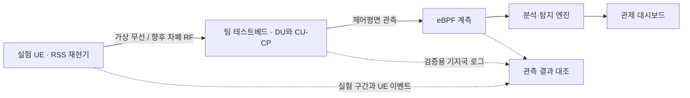

# 중간발표 초안 RSS 재현 도구와 현실 세계 영향

작성 기준일: 2026-10-20

담당 부분의 핵심은 **탐지기를 검증할 수 있도록 RSS 상황을 재현하고, 발생 조건과 관측 결과를 기록하는 것**이다. 현재는 OAI UE 기반 재현기를 구현하고 OCUDU 가상 무선 환경에서 미완료 접속의 생성·해제를 확인했다. 정상 단말의 서비스 영향과 탐지·관제 연동은 다음 검증 대상이다.

현실 세계 영향은 **5G 연구에서 확인된 접속 방해**, **운영망에서 발생한 제어신호 과부하 장애**, **산업 현장으로 이어질 수 있는 조건부 업무 영향**으로 구분한다. 이를 모두 “적은 자원으로 기지국을 다운시킨 실제 사건”으로 묶지 않는다.

## 1. 전체 발표에서 담당 내용이 들어갈 위치

| 기존 목차 | 넣을 내용 | 이 문서의 위치 |
|---|---|---|
| 2부 · Layer-3 관측 가능 위협 | RSS의 개념, 초기접속 미완료 시나리오를 우선한 이유 | §2 |
| 2부 · 위협의 현실 세계 임팩트 | 실험 결과·실제 장애·산업 업무 영향을 구분한 설명 | §3 |
| 3부 · 전체 아키텍처 | 재현기와 계측·분석기 운영자의 연결 지점 | §4 |
| 3부 · 구현 ① 공격 & eBPF 계측 | 재현 도구의 역할·구성·구현 현황 | §5 |
| 4부 · 진행 현황 & 예상 산출물 | 완료한 작업, 관측한 현상, 아직 검증할 부분 | §6 |
| 4부 · 앞으로의 계획 & 한계 | 정상 단말 영향·계측 대조·탐지 연동 평가 | §7 |
| APPENDIX · 예상 질문 | 용어 정정, 주장 범위, 1차 출처 | §8~10 |

아래의 **PPT 본문**은 슬라이드에 넣을 문구이며, **발표자 설명**은 문서 초안이나 발표 대본으로 사용할 수 있다. 슬라이드 번호는 전체 목차 확정 후 붙인다.

## 2. 2부 위협 설명

### PPT 본문

**RRC 시그널링 스톰과 초기접속 자원 고갈**

- RRC는 단말과 기지국 사이의 연결을 설정·유지·해제하는 제어 절차를 담당한다.
- 초기접속이 완료되지 않은 상태가 반복되면, 기지국의 연결 관리 자원이 일시적으로 점유될 수 있다.
- 수용 가능한 자원이 부족해지면 정상 단말의 새 연결도 지연되거나 거절될 수 있다.
- 이번 구현은 **초기접속 미완료 시나리오**를 우선 대상으로 한다.

근거: [Abou Hasna·El Falou, 2026, §V~VI](https://arxiv.org/html/2608.16441v1).

### 발표자 설명

“단말은 데이터를 주고받기 전에 기지국과 연결을 설정해야 합니다. 기지국은 이 과정에서 연결을 진행 중인 단말의 상태와 자원을 관리합니다. 접속이 끝나지 않는 상황이 반복되면, 이 자원을 회수하기 전까지 다른 단말이 사용할 여유가 줄어들 수 있습니다.

저희는 이 현상을 초기접속 미완료 시나리오라고 부릅니다. 이를 먼저 구현한 이유는 연결 시도와 완료의 차이를 관측할 수 있고, 재현기 기록과 기지국 로그를 비교해 탐지에 필요한 데이터를 검증하기 좋기 때문입니다.”

### 용어와 범위

**RRCSetupComplete 미전송형**은 3GPP 공식 공격 분류명은 아니지만, 표준 메시지명과 중단 지점을 그대로 드러내는 설명형 이름이다. 발표에서도 “`RRCSetup`을 ACK한 뒤 `RRCSetupComplete`를 보내지 않는 방식”으로 처음 정의한다.

C-RNTI는 셀 안에서 단말의 무선 전송을 식별하는 임시 식별자다. 이를 “인증된 사용자 신원”으로 설명하지 않는다. 또한 이번 현상을 **C-RNTI 번호 공간 전체의 소진**으로 단정하지 않는다. 발표의 중심 용어는 “미완료 접속에 할당된 UE 컨텍스트와 접속 수용 자원”이 적절하다.

“인증 전 절차를 대상으로 한다”와 “어떤 장비로든 쉽게 실행할 수 있다”는 다른 주장이다. 연구에는 조작 가능한 UE 소프트웨어와 무선 실험 장비가 사용됐다. 모든 RSS 변종이 인증·사전 정보 없이 성립하는 것도 아니다. [실험 구성 및 범위](https://arxiv.org/html/2608.16441v1).

현재 구현은 한 시나리오이므로 “RRC 스톰 2종을 구현했다”라고 쓰지 않는다. 두 번째 시나리오가 팀의 확정 목표라면 **“초기접속 미완료형 우선 구현, 반복 접속 계열은 후속 검토”**로 표시한다.

## 3. 2부 위협의 현실 세계 임팩트

### PPT 본문

**접속 장애가 현장 업무에 미치는 영향**

- **5G 실험:** 소프트웨어 UE 한 대가 유발한 초기접속 자원 고갈로 상용 휴대전화의 신규 접속 실패가 관측됐다.
- **운영망 사례:** DOCOMO는 2012년 제어신호 과부하로 최대 252만 명에게 통화·데이터 이용 장애가 발생했다고 발표했다.
- **산업적 의미:** 필요한 시점의 접속·연결 복구 실패는 작업 지연으로 이어지고, 통신 단절이 응용의 허용 시간을 넘으면 안전정지로 이어질 수 있다.

슬라이드 하단: **5G 연구 테스트베드 결과 / 3G 운영망의 비공격성 장애 사례 / 조건부 업무 영향**

출처: [5G 실험 논문 §VI](https://arxiv.org/html/2608.16441v1), [DOCOMO 공식 장애 발표](https://www.docomo.ne.jp/info/news_release/2012/01/26_00.html), [3GPP TS 22.104 Annex C.3](https://www.etsi.org/deliver/etsi_ts/122100_122199/122104/17.07.00_60/ts_122104v170700p.pdf).

### 발표자 설명

“이 위협의 의미는 정상 단말이 필요한 순간에 서비스를 시작하지 못할 수 있다는 점입니다. 5G 연구 테스트베드에서는 실험 UE 한 대가 초기접속 자원을 점유하는 동안 상용 휴대전화의 접속이 실패하는 현상이 확인됐습니다.

제어신호 과부하 자체는 실제 운영망에서도 장애를 일으킨 적이 있습니다. DOCOMO는 2012년 스마트폰 애플리케이션의 제어신호 증가와 설비 전환 과정에서 발생한 처리용량 초과로, 최대 252만 명에게 통화와 데이터 이용 장애가 발생했다고 발표했습니다. 이 사건은 5G RSS 공격이 아니라, 제어평면의 문제가 실제 서비스 장애로 이어질 수 있음을 보여주는 사례입니다.

스마트팩토리나 물류 환경에서는 단말이 접속하거나 통신을 복구하지 못하면 작업 시작과 재개가 늦어질 수 있습니다. 통신에 의존하는 응용은 허용 시간을 넘긴 단절에 안전정지로 반응할 수도 있습니다. 다만 기존 연결이 유지되는지, 대체망이나 로컬 제어가 있는지에 따라 실제 피해는 달라집니다.”

### 조사 결과와 인용 범위

| 근거 종류 | 확인된 내용 | 이 자료로 주장할 수 없는 것 |
|---|---|---|
| 5G 실물 무선 연구 | OAI 테스트베드에서 실험 UE 한 대와 상용 휴대전화를 사용해 신규 접속 실패를 관측 | 모든 상용 기지국의 크래시, 이미 연결된 모든 단말의 통신 중단 |
| 추가 5G 연구 | StormShield는 OAI·NVIDIA Aerial 기반 실물 무선 구성에서 접속 가용성과 방어 효과를 평가 | 상용 RU가 포함됐다는 이유만으로 상용 블랙박스 CU까지 검증됐다는 주장 |
| 실제 운영망 장애 | DOCOMO는 2012-01-25 08:26~13:08, 도쿄 일부 지역에서 최대 252만 명이 영향을 받았다고 발표 | 악의적 공격, 5G NR RSS, UE 한 대가 유발한 장애였다는 주장 |
| 산업 통신 요구사항 | 통신 단절이 응용의 survival time을 넘으면 안전상태·정지 및 추가 복구 시간이 필요할 수 있음 | RSS 발생 즉시 모든 공정이 정지한다는 주장 |

근거 위치: [실험 논문 §V-A·VI-A, Fig. 5](https://arxiv.org/pdf/2608.16441v1), [StormShield §6~7](https://arxiv.org/pdf/2605.14032v1), [DOCOMO 발표의 1~3항](https://www.docomo.ne.jp/info/news_release/2012/01/26_00.html), [TS 22.104 v17.7.0 Annex C.3, 인쇄 p.64](https://www.etsi.org/deliver/etsi_ts/122100_122199/122104/17.07.00_60/ts_122104v170700p.pdf).

이번에 확인한 1차 자료에서는 **이 초기접속 미완료형 공격 때문에 실제 상용 5G 운영망이 중단됐다는 사건 보고는 확인하지 못했다.** 실험에서 확인한 가능성과 운영망 사건을 구분해서 제시한다.

### 산업 현장으로 영향이 이어지는 조건

다음은 산업 사용례와 통신 요구사항을 연결한 **조건부 영향 시나리오**다. 아래 사업장에서 RSS 피해가 실제 발생했다는 의미가 아니다.

| 환경 | 접속·재접속이 필요한 상황 | 발생 가능한 업무 영향 | 영향을 바꾸는 조건 |
|---|---|---|---|
| 스마트팩토리 | 장비 기동, 연결 상실 후 복구 | 장비 투입·공정 재개 지연, 통신 의존 응용의 안전정지 | 기존 연결 유지, 로컬 제어, 이중화 |
| 물류·산업용 이동로봇 | 로봇 기동이나 통신 복구 시점 | 작업 지시·상태보고 재개 지연, 운반 작업 대기 | 자율 동작 범위, 대체망, 안전정책 |
| 현장 모니터링 | 카메라·센서의 새 연결 또는 복구 | 상태정보·영상의 가시성 공백 | 로컬 저장, 경보 경로, 우회 통신 |

국내 적용 맥락으로 과기정통부는 2023년 물류센터 AMR 운용과 조선소 공정·안전관리에 이음5G를 활용할 계획을 발표했다. 이는 사용례의 근거이며 현재 운영 성과나 공격 피해의 근거는 아니다. [과기정통부 보도자료 수록본, 2023-10-05](https://eiec.kdi.re.kr/policy/materialView.do?num=243310).

**공공안전망 표현은 분리한다.** 국내 재난안전통신망은 LTE 기반 PS-LTE다. “공공안전망·스마트팩토리 등 5G 특화망”으로 묶지 않고, 공공안전은 통신 가용성의 중요성을 설명하는 별도 맥락으로만 사용한다. [행정안전부 재난안전통신망 소개](https://mois.go.kr/frt/sub/a06/b11/policyBriefingView/screen.do).

### 그림 구성

`신규 접속·연결 복구 실패 → 필요한 통신을 시작·재개하지 못함 → 작업 지연 → 허용시간 초과 시 안전정지 가능`

첫 단계에는 “통신 영향 검증”, 뒤 단계에는 “업무 의존성에 따른 영향”을 표시한다. 이미 연결된 모든 단말이 즉시 끊기는 그림은 사용하지 않는다.

## 4. 3부 전체 아키텍처에서 재현기의 위치

### PPT에 추가할 설명

**재현기는 탐지 검증을 위한 입력과 실험 기록을 제공한다.**

실선은 목표로 하는 실험·관측 흐름, 점선은 결과 검증에 사용하는 기록이다. 이 그림은 연동 완료를 뜻하지 않는다. 전체 팀 아키텍처에 CU-UP을 표시하더라도, 이번 초기접속 시나리오의 설명은 CU-CP와 DU의 제어평면을 중심으로 한다.

### 발표자 설명

“재현기는 탐지 엔진에 시험 상황을 제공하는 역할입니다. 실험이 언제 시작되고 끝났는지, UE에서 어떤 이벤트가 발생했는지를 남깁니다. 계측팀이 관측한 결과를 이 기록과 기지국 로그에 맞춰 비교하면, 실제 사건을 놓쳤는지 또는 중복으로 세었는지 확인할 수 있습니다.

기지국 로그는 개발 단계에서 계측의 정확성을 대조하는 기준으로 사용합니다. 실제 배포 환경에서 벤더 내부 로그에 의존하지 않고 어디까지 관측할 수 있는지는 별도로 검증합니다.”

## 5. 3부 구현 ① 공격 재현 도구

### PPT 본문

**탐지 검증을 위한 RSS 재현 도구**

- **구현:** OAI UE 기반 초기접속 미완료 시나리오 재현기
- **환경:** AWS의 OCUDU 분리형 CU/DU와 ZMQ 가상 무선
- **관측:** 미완료 접속의 생성·해제 확인, 추가 시험에서 수용 한도 도달·접속 거절 로그 관측
- **산출 데이터:** 실험 조건·발생 구간·UE 이벤트 기록과 기지국 로그 대조 결과
- **다음 검증:** 정상 UE의 서비스 영향과 eBPF 계측·탐지 연동

하단 조건: **gNB 소스 무수정 / 기본 설정 실험과 설정 변경 실험 구분 / 차폐 OTA 미검증**

프로젝트 근거: [구현 문서](/Volumes/owc/Users/ideal/s-dev/ran-rrc-storm/rss-storm/README.md), [측정 기록](/Volumes/owc/Users/ideal/s-dev/ran-rrc-storm/rss-storm/docs/MEASUREMENTS.md).

### 발표자 설명

“저희가 맡은 부분은 탐지기가 실제 이상 상황을 잡는지 평가할 RSS 재현 도구입니다. OAI UE를 기반으로 초기접속이 완료되지 않는 상황을 반복해서 만들고, 실험 조건과 단말 이벤트를 기록하도록 구현했습니다.

현재는 AWS에서 CU와 DU를 분리한 OCUDU 환경에 가상 무선으로 연결해 시험했습니다. 미완료 접속이 만들어졌다가 해제되는 동작을 확인했고, 추가 시험에서는 수용 한도 도달과 접속 거절 로그를 관측했습니다.

여기서 다음으로 확인할 것은 정상 단말이 실제로 얼마나 영향을 받는지, 그리고 계측·탐지 시스템이 이 현상을 정확하게 포착하는지입니다. 재현기의 기록을 계측 데이터와 맞춰, 탐지 정확성과 탐지 지연을 평가할 계획입니다.”

### 도구의 구성과 기여

| 구성 | 역할 |
|---|---|
| 실험 UE | 정의한 초기접속 시나리오를 테스트베드에서 재현 |
| 실험 실행 관리 | 실험 조건·실행 구간을 관리하고 종료를 제어 |
| 이벤트 기록 | UE에서 관측한 이벤트와 시각을 보존 |
| 결과 분석 | 기지국 로그에서 절차의 생성·종료·거절을 대조 |

담당 파트의 기여는 **팀 OCUDU 환경에서 반복 평가할 수 있는 시험 도구와 검증 자료를 마련하는 것**이다. 새로운 공격의 최초 발견이나 상용 기지국 전체에 대한 취약성 입증을 성과로 주장하지 않는다.

실험 구간 라벨은 “이 구간에 해당 시나리오를 실행했다”는 기록이다. 실제 접속 자원이 점유됐거나 정상 사용자가 피해를 입었다는 정답은 별도 관측으로 확인해야 한다.

## 6. 4부 진행 현황과 예상 산출물

### PPT 본문

**현재 구현과 검증 범위**

| 항목 | 상태 |
|---|---|
| 초기접속 미완료 재현기·이벤트 기록 | 구현 |
| 가상 무선 환경의 미완료 접속 생성·해제 | 기존 원시 로그로 확인 |
| 수용 한도 도달·접속 거절 | 추가 실험 문서에 기록 |
| 정상 UE의 동시 접속·서비스 영향 | 추가 검증 필요 |
| eBPF 계측·탐지·관제 통합 평가 | 후속 과제 |
| 차폐 OTA와 상용 벤더 환경 | 미검증 |

**담당 파트 예상 산출물:** RSS 재현 도구, 실험 조건과 이벤트 기록, 계측 대조 결과, 재현 범위와 한계를 정리한 기술 문서

### 발표자 설명

“현재는 조사와 설계를 넘어 재현기 구현과 가상 무선 환경의 절차 확인까지 진행했습니다. 다만 실험 UE에 대한 접속 거절을 본 것과 정상 사용자 피해를 직접 측정한 것은 구분해야 합니다. 앞으로 정상 UE를 포함한 비교와 분석기 운영자 연동을 통해, 도구의 동작 확인을 탐지 성능 검증으로 이어가겠습니다.”

### 수치 사용에 관한 내부 확인 사항

- 최신 장시간 시험의 상세 수치는 측정 문서에 있으나, 해당 원시 로그는 이번 저장소 확인에서 찾지 못했다. 발표 본문은 재확인 가능한 절차와 정성적 관측을 중심으로 작성했다.
- 기본 설정과 접속 수용 용량 등을 변경한 시험을 섞지 않는다. 설정 변경 결과에는 변경 조건을 명시한다.
- 거절 메시지 한 건이 여러 로그 줄에 나타나는 사례가 있다. `rrcReject` 문자열 출현 횟수를 실제 거절 메시지 수로 제시하지 않는다.
- 과거 실행 메타데이터와 실제 CU 로그의 타이머 값이 다른 기록도 있다. 수치 발표 전에는 실제 로드 설정을 확인한다.
- 가상 무선의 진행 속도는 벽시계 시간과 일치하지 않을 수 있다. 가상 환경의 초당 수치를 실제 RF 성능으로 옮기지 않는다.

근거: [초기 실험 CU 로그](/Volumes/owc/Users/ideal/s-dev/ran-rrc-storm/tool/runs/A-1019T211216Z/ocu-window.log), [별도 포화 실험 로그](/Volumes/owc/Users/ideal/s-dev/ran-rrc-storm/tool/runs/ocu-saturation-window.log), [측정 기록](/Volumes/owc/Users/ideal/s-dev/ran-rrc-storm/rss-storm/docs/MEASUREMENTS.md), [테스트베드 한계](/Volumes/owc/Users/ideal/s-dev/ran-rrc-storm/testbed-limitations.md).

## 7. 4부 앞으로의 계획과 한계

### PPT 본문

**재현 결과를 탐지·관제 검증으로 연결**

1. 정상 접속·자연 발생 실패를 포함한 기준선 확보
2. UE 이벤트·기지국 로그·eBPF 계측 결과의 시간 및 건수 대조
3. 정상 단말의 접속 성공률·접속 지연과 탐지 지연·오탐 평가
4. 차폐 RF 환경에서 가상 무선 결과의 적용 범위 확인

현재 목표: **RSS 탐지와 위협 가시성 검증**

### 발표자 설명

“접속 실패는 공격 외에도 무선 상태나 장비 문제로 발생할 수 있습니다. 따라서 시도와 완료 건수의 차이만으로 공격이라고 단정하지 않고, 정상 상태에서 발생하는 실패와 비교하겠습니다. 또한 관측된 미완료 상태가 실제 기지국 절차의 수명과 일치하는지 확인하겠습니다.

이번 프로젝트는 탐지와 관제 가시성 확보를 우선합니다. 후속 시나리오는 필요한 관측값을 실제로 확보할 수 있는지 확인한 뒤 확장하겠습니다. 불법 기지국 등 다른 위협도 같은 카운터만으로 탐지할 수 있다고 가정하지 않습니다.”

### 계측팀과 맞춰야 할 설명

TeleRAN의 Table I은 프로토콜 식별자·상태 등의 보안 텔레메트리, Table II는 연결 시도·성공 등을 포함한 KPM 항목이다. 표에 존재한다는 사실만으로 팀 구현의 정확도나 RSS 탐지 성능이 입증되지는 않는다. [TeleRAN, Table I·II 및 §IV](https://www.csl.sri.com/users/gehani/papers/FutureG-2026.eBPF.pdf).

| 항목 | 발표에서의 용도 |
|---|---|
| `RRC.ConnEstabAtt` / `RRC.ConnEstabSucc` | 시도·완료 추세와 불균형 관찰 |
| `RRC.ConnEstabFailCause` | 실패 원인에 대한 보조 정보. 현재 OCUDU 공식 문서는 `NetworkReject`만 노출한다고 설명 |
| UE별 관측 이벤트·상태 | 집계 카운터를 보완하는 절차 흐름과 미완료 상태 추적 |

OCUDU의 해당 RRC 카운터는 노드 단위다. 또한 `RRC.ConnMean/Max`의 연결된 UE 수를 미완료 접속 수로 간주하지 않는다. [OCUDU 공식 E2 지표 설명](https://docs.ocudu.org/knowledge_base/e2sm_kpm_metrics/).

집계 창을 넘나드는 접속과 정상 실패가 있으므로 **같은 시간 창의 시도 수에서 성공 수를 뺀 값을 곧바로 현재 미완료 컨텍스트 수로 사용하지 않는다.** 패킷으로 추정한 종료 시점도 내부 자원의 실제 해제 시점과 대조해야 한다.

## 8. 기존 초안에서 고칠 문장

| 기존 표현 | 발표용 대체 문장 |
|---|---|
| “적은 자원으로 기지국 다운” | “소수 실험 장치의 접속 절차 악용으로 초기접속 자원이 부족해지고 정상 단말의 새 연결이 거절될 수 있다.” |
| “기지국 공격 중 가장 쉽고 영향이 제일 크다” | “접속 가용성에 영향을 주고, 시도·완료·미완료 상태를 비교해 검증할 수 있어 첫 시나리오로 선정했다.” |
| “공공안전망·스마트팩토리 등 5G 특화망의 즉각적 업무 중단” | “산업용 5G의 접속·복구 실패는 작업 지연으로 이어질 수 있으며, 통신 의존 응용은 허용시간 초과 시 안전정지할 수 있다.” |
| “C-RNTI를 다 써서 기지국이 죽는다” | “미완료 접속에 필요한 UE 컨텍스트와 접속 수용 자원이 점유된다.” |
| “RRC 스톰 2종 구현” | “초기접속 미완료 시나리오를 우선 구현했다.” |
| “지표로 RRC 스톰을 막는다” | “지표와 절차 흐름으로 이상을 탐지하고 운영자에게 근거를 제공한다.” |
| “대응은 연구 수준이고 효과가 검증되지 않았다” | “연구 테스트베드의 대응 실증은 있으나, 우리 기지국 무수정·벤더 중립 조건에서 적용 가능한 대응은 검증하지 않았다.” |
| “벤더 중립 솔루션 구현 완료” | “벤더별 내부 코드 의존도를 줄이는 계측·탐지를 목표로 OCUDU에서 검증 중이다.” |

대응의 연구 실증 근거: [실험 논문 §VI-B](https://arxiv.org/html/2608.16441v1), [StormShield §6~7](https://arxiv.org/pdf/2605.14032v1). 상용 환경으로의 일반화에는 접근 권한·관측 가능한 인터페이스·암호화 등 적용 조건도 확인해야 한다. [TeleRAN §V](https://www.csl.sri.com/users/gehani/papers/FutureG-2026.eBPF.pdf).

## 9. 예상 질문과 답변

### 실제로 발생한 5G RSS 공격 사례가 있나

“이번에 확인한 자료에서는 저희 초기접속 미완료 시나리오로 실제 상용 5G망이 중단됐다는 공개 사건 보고는 찾지 못했습니다. 다만 5G 연구 테스트베드에서는 정상 단말의 신규 접속 실패가 실증됐고, 제어신호 과부하가 실제 운영망 서비스 장애로 이어진 사례도 있습니다. 이 두 근거를 구분해 제시했습니다.”

### 한 대로 가능하다면 일반 휴대전화 앱으로도 가능한가

“인용한 연구의 한 대는 조작 가능한 소프트웨어 UE와 무선 실험 장비를 의미합니다. 일반 휴대전화 앱 하나로 가능하다고 주장하는 것은 아닙니다. 실제 성립 조건과 피해 정도는 기지국 구현과 설정에 따라 다릅니다.”

### 기지국이 다운됐다는 뜻인가

“이번에 설명하는 직접적인 결과는 접속 자원이 부족해 새 연결을 받아들이지 못하는 현상입니다. 기지국 프로세스 종료나 기존 사용자 연결 전체의 중단은 별도 결과이며, 저희 실험에서 확인했다고 말하지 않습니다.”

### 공격 도구를 왜 직접 만드는가

“탐지 성능을 평가하려면 언제 어떤 상황이 발생했는지 알아야 합니다. 저희는 팀 테스트베드에서 반복할 수 있는 재현기와 이벤트 기록을 마련해, 계측 결과와 탐지 결과를 대조하려고 합니다.”

### 탐지 지표 두 개만 있으면 충분한가

“접속 시도와 완료의 차이는 유용한 신호지만, 정상 혼잡이나 무선 실패에서도 나타날 수 있습니다. 정상 기준선, 실패 정보, 절차 흐름을 함께 보고 오탐과 누락을 평가해야 합니다.”

### 왜 대응은 하지 않는가

“연구 환경에서 대응 효과를 보인 사례는 있습니다. 저희는 먼저 기지국 소스를 수정하지 않는 조건에서 관측과 탐지가 가능한지 검증합니다. 실제 대응은 사용할 수 있는 제어 수단과 정상 단말에 대한 부작용을 별도로 확인해야 하므로 현재 검증 범위에서 분리했습니다.”

### 왜 vRAN을 가정하는가 실제로 쓰이는 환경인가

“vRAN은 기지국 기능을 소프트웨어로 실행하는 구조이므로, 저희는 접근 가능한 호스트와 CU/DU 인터페이스에서 계측을 검증하려고 합니다. 실제 상용 배치 사례도 있습니다. Verizon은 2025년 2월 미국 내 22,900개 이상의 vRAN 사이트를 운영한다고 발표했습니다. 다만 모든 5G망이 vRAN은 아니며, vRAN이 오픈소스나 벤더 중립을 뜻하는 것도 아닙니다.”

근거: [Verizon, 2025-02-27](https://www.verizon.com/about/news/value-virtualized-architecture-high-density-environments), [GSMA의 가상화와 개방형 인터페이스 구분, p.7](https://www.gsma.com/solutions-and-impact/connectivity-for-good/public-policy/wp-content/uploads/2021/02/GSMA_Open_and_Virtualised_Radio_Access_Networks_An_Explanatory_Guide_for_Policymakers.pdf).

### OCUDU에서 확인하면 상용 벤더에도 적용된다고 볼 수 있나

“OCUDU 검증은 첫 적용 사례입니다. 표준 프로토콜을 관측한다는 설계 방향과 여러 상용 벤더에서 실제 동작한다는 검증 결과는 구분합니다. 상용 환경에서는 호스트 접근 권한과 관측 경로 등을 추가로 확인해야 합니다.”

## 10. APPENDIX 출처

| 자료 | 발표에 사용하는 근거 | 확인 위치 |
|---|---|---|
| [Experimental Validation and Mitigation of RRC Storm Attacks in 5G Cellular Networks, 2026](https://arxiv.org/pdf/2608.16441v1) | 실물 무선 연구의 신규 접속 방해 및 대응 평가 | §V-A, §VI, Fig. 5 |
| [StormShield, WiSec 2026](https://arxiv.org/pdf/2605.14032v1) | 별도 실물 무선 연구 및 방어 실증의 적용 범위 | §6~7 |
| [DOCOMO, 2012-01-26 장애 발표](https://www.docomo.ne.jp/info/news_release/2012/01/26_00.html) | 2012-01-25 제어신호 과부하 운영망 장애 | 1항 영향, 2항 경과, 3항 원인 |
| [3GPP TS 22.104 v17.7.0](https://www.etsi.org/deliver/etsi_ts/122100_122199/122104/17.07.00_60/ts_122104v170700p.pdf) | 통신 중단과 응용의 안전상태·복구 시간 | Annex C.3, 인쇄 p.64 |
| [과기정통부 물류센터 이음5G 보도자료 수록본](https://eiec.kdi.re.kr/policy/materialView.do?num=243310) | 물류로봇·조선소 적용 계획 | 2023-10-05 |
| [행정안전부 재난안전통신망 소개](https://mois.go.kr/frt/sub/a06/b11/policyBriefingView/screen.do) | 국내 재난안전통신망의 PS-LTE 기반 | 구축 목적과 통신망 구성 |
| [TeleRAN](https://www.csl.sri.com/users/gehani/papers/FutureG-2026.eBPF.pdf) | 보안 텔레메트리·KPM 항목 및 관측 제약 | Table I·II, §IV~V |
| [OCUDU Supported E2 Metrics](https://docs.ocudu.org/knowledge_base/e2sm_kpm_metrics/) | RRC 카운터의 범위·노드 단위 집계·실패 원인 지원 | RRC Connections |
| [KISA 5G 특화망 보안 안내서](https://www.kisa.kr/2060302/form?page=1&postSeq=7) | 특화망 보안의 배경 참고자료 | 등록 2026-03-18 |
| [Verizon vRAN 운영 발표](https://www.verizon.com/about/news/value-virtualized-architecture-high-density-environments) | vRAN 상용 배치 사례 | 2025-02-27 |
| [GSMA Open and Virtualised Radio Access Networks](https://www.gsma.com/solutions-and-impact/connectivity-for-good/public-policy/wp-content/uploads/2021/02/GSMA_Open_and_Virtualised_Radio_Access_Networks_An_Explanatory_Guide_for_Policymakers.pdf) | vRAN과 Open RAN의 개념 구분 | p.7 |

KISA 자료의 정확한 제목은 **「5G 특화망 보안 안내서」**다. 이번 초안에서는 공식 게시물과 첨부 존재를 확인했으며, PDF 본문을 RSS 피해의 직접 근거로 인용하지 않았다.

