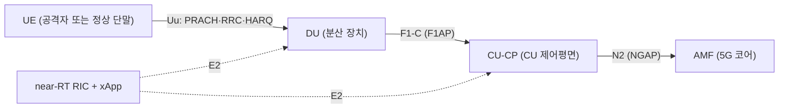
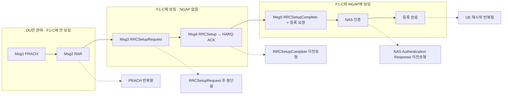
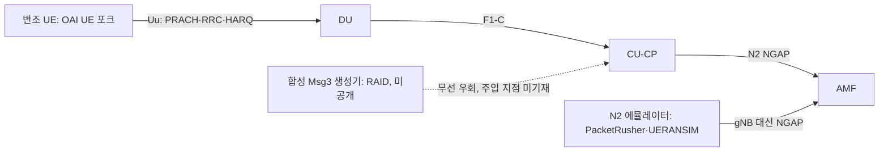

# RRC 시그널링 스톰 공개 지형: 변종·논문·도구

| 항목 | 내용 |
|---|---|
| 갱신 | 2026-10-13. 인용한 웹 자료·리포지토리의 접근일도 모두 같다 |
| 문서 역할 | 팀장 요청 #2에 대한 답이다. 다른 RRC 시그널링 스톰 공격의 변종·논문·공개 도구를 정리하고 도구 사이의 차이를 비교해, 우리 재현기 요구사항(§7)의 근거로 쓴다 |
| 선행 지식 | [rss-theory.md](rss-theory.md) §2(5G 접속의 기초)와 §3(시그널링 스톰의 정의와 절차 기반 설명형 이름). 이 문서도 §1.2에서 필요한 용어를 짧게 풀이한다 |
| 관련 문서 | [rss-theory.md](rss-theory.md)(점유 메커니즘, OCUDU 수치의 단일 출처는 §8), [methodology.md](methodology.md)(절차 기반 설명형 이름·관측 경계), [tool-survey.md](tool-survey.md)(정상 UE 연결 경로·5gattacks 패치 세부), [design.md](design.md)(재현기 설계) |

## 요약

RRC(Radio Resource Control, 무선 자원 제어) 시그널링 스톰(RSS, RRC Signaling Storm)은 단말(UE, User Equipment)이 5G 기지국(gNB, next generation NodeB)에 접속하는 절차를 일부러 끝내지 않는 행동을 반복해 기지국 자원을 고갈시키는 공격이다 [1, §3]. 본 문서는 이 공격에 대해 공개된 변종·논문·도구가 무엇이고, 그중 무엇을 팀 테스트베드에서 본 프로젝트의 RRCSetupComplete 미전송형 시나리오(접속 절차의 마지막 메시지 `RRCSetupComplete`를 보내지 않고 처음부터 다시 접속하기를 반복하는 시나리오, §3)를 재현하는 데 쓸 수 있는지를 묻는다 [2]. 팀 테스트베드의 기지국은 OCUDU(팀이 쓰는 srsRAN 계열 오픈소스 CU/DU)다 [2]. 이를 위해 논문 본문, 공개 리포지토리의 파일·브랜치·diff, OCUDU 소스(커밋 `440cdbb`)를 직접 열어 읽었고, 어떤 도구도 실행하지 않았다(§2). 그 결과 실제 무선 구간(Uu)으로 gNB를 공격하는 공개 코드는 OpenAirInterface(OAI) UE 포크(원본 소스를 복제해 고친 사본) 3건이며, 그중 RRCSetupComplete 미전송형(Msg4 수신 확인 뒤 `RRCSetupComplete` 생략)을 구현한 것은 5gattacks 하나뿐이었다 [3], [4], [5]. 세 포크는 모두 구형 OAI를 바탕으로 OAI gNB를 겨냥하며(§5.1), OCUDU를 대상으로 시험한 공개 기록은 찾지 못했다. OCUDU 공식 문서가 정상 연결을 보인 OAI UE는 2026.w25 이상이어서, 구형 포크를 그대로 붙일 근거도 없다 [6, §3.1]. 2025–2026년의 주요 RSS 논문은 대부분 탐지·완화 논문이고 공격 코드를 공개하지 않았으며, 공개된 대응도 대부분 기지국 쪽 무선 접속망(RAN, Radio Access Network)의 수정을 전제한다 [7, §6], [8, §6.1], [9, §V-C]. 따라서 '최신 UE 위의 RRCSetupComplete 미전송형 + 실행 중 바꿀 수 있는 노브(재현기의 조절 가능한 파라미터) + 시도마다 실제로 무슨 일이 일어났는지 남기는 정답 기록 + 위치·송신 이득 같은 물리 변수 기록'을 함께 제공하는 공개물은 없으며, 이 공백을 R1–R9의 재현기 요구사항으로 정리했다(§7). 이 결론은 문헌과 코드 판독에 근거하므로, OCUDU에서의 실제 공격 효과와 각 도구의 동작은 실험으로 따로 확인해야 한다.

## 1. 서론

### 1.1 이 문서가 답하는 질문

본 프로젝트의 서브태스크는 팀의 O-RAN(Open RAN) 기지국 침입 탐지·대응(IDS/IPS, 침입 탐지/방지 시스템) 테스트베드에서, 탐지·대응기를 검증할 "외부자 UE(공격자) 측 RRC signaling storm 재현 도구"를 만드는 것이다 [2]. 설계 목표는 강한 공격이 아니라 파라미터가 통제되는 재현기다 [2]. 팀 프로젝트는 상용 가상화 RAN(vRAN)에서 벤더가 만든 기지국 중앙 장치(CU, §1.2)의 소스를 고칠 수 없다는 전제에서, 기지국 소스를 수정하지 않고 바깥에서 탐지·대응하는 것을 목표로 한다 [2]. 바깥이란 기지국 내부 인터페이스 F1(§1.2)의 메시지를 엿보는 eBPF(리눅스 커널 안에서 작은 프로그램을 안전하게 실행하는 기술) 텔레메트리 프록시와, §1.2에서 설명할 near-RT RIC을 말한다 [2]. 따라서 기지국 코드를 고쳐야 동작하는 공개 대응은 우리 조건에 그대로 옮길 수 없으며, 이 문서가 각 대응의 'RAN 수정 여부'를 따로 표시하는 이유가 여기에 있다(추론, [2]에 근거). 재현기를 새로 만들기 전에 이미 공개된 공격·논문·도구가 무엇을 하고 무엇을 하지 않는지 알아야 중복을 피하고 빈 곳을 정확히 겨냥할 수 있다. 그래서 이 문서는 다음 네 질문에 답한다.

- **Q1.** RSS에는 어떤 변종이 있고, 각 변종은 접속 절차의 어디서 멈춰 어떤 자원을 붙잡는가? (§3)
- **Q2.** 어떤 논문이 어떤 조건에서 무엇을 보였고, 그 수치를 우리 환경에 옮겨도 되는가? (§4)
- **Q3.** 공개 도구 중 실제로 열어 확인한 코드가 있는 것은 무엇이며, 우리 OCUDU 테스트베드에서 무엇을 할 수 있고 무엇을 할 수 없는가? (§5, §6)
- **Q4.** 공개물이 채우지 못하는 공백은 무엇이고, 그것이 재현기 요구사항으로 어떻게 이어지는가? (§7)

### 1.2 이 문서를 읽기 위한 최소 배경

이 절은 처음 읽는 사람을 위해 이 문서에 필요한 개념만 짧게 정리한다. 각 문단은 그 개념이 이 문서에서 왜 필요한지부터 말한다. 자세한 설명은 [rss-theory.md](rss-theory.md) §2–§3에 있고, 규격 근거는 각 문장에 달았다.

**기지국 구조.** 이 구분이 필요한 이유는, 공격이 접속 절차의 어디에서 멈추느냐에 따라 메시지가 DU 안에서 끝나는지, F1-C를 거쳐 CU까지 가는지, NGAP을 거쳐 코어까지 가는지가 정해지고, 그것이 곧 공격을 관측할 수 있는 위치이기 때문이다(§3.1). 3GPP 구조에서 gNB는 RRC·SDAP·PDCP를 맡는 CU(Central Unit, 중앙 장치)와 RLC·MAC·PHY를 맡는 DU(Distributed Unit, 분산 장치)로 나뉠 수 있고, 둘은 F1 인터페이스로 연결된다 [10, §3.1], [1, §2.2]. CU는 다시 RRC와 PDCP의 제어평면 부분을 맡는 CU-CP(CU Control Plane, CU 제어평면)와 사용자 데이터 쪽을 맡는 CU-UP(CU User Plane)로 나뉘며, CU-CP와 DU 사이의 연결이 F1-C(F1 제어평면)다 [10, §3.1]. F1-C에서는 F1AP(F1 Application Protocol) 메시지가 오가고, UE가 보낸 첫 RRC 메시지도 F1AP의 Initial UL RRC Message Transfer에 담겨 DU에서 CU로 전달된다 [11, §8.4.1.1], [1, §2.7]. O-RAN에서는 이 장치들을 O-CU, O-DU라 부르고, 안테나 쪽 무선 장치는 O-RU(Radio Unit)라 부른다 [1, §2.2]. 무선 프로토콜은 아래에서부터 PHY(물리 계층, 무선 신호 송수신), MAC(Medium Access Control, 단말 간 스케줄링과 HARQ 재전송), RLC(Radio Link Control, 분할·재조립과 재전송), PDCP(Packet Data Convergence Protocol, 암호화와 무결성 보호) 계층과 그 위의 RRC로 쌓인다 [1, §2.3]. TCP/IP에 익숙한 독자는 PHY·MAC을 링크 계층 쪽에 두고 보면 되지만(본 문서의 비유), 이동통신 보안 문헌이 말하는 계층 3(L3)은 IP가 아니라 RRC·NAS 같은 제어 시그널링 계층이다. 5G-Spector 논문은 DU가 MAC·RLC 같은 계층 2(L2) 기능을, CU가 RRC 같은 L3 제어 프로토콜을 맡는다고 설명하고 [12, §III-B], 'L3 공격'을 RRC와 NAS 메시지를 조작하는 공격으로 쓴다 [12, §I]. 5G 코어 쪽에서 접속과 이동성을 관리하는 기능은 AMF(Access and Mobility Management Function)이고, gNB는 NG-C 인터페이스로 AMF에 연결된다 [13, §4.1]. 이 인터페이스 위의 제어 프로토콜이 NGAP(NG Application Protocol)이며 [1, §2.7], 일부 문헌은 같은 연결을 N2라고 부른다 [14, §II-A]. 이 문서의 그림 1과 그림 3에 나오는 N2는 이 NG-C를 가리킨다. 단말과 코어가 주고받는 등록·인증 같은 제어 메시지는 NAS(Non-Access Stratum) 계층에 속하며, AMF가 NAS 시그널링을 종단한다 [13, §4.2], [1, §2.3]. 방향을 말할 때 상향(UL, uplink)은 단말에서 기지국으로, 하향(DL, downlink)은 기지국에서 단말로 가는 방향이다 [15, §3.2].

**접속 절차와 Msg 번호.** 이 문서는 변종을 '접속 절차의 어디에서 멈추는가'로 나누므로(§3.1), 접속 메시지의 순서와 번호를 알아야 한다. UE는 RRC 메시지를 보내기 전에 랜덤 액세스(RA, Random Access)로 기지국과 상향 동기를 맞추고 첫 상향 전송 자원을 받는다 [16, §5.1], [1, §2.5]. 4단계(4-step) RA에서 Msg1은 PRACH(Physical Random Access Channel) 위로 보내는 프리앰블(preamble)이고, Msg2는 RAR(Random Access Response, 랜덤 액세스 응답)이다 [13, §9.2.6], [1, §2.5]. Msg3에는 `RRCSetupRequest`가, Msg4에는 `RRCSetup`이 실리고, Msg4는 같은 프리앰블을 고른 단말들 사이의 경합 해소(contention resolution)도 맡는다 [1, §2.5], [16, §5.1.5]. UE의 MAC 계층은 경합 해소에 성공했을 때만 Msg4에 대한 HARQ(Hybrid Automatic Repeat reQuest) ACK(수신 확인)를 보낸다 [16, §5.3.2.2], [1, §2.5]. 논문들은 그다음 UE가 보내는 `RRCSetupComplete`를 'Msg5'라고 부르지만, 이는 논문의 약칭이지 표준 용어가 아니다 [17, §3]. `RRCSetupComplete`에는 UE가 코어(AMF)에 자신을 등록하려고 보내는 첫 NAS 메시지인 등록 요청(Registration Request)이 실린다 [7, §4], [1, §2.6]. 2단계(2-step) RA라는 선택적 방식도 있는데, 프리앰블과 PUSCH(Physical Uplink Shared Channel) 데이터를 묶은 MsgA를 한 번에 보내고 MsgB로 응답을 받는다 [13, §9.2.6], [1, §2.5]. 무선 구간에서 단말을 가리키는 임시 식별자는 RNTI(Radio Network Temporary Identifier)라고 부르며, RA 중에는 DU가 Msg2로 TC-RNTI(Temporary C-RNTI)를 주고 경합 해소에 성공하면 UE가 이것을 C-RNTI(Cell RNTI)로 삼는다 [16, §5.1.4], [16, §5.1.5], [1, §2.5].

**연결 설정 메시지와 타이머.** 공개 공격 코드가 무시하는 타이머(§5.1)와 변종이 바꾸는 필드(§3.2)를 이해하려면 다음 용어가 필요하다. `RRCSetupRequest`에는 초기 UE identity(`ue-Identity`)와 접속 이유를 알리는 `establishmentCause`(예: emergency, mo-Data) 두 필드가 있다 [15, §6.2.2], [1, §2.6]. 초기 UE identity는, 상위 계층이 5G-S-TMSI(망이 앞서 할당한 임시 단말 식별자)를 주면 그 일부(ng-5G-S-TMSI-Part1)이고 그렇지 않으면 39비트 임의값(randomValue)이다 [15, §5.3.3.3]. 따라서 가입자의 영구 식별자인 IMSI(International Mobile Subscriber Identity)는 Msg3에 실리지 않는다 [15, §5.3.3.3], [15, §6.2.2]. 일반적으로 TMSI(Temporary Mobile Subscriber Identity)는 망이 단말에 준 임시 식별자를 가리키며, 이 문서는 5G의 것을 5G-S-TMSI로 [15, §5.3.3.3], LTE의 것을 S-TMSI(SAE-Temporary Mobile Subscriber Identity)로 [7, §2.1] 적는다. 일부 논문은 5G-S-TMSI 안의 5G-TMSI라는 이름을 쓰는데 [18, §2.1], 원문을 옮길 때만 그 표기를 따른다. T300은 UE가 `RRCSetupRequest`를 보낸 뒤 응답을 기다리는 UE 쪽 타이머다 [15, §7.1.1], [1, §2.6]. `RRCReject`는 망이 연결 설정이나 재개 요청을 거절할 때 보내는 메시지이고 [15, §6.2.2], 선택 필드인 waitTime(재시도 대기 시간)이 들어 있으면 UE는 그 값으로 T302를 시작해 그동안 재시도를 미룬다 [15, §5.3.15.2], [1, §2.6]. 연결 상태에 따라 UE는 RRC_IDLE(연결 없음), RRC_INACTIVE(연결을 일시 중단(suspend)하고 컨텍스트만 보관), RRC_CONNECTED(연결됨) 중 하나에 있다 [15, §4.2.1], [1, §2.4]. 재개(resume)는 RRC_INACTIVE UE가 연결을 되살리는 절차이고 [15, §5.3.13], 재수립(re-establishment)은 RRC_CONNECTED UE가 무선 링크 실패(RLF, Radio Link Failure) 등을 겪은 뒤 기존 연결을 이어 가려는 절차다 [15, §5.3.7.1], [15, §5.3.7.2]. inactivity 타이머는 활동 없는 연결을 기지국이 만료시키는 타이머로, 너무 짧게 잡으면 단말이 연결 절차를 자주 반복해 시그널링 부하가 늘어난다 [19, §IX].

**절차 기반 설명형 이름.** 이 문서는 문헌의 공격을 절차 기반 설명형 이름에 대응시켜 비교한다. 본 프로젝트가 RRCSetupComplete 미전송형이라고 부르는 시나리오는 Msg4를 받고 HARQ ACK까지 보낸 뒤 `RRCSetupComplete`를 보내지 않고 새 RA를 반복하는 것이다 [2]. RRCSetupComplete 미전송형, RRCSetupRequest 후 중단형, UE 재시작 반복형, RRCResume 반복형, PRACH 반복형은 표준 메시지명과 중단·반복 지점에 기반한 설명형 이름이며 3GPP 공식 공격 분류명은 아니다 [17, §2]. 이 문서는 문헌에서 찾은 변종에 NAS Authentication Response 미전송형 같은 이름을 새로 붙이는데, 이것도 본 문서가 정한 이름이며 표준 용어가 아니다.

**관측과 대응 도구.** 탐지기가 무엇을 볼 수 있는지가 변종별 가시성(§3.2)과 도구 비교(§6)를 정하므로, 관측 도구의 한계를 알아야 한다. near-RT RIC(near-Real-Time RAN Intelligent Controller)는 O-RAN 구조에서 기지국 바깥에 두는 제어 플랫폼이고, 그 위에서 동작하는 응용을 xApp이라 부르며, RIC과 기지국 사이 인터페이스는 E2다 [1, §2.8]. OCUDU의 E2SM-KPM(E2 Service Model – Key Performance Measurement)은 RRC 연결 시도(`RRC.ConnEstabAtt`, 이하 `Att`)·성공(`RRC.ConnEstabSucc`, 이하 `Succ`) 같은 CU-CP 노드 단위 카운터를 내보낸다 [20]. 노드 단위라는 것은 기지국(E2 노드) 전체의 합계만 보이고 어느 UE의 시도인지는 구별되지 않는다는 뜻이다 [20]. 또 OCUDU 튜토리얼은 최소 모니터링 주기를 1초로 적고 있어 [21], 수십 ms 간격으로 일어나는 시도 하나하나는 KPM으로 보이지 않는다(추론, [1, §2.8]). OCUDU는 팀이 쓰는 srsRAN 계열 오픈소스 CU/DU이고 [2], OAI(OpenAirInterface)와 srsRAN/srsUE는 공격 UE를 만들 때 바탕이 되는 다른 오픈소스 스택이다 [6, §2.1].

**그 밖의 용어.** 표 1은 뒤의 표에 자주 나오는 나머지 용어를 모은 것이다. 왼쪽 열의 용어를 본문에서 만나면 이 표로 돌아오면 된다.

표 1. 그 밖의 용어

| 용어 | 뜻 | 근거 |
|---|---|---|
| OTA(Over-The-Air) | 실제 전파로 시험하는 방식 | [6, §2.1] |
| ZMQ(ZeroMQ) 가상 RF, rfsim(RF simulator) | 전파 대신 소프트웨어로 무선 구간을 흉내 내는 방식. rfsim은 OAI 고유 방식이다 | [6, §2.1] |
| SDR(Software-Defined Radio), B210·X410 | 신호 처리를 소프트웨어로 하는 범용 무선 장치. B210과 X410은 Ettus USRP 계열 SDR이다 | [6, §2.1], [7, §6] |
| TDD/FDD, n78, SCS, PRB | 셀 설정 용어. 시분할/주파수분할 이중화, 3.5 GHz 대역, 부반송파 간격(Subcarrier Spacing), 주파수 자원 블록(Physical Resource Block). 자세한 뜻은 [tool-survey.md](tool-survey.md) §2.1 | [6, §2.1] |
| TA(Timing Advance) | gNB가 상향 신호에서 추정하는 시간 보정값. 단말과의 거리를 대략 반영하며 단말이 직접 고르는 값이 아니다 | [9, §IV-B] |
| RSSI(Received Signal Strength Indicator) | 수신 신호 세기 | [7, §5.1] |
| LTE의 eNB·MME·EPC | 4G LTE에서 기지국(evolved Node B), 코어의 이동성 관리 기능(Mobility Management Entity), 코어망 전체(Evolved Packet Core) | [19, §II] |
| BTS(Base Transceiver Station) | 기지국을 가리키는 예전 용어. LTEFuzz는 eNB를 LTE의 BTS라고 설명하고, 'BTS 자원 고갈(BTS resource depletion)'이라는 공격 이름을 썼다. 5G-Spector와 StormShield도 같은 이름을 쓴다 | [19, §II-A], [19, §VI-A], [12, §III], [7, §2.1] |
| SA(Standalone) | 6G-XSec이 실험에 쓴 단독형(standalone) 5G 망 구성 | [22, §4] |
| ML, LSTM | 기계 학습(Machine Learning), 순차 데이터를 다루는 신경망 모델 LSTM(Long Short-Term Memory) | [23], [22, §3] |
| nFAPI 에뮬레이터 | OAI가 물리 계층 통신을 소프트웨어로 흉내 내는 모드. 5G-Spector가 공격 시뮬레이션에 썼다 | [12, §VII] |
| DoS, DDoS | 서비스 거부(Denial of Service) 공격. 여러 위치의 여러 단말이 함께 하면 분산(distributed) 공격, 곧 DDoS(Distributed DoS)라 부른다 | [12, §III], [9, §IV-B] |

그림 1은 이 문서가 다루는 장치와 인터페이스를 한 장에 보여 준다. 왼쪽에서 오른쪽으로 갈수록 접속 절차가 더 진행된 뒤에야 메시지가 도달하는 곳이며, RIC은 E2로 CU와 DU에 붙는다.

그림 1. 이 문서가 다루는 장치와 인터페이스. Uu는 UE와 기지국 사이의 무선 인터페이스다 [1, §2].

### 1.3 범위와 읽는 법

이 문서는 공개 자료의 지형을 정리하는 조사 문서다. 절차 기반 설명형 이름과 관측 경계는 [methodology.md](methodology.md) §2–§4에, 정상 UE 연결 경로와 5gattacks 패치의 세부는 [tool-survey.md](tool-survey.md) §3–§4에 있으므로 여기서 반복하지 않는다. OCUDU의 타이머·용량 수치는 [rss-theory.md](rss-theory.md) §8이 단일 출처이며, 이 문서는 그 절을 인용만 한다. 노브(knob, 재현기의 조절 가능한 파라미터)는 프로세스를 시작할 때 고정되는 '실행 시작 인자'와 실행 도중 바꿀 수 있는 '실행 중 변경'(예: OAI의 telnet 명령)으로 구분해 쓴다 [24, §3], [24, §5].

처음 읽는다면 §3의 그림 2와 표 3으로 변종의 큰 그림을 잡고, §8 결론을 먼저 읽은 뒤 필요한 표로 돌아가는 순서를 권한다. 사실 주장에는 대괄호 번호로 출처를 달았고, 우리 자신의 추론은 '(추론)', 확인하지 못한 항목은 '(미확인)'으로 표시했다.

## 2. 조사 방법

### 2.1 조사 경로

본 조사는 초판(같은 날인 2026-10-13 작성)에서 다음 방식으로 자료를 모았다. 리포지토리는 파일 트리·브랜치·diff를 직접 열어 확인했고, 논문은 HTML 또는 PDF 본문을 열었으며, OCUDU는 커밋 `440cdbb`의 소스를 직접 읽었다. 본문을 보지 못하고 초록이나 일부만 본 문헌은 따로 구분했다(§4.2). 도구 표에는 실제 파일을 열어 확인한 리포지토리만 넣었고, 코드를 공개하지 않은 논문은 논문 절(§4)에만 두었다. 리포지토리의 '최근 활동'은 GitHub의 `pushed_at` 값을 기준으로 적었다. 이 방식은 "리포의 '공개' 주장은 실제 URL·내용까지 열어 확인한다"는 본 프로젝트의 조사 원칙을 따른 것이다 [2].

일부 자료는 다른 문헌의 인용을 따라가 존재만 확인했다. 예를 들어 O-RAN WG1의 Use Cases Analysis Report는 StormShield 논문이 인용한 것으로만 확인했고 본문은 열지 않았다 [7, §6]. UCD 데모 논문이 기여 항목에서 제공한다고 밝힌 스크립트·멀티플렉서의 URL은 공개 창구에서 찾지 못했다 [6, §5].

초판 작성 때 검색에 쓴 검색어나 데이터베이스 목록은 기록해 두지 않았다. 따라서 이 절은 검색 경로를 재구성하지 않으며, 조사가 빠뜨린 문헌이나 도구가 있을 수 있다는 점을 한계로 둔다.

### 2.2 확인 수준의 구분

표 2는 이 문서에서 각 자료를 어느 수준까지 확인했는지 구분하는 기준이다. 표의 각 행은 확인 수준 하나이고, 오른쪽 열은 그 수준의 자료가 이 문서의 어디에 실렸는지를 보여 준다.

표 2. 자료의 확인 수준

| 확인 수준 | 의미 | 이 문서에서의 위치 |
|---|---|---|
| 본문 확인 | 논문의 HTML/PDF 본문을 열어 해당 수치·서술을 찾았다 | §4.1 표 4 |
| 초록·일부만 확인 | 초록, 메타데이터, 데이터셋 설명만 확인했다. 본문 수치는 인용하지 않는다 | §4.2 표 5, §4.2 끝의 범위 밖 목록 |
| 인용으로만 존재 확인 | 다른 문헌이 인용한 것만 확인했다 | §4.2 표 5(O-RAN WG1 보고서) |
| 코드 열람 | 리포지토리의 실제 파일·diff를 열었다 | §5.1 표 6, §5.2 표 7 |
| 실행 | 도구를 실제로 실행했다 | 해당 없음. 어떤 도구도 실행하지 않았다 |

### 2.3 이번 개정에서의 재확인

이번 개정(2026-10-13)에서는 초판의 사실을 유지하면서 각 주장의 출처를 다시 열어 위치(절·표·줄 번호)를 붙였다. 논문은 로컬에 보관한 본문 사본을, 리포지토리의 라이선스와 최근 활동은 GitHub REST API의 `license.spdx_id`와 `pushed_at` 값을, 초록만 본 문헌은 DOI로 조회한 서지·초록 정보(OpenAlex, Semantic Scholar)를 다시 확인했다. 재확인 과정에서 출처와 표현이 다른 곳은 본문에 '(미확인)' 또는 정정 문구로 표시했다. 예를 들어 RadioShield는 본문을 열지 못했으므로 초판의 '본문 확인' 표에서 '초록만 확인' 표(§4.2)로 옮겼다.

### 2.4 범위와 한계

이 조사는 RAN(무선 접속망) 쪽 RRC 시그널링 스톰에 초점을 둔다. 코어망·페이징·가짜 기지국처럼 다른 인프라가 필요한 스톰은 범위 밖으로 분류만 했다(§3, §4.2). 어떤 공격·탐지 도구도 실행하지 않았으므로, 표의 '할 수 있는 것'은 문서와 코드에서 읽은 기능이지 우리 장비에서 확인한 결과가 아니다. 논문 수치는 각 논문의 설정에서 나온 값이며 서로 비교할 수 있는 상한이 아니다.

## 3. 변종 분류

### 3.1 '변종'의 뜻

이 문서에서 RSS의 **변종(variant)**은 공격 UE가 접속 절차의 어느 지점까지 진행한 뒤 멈추고 처음부터 다시 시도하는지로 구별한 공격 패턴을 말한다. 멈추는 지점이 중요한 이유는 기지국과 코어가 접속 절차의 단계마다 서로 다른 자원을 순서대로 할당하기 때문이다. 예를 들어 DU는 Msg2에서 TC-RNTI를 주고 [16, §5.1.4], Msg3을 받으면 DU UE 컨텍스트(기지국이 단말마다 유지하는 상태 정보)와 전용 상향 제어 자원을 잡으며, CU-CP도 이때 UE 컨텍스트와 RRC 설정 절차를 시작한다 [1, §4.3]. 여기서 전용 상향 제어 자원은 PUCCH(Physical Uplink Control Channel) 위의 SR(Scheduling Request)·CSI(Channel State Information) 보고 자원과 SRS(Sounding Reference Signal) 자원을 말하며, 셀마다 개수가 한정돼 있다 [1, §2.3], [1, §8]. `RRCSetupComplete`가 오면 비로소 CU가 AMF로 NGAP 메시지(INITIAL UE MESSAGE)를 보내므로, 그 전에 멈추는 공격은 코어에 보이지 않는다 [10, §8.1], [1, §4.1]. 따라서 멈춘 지점이 (1) 어떤 자원이 붙잡히는지, (2) 그 자원이 얼마나 오래 붙잡히는지, (3) F1-C·NGAP·KPM 중 어디에서 공격이 보이는지를 정한다(추론, [1, §4]에 근거).

그림 2는 접속 절차를 왼쪽에서 오른쪽으로 놓고, 각 변종이 어디서 멈추는지를 점선으로 표시한다. 상자 묶음은 메시지가 어느 인터페이스에서 보이는지에 따라 나눈 것이다. 아래 Msg 번호는 [methodology.md](methodology.md) §3의 4-step RA 약칭을 따른다.

그림 2. 변종별 중단 지점. 점선은 그 변종이 해당 지점까지 진행한 뒤 멈추고 새로 시도한다는 뜻이다. Msg4 상자의 화살표(→ HARQ ACK)는 UE가 Msg4를 받고 수신 확인을 보내는 단계까지를 뜻하며, RRCSetupComplete 미전송형은 이 ACK 뒤에 멈춘다. Msg5 상자의 등록 요청은 §1.2에서 설명한 NAS 메시지다. RRCResume 반복형과 재수립 변종은 `RRC_INACTIVE`·`RRC_CONNECTED` 상태에서 시작하는 별도 절차여서 그림에 넣지 않고 표 3에만 적었다.

### 3.2 변종 표

표 3은 변종이 많고 열도 많으므로, 먼저 범위 안의 주요 변종을 한 문장씩 정리한다. RRCSetupComplete 미전송형은 Msg4를 받고 HARQ ACK까지 보낸 뒤 멈추므로, Msg3 때 잡힌 DU·CU 양쪽 컨텍스트가 CU의 타임아웃까지 남는다 [9, §V-B], [1, §4.3]. RRCSetupRequest 후 중단형은 Msg3 직후 멈추며, OCUDU p5 실측에서는 capacity 96을 채웠지만 기본 CSI-DTX RLF 정책으로는 지속 거부가 성립하지 않았고, 실험 전용 hold 프로필에서 10.13초 동안 정상 probe 11/11 자원 거절이 확인됐다 [1, §8.3]. RRCSetup HARQ-ACK 억제형은 Msg4를 복호한 뒤 HARQ ACK를 억제하는 본 프로젝트 변종이며 p5 ACK-on/off 비교 3회에서 DU ACK 0과 max-retransmission을 확인했다. NAS Authentication Response 미전송형은 Msg5와 등록 요청까지 보낸 뒤 코어의 인증 요청에 답하지 않으므로, 기지국 연결 컨텍스트에 더해 코어의 인증 상태까지 붙잡는다 [19, §VI-A], [25, L1528–L1541]. PRACH 반복형은 Msg3 전에 멈추므로 PRACH 기회·프리앰블 같은 DU의 RA 자원만 건드린다 [17, §2], [1, §4.3]. UE 재시작 반복형은 등록까지 마친 뒤 재시작을 반복하므로 각 시도가 정상 접속과 같은 전체 절차를 거친다 [17, §2]. RRCResume 반복형은 RRC_INACTIVE에서 재개 요청을 반복하며, 망이 먼저 단말을 일시 중단시켜야 성립한다 [26, §6.7.1]. 표 3에는 이 밖의 변종(Blind DoS, 우선순위 cause, 2-step RA, CU 처리 포화, 비활성 타이머 기반 재연결 반복형, 재수립, 인프라·봇넷 변종)도 들어 있고, OCUDU 코드 근거가 필요한 판단은 표 뒤의 본문과 [rss-theory.md](rss-theory.md) §8에서 설명한다.

표 3은 조사에서 찾은 변종을 정리한다. 각 행은 변종 하나이며, '가시성' 열은 F1-C(CU–DU 제어 메시지), NGAP(gNB–AMF 메시지), OCUDU KPM(노드 단위 카운터)에서 각각 무엇이 보이는지를 슬래시로 나눠 적었다. 마지막 열은 [methodology.md](methodology.md) §2의 설명형 이름과의 대응이며, **NEW**는 기존 시나리오 목록에 없던 변종이다.

표 3. RSS 변종 분류

| 변종 | 절차·중단 지점 | 주로 고갈되는 자원 | 가시성: F1-C / NGAP / OCUDU KPM | 변조 UE 하나로 가능한가 | 대표 문헌·코드 | 사용자용 이름 |
|---|---|---|---|---|---|---|
| **RRCSetupComplete 미전송형**: Msg5 생략 | 4-step RA → Msg4 수신·HARQ ACK → Msg5 생략 → 새 RA [9, §V-B]. 5gattacks는 `RRCReject`와 T302도 무시한다 [27, L204–L209, L270–L271] | DU UE 컨텍스트와 전용 SR/CSI/SRS, CU-CP UE 컨텍스트 [1, §4] | F1: Initial UL RRC → DL RRC(`RRCSetup`) → 무응답 → release [1, §4] / NGAP: 없음 [1, §4] / KPM: `RRC.ConnEstabAtt` 증가·`Succ` 정체, 고갈 시 `FailCause.NetworkReject` 증가 [20], [28, L72–L86] | 가능. OTA 실측 약 25/s [9, §VI-A], 45.7 Msg3/s [7, §7] | KAUST, StormShield, EVT(모델) [29, §III-A]. 코드: 5gattacks [3] | RRCSetupComplete 미전송형 |
| **RRCSetupRequest 후 중단형**: Msg3 뒤 재시작 | Msg1–3 반복, Msg4와 T300 무시 [30, §V-A] | OAI: KAUST 구현에서는 gNB가 임시 컨텍스트를 곧 해제해 축적되지 않았다 [9, §V-B]. OCUDU p5: MAC Msg3→CU 요청 10/10 exact join, capacity 96 점유 확인. 기본 CSI-DTX RLF에서는 지속 거부가 실패했고, 실험 전용 hold 프로필의 G35에서 10.13초간 probe 11/11 자원 거절 [1, §8], [실측](artifacts/p5-msg3-cap96-20261030/README.md) | F1: Initial UL RRC 또는 포화 시 자원 거절 / NGAP: 없음 / KPM: `Att` 증가 | 가능. 132.07 Msg3/s(RF 시뮬레이션) [30, §V-B] | Nguyen [30]. 코드: salam 포크 [4], 본 프로젝트 OAI w38 구현 | RRCSetupRequest 후 중단형 |
| **RRCSetup HARQ-ACK 억제형**: Msg4 ACK 억제 | Msg4 복호 뒤 최초·재전송 HARQ-ACK PUCCH를 보내지 않고 Msg5도 생략 | DU가 Msg4를 재전송한 뒤 max-retransmission으로 폐기. p5 단일 UE ACK-on/off 비교 3회에서 ACK-on 64~65건·max-retx 0건, ACK-off ACK 0건·max-retx 38~40건 [실측](artifacts/label-v1-rlf20-20261030/README.md) | F1: Initial UL RRC와 DL RRC / NGAP: 없음 / KPM: `Att` 증가 | 가능 | 본 프로젝트 OAI w38 구현 | RRCSetup HARQ-ACK 억제형 |
| **NAS Authentication Response 미전송형**: BTS 자원 고갈(BTS resource depletion, LTEFuzz가 붙인 이름 [19, §VI-A]) | Msg5 + 등록 요청(임의 identity) → 인증 요청(Authentication Request) 무응답 → 지연 후 새 RA [19, §VI-A], [25, L1528–L1541] | gNB 연결 컨텍스트와 코어의 인증 상태. 보유시간은 코어 NAS 타이머로 정해진다. LTE는 MME의 T3460이고 [12, §VI]. **OCUDU 실측(2026-10-22): 보유시간을 정하는 것은 코어 타이머가 아니라 OCUDU 자신의 NGAP 가드였다** — `UE did not request a PDU session after 3000ms. Releasing UE from DU`. 철거 포함 3,143 ms 로 RRCSetupComplete 미전송형(1,999 ms)의 1.57배. 상세: [A-NAS 컨텍스트 보유 실측](artifacts/archive-du-cell-resource-20261026/findings/anas-completed-context-hold.md) | F1: Msg5와 하향 NAS까지 / NGAP: InitialUEMessage부터 release까지(추론, [1, §2.7]) / KPM: `Succ`도 올라 성공처럼 보인다(추론, [20]). Msg5/Msg4 비율 탐지에 잘 걸리지 않을 것이다(추론, §3.4) | 가능. LTE 약 20/s [19, §VI-A] | LTEFuzz, 5G-Spector, 6G-XSec, Buckler(LTE) [19], [12], [22], [8]. 코드: 5GSEC/OAI-5G [5] | **NEW** |
| **Blind DoS** | Msg3 `ue-Identity`에 피해 UE의 5G-S-TMSI를 넣고 인증 단계에서 멈춤 [25, L1528–L1541], [18, §3.1] | 용량이 아니라 피해 UE의 연결(표적 DoS) [19, §VI-B] | F1·NGAP: 활성 UE와 같은 5G-S-TMSI(추론, [15, §6.2.2], [18, §3.1]) / KPM: 특이 지표 없음(추론) | **5G에서는 실측 반증(2026-10-22).** 구현해서 시험했다(노브 `--rss.blind_tmsi`): AMF가 매 등록마다 새 5G-GUTI를 발급하므로(3런에서 서로 다른 값 3개) 학습한 5G-S-TMSI는 주입 시점에 만료되고, 살아 있는 값은 암호화된 Registration Accept 안에만 있다. 즉 GUTI 재할당이 이 변종의 전제를 무너뜨린다 — LTE Blind DoS가 5G로 이전되지 않는 이유다. 상세: [Blind DoS 적용 범위 실측](artifacts/archive-du-cell-resource-20261026/findings/coverage-the-remaining-lever.md) §0.7 | LTEFuzz, 5G-Spector, Dayaratne [19], [12], [18]. 코드: 5GSEC `--RRC-TMSI` [32, L29] | **NEW**(identity 정책 노브의 극단값) |
| **우선순위 cause** | RRCSetupComplete 미전송형 또는 NAS Authentication Response 미전송형에서 `establishmentCause`만 emergency 등으로 바꿈 [29, §III-A] | LTE 사업자는 emergency cause면 기존 연결까지 release될 수 있다고 답했다 [19, §VI-A]. OCUDU CU-CP의 수용 검사는 AMF·CU-UP 연결만 보고 cause는 보지 않는다(코드 판독) [33, L83–L94], [28, L67–L76] | F1: `RRCSetupRequest`의 `establishmentCause` 필드 [15, §6.2.2] / KPM: 원인 라벨 미노출(추론, [20]) | 필드 하나만 바꾸면 된다. 공개 NR 구현은 없다. 5GSEC의 `--rrc-911`은 NR 코드에 연결돼 있지 않다 [32, L37], [5] | LTEFuzz, EVT [19, §VI-A], [29, §III-A] | **NEW**(노브) |
| **PRACH 반복형**: Msg3 전 RA 부하 | 프리앰블만 보내거나 RAR 뒤 Msg3를 보내지 않음 [17, §2] | PRACH 기회(occasion)·프리앰블, TC-RNTI·Msg3 전송 허가(DU) [1, §4] | F1·NGAP: 없음 / KPM: 경합 기반 프리앰블 카운터 없음. `RACH.PreambleDedCell`은 전용 프리앰블 카운터다 [20] | 부분적. 정상 RA 루프는 RAR 수신 창과 backoff에 묶인다 [16, §5.1.4] | Lichtman [34, §III], 3PS-RAN·Rezaeifar(초록) [35], [36]. PHY 재머: dfki [37] | PRACH 반복형 |
| **2-step RA MsgA** | 2단계 RA의 첫 메시지 MsgA(프리앰블 + PUSCH 데이터) 반복, 응답 MsgB 이후 미완료 [13, §9.2.6]. 이 반복을 변종으로 묶은 것은 본 문서의 추론이다 | MsgA의 PUSCH 기회, UE 컨텍스트(추론) | (미확인) | OCUDU는 2-step RA를 선택 설정으로 지원하며 기본값은 미설정이다(코드 확인) [38, L1330]. 팀 셀에서 켜져 있으면 Msg 번호와 RRCSetupComplete 미전송형 개입 지점이 달라지므로 실행마다 기록한다 | Dong(초록, 저궤도 위성망 시뮬레이션) [39] | **NEW** |
| **CU 처리 포화** | Msg3를 초당 1만–5만 건 버스트 → Msg4 지연 → 정상 UE의 `ra-ContentionResolutionTimer`(8–64 ms) 만료 [14, §I], [15, §6.3.2] | CU-CP의 RRC 처리 연산·큐(컨텍스트 개수 아님) [14, §I] | F1: 메시지율 / KPM: 1초 주기로는 너무 느림(추론, [21], [1, §2.8]) | 불가. OTA 단일 UE 속도와 2–3자릿수 차이가 난다(추론, 위 속도 수치 비교) | RAID, Surviving the Storm(모델) [14], [40] | **NEW**, 범위 밖 |
| **UE 재시작 반복형**: 재부팅·재접속 반복 | 등록·세션까지 완료한 뒤 재시작을 반복하는 시나리오다 [17, §2]. UCD 데모는 여러 srsUE의 재부팅 반복으로 PRACH와 `RRCSetupRequest`를 늘린다 [41, §III-B] | CU와 AMF/AUSF(Authentication Server Function, 인증 서버 기능) 처리, 정상 UE 재등록 지연 [42, §IV-B] | F1·NGAP: 전체 시퀀스 / KPM: `Att`·`Succ` 동반 상승(추론) | 단일 루프는 가능하지만 스톰이 되려면 다수 UE가 필요하다 [42, §IV-B], [41, §IV] | Tabiban, UCD 데모, RadioShield [42], [41], [43] | UE 재시작 반복형 |
| **비활성 타이머 기반 재연결 반복형** | 비활성(inactivity) 해제 직후 소량 데이터로 재연결 [44] | RRC setup/release, 코어 Service Request(추론, [44]) | F1·NGAP: setup·release 반복(추론) / KPM: `RRC.ConnMean` 진동(추론) | UE당 영향이 inactivity 타이머로 제한돼 다수 UE가 필요하다(추론) | Shabbir(초록) [44], 3G 문헌 [45] | UE 재시작 반복형 확장 |
| **RRCResume 반복형**: resume 반복 | 망이 suspend해 RRC_INACTIVE로 보낸 UE가 `waitTime`을 무시하고 같은 I-RNTI(Inactive RNTI)로 `RRCResumeRequest`를 반복 [26, §6.7.1] | gNB RRC 처리·컨텍스트 [26, §6.7.1] | F1: `RRCResumeRequest`를 담은 Initial UL RRC / NGAP: 보통 없음(추론) / KPM: resume 지표 없음 [20] | 가능. 단, 망이 먼저 suspend해야 한다 [26, §6.7.1]. OCUDU에 resume 절차 코드는 있으나 [46], CU-CP의 `RRC_INACTIVE` 사용은 기본값으로 꺼져 있다 [1, §2.4]. 팀 설치본의 설정은 (미확인) | TR 33.861 Sol.#7, Dayaratne [26], [18, §3.1] | RRCResume 반복형 |
| **재수립 반복·위조** | `RRCReestablishmentRequest` 반복 [26, §6.7.1]. Dayaratne는 재수립 요청으로도 Blind DoS가 가능하다고 서술한다 [18, §3.1]. 재수립 요청의 UE identity는 C-RNTI, PCI(Physical Cell ID, 물리 셀 식별자), shortMAC-I로 이루어지므로 [15, §6.2.2], (PCI, C-RNTI)를 위조하는 변형도 생각할 수 있다(추론) | RRC 처리. OCUDU는 DU가 새 UE를 받지 못하면 (PCI, C-RNTI)로 찾은 기존 UE를 release하는 경로가 있다 [28, L126–L135]. **실증됨(2026-10-22): 정상 UE가 인증 없이 끊긴다.** `shortMAC-I = 0` 위조 요청 1.6 ms 뒤 `rrcRelease`, PDU 세션 보유 UE 포함, 셀 용량 압력 불필요. 축출 120건. **단 면역 창이 있다** — 접속 후 7.16초 초과 컨텍스트 축출은 0/120 이므로 지속적 차단은 이 경로로 성립하지 않는다 | F1: Initial UL RRC / KPM: `RRC.ReEstabAtt` [20] | 가능 [26, §6.7.1] | TR 33.861 KI#5, Dayaratne [26, §5.5.2], [18] | **NEW**(기존 methodology에서는 범위 밖, 개정판 [methodology.md](methodology.md) §2는 재검토 후보로 표시) |
| **인프라·봇넷이 필요한 변종** | 가짜 기지국의 RAR TA 조작에 따른 무선 링크 실패(RLF, Radio Link Failure)·재수립 루프 [47], 페이징 스톰 [48], N2·NAS 등록 스톰 [49], O-RU 장악·그룹 핸드오버 [50], [43] | 피해 UE, 페이징 용량, AMF/AUSF, 이동성 시그널링 | 변종마다 다름 | 불가. 가짜 기지국(FBS, False Base Station)·봇넷·인프라 장악이 필요하다 | Shanto, Fang·Yan, Zhang(CNSM), Mayhoub, RadioShield | NEW, 범위 밖 |

표 3에서 두 판단은 원문으로 근거를 남겨 둔다. 첫째, RRCSetupRequest 후 중단형 행의 OCUDU 판단은 기존 methodology의 서술을 바로잡는 내용이므로(부록 A 3번) 근거가 된 OCUDU 스케줄러 코드를 옮긴다.

> `// Timeout before ConRes CE could be ACKed: deactivate UE.` [31, L434]
> (번역) 경합 해소 MAC 제어 요소(ConRes CE)가 ACK되기 전에 타이머가 만료되면 UE를 비활성화(스케줄 중지)한다.

이 분기는 UE를 지우지 않고 `u.deactivate()`만 호출한다 [31, L434–L436]. 초판은 이 동작을 스케줄러 파일 `ue_fallback_scheduler.cpp`에 연결했는데, `440cdbb`에서 그 파일은 ConRes CE 스케줄링과 ConRes 타이머 시작 표시를 맡고 [51, L157–L173], 만료 때의 비활성화 분기는 위의 `ue_repository.cpp`에 있다 [31, L425–L437]. 이후 p5에서 RRCSetupRequest 후 중단형의 Msg3→CU 도달과 capacity 96 점유가 확인됐고, 기본 프로필에서는 CSI-DTX RLF가 먼저 해제하며 실험 전용 hold 프로필에서만 지속 거부가 성립했다 [1, §8], [실측](artifacts/p5-msg3-cap96-20261030/README.md). 둘째, PRACH 반복형의 결과가 기지국 구현마다 다를 수 있는 이유는 규격이 그 상황의 기지국 동작을 정하지 않기 때문이다.

> "the 5G NR specifications do not specify the behavior of the base station when encountering a large number of invalid preambles." [34, §III]
> (번역) 5G NR 규격은 기지국이 대량의 무효 프리앰블을 만났을 때의 동작을 정하지 않는다.

### 3.3 OCUDU에서 RRCSetupComplete 미전송형이 성공하는 조건

OCUDU에서는 RRCSetupComplete 미전송형이 성공하는 조건이 OAI 문헌과 다를 수 있다. 보유시간은 응답 없는 시도 하나가 기지국 자원을 붙잡고 있는 시간이다 [1, §6.1]. 초당 R건씩 시도가 들어와 각각 T초씩 머물면 같은 순간에 약 R×T개가 쌓이므로, 이것이 용량 N 이상이면 포화된다. 즉 포화 조건은 `요청률 × 보유시간 ≥ 용량`이다 [9, §VI-A], [1, §6.2]. KAUST 실험에서는 보유시간이 5초였고 용량은 OAI의 16 또는 90이었다 [9, §VI-A]. 반면 OCUDU의 기본 보유시간은 이보다 짧고, DU 셀별 수립 가능 UE 수의 추정 상한은 OAI 값보다 크다 [1, §8.2]. 그래서 KAUST와 같은 단일 UE 시도율로는 R×T가 N에 못 미쳐 포화되지 않을 수 있다(추론, [1, §8.5]). 구체적인 수치와 근거는 [rss-theory.md](rss-theory.md) §8에 있으며, 이 문서는 그 값을 반복하지 않는다.

### 3.4 RRCSetupComplete 미전송형과 NAS Authentication Response 미전송형의 탐지 특징 차이

변종을 나누는 실익은 어떤 탐지 규칙이 어떤 변종을 놓치는지 미리 가늠할 수 있다는 데 있다. 이 절은 두 계열의 탐지 특징, 곧 메시지 비율 특징과 공개 규칙 파일을 예로 든다.

첫째 계열은 Msg5/Msg4 비율이다. 정상 UE는 Msg4(`RRCSetup`)를 받으면 거의 항상 Msg5(`RRCSetupComplete`)를 보내므로, 일정 시간 창 안의 Msg5 수를 Msg4 수로 나눈 비율은 1에 가깝다 [9, §IV-A]. RRCSetupComplete 미전송형은 Msg5를 보내지 않아 이 비율을 낮추며, KAUST와 Nguyen은 비율이 임계 0.5 아래로 떨어지면 공격으로 판정한다 [9, §VI-B], [30, §VI].

> "Under normal or high-load conditions, this ratio should remain close to one. During the attack, the ratio decreases because the attacker causes the gNB to send multiple Msg4 without completing the setup." [9, §IV-A]
> (번역) 정상 또는 고부하 조건에서 이 비율은 1에 가까워야 한다. 공격 중에는 공격자가 설정을 끝내지 않은 채 gNB가 Msg4를 여러 번 보내게 만들므로 비율이 떨어진다.

둘째 계열은 5GSEC MobieXpert 탐지기의 규칙 파일이다. MobieXpert는 MobiFlow 텔레메트리(기지국 제어 메시지를 UE·기지국 단위 레코드로 구조화한 형식)를 입력으로 받아 P-BEST 규칙 언어로 공격을 판정하는 xApp이다 [12, §IV], [12, §V]. 규칙 파일은 MobiFlow 레코드의 `rrc_state`를 [INACTIVE, RRC_IDLE, RRC_CONNECTED, RRC_RECONFIGURED] 순서의 정수로, `nas_state`를 [EMM_DEREGISTERED, EMM_REGISTERING, EMM_REGISTERED] 순서의 정수로 정의한다 [52, osc rules.pbest L152–L153]. 따라서 `rrc_state < 2`는 RRC 연결이 아직 수립되지 않은 상태를, `nas_state == 1`은 NAS 등록 절차가 진행 중인 상태를 뜻한다(추론, 위 정의에 근거). 그 `osc` 브랜치 규칙 파일에는 두 종류의 BTS 자원 고갈 규칙이 함께 있다 [52, osc rules.pbest L436–L496].

- 5G BTS 규칙(`bts_depletion_add_first_transient_ue_5g`, `bts_depletion_add_transient_ue_5g`)은 `nas_state == 1`(NAS 등록 중)을 조건으로 한다 [52, osc rules.pbest L466–L496]. 따라서 NAS 단계에 들어가지 않는 RRCSetupComplete 미전송형에는 걸리지 않는다(추론).
- RRC 수명 규칙(`bts_depletion_first_transient_ue`, `bts_depletion_add_transient_ue`)은 NAS 조건 없이 `rrc_state < 2`와 짧은 RRC 수명(`rrc_inactive_timer − rrc_initial_timer`가 임계보다 작음)을 본다 [52, osc rules.pbest L436–L464]. 따라서 RRCSetupComplete 미전송형에 걸릴 수 있다(추론). 다만 두 타이머 필드는 규칙 파일에 설명 없이 선언만 돼 있고 [52, osc rules.pbest L158–L159], 5G용 MobiFlow가 이 RRC 상태·타이머 필드를 실제로 채우는지는 (미확인)이다.

반대로 NAS Authentication Response 미전송형은 Msg5를 보내므로, 첫째 계열의 Msg5/Msg4 비율이 1에 가깝게 나올 것이다(추론, [9, §IV-A], [30, §VI]). 즉 RRCSetupComplete 미전송형은 비율 특징에, NAS Authentication Response 미전송형은 NAS 조건 규칙에 걸리기 쉬울 것으로 본다(추론). 두 변종을 같은 재현기에서 제공하면 두 계열의 탐지 특징을 서로 교차 검증할 수 있다(추론).

## 4. 논문

표 4는 본문을 확인한 문헌 17건(2018–2026년, 3GPP 연구 보고서 1건 포함)을 담는다. 그중 2019년 이후의 RAN 쪽 RSS 논문은 대부분 탐지·완화 기법을 제안한다(표 4의 '탐지·대응' 열). 공격 코드를 공개한 것은 KAUST와 5G-Spector 계열뿐이다 [3], [5]. 표의 수치는 각 논문의 설정에서 나온 값이라 서로 비교할 수 있는 상한이 아니다.

### 4.1 본문을 확인한 문헌

표 4는 본문을 열어 확인한 문헌을 대략 최신순으로 정리한다. 각 행은 논문 하나이고, '핵심 수치' 열의 괄호는 그 수치가 나온 조건이다. '테스트베드' 열에서는 먼저 실제 무선(OTA)인지 시뮬레이션·에뮬레이션인지, 기지국이 오픈소스(OAI·srsRAN)인지 상용 제품인지를 보면 된다. 그것이 그 수치를 우리 OCUDU 환경에 옮길 수 있는지를 정하기 때문이다(추론, §2.4). 이 열에 나오는 이름은 다음과 같다.

- **코어**: Open5GS는 오픈소스 5G 코어로, UCD 데모에서는 AMF·UPF·SMF 기능을 제공했다 [41, §II-A]. OMEC(Open Mobile Evolved Core)는 ONF의 LTE 코어(EPC)다 [12, §VI].
- **near-RT RIC 구현**: FlexRIC과 O-RAN SC(OSC) RIC은 OCUDU 튜토리얼이 예로 드는 두 RIC 프레임워크다 [21]. ONOS RIC은 5G-Spector가 쓴 SD-RAN 플랫폼의 RIC 구성 요소다(추론, [12, §VI], [12, App. B]).
- **상용·가속 기지국 구성 요소**: Amarisoft는 CU/DU 기능을 제공하는 상용 소프트웨어 플랫폼이다 [53]. NVIDIA Aerial(ARC)은 GPU로 gNB 프로토콜 스택의 하위 계층 기능을 처리한다 [7, §1].
- **기능 분할(split)**: StormShield의 split 8.1 구성에서는 OAI가 USRP X410 SDR로 신호를 직접 송수신하고, split 7.2 구성에서는 GPU 기반 NVIDIA ARC가 하위 계층 기능을 맡아 상용 Foxconn RU에 연결된다 [7, §1]. 즉 split 번호는 기지국 처리를 무선 장치(RU) 쪽과 그 위 장치 사이에서 어디서 나누는지를 나타낸다(추론, [7, §1]).
- **에뮬레이터·장비**: Colosseum은 소프트웨어로 정의한 대규모 5G 망 에뮬레이터다 [22, §4]. Tofino 1은 RAID가 탐지 모델을 올린 프로그래머블 스위치이며 [14, §I], 'F1 인라인'은 이 스위치를 F1 경로 중간에 두었다는 뜻이다(추론, [14, §IV-A]).

표 4. 본문을 확인한 RSS 관련 문헌

| 문헌 | 공격 절차 | 공격자 모델 | 테스트베드 | 핵심 수치(조건) | 코드 공개 | 탐지·대응 |
|---|---|---|---|---|---|---|
| Buckler: "Towards Operator-Empowered Vulnerability Hotfixing for 5G Radio Access Networks" (2026, arXiv) [8] | LTE BTS depletion: NAS 인증 요청을 받으면 PHY를 리셋하고 새 RRC 연결을 반복한다(NAS Authentication Response 미전송형 계열) [8, §6.3]. Blind DoS도 재현했다 [8, §6.1] | 변조 srsUE 1대(두 번째 B210) [8, §6.1] | srsRAN 23.11·OAI v2.2.0의 **LTE 설정**, O-RAN SC near-RT RIC, 피해 단말 Samsung A20 [8, §6.1] | Open5GS 기본 설정에서 더미 연결 하나가 15초 뒤에 만료된다 [8, §6.3] | HTML 본문에는 아티팩트 URL이 없고 'artifacts' 언급만 있다 [8, §4.3], [8, §6.3] | eBPF 훅을 계측한 vRAN(가상화 RAN)에 hotfix를 삽입한다. `SetupComplete` 뒤 `AuthResponse`가 없는 연결이 임계를 넘으면 가장 오래된 것을 Release한다 [8, §5.3]. **RAN 계측이 필요하고, Msg5 이전인 RRCSetupComplete 미전송형은 세지 않는다**(추론, 규칙 조건에 근거) |
| KAUST: ["Experimental Validation and Mitigation of RRC Storm Attacks in 5G Cellular Networks"](https://arxiv.org/html/2608.16441) (2026, arXiv v2) [9] | **RRCSetupComplete 미전송형** [9, §V-B] | 고정 위치의 단일 변조 OAI UE [9, §V-B], [9, §VI-B] | OAI gNB+UE(`92980ceb`) [3], B210 2대 OTA [9, §V-A], n78 106 PRB(본문이 아니라 공개 스크립트의 gNB conf 파일명 기준) [3, scripts/run-gnb-mitigation.sh], 피해 단말 Nothing Phone (3a) [9, §V-A] | 16 UE 한도는 0.65초, 90 UE 한도는 3.61초에 포화(약 25 req/s). 미완료 대기 5초. 이후 `RRCReject`로 폰 접속 실패 [9, §VI-A] | [5gattacks/5g-rrc-storm](https://github.com/5gattacks/5g-rrc-storm)(LICENSE 없음) [3] | gNB RRC 내부를 수정한다 [9, §V-C]. 시간 창 안의 `R = N_Msg5/N_Msg4`가 0.5 아래로 떨어지면 탐지한다 [9, §IV-A], [9, §VI-B]. 탐지되면 TA 값을 몇 개씩 묶은 버킷(실험에서는 연속한 TA 두 값) 가운데 미완료 연결이 가장 많은 버킷을 의심 버킷으로 정해 그 미완료 컨텍스트를 즉시 해제하고, 그 버킷에서 오는 새 시도에는 기본 대기(5초) 대신 Msg4 송신 뒤 100 ms의 짧은 완료 타이머를 적용한다 [9, §IV-B], [9, §VI-B]. 적용 후 폰이 1~2회 만에 접속했다 [9, §VI-B] |
| StormShield (ACM WiSec 2026) [7] | **RRCSetupComplete 미전송형**: Msg4를 받은 뒤 Msg5에 응답하지 않는다 [7, §4] | MUE(악성 UE) 1~2대, 정지 또는 이동 [7, §6], [7, §7] | OAI + NVIDIA Aerial, USRP X410(기능 분할 split 8.1)·Foxconn RU(Radio Unit, split 7.2) OTA, 피해 단말 OnePlus Nord [7, §6] | MUE당 45.7 Msg3/s. Max UE 16–64(OAI 기본 16) [7, §7]. 정확도 97.6%, 공격 시작 후 106.5 ms 안에 탐지·차단 [7, §8]. MUE 2대일 때 92% [7, §7] | HTML에 코드 링크 없음 [7] | 신규 보안 E2 SM과 gNB 쪽 차단 목록((TA, RSSI) 지문)으로 연결을 reject하고 RRC 컨텍스트를 drop한다 [7, §5.2]. 논문은 RAN 데이터평면을 수정하지 않는다고 쓰지만 [7, §1], **구현은 FlexRIC과 OAI gNB를 확장했다** [7, §6] |
| [UCD 데모](https://doi.org/10.23919/IFIPNetworking70592.2026.11579259) (IFIP Networking 2026 Demo) [41] | **UE 재시작 반복형**: 동기화된 bash 스크립트로 여러 srsUE를 재부팅해 PRACH·`RRCSetupRequest`를 반복시킨다 [41, §III-B]. 데이터평면 flood(hping3·nping·slowloris)도 실행한다 [41, §III-A] | 데모는 srsUE 15개를 실행한다 [41, §IV] | srsRAN gNB, Open5GS, FlexRIC, GNU Radio ZMQ mux [41, §II-A] | XGBoost Radio IDS 99.43%, Network IDS 97.88% [41, Table I]. 논문은 이 값이 "prior experimental deployments"에서 나왔다고 명시한다 [41, §V] | 기여 항목에서 스크립트·mux 제공을 주장하나 [41, §I] URL은 찾지 못했다 [6, §5] | 다층 IDS xApp [41, §II-B] |
| RAID (arXiv 2025; IEEE/IFIP NOMS 2026으로 표기된 저자 게시본) [14], [54] | Msg3 버스트로 CU의 RRC 처리를 포화시켜 정상 UE의 경합 해소 타이머(8–64 ms) 만료를 유발한다 [14, §I] | 시뮬레이션용 Scapy+socket Msg3 생성기(최대 5만/s, 모의 UE 최대 1000)와 실제 Pixel 7 Pro 3대 [14, §IV-A] | OAI CU-CP/CU-UP, OAI DU 5대 × 서버 2대(n78 TDD 40 MHz), Open5GS, FlexRIC, F1 인라인 Tofino-1 [14, §IV-A] | 정확도 94% 이상(초당 패킷 수(PPS) 1만·3만·5만) [14, §IV-B]. 흐름당 추론 3.4 µs, RIC 방식은 15–176 ms [14, §IV-B] | 없음. 생성기의 주입 지점도 기재하지 않았다 [14, §IV-A] | 프로그래머블 스위치 안의 Random Forest(SCTP(Stream Control Transmission Protocol) 흐름 특징)로 악성 흐름을 drop한다 [14, §III] |
| Beyond Static Thresholds (EVT) (ACM MSWiM 2025; Ericsson·EURECOM) [29] | RRCSetupComplete 미전송 모델: Msg3 반복, Msg5 미완료. emergency·high-priority cause 가능 [29, §III-A] | 단일 또는 다수 MUE [29, §III-A] | 실제 사업자의 RRC 카운터(15분 집계)에 모의 공격을 합성했다 [29, §V-A]. Nmax(동시 수용 최대 UE 수)=300 가정, 공격률 최대 100 Msg3/s [29, §V-B] | 정확도·정밀도·재현율 93% 초과, 평균 탐지 지연 2.72초 [29, §I] | 없음(원자료는 라이선스 제약으로 비공개) [29, §V-A] | EVT(극값 이론) 적응 임계 [29] |
| Dayaratne 등 (2025, arXiv) [18] | Blind DoS: 피해 UE의 5G-TMSI(논문 표기)로 Setup을 요청한다. Resume·Reestablishment 요청으로도 가능하다고 서술한다 [18, §3.1] | 자기 UE 또는 SDR [18, §3.1] | 6G-XSec 데이터에 Blind DoS 17건을 추가해 메시지 1,016개로 증강했다 [18] | 제로샷(추가 학습 없이 바로 쓰는) LLM(대규모 언어 모델) 탐지 [18] | (미확인) | MobiFlow를 입력으로 쓰는 LLM xApp [18] |
| Surviving the Storm (2025, arXiv; Chatzimiltis 등) [40] | 대량 접속(attach) 부하 모델(F1AP 포함) [40] | 대량 UE 도착 [40] | 큐잉 시뮬레이션 [40] | 분리형 구조가 혼잡에 더 취약하다. 적응형 구성으로 resilience가 최대 286% 개선된다 [40] | 같은 이름 저자의 SignalingStormSimulation이 README에서 이 모델을 재구성한다고 명시한다 [55] | 적응형 자원 구성 [40] |
| Nguyen 등: "RRC Signaling Storm Detection in O-RAN" (IEEE ISCC 2025) [30] | **RRCSetupRequest 후 중단형**: Msg1–3 반복, Msg4·T300 무시 [30, §V-A] | 단일 변조 OAI UE. 정상 부하는 실제 UE가 아니라 xApp 카운터에 더한 절단 포아송 값이다 [30, §VII-A] | OAI gNB/UE를 "RF-simulated air interface"로 연결 [30, §III-C], 가상머신 [30, §VII-A]. OAI 버전 미기재 | 132.07 Msg3/s, 16 UE, 대기 2.7초, 약 150 ms 만에 불가용 [30, §V-B], [30, §VII-B]. 약 90 ms에 탐지(625 ms 창, R1·R2 임계 0.5), CPU 1.2% [30, §VI], [30, §VII] | 없음. KAUST도 구현이 공개되지 않았다고 적는다 [9, §I] | FlexRIC xApp 탐지만 [30, §VII] |
| Bogucka 등 (IEEE Communications Magazine 게재 승인, 2025) [53] | 연결 요청 반복(mMTC(massive Machine-Type Communications, 대규모 사물통신) 단말 모사). 목표는 코어 제어평면 범람이고 Msg5 생략은 서술하지 않는다 [53, §V] | 공격 스마트폰 1대 [53, §V] | Amarisoft CU/DU, B210, Samsung A52s OTA [53] | 공격은 시간당 15회(1회 = 2초 간격 요청 12건). 임계 γ=1에서 탐지 확률 Pd 약 68%, 오경보 확률 Pfa 0.5% 미만. 정지한 단말 1대도 TA가 3값으로 흔들렸다 [53, §V] | 없음 | SSD-xApp이 TA별 KPI(Key Performance Indicator) profile로 TA reject 정책을 만든다 [53, §V]. Amarisoft API wrapper로 REPORT/CONTROL을 수행한다 [53]. 따라서 **gNB 소스는 수정하지 않은 것으로 읽힌다**(추론, 논문은 수정 여부를 명시하지 않음). 집행 방식은 서술하지 않았다. 저속 완료 접속 대상이라 RRCSetupComplete 미전송형 미완료 컨텍스트 차단의 근거는 되지 않는다(추론) |
| 5G-Spector (NDSS 2024) [12] | LTE BTS depletion(인증 단계에서 정지), Blind DoS 외 L3 공격(RRC·NAS 메시지 조작 공격, §1.2) [12, §VI] | 단일 변조 OAI UE [12, §VII] | OAI LTE(2023.w23), OMEC, ONOS RIC [12, App. B]. OTA는 B210 + Pixel 5 [12, §VII-C] | 알려진 공격 7종과 미지 변종 11종 탐지, 실제 trace 31개에서 오경보 없음, CPU 2% 미만 [12]. BTS 공격 구현은 약 20 LoC(코드 줄 수) [12, §VII] | 탐지기 5GSEC/5G-Spector(Apache-2.0) [56], 공격 코드 5GSEC/OAI-5G 브랜치 [5] | MobiFlow와 MobieXpert P-BEST 규칙 [12, §V] |
| 6G-XSec (ACM HotNets 2024) [22] | 5G SA BTS DoS(인증 단계의 위조 RRC 연결), Blind DoS 등 [22, §4] | 변조 OAI UE(Colosseum 에뮬레이터에서 공격 데이터 수집) [22, §4] | OAI 5G SA CU/DU, B210, OSC RIC. F1AP·NGAP pcap을 MobiFlow로 변환 [22, §4] | 공격 5종 탐지 100%, 오탐 10% 미만 [22, §4.1] | 5GSEC/MobiWatch [22, §4], [57] | 비지도 오토인코더(AE)·LSTM과 LLM 설명 [22] |
| Tabiban 등: "Signaling Storm in O-RAN: Challenges and Research Opportunities" (IEEE Communications Magazine 62(6), 2024) [42] | 개관: T1 사칭 deregistration부터 T6 부수 피해까지. O-RAN 고유 경로 R1–R4 [42] | 봇넷, 사칭, FBS, 장악된 O-DU/O-RU [42] | OAI 단일형 vs 분리형, UE 재부팅 예비 실험 [42, §IV-B] | 분리형에서 패킷 약 2.5배. 15 UE 재부팅 시 정상 UE 재등록 지연 125초. 저자는 OAI가 DU·RU를 함께 배치한 조건이라는 단서를 단다 [42, §IV-B] | 없음 | 기존 대응 S1–S8 분류 [42] |
| Hoffmann·Kryszkiewicz (IEEE INFOCOM Workshops 2023) [58] | RRC Setup Request 반복 [58, §II] | IIoT(Industrial IoT) 정상 단말 100대와 공격자 5대(원문 "100 legitimate IIoT devices and 5 adversaries") [58, §III]. 초판의 '100대 중 해킹된 5대' 표기를 원문에 맞게 정정했다 | 시뮬레이션(단일 셀, 20일) [58, §III] | 공격 1회 = 5초 안에 요청 100건. γ=6.5에서 Pfa 1.5%, Pd 92% [58, §III] | 없음 | TA별 KPI profile xApp, TA reject [58, §II] |
| 3GPP TR 33.861 V16.1.0 (2020) [26] | KI#5(Key Issue #5): AS(Access Stratum, 무선 접속 계층) 보안 전의 반복 접속 요청과 프리앰블 점유, AS 보안 후의 재수립·resume 반복 [26, §5.5.2]. Sol.#7(Solution #7)은 같은 I-RNTI로 `RRCResumeRequest`를 반복하는 형태다 [26, §6.7.1] | 장악되거나 오작동하는 CIoT(Cellular IoT) 단말 집단 [26, §5.5.2] | 해당 없음 | §7.5 "for KI#5 no normative work is needed" [26, §7.5]. (번역) KI#5에 대해서는 규격(normative) 변경 작업이 필요 없다. 즉 3GPP는 이 위협에 대한 의무 대응을 규격에 넣지 않았고, 대응은 구현에 맡겨진 것으로 읽힌다(추론) | 해당 없음 | Sol.#7: per-gNB·per-UE 임계 카운터, 대기 타이머를 준 reject [26, §6.7.2] |
| LTEFuzz (IEEE S&P 2019) [19] | LTE BTS depletion: 임의 IMSI로 Attach(LTE의 망 등록)한 뒤 인증에 응답하지 않고 새 RA [19, §VI-A]. Blind DoS: 피해 UE의 S-TMSI(LTE의 임시 식별자) 사용 [19, §VI-B] | 단일 srsUE + B210 [19, §VI-A] | 상용 펨토셀 + OAI EPC(BTS) [19, §VI-A], 상용 eNB 3개 벤더(Blind DoS) [19, §VI-B] | 16개를 0.762초에 채움(약 20/s). 사업자는 emergency cause면 기존 연결까지 release될 수 있다고 답했다 [19, §VI-A]. Blind DoS는 IDLE 피해 UE에 대해 모든 벤더에서 성공했다 [19, §VI-B] | 공개 진술을 찾지 못함 | inactivity 타이머 단축, 같은 S-TMSI가 반복되면 재할당 [19, §IX] |
| Lichtman 등 (IEEE ICC Workshops 2018) [34] | PRACH spoofing·flood 분석 [34, §III] | 재머·스푸퍼 [34] | 분석 | 규격이 대량의 무효 프리앰블에 대한 기지국 동작을 정하지 않는다 [34, §III] | 없음 | 구현 권고 [34, §V] |

표 4에서 특히 중요한 두 서술은 원문으로 옮겨 둔다. 첫째, Buckler의 실험은 5G가 아니라 LTE 설정에서 이루어졌다.

> "Both stacks are instrumented and evaluated in their LTE configurations, as the example attacks were more reliably reproduced" [8, §6.1]
> (번역) 두 스택 모두 LTE 설정에서 계측·평가했는데, 예시 공격이 그 설정에서 더 안정적으로 재현됐기 때문이다.

둘째, StormShield는 E2 기반 폐루프를 표방하지만 실제 구현은 기지국 소스를 확장했다.

> "We implemented the required E2SM and O-RAN procedures by extending both FlexRIC and the OAI gNB" [7, §6]
> (번역) 필요한 E2SM과 O-RAN 절차를 FlexRIC과 OAI gNB를 모두 확장해 구현했다.

### 4.2 초록 또는 일부만 확인한 문헌

표 5는 본문을 열지 못하고 초록, 서지 정보, 데이터셋 설명, 다른 논문의 인용으로만 확인한 문헌이다. 이 표의 내용은 본문 수치로 쓰지 않는다.

표 5. 초록·일부만 확인한 문헌

| 문헌 | 다루는 것 | 우리 변종과의 관계 |
|---|---|---|
| RadioShield (IFIP Networking 2026) [43]. **본문 미열람**, 초록과 데이터셋 README만 확인 | UE 재부팅 스톰과 핸드오버 스톰을 물리 O-RAN 테스트베드에서 다루고, O-DU의 PHY/MAC 텔레메트리로 dApp(DU 가까이에서 동작하는 분산 응용)에서 조기 탐지하며, 이진·다중 분류 정확도 99% 초과를 보고한다 [43]. 데이터셋 README는 UE 3대, 약 5–10초 간격의 동기 실행, OAIBox 인터페이스, benign 45분·reboot 30분·handover 30분을 적는다 [59]. 초판의 'O-DU 재시작 핸드오버 스톰' 표현은 이번 개정에서 출처를 다시 찾지 못했다(미확인). README는 "repeated group handover triggering"이라고만 쓴다 [59] | UE 재시작 반복형·핸드오버 참고. 데이터셋만 공개됐다(§5.2) |
| 3PS-RAN (IEEE Access 2026; Aksu 등) [35] | OAI 실시간 환경의 RACH flooding. 'CU-UE-ID list'의 유한 용량을 노린다. 정상 UE의 평균 접속 시간을 9–25배 개선했다 [35] | PRACH 반복형과 RRCSetupComplete 미전송형의 경계. 본문 미열람 |
| Shabbir 등 (Computer Networks 2026) [44] | 5G inactivity 타이머를 이용한 연결·해제 반복형 시그널링 스톰의 탐지 [44] | 비활성 타이머 기반 재연결 반복형 |
| Rezaeifar 등 (Ad Hoc Networks 2025) [36] | mMTC에서 연속 프리앰블을 보내는 단말을 TA로 위치 추정해 탐지(시뮬레이션) [36] | PRACH 반복형 |
| Dong 등 (Future Internet 2025) [39] | 저궤도 위성 인터넷의 2-step RA에서 DoS·replay를 고려한 적응 backoff(시뮬레이션) [39] | 2-step RA |
| Branco da Silva 등 (MobiCom 2024) [23] | RA DDoS의 ML 탐지가 MAC의 경합 해소 타이머보다 빠르다 [23] | PRACH 반복형·RRCSetupComplete 미전송형 탐지 지연 기준 |
| O-RAN WG1 Use Cases Analysis Report v17.00 §4.15 (`O-RAN.WG1.TR.Use-Cases-Analysis-Report-R004-v17.00`, 2024) [60] | signaling storm 탐지·완화 use case. StormShield는 이 절이 near-RT RIC 탐지와 E2 정책을 통한 동적 완화를 정의한다고 인용한다 [7, §6] | 팀 RIC 폐루프의 표준 쪽 근거 후보. **본문 미열람**(O-RAN 사이트에서 내려받아야 함). StormShield 인용으로만 존재를 확인했다 |

다음 문헌은 범위 밖으로 분류했으며 초록이나 일부만 확인했다. 가짜 기지국(FBS)·인프라 장악 계열은 Shanto 등(NDSS FutureG 2026) [47], Mayhoub 등(IEEE CSCN 2024) [50], Park 등(ARES 2022) [61]이다. 코어·NAS 스톰 계열은 Zhang 등(CNSM 2023) [49], Park 등(Applied Sciences 2022) [62]이다. 페이징 스톰 계열은 Fang·Yan(WiSec 2020) [48], Serror 등(WiSe 2006) [63]이다. 3G/LTE 배경 모델은 Abdelrahman·Gelenbe(ICC 2014) [45], Gorbil 등 [64], Lee·Bu·Woo(INFOCOM 2007) [65], Bassil 등(MobiWac 2012) [66], Merlo 등(TDSC 2014) [67]이며, 이 문헌들의 쓰임새는 [methodology.md](methodology.md) §7에 있다. 초판은 Gorbil 등을 Q2SWinet 2014로 적었으나, 이번 개정에서는 arXiv 판(IEEE TETC 투고 주석)만 확인했다(미확인).

### 4.3 문헌에서 읽을 점

**Msg4 ACK가 필요하다고 명시한 문헌은 KAUST 하나다.** KAUST는 이전 연구처럼 Msg3 직후에 재시작하는 방식으로는 자기 구현에서 미완료 연결이 쌓이지 않았다고 보고했다.

> "In our implementation, this was not sufficient. After Msg3, the attacker still had to receive Msg4 and acknowledge it at the lower layer." [9, §V-B]
> (번역) 우리 구현에서는 그것으로 충분하지 않았다. 공격자는 Msg3 뒤에도 Msg4를 받아 하위 계층에서 수신 확인을 보내야 했다.

StormShield는 Msg5를 보내지 않는다는 점만 서술하고 Msg4 ACK 처리는 기재하지 않았다 [7, §4]. LTEFuzz는 LTE이고, 연결이 수립된 뒤 인증 단계에서 멈춘다 [19, §VI-A].

**속도 수치는 구현마다 다르다.** LTEFuzz는 약 20/s [19, §VI-A], KAUST는 약 25/s(Msg4 뒤 10 ms 구현 타이머) [9, §VI-B], [27, L280], StormShield는 45.7 Msg3/s [7, §7], Nguyen은 132.07 Msg3/s [30, §V-B]였다. Nguyen의 실험은 RF 시뮬레이션으로 무선 구간을 흉내 냈으므로 [30, §III-C], 그 값은 실제 무선이 아니라 시뮬레이션 환경의 시간 기준으로 읽어야 한다(추론, [1, §7.2]). 그래서 이 문서는 어느 값도 상한으로 쓰지 않는다.

**성공 사례의 용량 조건은 모두 작다.** KAUST는 OAI의 최대 UE 수 16과 90 [9, §VI-A], StormShield는 16–64 [7, §7], LTEFuzz는 펨토셀의 16개 [19, §VI-A]에서 공격이 성공했다. OCUDU의 기본 조건은 이와 다르다 [1, §8].

**왜 TA·RSSI를 지문으로 쓰는가.** 공격 UE는 인증을 끝내지 않으므로 RNTI 같은 임시 식별자가 시도마다 바뀌고, KAUST의 공격 UE도 시도마다 새 임의 identity를 쓴다 [7, §1], [9, §V-B]. 그래서 기지국은 identity로 공격자의 시도를 하나로 묶을 수 없고, 대응 논문들은 단말이 직접 고르지 않는 물리 계층 값을 공격자의 '지문'으로 쓴다.

> "Since MUEs never complete the authentication procedure, their temporary identifiers (e.g., RNTI) change at every new connection attempt. This makes it difficult for the gNB to attribute subsequent connection attempts to specific UEs, and, thus, to implement per-UE blocking policies. Consequently, effective mitigation must rely on device- or transmission-level fingerprints (e.g., Timing Advance (TA))" [7, §1]
> (번역) 악성 UE는 인증 절차를 끝내지 않으므로 RNTI 같은 임시 식별자가 새 연결 시도마다 바뀐다. 그래서 gNB가 이후 시도를 특정 UE에 귀속시키기 어렵고 UE별 차단 정책도 구현하기 어렵다. 따라서 효과적인 완화는 TA 같은 장치·전송 수준의 지문에 기대야 한다.

KAUST도 TA가 gNB가 상향 신호에서 추정하는 값이고 UE가 직접 고르지 않는다는 점을 그룹 기준으로 삼은 이유로 든다 [9, §IV-B].

**TA 지문은 OTA에서 흔들린다.** TA(Timing Advance)는 gNB가 상향 신호에서 추정하는 시간 보정값으로, 단말과의 거리를 대략 반영한다 [9, §IV-B]. Bogucka의 실험에서는 정지한 단말 하나도 TA가 3값으로 나타났고 Pd는 약 68%였다 [53, §V]. StormShield는 이동하는 MUE의 지문이 시간에 따라 변한다고 보고했다 [7, §6]. 이것이 재현기가 위치·송신 이득·이동 여부를 통제 변수로 기록해야 하는 이유다(추론).

## 5. 공개 도구

이 절에는 실제 파일을 열어 확인한 리포지토리만 넣었다. 코드를 공개하지 않은 논문(StormShield, RAID, Buckler, Nguyen, UCD 데모)은 §4에 있다. OCUDU·srsRAN 공식 예제와 3 UE ZMQ 브로커는 [tool-survey.md](tool-survey.md) §3에 있다. 아래 표에서 **포크(fork)**는 원래 프로젝트(여기서는 OAI)의 소스를 복제해 고친 사본이고, **패치(patch)**는 원본 소스에 적용할 변경분 파일이며, **diff**는 두 버전 사이의 차이다. 라이선스 표기의 **NOASSERTION**은 GitHub이 표준 라이선스를 자동으로 판별하지 못했다는 뜻이다. '최근 활동'은 GitHub의 `pushed_at` 값이다.

### 5.1 실제 Uu로 gNB를 공격하는 코드

표 6은 실제 무선 구간(Uu)에서 gNB를 공격하는 공개 코드다. 인터페이스 열의 rfsim은 OAI의 RF 시뮬레이터(실제 무선 대신 소프트웨어로 신호를 주고받는 모드)이고, B210은 Ettus USRP B210 SDR(Software-Defined Radio)이다.

표 6. 실제 Uu 공격 코드

| 이름 | 종류 | 스택 | 인터페이스 | 다루는 변종 | 공격 코드 실재 | 노브(실행 시작 인자 / 실행 중 변경) | RRCSetupComplete 미전송형 재현기와의 관련성 |
|---|---|---|---|---|---|---|---|
| [5gattacks/5g-rrc-storm](https://github.com/5gattacks/5g-rrc-storm) [3] | OAI 패치(공격) + 별도 완화 패치 + NMS(웹 관리 화면) [3] | OAI `92980ceb` [3] | Uu-RF(B210), Uu-rfsim [3, scripts/] | **RRCSetupComplete 미전송형** | 있음. `storm-attack.patch`(14,208 B)는 UE 쪽(MAC·RRC) [27, L36–L63, L180–L284]과 gNB 쪽(PRACH 로그, UL failure(상향 링크 실패) 타이머·로그, gNB 설정 파일) [27, L1–L35, L64–L179, L285–L306]을 함께 바꾼다. `storm-mitigation.patch`(23,308 B)는 gNB용이다 [3] | 없음. 재시도 `attack_rach_timer` 10 ms는 빌드 상수다 [27, L280] | **직접**. UE 쪽 로직만 최신 OAI로 이식하고 gNB 변경은 버린다 [2] |
| [salam-ai-learning/5g-rrc-storm-attack](https://github.com/salam-ai-learning/5g-rrc-storm-attack) (`storm_attack`) [4] | OAI 계열 전체 소스 포크 [4] | 기준 커밋 메시지가 'v3.3.0 release codebase'이고 `fc_*` 함수가 있어 Firecell 계열로 본다(upstream OAI 태그 아님, 추론) [4] | OAI UE. 실행 안내는 확인하지 않았다 | **RRCSetupRequest 후 중단형** | 있음. 5커밋 diff: Msg3 뒤 `nrRA_GENERATE_PREAMBLE`로 복귀, `nr_rrc_process_rrcsetup` 주석 처리, T300 비활성, gNB UL failure 트리거 2→2700 ms [4] | 없음(빌드 상수) [4] | RRCSetupRequest 후 중단형 참고. 커밋 작성자 이름(Abdallah Abou Hasna)이 KAUST 1저자와 같지만 개인 메일 계정이라 동일인인지는 (미확인)이다 [4], [9]. 커밋 메시지의 "gNB 2.7s"는 Nguyen의 대기 2.7초와 같은 값이다(관계 미확인) [4], [30, §IV-A] |
| [5GSEC/OAI-5G](https://github.com/5GSEC/OAI-5G) (`lte.attack`, `nr.attack`, `nr.attack.v2.1.0`) [5] | OAI 포크(RIC agent + L3 공격 데모) [5] | OAI v2.1.0(NR), LTE 브랜치 별도 [5] | Uu(OAI UE). 5G-Spector 논문은 LTE nFAPI 에뮬레이션과 B210 OTA를 썼다 [12, §VII] | **NAS Authentication Response 미전송형, Blind DoS**(LTE 쪽은 L3 공격이 더 있다) [32] | 있음. `common/attacks/`, NR `rrc_UE.c`·`nr_nas_msg_sim.c`(v2.1.0 대비 diff) [5] | 실행 시작 인자(실행 중 변경 아님). `--bts-attack`은 인자 값(공격 수준)이 5 이상일 때만 NR 코드의 공격 분기가 동작한다 [25, L846], [25, L1528]. `--bts-delay`(기본 188 ms, RRC task의 blocking `usleep`) [32, L27], [25, L1541], `--blind-dos-attack`+`--RRC-TMSI` [32, L28–L29]. `--rrc-911`·`--rep-conn-count`·`--auth-sync-attack`은 NR에서 파싱만 된다 [32, L32–L37], [5] | RRCSetupComplete 미전송형은 아니다. CLI 노브 설계와 NAS Authentication Response 미전송형·Blind DoS 대조 시나리오의 참고 |
| [5GSEC/MobiDojo](https://github.com/5GSEC/MobiDojo) [68] | 공격 실행 오케스트레이션(docker) + pcap 재생 [68] | OAI gNB/UE(RF 에뮬레이션) + 5Greplay [68] | Uu-rfsim, pcap 재생 [68] | 5G-Spector 공격 그대로 [68] | 있음. README는 공격 구현이 5G-Spector에서 왔다고 명시한다 [68] | RSS 속도 노브 문서 없음 [68] | 참고. 위 5GSEC 포크의 공격을 실행 환경으로 감싼 것으로 본다(추론, [68]) |

표 6의 네 공개물의 라이선스와 최근 활동(GitHub `pushed_at`)은 다음과 같다. 재사용 권한은 R9(§7)에서 다시 다룬다.

- **5gattacks/5g-rrc-storm**: LICENSE 파일이 없고, README는 private testbed 전용을 명시한다 [3, README 'Disclaimer']. 최근 활동 2026-06-09 [3].
- **salam-ai-learning/5g-rrc-storm-attack**: GitHub 표시는 NOASSERTION이고, LICENSE 파일은 OAI Public License v1.1이다 [4]. 최근 활동 2025-07-14 [4].
- **5GSEC/OAI-5G**: GitHub 표시는 NOASSERTION이고, LICENSE 파일은 OAI Public License v1.1이다 [5]. 최근 활동은 `lte.attack` 2023-09-28, `nr.attack` 2024-06-23, `nr.attack.v2.1.0` 2024-12-02다 [5].
- **5GSEC/MobiDojo**: Apache-2.0, 최근 활동 2025-09-23 [68].

### 5.2 그 밖의 공개물

표 7은 공격 코드가 아니거나 RRCSetupComplete 미전송형과 간접적으로만 관련된 공개물이다. 'RRCSetupComplete 미전송형 관련성' 열은 우리 재현기나 분석기 운영자가 이것을 어떻게 쓸 수 있는지를 적는다.

표 7. 그 밖의 공개물

| 이름 | 분류 | 스택·인터페이스 | 공격 코드 | 노브 | 라이선스·최근 활동 | RRCSetupComplete 미전송형 관련성 |
|---|---|---|---|---|---|---|
| [5GSEC/MobieXpert](https://github.com/5GSEC/MobieXpert) [52] | 탐지기(P-BEST 규칙 xApp) | MobiFlow 입력 | 없음 | 규칙 임계값 | Apache-2.0, 2026-10-06 [52] | 참고. `main`의 기본 `rules.pbest`에는 BTS 규칙이 없고 임계 선언만 있다(규칙은 `rules_v1.pbest`에 있다) [52, main rules.pbest L26–L30]. `osc` 브랜치에는 NAS 조건 5G 규칙과 RRC 수명 규칙이 함께 있다(§3.4) |
| [5GSEC/MobiFlow-Auditor](https://github.com/5GSEC/MobiFlow-Auditor) [69] | 텔레메트리 xApp | E2SM-KPM v2.0. **5GSEC 수정 OAI gNB(`v2.1.0.secsm.osc`) 필요** [69, README] | 없음 | 해당 없음 | Apache-2.0, 2026-07-08 [69] | 무수정 OCUDU에는 바로 쓸 수 없다(추론). 라벨 스키마 참고 |
| [5GSEC/MobiWatch](https://github.com/5GSEC/MobiWatch) [57] | 딥러닝(오토인코더·LSTM) 탐지 xApp + pcap/CSV 데이터 [22, §3] | MobiFlow 입력 [22, §4] | 없음 | 해당 없음 | Apache-2.0, 2025-08-06 [57] | 탐지 참고 |
| [5GSEC/ocudu-config](https://github.com/5GSEC/ocudu-config) [70] | OCUDU 설정 모음 | OCUDU 분리 CU/DU + Open5GS + srsUE ZMQ, band 3 FDD, 10 MHz, 15 kHz [70, README], [70, du_zmq.yml L24–L26]. `du_zmq.yml`의 F1AP에 `sctp_nodelay: true # ... for eBPF to parse correctly` [70, du_zmq.yml L9] | 없음 | 해당 없음 | 라이선스 없음, 2026-10-02 [70] | 공격 도구는 아니다. MobiFlow 그룹이 OCUDU F1의 eBPF 파싱을 준비하고 있다는 정황(추론)으로, 텔레메트리 팀과 공유할 만하다 |
| [Hamid-telco-ai/ssd-xapp-srsran-open5gs](https://github.com/Hamid-telco-ai/ssd-xapp-srsran-open5gs) [71] | 탐지 xApp + 합성 이벤트 | software-only, mocked RIC adapter [71] | 실제 Uu 공격 없음(합성 트래픽) [71] | 생성기 preset [71] | MIT, 2026-04-28 [71] | 공격 쪽은 해당 없음. TA × 시간 버킷 KPI profile과 `alert -> rate_limit -> reject` 정책 사다리는 참고 [71] |
| [RRC Signalling Storm Dataset](https://www.kaggle.com/datasets/farahabedzadeh/rrc-signalling-storm-dataset-5g-o-ran-testbed) [59] | 데이터셋(RadioShield) | 물리 테스트베드, UE 3대 [59] | 생성기 없음 | 해당 없음 | Unknown, 7.47 GB [59] | RRCSetupComplete 미전송형 라벨 없음. UE 재시작 반복형·핸드오버 참고 |
| [NetsLab-Demo 5G-ORAN-IDD](https://github.com/NetsLab-Demo/NetsLab-Demo-Netslab-5G-ORAN-IDD) [72] | 데이터 + 분석 노트북 [72] | 해당 없음 | 없음 [72] | 해당 없음 | MIT, 2025-05-17 [72] | 탐지 데이터 |
| [dfki-in/5G-PRACH-Smart-Jammer](https://github.com/dfki-in/5G-PRACH-Smart-Jammer) [37] | PHY PRACH 재머(GLOBECOM 2024 WS) [37] | OAI 포크 `Jammer` 브랜치 [37] | 리포 설명상 있음. 브랜치 코드는 열지 않았다 | (미확인) | NOASSERTION(OAI Public License 배지), 2024-08-06 [37] | PRACH 반복형 대조 참고. RRC 스톰은 아니다 |

RRCSetupComplete 미전송형 재현과 관련 없는 공개물은 분류만 적는다.

- **N2·코어 부하기**(gNB를 대신하거나 코어만 친다): PacketRusher(Apache-2.0) [73], UERANSIM(AGPL-3.0) [74], my5G-RANTester(Apache-2.0) [75], pzeina/5g-bv-storm(CNSM 2023 산출물, UERANSIM + free5GC) [76], salam-ai-learning3의 16core-registration-attack [77]·5G-Registration-Attack [78]. 앞의 것은 트리에 PacketRusher 기반 AMF 등록 폭주 코드가 있고 [77], 뒤의 것은 트리에 PacketRusher·UERANSIM·Scapy를 쓰는 등록 공격 디렉터리(`using-open5gs-packetrusher-ueransim`, `using-oai-ueransim`, `scapy-based-attack`)가 있다 [78]. 두 리포의 커밋 작성자는 '1915venu', 'Venu', 'Prateek Bhaisora'라 KAUST와 연결할 근거가 없다 [77], [78].
- **재생·fuzz·반대 방향 공격**: 5Greplay는 코어 기능이나 gNB를 대상으로 트래픽을 재생·변조한다 [79]. README의 기능 설명으로 보아 PRACH·HARQ 같은 Uu 무선 절차는 만들지 않는다(추론). 5Ghoul은 rogue gNB가 단말을 공격하는 도구다 [80].
- **시뮬레이션**(gNB 없음): omerdikyol/rrc-storm-dt는 SimPy 큐 모델이며 README도 실측이 아니라고 명시한다 [81]. SignalingStormSimulation은 UE별 RRC 타이머 재시도를 넣은 이산사건 시뮬레이터다 [55].

## 6. 도구 간 차이

도구가 어느 인터페이스에 붙느냐가 우리 OCUDU 테스트베드에서 시험할 수 있는 범위를 정한다. 그림 3은 세 종류의 도구가 각각 어디로 메시지를 넣는지를 보여 준다. 실선은 표준 인터페이스를 쓰는 경로이며, 장치 하나를 흉내 내는 도구(N2 에뮬레이터)도 표준 인터페이스를 쓰므로 실선으로 그렸다. 점선은 표준 인터페이스 밖에서 직접 주입하는 경로다. 장치 이름은 그림 1과 같게 DU·CU-CP로 적었으며, O-RAN 문헌에서는 이를 O-DU·O-CU-CP라 부른다.

그림 3. 도구 분류별 주입 지점. 근거는 표 6–7과 RAID 논문이다 [14, §IV-A].

표 8은 그림 3의 분류별로 우리 OCUDU 테스트베드에서 할 수 있는 것과 할 수 없는 것을 정리한다.

표 8. 도구 분류별 가능 범위

| 도구 분류 | 우리 OCUDU에서 할 수 있는 것 | 할 수 없는 것 |
|---|---|---|
| 실제 Uu OAI UE 포크(§5.1) | DU·CU가 실제로 컨텍스트를 만들고 해제하는 과정을 재현한다. F1 탭, KPM, 정상 UE 영향을 같은 실행에서 관측한다(추론, [1, §4]) | 구형 OAI라 OCUDU와의 상호운용이 (미확인)이다 [6, §3.1]. 노브는 빌드 상수(5gattacks·salam)이거나 다른 변종용(5GSEC)이다(표 6) |
| N2 에뮬레이터 | AMF 등록 스톰 같은 코어 부하를 만든다 [76] | RRC와 F1을 만들지 않고 OCUDU를 아예 거치지 않는다. RRCSetupComplete 미전송형에는 NGAP이 없으므로 해당이 없다 [1, §4] |
| 합성 주입기(RAID 생성기, ssd-xapp mock) | 탐지 파이프라인의 처리량과 지연을 시험한다 [14, §IV-B] | DU 자원 할당, HARQ, TA/RSSI가 없다. '실제 Uu 공격'으로 라벨하면 안 된다(추론). RAID 생성기는 공개되지 않았다 [14, §IV-A] |
| 탐지기·텔레메트리(5GSEC) | 규칙과 라벨 형식을 참고한다 | MobiFlow는 수정된 gNB가 필요하다 [69, README]. 5G 규칙은 NAS 상태 기준이고, RRCSetupComplete 미전송형에 걸릴 수 있는 RRC 수명 규칙은 5G 입력 필드가 채워지는지 (미확인)이라 RRCSetupComplete 미전송형의 기대 경보로 바로 쓰기 어렵다(§3.4) |
| 데이터셋 | 오프라인 학습과 평가 | RRCSetupComplete 미전송형 라벨이 없고 우리 셀 조건도 아니다 [59] |
| 시뮬레이션 | 점유량·큐 모델을 추정한다 [55] | gNB가 없다 [81] |
| 재생·fuzz·재머 | 패킷 재생, PHY 간섭(D 대조군) [79], [37] | Uu RRC 절차를 만들지 않는다(추론). 5Ghoul은 공격 방향이 반대다 [80] |

같은 'OAI UE 포크'라도 세 공격 코드는 서로 다른 것을 만든다. 표 9는 세 포크를 항목별로 나란히 비교한다. 'gNB 쪽 변경' 행이 중요한 이유는, 공개 패치가 공격 UE만이 아니라 대상 gNB의 타이머까지 바꾸면 논문 수치가 공격 효과인지 gNB 설정 효과인지 가려내기 어렵기 때문이다(추론, [6, §4.4]).

표 9. 세 OAI UE 공격 포크의 비교

| 항목 | 5gattacks | salam | 5GSEC `nr.attack.v2.1.0` |
|---|---|---|---|
| 중단 지점 | Msg4 HARQ ACK 뒤(RRCSetupComplete 미전송형) [9, §V-B] | Msg3 직후(RRCSetupRequest 후 중단형). `RRCSetup` 처리를 주석 처리 [4] | 인증 요청 수신(NAS Authentication Response 미전송형) 또는 피해 UE의 5G-S-TMSI 사용(Blind DoS) [25, L1528–L1541] |
| 재시도 | `RRCSetup`을 받으면 `attack_rach_timer`(10 ms) 뒤 새 `RRCSetupRequest` [27, L212–L217, L257–L261, L280]. `RRCReject` 뒤 즉시 재요청하고 T302 처리는 주석 처리 [27, L204–L209, L270–L271] | UE MAC이 Msg3 뒤 바로 프리앰블 생성으로 복귀, T300 비활성 [4] | `bts_delay`(기본 188 ms) 대기 뒤 PHY/MAC 리셋, RA 재시작 [25, L1541–L1555] |
| 초기 identity | 5G-S-TMSI가 없으면 시도마다 OAI 기본 난수 [82, L382–L400], [15, §5.3.3.3] | 커밋 메시지 "send different msg3 each time" [4] | `srand(_ra_restart_counter+1)`라 실행마다 같은 순서 [25, L616]. level 5 이상이면 IMSI 1바이트가 100값을 순환 [25, L846–L851]. Blind DoS는 `--RRC-TMSI`로 지정한 값 [32, L29] |
| gNB 쪽 변경 | 있음: UL failure 30000/10000 → 5000/1000 ms, 로그 추가 [27, L124–L127] | 있음: gNB UL failure 트리거 2 → 2700 ms [4] | 확인하지 않음 |
| 노브 | 빌드 상수 [27, L280] | 빌드 상수 [4] | 실행 시작 인자 [32, L25–L37] |

## 7. 공백과 재현기 요구사항

공개물에 없는 것은 'OCUDU 대상 + 최신 UE + 실행 시작 인자·실행 중 변경 노브 + 시도별 정답'의 조합이다(§5–§6의 종합). 이 조합이 우리 재현기의 요구사항이 된다. 구체적인 설계는 [design.md](design.md)에 있다.

여기서 '시도별 정답'이 왜 필요한지 먼저 짚어 둔다. 재현기의 목적은 팀의 탐지·대응기를 검증하는 것이다 [2]. 놓친 공격과 잘못 울린 경보를 세려면 각 시도가 실제로 무엇이었는지(의도, Msg4 수신 여부, Msg5 송신 여부, 시각)를 공격자 쪽에서 확정한 기록, 곧 정답(ground truth)이 있어야 하며, 본 프로젝트는 이를 탐지기 입력과 분리해 채점 기준으로만 쓴다 [17, §4]. 또 R6의 '물리 변수'는 탐지기가 쓰는 TA·RSSI 같은 값에 영향을 주는 위치·송신 이득·이동 여부를 말한다(§4.3).

표 10은 공백을 하나씩 요구사항으로 옮긴 것이다. 각 행은 '무엇이 없는가(공백) → 그 근거 → 그래서 재현기가 해야 할 일'의 순서로 읽는다. R1–R9의 번호는 다른 문서가 인용하므로 바꾸지 않는다.

표 10. 공백과 재현기 요구사항

| # | 공백 | 근거 | 재현기 요구사항 |
|---|---|---|---|
| R1 | OCUDU를 대상으로 한 RRCSetupComplete 미전송형 공개 구현이 없다 | §5.1의 세 포크는 모두 구형 OAI이고 대상은 OAI gNB다(표 6). OCUDU 공식 OAI UE 경로는 2026.w25 이상을 요구한다 [6, §3.1] | 최신 OAI UE에 RRCSetupComplete 미전송형 UE 로직만 이식한다. 공개 패치의 gNB 변경은 가져오지 않는다 [2] |
| R2 | 실행마다 바꿀 수 있는 RRCSetupComplete 미전송형 노브가 없다 | 5gattacks·salam은 빌드 상수다 [27, L280], [4]. 5GSEC는 NAS Authentication Response 미전송형용 지연과 Blind DoS용 `--RRC-TMSI` 실행 시작 인자뿐이고 완료율이 없다 [32, L25–L37] | 요청 간격, 완료율(일부 시도는 정상적으로 Msg5 송신), 버스트 패턴, 최대 지속시간을 실행 시작 인자나 실행 중 변경으로 둔다 |
| R3 | identity 정책을 통제할 수 없다 | 5GSEC는 시드가 고정돼 실행마다 같은 순서다 [25, L616]. 5gattacks는 매번 난수다 [82, L382–L400]. 피해 UE의 임시 식별자(5G-S-TMSI, LTE는 S-TMSI)를 재사용하면 표적 DoS가 된다 [19, §VI-B] | 무작위(기본), 고정, 시드 지정을 노브로 둔다. 피해 UE 식별자 재사용은 별도 시나리오와 안전 절차로 분리한다 |
| R4 | 단일 UE 속도가 OCUDU 상한에 못 미칠 수 있다 | OCUDU 기본값으로 계산한 단일 UE 점유가 DU 셀 상한보다 작을 수 있다 [1, §8]. TS 38.321상 MAC 엔티티 하나에서는 동시에 RA 하나만 진행된다 [16, §5.1.1] | 여러 UE 인스턴스를 실행할 수 있게 한다. 용량 설정을 바꾼 실험은 원래 설정과 구분해 기록한다 [17, §6]. 채움 시간과 상한 N을 함께 기록한다 |
| R5 | 시도별 정답 라벨이 없다 | 데이터셋에 RRCSetupComplete 미전송형 라벨이 없다 [59]. 논문은 집계 수치만 낸다(표 4) | 시도마다 의도와 실제 도달점(Msg4 수신, ACK, Msg5 송신 여부)과 시각을 남긴다 [17, §5] |
| R6 | 물리 변수를 기록하지 않는다 | KAUST·StormShield·Hoffmann·Bogucka가 모두 TA 또는 RSSI를 특징으로 쓴다 [9, §IV-B], [7, §5.1], [58, §II], [53, §V]. 정지 단말도 TA가 흔들린다 [53, §V] | TA, RSSI, 위치, 송신 이득, 이동 여부를 실행 기록에 넣는다 |
| R7 | 변종 간 대조가 어렵다 | NAS Authentication Response 미전송형은 Msg5/Msg4 비율 탐지에 잘 걸리지 않을 수 있다(추론). RRCSetupComplete 미전송형은 NAS 조건 규칙에는 걸리지 않고, RRC 수명 규칙에 걸리는지는 (미확인)이다(§3.4) | RRCSetupRequest 후 중단형과 RRCSetup HARQ-ACK 억제형은 같은 OAI w38 프레임워크에 구현해 p5 ZMQ에서 검증했다. 이 두 변종의 구현 목표는 완료됐고, NAS Authentication Response 미전송형은 별도 후속 범위다 |
| R8 | 무수정 gNB 대응의 선례가 거의 없다 | 대부분 RAN을 수정한다 [9, §V-C], [7, §6], [8, §6.1], [69, README]. 예외인 Bogucka의 벤더 API도 집행 방식은 서술되지 않았고, 저속 완료 접속 시나리오라 RRCSetupComplete 미전송형 미완료 컨텍스트 차단은 보이지 않는다 [53, §V] | 대응 자체는 재현기 범위가 아니다. 대신 조치 판정에 쓸 기록(미완료 컨텍스트 감소, 정상 UE 회복 시각)을 남긴다 |
| R9 | 재사용 권한이 불명확하다 | 5gattacks는 라이선스가 없다 [3]. salam과 5GSEC는 GitHub 표시가 NOASSERTION이고 LICENSE 파일은 OAI Public License v1.1이다 [4], [5] | 코드를 복사하지 않고 동작을 재구현한다. 인용하고, 필요하면 저자 허가를 받는다 [2] |

## 8. 결론

**첫째, 실제 Uu로 gNB를 공격하는 공개 코드는 OAI UE 포크 3건이며, 이 중 우리 RRCSetupComplete 미전송형(Msg4 HARQ ACK 뒤 `RRCSetupComplete` 생략)을 구현한 것은 5gattacks/5g-rrc-storm 하나뿐이다** [3], [9, §V-B]. 나머지 두 건은 변종이 다르다. salam-ai-learning/5g-rrc-storm-attack은 Msg3 직후 재시작하는 RRCSetupRequest 후 중단형이고 [4], 5GSEC/OAI-5G `nr.attack.v2.1.0`은 Msg5와 등록 요청까지 보낸 뒤 인증 단계에서 멈추는 NAS Authentication Response 미전송형과 Blind DoS다 [25, L1528–L1541]. 세 건 모두 구형 OAI(`92980ceb`, Firecell 계열 'v3.3.0', OAI v2.1.0) 위에 있고 공격 대상은 OAI gNB다(표 6). OCUDU를 대상으로 시험한 공개 기록은 찾지 못했으며, OCUDU 공식 OAI UE 경로는 OAI 2026.w25 이상을 요구한다 [6, §3.1].

**둘째, 그 밖의 공개물로는 OCUDU에서 RRCSetupComplete 미전송형을 만들 수 없다.** N2 에뮬레이터는 gNB 자체를 대신하고 [74], 합성 Msg3 생성기는 무선 구간을 건너뛰며 [14, §IV-A], 탐지기·데이터셋·시뮬레이션은 공격을 생성하지 않는다(표 7). 2025–2026년의 주요 RSS 논문(StormShield, RAID, Buckler, EVT)은 공격 코드를 공개하지 않았다(표 4).

**셋째, 공개된 대응은 대부분 RAN 쪽 수정을 전제한다.** 본 프로젝트는 기지국 소스를 고치지 않는다는 전제에 서 있으므로(§1.1) [2], 이 점은 공개 대응을 그대로 옮길 수 없다는 뜻이다(추론). KAUST와 StormShield는 OAI gNB를 고쳤고 [9, §V-C], [7, §6], Buckler는 훅을 계측한 vRAN을 쓰며 [8, §6.1], MobiFlow는 5GSEC가 수정한 OAI gNB가 필요하다 [69, README]. 예외는 Bogucka 등이다. 이들은 상용 Amarisoft CU/DU를 API wrapper로 제어했지만 차단을 어떻게 집행했는지는 서술하지 않았다 [53]. 또 그 공격은 스마트폰이 2초 간격 연결 요청 12건을 시간당 15회 보내 코어 제어평면을 노리는 저속 시나리오다.

> "launching 15 signaling storm attacks per hour; one attack composed of 12 connection establish requests sent in 2 s intervals" [53, §V]
> (번역) 시간당 15회의 시그널링 스톰 공격을 했고, 공격 1회는 2초 간격으로 보낸 연결 설정 요청 12건으로 이루어졌다.

Bogucka 등은 Msg5 생략을 서술하지 않으므로 완료 접속으로 읽힌다(추론). 따라서 이 결과는 RRCSetupComplete 미전송형 미완료 컨텍스트를 막을 수 있다는 근거가 되지 않는다.

**넷째, 그래서 재현기는 직접 만들었다.** 다음 조합을 제공하는 공개물은 없다: 최신 OAI UE 위에서 동작하는 RRCSetupComplete 미전송형, 실행 시작 인자나 실행 중 변경으로 바꾸는 요청 간격·완료율·identity 정책, 시도마다 '의도와 실제 도달점'을 남기는 라벨, TA·RSSI·위치 기록(§5–§6의 종합). 요구사항은 §7의 R1–R9로 정리했다. 초판의 공개물 조사는 문헌과 코드 판독만으로 했지만, 이후 본 프로젝트의 OAI w38 RRCSetupRequest 후 중단형과 RRCSetup HARQ-ACK 억제형 구현을 p5 ZMQ에서 실행해 검증했다. 차폐 OTA와 독립 정상 UE의 지속 서비스 거부는 별도 미검증 범위다.

## 참고문헌

[1] 내부 문서, [rss-theory.md](rss-theory.md) — "RRC 시그널링 스톰의 원리" (§2 배경, §3 시그널링 스톰의 정의, §4 RRCSetupComplete 미전송형 진행 과정, §6 고갈 동역학, §7 RRCSetupComplete 미전송형과 RRCSetupRequest 후 중단형, §8 OCUDU 수치의 단일 출처).
[2] 내부 문서, [AGENTS.md](AGENTS.md) — 프로젝트 컨텍스트(서브태스크 목표, 작업 원칙, 열린 결정).  
[3] 5gattacks, "5g-rrc-storm" repository (README, scripts/, 패치 2종; LICENSE 없음; pushed_at 2026-06-09), accessed 2026-10-13. https://github.com/5gattacks/5g-rrc-storm  
[4] salam-ai-learning, "5g-rrc-storm-attack" repository (branch storm_attack; 기준 커밋 3d70c14f "v3.3.0 release codebase"; diff 3d70c14f...b8d303cd 5커밋; GitHub 라이선스 NOASSERTION; pushed_at 2025-07-14), accessed 2026-10-13. https://github.com/salam-ai-learning/5g-rrc-storm-attack/compare/3d70c14f...b8d303cd  
[5] 5GSEC, "OAI-5G" repository (branches lte.attack, nr.attack, nr.attack.v2.1.0; diff v2.1.0...nr.attack.v2.1.0; GitHub 라이선스 NOASSERTION), accessed 2026-10-13. https://github.com/5GSEC/OAI-5G/compare/v2.1.0...nr.attack.v2.1.0  
[6] 내부 문서, [tool-survey.md](tool-survey.md) — "정상 UE 연결 경로와 RRCSetupComplete 미전송형 공격 코드의 재사용 범위" (§2.1 후보 도구와 무선 경로의 기초, §3 정상 UE 기준, §4 5gattacks, §5 다른 공개물).
[7] N. Giustini, A. Lacava, L. Bonati, S. Maxenti, M. Polese, T. Melodia, and F. Cuomo, "StormShield: Fingerprint-Based Detection and Mitigation of RRC Signaling Storms in O-RAN 5G RANs," ACM WiSec 2026, arXiv:2605.14032, 2026. https://arxiv.org/html/2605.14032  
[8] D. H. Kim, X. Z. Khooi, H. Nam, S. Baek, M. C. Chan, C. Park, and M. S. Kang, "Towards Operator-Empowered Vulnerability Hotfixing for 5G Radio Access Networks" (시스템 이름 Buckler), arXiv:2608.30615v1, 2026. https://arxiv.org/html/2608.30615  
[9] A. Abou Hasna and A. El Falou, "Experimental Validation and Mitigation of RRC Storm Attacks in 5G Cellular Networks," arXiv:2608.16441v2, 2026. https://arxiv.org/html/2608.16441
[10] 3GPP TS 38.401 V19.3.0, "NG-RAN; Architecture description," ETSI, 2026. https://www.etsi.org/deliver/etsi_ts/138400_138499/138401/19.03.00_60/ts_138401v190300p.pdf  
[11] 3GPP TS 38.473 V17.13.0, "NG-RAN; F1 Application Protocol (F1AP)," ETSI, 2025. https://www.etsi.org/deliver/etsi_ts/138400_138499/138473/17.13.00_60/ts_138473v171300p.pdf  
[12] H. Wen, P. Porras, V. Yegneswaran, A. Gehani, and Z. Lin, "5G-Spector: An O-RAN Compliant Layer-3 Cellular Attack Detection Service," NDSS 2024. https://www.ndss-symposium.org/wp-content/uploads/2024-527-paper.pdf  
[13] 3GPP TS 38.300 V16.22.0, "NR; NR and NG-RAN Overall description; Stage-2," ETSI, 2026. https://www.etsi.org/deliver/etsi_ts/138300_138399/138300/16.22.00_60/ts_138300v162200p.pdf  
[14] M. Rouili, Y. Xiao, S. Liu, and R. Boutaba, "RAID: In-Network RA Signaling Storm Detection for 5G Open RAN," arXiv:2511.14921v1, 2025. https://arxiv.org/html/2511.14921v1  
[15] 3GPP TS 38.331 V16.21.0, "NR; Radio Resource Control (RRC); Protocol specification," ETSI, 2025. https://www.etsi.org/deliver/etsi_ts/138300_138399/138331/16.21.00_60/ts_138331v162100p.pdf  
[16] 3GPP TS 38.321 V16.18.0, "NR; Medium Access Control (MAC) protocol specification," ETSI, 2025. https://www.etsi.org/deliver/etsi_ts/138300_138399/138321/16.18.00_60/ts_138321v161800p.pdf  
[17] 내부 문서, [methodology.md](methodology.md) — "RSS 재현 실험 방법론" (§2 시나리오, §3 Msg 표기, §4 정답과 탐지 입력, §5 실행 기록, §6 합격 기준, §7 3G 문헌).  
[18] T. Dayaratne, N. D. Pham, V. Vo, S. Lai, S. Abuadbba, H. Suzuki, X. Yuan, and C. Rudolph, "From Description to Detection: LLM based Extendable O-RAN Compliant Blind DoS Detection in 5G and Beyond," arXiv:2510.06530, 2025. https://arxiv.org/abs/2510.06530  
[19] H. Kim, J. Lee, E. Lee, and Y. Kim, "Touching the Untouchables: Dynamic Security Analysis of the LTE Control Plane" (LTEFuzz), IEEE S&P 2019. https://syssec.kaist.ac.kr/pub/2019/kim_sp_2019.pdf  
[20] OCUDU, "E2SM-KPM metrics," accessed 2026-10-13. https://docs.ocudu.org/knowledge_base/e2sm_kpm_metrics/  
[21] OCUDU, "Integrating a Near-RT RIC and deploying an xApp" (Limitations 절), accessed 2026-10-13. https://docs.ocudu.org/tutorials/near-rt-ric/  
[22] H. Wen, P. Sharma, V. Yegneswaran, P. Porras, A. Gehani, and Z. Lin, "6G-XSec: Explainable Edge Security for Emerging OpenRAN Architectures," ACM HotNets 2024. https://onehouwong.github.io/papers/HotNets_2024_6gxsec.pdf  
[23] P. R. Branco da Silva et al., "Evaluation of the Latency of Machine Learning Random Access DDoS Detection in Open RAN," ACM MobiCom 2024. https://doi.org/10.1145/3636534.3701546 (초록만 확인)  
[24] 내부 문서, [design.md](design.md) — "RRCSetupComplete 미전송형 RSS 재현기 설계" (§5 노브 정의).
[25] 5GSEC OAI-5G source, branch nr.attack.v2.1.0 (commit b631b577), openair2/RRC/NR_UE/rrc_UE.c. https://github.com/5GSEC/OAI-5G/blob/b631b577cc00929e50947a453dc5d4c2dcdfa887/openair2/RRC/NR_UE/rrc_UE.c  
[26] 3GPP TR 33.861 V16.1.0, "Study on evolution of Cellular Internet of Things (CIoT) security for the 5G System," 3GPP, 2020. https://www.3gpp.org/ftp/Specs/archive/33_series/33.861/33861-g10.zip  
[27] 5gattacks, "storm-attack.patch" (줄 번호는 고정 커밋 기준), commit `0e71f7aee24999b66d44e10db4612f96b5219d98`, accessed 2026-10-13. https://github.com/5gattacks/5g-rrc-storm/blob/0e71f7aee24999b66d44e10db4612f96b5219d98/storm-attack.patch
[28] OCUDU source, commit 440cdbb, lib/rrc/ue/rrc_ue_message_handlers.cpp. https://gitlab.com/ocudu/ocudu/-/blob/440cdbbee077e97e824db285bf227c15c84bd0bb/lib/rrc/ue/rrc_ue_message_handlers.cpp#L65  
[29] D. K. Nguyen, R. El Malki, F. Rebecchi, R. Knopp, and M. Önen, "Beyond Static Thresholds: Adaptive RRC Signaling Storm Detection with Extreme Value Theory," ACM MSWiM 2025, arXiv:2511.01391, 2025. https://arxiv.org/abs/2511.01391  
[30] D. K. Nguyen, R. El Malki, and F. Rebecchi, "RRC Signaling Storm Detection in O-RAN," IEEE ISCC 2025, arXiv:2504.15738, 2025. https://arxiv.org/html/2504.15738  
[31] OCUDU source, commit 440cdbb, lib/scheduler/ue_context/ue_repository.cpp. https://gitlab.com/ocudu/ocudu/-/blob/440cdbbee077e97e824db285bf227c15c84bd0bb/lib/scheduler/ue_context/ue_repository.cpp#L434  
[32] 5GSEC OAI-5G source, branch nr.attack.v2.1.0 (commit b631b577), common/attacks/attack_cliopts.h. https://github.com/5GSEC/OAI-5G/blob/b631b577cc00929e50947a453dc5d4c2dcdfa887/common/attacks/attack_cliopts.h  
[33] OCUDU source, commit 440cdbb, lib/cu_cp/cu_cp_controller/cu_cp_controller.cpp. https://gitlab.com/ocudu/ocudu/-/blob/440cdbbee077e97e824db285bf227c15c84bd0bb/lib/cu_cp/cu_cp_controller/cu_cp_controller.cpp#L83  
[34] M. Lichtman, R. M. Rao, V. Marojevic, J. H. Reed, and R. P. Jover, "5G NR Jamming, Spoofing, and Sniffing: Threat Assessment and Mitigation," IEEE ICC Workshops 2018, arXiv:1803.03845. https://arxiv.org/abs/1803.03845  
[35] N. B. Aksu, I. Saridas, U. Gülen, R. Fadaei Fouladi, Ö. F. Tuna, and S. Tedik Başaran, "3PS-RAN: A Real-Time Framework for Securing the O-RAN RACH Against DDoS Attacks Toward NextG," IEEE Access 14, 2026. https://doi.org/10.1109/access.2026.3687602 (초록만 확인)  
[36] Z. Rezaeifar, Z. Alavikia, and C. Hahn, "Location-based early detection and prevention of DDoS attacks in mMTC networks," Ad Hoc Networks 181, 2025. https://doi.org/10.1016/j.adhoc.2025.104090 (초록만 확인)  
[37] dfki-in, "5G-PRACH-Smart-Jammer" repository (branch Jammer; README; GitHub 라이선스 NOASSERTION; pushed_at 2024-08-06), accessed 2026-10-13. https://github.com/dfki-in/5G-PRACH-Smart-Jammer  
[38] OCUDU source, commit 440cdbb, apps/units/flexible_o_du/o_du_high/du_high/du_high_config.h. https://gitlab.com/ocudu/ocudu/-/blob/440cdbbee077e97e824db285bf227c15c84bd0bb/apps/units/flexible_o_du/o_du_high/du_high/du_high_config.h#L1330  
[39] J. Dong, Y. Wang, Q. Zhao, R. Ma, and J. Yang, "Enhancing Two-Step Random Access in LEO Satellite Internet an Attack-Aware Adaptive Backoff Indicator (AA-BI)," Future Internet 17(10), 2025. https://doi.org/10.3390/fi17100454 (초록만 확인)  
[40] S. Chatzimiltis, M. Shojafar, M. Boloursaz Mashhadi, and R. Tafazolli, "Surviving the Storm: The Impacts of Open RAN Disaggregation on Latency and Resilience," arXiv:2505.00605, 2025. https://arxiv.org/abs/2505.00605  
[41] F. Abed Zadeh, B. Siniarski, S. Wang, and M. Liyanage, "Demo: Attack Execution and Multi-Layer xApp-based Intrusion Detection in an O-RAN Environment," IFIP Networking 2026 Demo. https://doi.org/10.23919/IFIPNetworking70592.2026.11579259 (DOI는 OpenAlex 서지 조회로 확인)
[42] A. Tabiban, H. A. Alameddine, M. A. Salahuddin, and R. Boutaba, "Signaling Storm in O-RAN: Challenges and Research Opportunities," IEEE Communications Magazine 62(6), 2024. https://rboutaba.cs.uwaterloo.ca/Papers/Journals/2023/TabibanCommMag23.pdf  
[43] F. Abed Zadeh, B. Siniarski, S. Wang, and M. Liyanage, "RadioShield: A PHY-Layer Defense Framework for RRC Signaling Storms in O-RAN," IFIP Networking 2026. https://doi.org/10.23919/IFIPNetworking70592.2026.11579264 (초록만 확인)  
[44] M. Shabbir, S. Kandeepan, W. S. T. Rowe, and A. Al-Hourani, "Detection of RRC inactivity timer based signalling storm attack on 5G and B5G networks," Computer Networks 282, 2026. https://doi.org/10.1016/j.comnet.2026.112286 (초록만 확인)  
[45] O. H. Abdelrahman and E. Gelenbe, "Signalling Storms in 3G Mobile Networks," IEEE ICC 2014, arXiv:1405.2735. https://arxiv.org/html/1405.2735  
[46] OCUDU source, commit 440cdbb, lib/rrc/ue/procedures/rrc_resume_procedure.cpp. https://gitlab.com/ocudu/ocudu/-/blob/440cdbbee077e97e824db285bf227c15c84bd0bb/lib/rrc/ue/procedures/rrc_resume_procedure.cpp  
[47] S. K. Shanto, I. Karim, and E. Bertino, "Breaking 5G on The Lower Layer," NDSS FutureG Workshop 2026. https://www.ndss-symposium.org/wp-content/uploads/futureg26-39.pdf (초록·일부만 확인)  
[48] K. Fang and G. Yan, "Paging storm attacks against 4G/LTE networks from regional Android botnets," ACM WiSec 2020. https://doi.org/10.1145/3395351.3399347 (초록만 확인)  
[49] B. Zhang, P. Zeinaty, N. Limam, and R. Boutaba, "Mitigating Signaling Storms in 5G with Blockchain-assisted 5GAKA," CNSM 2023. https://doi.org/10.23919/cnsm59352.2023.10327880 (초록만 확인)  
[50] S. Mayhoub et al., "A New Sub-Use Case for Signaling Storm Attack in Open RAN and an ML-based Detection Approach," IEEE CSCN 2024. https://doi.org/10.1109/cscn63874.2024.10849726 (초록만 확인)  
[51] OCUDU source, commit 440cdbb, lib/scheduler/ue_scheduling/ue_fallback_scheduler.cpp (ConRes CE 스케줄링과 ConRes 타이머 시작 표시, L157–L173; 초판이 "스케줄링만 멈추고"에 연결한 파일이며, `440cdbb`에서 만료 시 비활성화 분기는 ue_repository.cpp에 있다). https://gitlab.com/ocudu/ocudu/-/blob/440cdbbee077e97e824db285bf227c15c84bd0bb/lib/scheduler/ue_scheduling/ue_fallback_scheduler.cpp#L157  
[52] 5GSEC, "MobieXpert" repository (main·osc 브랜치의 src/pbest/expert/rules.pbest, main의 rules_v1.pbest; Apache-2.0; pushed_at 2026-10-06), accessed 2026-10-13. https://github.com/5GSEC/MobieXpert/blob/osc/src/pbest/expert/rules.pbest (main 브랜치: https://github.com/5GSEC/MobieXpert/blob/main/src/pbest/expert/rules.pbest)  
[53] H. Bogucka, M. Hoffmann, P. Kryszkiewicz, and Ł. Kułacz, "An Open-RAN Testbed for Detecting and Mitigating Radio-Access Anomalies," IEEE Communications Magazine (게재 승인), arXiv:2503.10255, 2025. https://arxiv.org/abs/2503.10255  
[54] R. Boutaba 연구실 게시본, "rouili-noms26.pdf" (RAID 논문 PDF; 게재처는 파일명으로만 표기됨), accessed 2026-10-13. https://rboutaba.cs.uwaterloo.ca/Papers/2026/rouili-noms26.pdf  
[55] sotirischatzimiltis, "SignalingStormSimulation" repository (README; MIT; pushed_at 2026-07-06), accessed 2026-10-13. https://github.com/sotirischatzimiltis/SignalingStormSimulation  
[56] 5GSEC, "5G-Spector" repository (Apache-2.0), accessed 2026-10-13. https://github.com/5GSEC/5G-Spector  
[57] 5GSEC, "MobiWatch" repository (Apache-2.0; pushed_at 2025-08-06), accessed 2026-10-13. https://github.com/5GSEC/MobiWatch  
[58] M. Hoffmann and P. Kryszkiewicz, "Signaling Storm Detection in IIoT Network based on the Open RAN Architecture," IEEE INFOCOM Workshops 2023, arXiv:2302.08239. https://arxiv.org/abs/2302.08239  
[59] F. Abed Zadeh, "RRC Signalling Storm Dataset (5G O-RAN Testbed)," Kaggle (데이터셋 설명·README, 라이선스 Unknown, 7,471,786,057 B), accessed 2026-10-13. https://www.kaggle.com/datasets/farahabedzadeh/rrc-signalling-storm-dataset-5g-o-ran-testbed  
[60] O-RAN Alliance WG1, "Use Cases Analysis Report v17.00," O-RAN.WG1.TR.Use-Cases-Analysis-Report-R004-v17.00, 2024. 본문 미열람; StormShield 논문(Giustini 등, ACM WiSec 2026)의 참고문헌 목록으로만 확인. 배포처: O-RAN Alliance, "Specifications," accessed 2026-10-13. https://specifications.o-ran.org/specifications  
[61] S. Park, I. You, H. Park, and D. Kim, "Analyzing RRC Replay Attack and Securing Base Station with Practical Method," ARES 2022. https://doi.org/10.1145/3538969.3544448 (초록만 확인)  
[62] S. Park, B. Cho, D. Kim, and I. You, "Machine Learning Based Signaling DDoS Detection System for 5G Stand Alone Core Network," Applied Sciences 12(23), 2022. https://doi.org/10.3390/app122312456 (초록만 확인)  
[63] J. Serror, H. Zang, and J. C. Bolot, "Impact of paging channel overloads or attacks on a cellular network," ACM WiSe 2006. https://doi.org/10.1145/1161289.1161304 (서지만 확인)  
[64] G. Gorbil, O. H. Abdelrahman, M. Pavloski, and E. Gelenbe, "Storms in Mobile Networks," arXiv:1411.1280, 2014. https://arxiv.org/abs/1411.1280 (초판 표기 Q2SWinet 2014는 미확인)  
[65] P. P. C. Lee, T. Bu, and T. Woo, "On the Detection of Signaling DoS Attacks on 3G Wireless Networks," IEEE INFOCOM 2007. https://doi.org/10.1109/infcom.2007.153 (서지만 확인)  
[66] R. Bassil, A. Chehab, I. H. Elhajj, and A. Kayssi, "Signaling oriented denial of service on LTE networks," ACM MobiWac 2012. https://doi.org/10.1145/2386995.2387024 (서지만 확인)  
[67] A. Merlo, M. Migliardi, N. Gobbo, F. Palmieri, and A. Castiglione, "A Denial of Service Attack to UMTS Networks Using SIM-Less Devices," IEEE TDSC 11(3), 2014. https://doi.org/10.1109/tdsc.2014.2315198 (서지만 확인)  
[68] 5GSEC, "MobiDojo" repository (README; Apache-2.0; pushed_at 2025-09-23), accessed 2026-10-13. https://github.com/5GSEC/MobiDojo  
[69] 5GSEC, "MobiFlow-Auditor" repository (README; Apache-2.0; pushed_at 2026-07-08), accessed 2026-10-13. https://github.com/5GSEC/MobiFlow-Auditor  
[70] 5GSEC, "ocudu-config" repository (README, zmq_config/du_zmq.yml; 라이선스 표시 없음; pushed_at 2026-10-02), accessed 2026-10-13. https://github.com/5GSEC/ocudu-config/blob/main/zmq_config/du_zmq.yml  
[71] Hamid-telco-ai, "ssd-xapp-srsran-open5gs" repository (README; MIT; pushed_at 2026-04-28), accessed 2026-10-13. https://github.com/Hamid-telco-ai/ssd-xapp-srsran-open5gs  
[72] NetsLab-Demo, "NetsLab-Demo-Netslab-5G-ORAN-IDD" repository (트리: 노트북 2개·data/; MIT; pushed_at 2025-05-17), accessed 2026-10-13. https://github.com/NetsLab-Demo/NetsLab-Demo-Netslab-5G-ORAN-IDD  
[73] HewlettPackard, "PacketRusher" repository (Apache-2.0), accessed 2026-10-13. https://github.com/HewlettPackard/PacketRusher  
[74] aligungr, "UERANSIM" repository (AGPL-3.0), accessed 2026-10-13. https://github.com/aligungr/UERANSIM  
[75] my5G, "my5G-RANTester" repository (Apache-2.0), accessed 2026-10-13. https://github.com/my5G/my5G-RANTester  
[76] pzeina, "5g-bv-storm" repository (README: UERANSIM + Free5GC, CNSM 2023 논문 인용), accessed 2026-10-13. https://github.com/pzeina/5g-bv-storm  
[77] salam-ai-learning3, "16core-registration-attack" repository (트리: distributed-attack/PacketRusher, packetrusher_config.yml; 커밋 작성자 1915venu), accessed 2026-10-13. https://github.com/salam-ai-learning3/16core-registration-attack  
[78] salam-ai-learning3, "5G-Registration-Attack" repository (트리: cn-configs, custom-packet-scripts, scapy-based-attack, using-oai-ueransim, using-open5gs-packetrusher-ueransim; README는 제목만 있음; 커밋 작성자 Venu, Prateek Bhaisora), accessed 2026-10-13. https://github.com/salam-ai-learning3/5G-Registration-Attack  
[79] Montimage, "5Greplay" repository (README; Apache-2.0), accessed 2026-10-13. https://github.com/Montimage/5Greplay  
[80] asset-group, "5ghoul-5g-nr-attacks" repository (README; GPL-2.0), accessed 2026-10-13. https://github.com/asset-group/5ghoul-5g-nr-attacks  
[81] omerdikyol, "rrc-storm-dt" repository (README; MIT), accessed 2026-10-13. https://github.com/omerdikyol/rrc-storm-dt  
[82] OAI source, commit 92980ceb, openair2/RRC/NR_UE/rrc_UE.c (`nr_rrc_ue_prepare_RRCSetupRequest`). https://gitlab.eurecom.fr/oai/openairinterface5g/-/blob/92980ceb725a94dbfe97c509d16f1313eee083e0/openair2/RRC/NR_UE/rrc_UE.c#L382  
[83] 5gattacks, "scripts/build-attacker.sh," accessed 2026-10-13. https://github.com/5gattacks/5g-rrc-storm/blob/main/scripts/build-attacker.sh

## 부록 A. 기존 문서와 다른 점

이 조사(이 문서, [rss-theory.md](rss-theory.md), [design.md](design.md)의 초판 작성 시점)에서 찾은 사실 중 그 당시의 기존 문서와 어긋난 점을 여기에 모았다. 초판 작성 당시에는 기존 파일을 고치지 않고 이 목록만 남겼다. 이번 개정에서 [methodology.md](methodology.md)와 [tool-survey.md](tool-survey.md)가 함께 다시 쓰이며 이 목록을 반영했으므로, 표 A1에 '이번 개정에서 반영된 위치' 열을 더했다. '해당 위치' 열은 기존 판의 절 번호이고, '반영된 위치' 열은 개정판의 절 번호다. [AGENTS.md](AGENTS.md)는 이번 개정 대상(연구 문서 5종)에 포함되지 않아 반영되지 않았다.

표 A1. 기존 문서와 다른 점과 반영 위치

| # | 해당 위치(기존 판) | 다른 점 | 근거 | 이번 개정에서 반영된 위치 |
|---|---|---|---|---|
| 1 | [AGENTS.md](AGENTS.md) '확정/파악된 것', [tool-survey.md](tool-survey.md) §2 | 공개 공격 코드는 5gattacks 외에 OAI UE 포크 2건(salam: RRCSetupRequest 후 중단형, 5GSEC: NAS Authentication Response 미전송형·Blind DoS)이 더 있다. '런타임 rate·완료율 노브는 없다'는 5gattacks에만 맞다. 5GSEC에는 지연·`--RRC-TMSI` 실행 시작 인자가 있고(RRCSetupComplete 미전송형 아님), 완료율 노브는 어디에도 없다 | §5.1, [5] | [tool-survey.md](tool-survey.md) §4.5 (개정 반영). AGENTS.md는 미반영(이번 개정 대상 아님) |
| 2 | [methodology.md](methodology.md) §1 RRCSetupRequest 후 중단형 행, [tool-survey.md](tool-survey.md) §3 Nguyen 행 | KAUST는 RRCSetupRequest 후 중단형 실패를 OTA로 한정하지 않았다("In our implementation, this was not sufficient"). 에뮬레이션과 실제 무선의 차이는 Msg4 직후 즉시 재시작에 대한 서술이다 | [9, §V-B] | [methodology.md](methodology.md) §2 (개정 반영), [tool-survey.md](tool-survey.md) §5 (개정 반영) |
| 3 | [methodology.md](methodology.md) §1·§2(RRCSetupRequest 후 중단형을 RRCSetupComplete 미전송형 성공 근거에서 제외) | 분리 원칙은 유지한다. OCUDU p5에서는 RRCSetupRequest 후 중단형의 Msg3→CU 도달과 capacity 96 점유를 확인했다. 기본 CSI-DTX RLF 정책에서는 지속 거부가 실패했고, 실험 전용 hold 프로필에서만 10.13초 probe 11/11 자원 거절이 성립했다. KAUST 결과를 OCUDU 기대치로 옮기지 않는다 | [31, L434–L436], [1, §8], [실측](artifacts/p5-msg3-cap96-20261030/README.md) | [methodology.md](methodology.md) §2 (개정 반영) |
| 4 | [methodology.md](methodology.md) §5 2번(16/90 UE 한도) | 16/90은 OAI 수치다. OCUDU에서 먼저 걸리는 한도는 CU-CP 전체 한도가 아니라 DU 셀별 수립 가능 수이며, 상한식보다 실제 값이 낮을 수 있다. 팀 셀 값은 DU 기동 로그로 확인한다 | [1, §8] | [methodology.md](methodology.md) §6 (개정 반영) |
| 5 | [methodology.md](methodology.md) §4(초기 UE identity 정책 노브) | OCUDU CU-CP는 `RRCSetupRequest`의 초기 identity를 저장만 하고 중복을 검사하지 않는다(코드 판독). 이 노브는 수락·거부가 아니라 탐지 특징만 바꾼다. IMSI는 Msg3에 실리지 않는다 | [28, L88–L101], [15, §5.3.3.3] | [methodology.md](methodology.md) §5 (개정 반영) |
| 6 | [methodology.md](methodology.md) §1(재수립은 범위 밖) | 재수립 반복은 변조 UE 하나로 만들 수 있고 TR 33.861 KI#5가 이 위협을 명시한다. OCUDU에는 (PCI, C-RNTI)로 기존 UE를 release하는 경로가 있다. 정상 UE가 끊기는지는 (미확인)이다. 범위 재검토 근거 | 표 3 재수립 행, [26, §5.5.2] | [methodology.md](methodology.md) §2 (개정 반영) |
| 7 | [tool-survey.md](tool-survey.md) §2(KAUST 5초 대기 판단 유보) | 공격 fork의 빌드 스크립트가 gNB도 함께 빌드하고, 논문의 5초가 공격 패치 `UL_FAILURE_TIMEOUT 5000`과 같다(완화 패치는 기본 30초 유지). 5초는 공격 fork gNB 상수였을 가능성이 크지만 저자 확인 전에는 단정하지 않는다 | [83], [27, L124–L127], [3] (완화 패치에는 `UL_FAILURE` 변경 없음) | [tool-survey.md](tool-survey.md) §4.4 (개정 반영) |
| 8 | [AGENTS.md](AGENTS.md) '핵심 사실' MobiFlow 항목 | MobiFlow 수집에는 5GSEC가 수정한 OAI gNB가 필요해 무수정 OCUDU 전제와 충돌한다. MobieXpert `main` 기본 규칙 파일에는 BTS 규칙이 없다 | [69, README], §5.2 | 미반영. AGENTS.md는 이번 개정 대상이 아니다 |
| 9 | [AGENTS.md](AGENTS.md) '대응은 별도 성립 조건'(벤더 관리 API는 가설) | 조사 범위에서 무수정 상용 CU에서 동작한 공개 대응은 Bogucka(Amarisoft API wrapper)뿐이다. 단, 저속 완료 접속 시나리오이고 집행 방식이 서술되지 않아 RRCSetupComplete 미전송형 미완료 컨텍스트 차단의 근거는 아니다 | [53] | 미반영. AGENTS.md는 이번 개정 대상이 아니다 |

점유 근사식, T300·T302 정의, KPM 집계 한계, RRCSetupComplete 미전송형의 AMF 미도달은 기존 문서와 일치했다 [1, §2.6], [1, §4.1], [1, §6.1], [1, §8.4].
