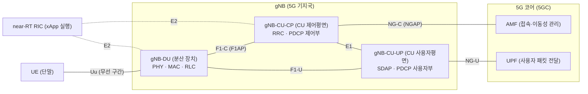
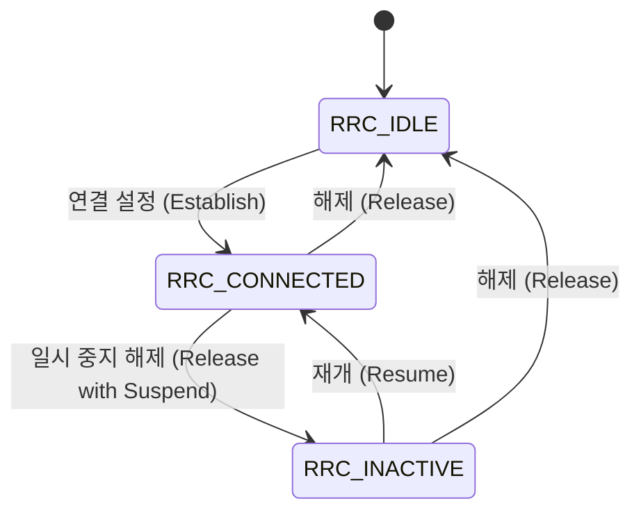
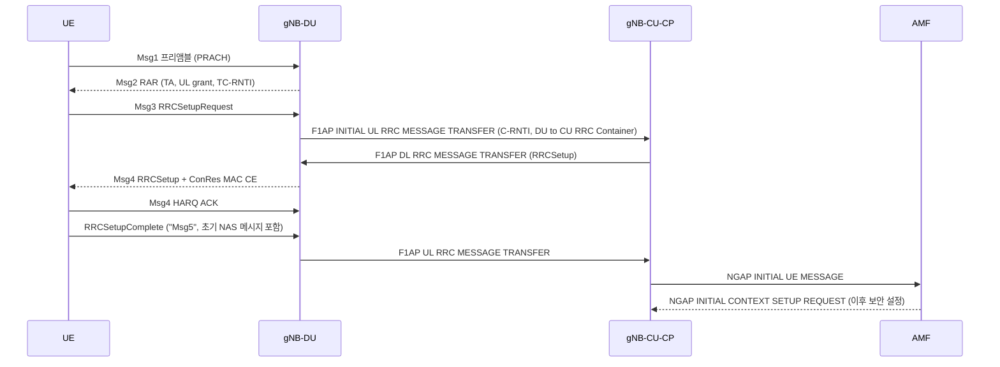
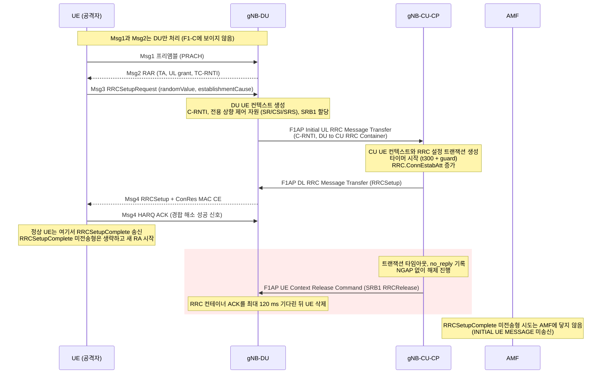

# RRC 시그널링 스톰의 원리

| 항목 | 내용 |
|---|---|
| 갱신 | 2026-10-30 |
| 문서 역할 | 팀장이 요청한 "RSS 원리 설명"에 대한 답이다. 본 프로젝트가 "RRCSetupComplete 미전송형"이라 부르는 RRC(Radio Resource Control, 무선 자원 제어) 시그널링 스톰(RSS, RRC Signaling Storm)(정의는 §1.1)이 **왜** 기지국 자원을 붙잡는지를 5G 접속의 기초부터 규격·논문·소스 코드로 설명한다. 탐지기 설계의 근거 문서이며, 다른 문서가 인용하는 OCUDU 수치의 단일 출처(§8)다. OCUDU는 팀이 쓰는 오픈소스 기지국 소프트웨어(CU/DU, §2.2)로, srsRAN(오픈소스 이동통신 기지국·단말 소프트웨어) 계열이다 |
| 선행 지식 | 없음. TCP/IP와 운영체제 기초만 가정한다. 5G를 처음 접한다면 §2부터 순서대로 읽는다 |
| 관련 문서 | [rss-landscape.md](rss-landscape.md)(변종·논문·공개 도구), [methodology.md](methodology.md)(실험 시나리오·관측·합격 기준), [tool-survey.md](tool-survey.md)(정상 UE 연결 경로·공개 공격 코드), [design.md](design.md)(재현기 설계) |
| 확인 방법·기준 버전 | 인용한 규격·논문·웹 문서·소스 코드는 2026-10-13에 직접 열어 확인했다. OCUDU는 커밋 `440cdbb`(기본 브랜치 `dev`의 끝), OAI(OpenAirInterface)는 태그 `2026.w40`(`f8f7695`) 기준이다. 이후 p5 분리형 OCUDU/OAI ZMQ 실측 결과를 2026-10-30에 보강했다 |

## 요약

기지국은 셀(기지국이 서비스하는 무선 영역 단위)마다 동시에 받을 수 있는 단말 수가 정해져 있다. 본 문서는 "단말(UE, User Equipment)이 기지국(gNB, next generation NodeB)과의 연결 설정을 끝내지 않고 중간에서 포기하기를 빠르게 반복하면, 왜 정상 단말까지 접속하지 못하게 되는가"라는 질문에 답한다. 본 문서는 이런 공격의 1차 실험 시나리오를 **RRCSetupComplete 미전송형**으로 적는다. 이는 3GPP 공식 공격 분류명이 아니라 표준 메시지명과 중단 지점을 나타내는 설명형 이름이다. RRCSetupComplete 미전송형 공격 단말은 랜덤 액세스(접속 첫 단계)와 `RRCSetup` 수신(Msg4에 대한 HARQ ACK 송신)까지는 정상 단말처럼 진행하고, 연결 설정을 끝내는 마지막 메시지 `RRCSetupComplete`만 보내지 않은 채 처음부터 다시 접속을 시도하는 일을 반복한다(정식 정의는 §3.4, §4.1) [1], [2, §V-B]. 이를 위해 3GPP 규격 다섯 개, 이 공격을 OpenAirInterface(OAI, 공개 소스 이동통신 소프트웨어)로 실험한 두 논문, 팀이 쓰는 OCUDU 기지국과 OAI의 소스 코드를 직접 읽고 서로 대조했다(목록은 참고문헌). 두 논문은 Abou Hasna·El Falou의 논문(소속 기관을 따서 이하 "KAUST 논문") [2]와 Nguyen 등의 논문 [3]이다. 첫째, OCUDU 기지국은 단말을 인증하기 훨씬 전, 랜덤 액세스의 세 번째 메시지 Msg3(초기 접속에서는 `RRCSetupRequest`를 싣는다) [4, §3.1]를 받는 시점에 단말별 상태 기록(컨텍스트)과 그 단말 전용으로 예약한 상향 제어 자원을 잡으며, Nguyen 등도 gNB가 보통 Msg3 수신 때 컨텍스트를 할당한다고 쓴다 [5, L55], [6, §8.1], [3, §IV-A]. 둘째, 규격에는 기지국이 완료 메시지(`RRCSetupComplete`)를 얼마나 기다릴지 정하는 망 쪽 타이머가 없어 미완료 시도를 붙잡아 두는 시간(보유 시간)은 구현이 정하며, OCUDU 코드상 기본값은 약 2초다 [2, §III], [7, L41]. 셋째, 완료 메시지가 오지 않으면 코어망의 AMF(Access and Mobility Management Function, 5G 코어의 접속·이동성 관리 기능)로는 아무 메시지도 가지 않으므로, 이 공격은 기지국 내부의 중앙 장치(CU)와 무선부를 맡는 분산 장치(DU) 사이의 F1 인터페이스 경계에서만 관측하고 대응할 수 있다 [6, §8.1]. 넷째, 초당 시도 수와 보유 시간의 곱이 동시 수용 한도 이상이면 포화(동시에 받을 수 있는 단말 자리가 모두 차서 새 단말을 받지 못하는 상태)가 일어나며(추론, [2, §III], [3, §IV-B]), 문헌에 자주 인용되는 KAUST 논문의 0.65초·3.61초는 보유 시간이 아니라 자리를 다 채우는 데 걸린 "채움 시간"이다 [2, §VI-A]. p5 hold32 V4는 DU ACK 확인 RRCSetupComplete 미전송형과 CU 200 도달은 입증했지만 기본 정리시간보다 공격률이 빠르다는 조건은 입증하지 못해 성공 증거에서 강등했다.

## 1. 서론

### 1.1 이 문서가 답하는 질문

팀 프로젝트는 상용 기지국의 중앙 장치를 블랙박스(내부 소스를 볼 수 없는 장비)로 가정하고, 기지국 소스를 고치지 않은 채 텔레메트리와 near-RT RIC(near-Real-Time RAN Intelligent Controller, §2.8)로 공격을 탐지하고 대응하는 폐루프를 만드는 것을 목표로 한다 [1]. 여기서 RAN(Radio Access Network, 무선 접속망)은 단말과 코어망 사이에서 기지국이 이루는 망을 가리킨다. 텔레메트리(telemetry)는 장비 내부 동작을 외부에서 수집한 관측 데이터이고, 폐루프(closed loop)는 탐지 결과로 조치를 내리고 그 효과를 다시 관측해 조정하는 순환 구조다. 그중 본 서브태스크는 그 탐지·대응기를 검증하기 위해 **파라미터가 통제되는** RRC 시그널링 스톰 재현기를 만드는 일이다 [1]. 재현기를 설계하고 탐지기의 입력을 정하려면, 공격이 어떤 메시지 순서에서 어떤 자원을 얼마 동안 붙잡는지를 먼저 알아야 한다(추론).

본 문서가 다루는 공격은 **RRCSetupComplete 미전송형**이다. 이 이름은 3GPP의 공식 공격 분류명이 아니라, 표준 메시지명과 중단 지점을 그대로 나타낸 설명형 이름이다 [1]. RRCSetupComplete 미전송형 공격 단말은 랜덤 액세스(§2.5)와 `RRCSetup` 수신(Msg4에 대한 HARQ ACK 송신)까지는 정상 단말처럼 진행한다. 그 뒤 연결 설정을 끝내는 마지막 메시지 `RRCSetupComplete`만 보내지 않고, 처음부터 다시 접속을 시도하는 일을 반복한다(정식 정의는 §3.4, §4.1) [1], [2, §V-B]. 이 문장에 나온 용어는 §2에서 차례로 설명한다. 본 문서는 다음 다섯 질문에 답한다.

1. 단말이 기지국에 처음 접속할 때 두 장치는 어떤 메시지를 주고받으며, 기지국은 그 과정에서 무엇을 할당하는가? (§2, §4)
2. "RRC 시그널링 스톰"과 본 프로젝트의 "RRCSetupComplete 미전송형"은 정확히 무엇을 가리키는가? (§3)
3. 공격자는 어떤 파라미터를 조작하고, 기지국과 환경의 어떤 설정이 효과를 좌우하는가? (§5)
4. 언제 기지국이 포화되며, 논문의 수치는 무엇을 뜻하는가? (§6, §7)
5. 팀이 쓰는 OCUDU 기지국에 대입하면 기본값은 얼마이고, 무엇이 아직 확인되지 않았는가? (§8, §9)

### 1.2 읽는 법과 표기

§2는 5G를 처음 접하는 독자를 위한 배경이다. 단말·기지국·코어의 역할, 기지국 내부의 분리 구조, 무선 프로토콜 계층, 접속 절차를 순서대로 설명하며, 이미 아는 독자는 건너뛰어도 된다. §3은 시그널링 스톰의 정의와 절차 기반 설명형 이름을 정하고, §4~§7은 RRCSetupComplete 미전송형 공격의 진행 과정, 조작 파라미터, 고갈 동역학, 변형(RRCSetupRequest 후 중단형)을 다룬다. §8은 팀이 쓰는 OCUDU의 수치를 모은 단일 출처이고, §9는 한계, §10은 팀장에게 설명하기 위한 확인 질문이다. 처음 나오는 용어는 부록 A 용어집에서 다시 찾을 수 있다.

인용은 참고문헌 번호로 표시한다. [n, §x]는 규격·논문의 절, [n, Table x]는 표, [n, L123]은 소스 파일의 줄 번호다. 저자의 추론은 "(추론)", 확인하지 못한 사항은 "(미확인)"으로 표시한다. 핵심 주장은 원문을 인용 블록으로 옮기고 한국어 번역을 붙인다. 메시지 번호 Msg1~Msg4는 4단계 랜덤 액세스의 메시지 번호이며(Msg3은 MAC 규격이 정의한 표준 용어다 [4, §3.1]), "Msg5"는 표준 용어가 아니라 `RRCSetupComplete`를 가리키는 논문 약칭이다(§2.5) [2, §II-A]. 본 문서는 같은 날짜(2026-10-13)에 메모 형식으로 쓴 판을 논문 형식으로 개정한 것이며, 본문의 "이전 판"은 그 판을 가리킨다.

본 문서가 자주 인용하는 문헌은 다음 네 가지다. [2]는 사우디아라비아 KAUST(King Abdullah University of Science and Technology)의 Abou Hasna·El Falou가 2026년 arXiv에 공개한 논문이다 [2]. 이들은 OAI 단말·기지국과 USRP(범용 SDR 장비) 두 대로 만든 실제 무선 테스트베드에서 RRCSetupComplete 미전송형 공격을 실험하고, 단말의 TA(Timing Advance, 기지국과의 거리를 대략 반영하는 값, §2.5.2) 값을 이용한 완화책을 제안했다 [2, §IV-B, §V-A, §VI]. 본 문서는 이 논문을 소속 기관을 따서 "KAUST 논문" 또는 "KAUST"로 줄여 부른다. [3]은 Nguyen 등이 2025년 arXiv에 공개한 논문으로, OAI의 RF 시뮬레이터(무선 구간을 소프트웨어로 흉내 내는 환경)에서 Msg3 직후 재시작하는 방식으로 gNB 자원을 채우고, 이를 O-RAN의 외부 응용(xApp, §2.8)으로 탐지하는 방법을 제안했다 [3, §III-C, §V-A]. [8]은 Tabiban 등이 O-RAN의 시그널링 스톰 문제와 연구 과제를 개관한 IEEE Communications Magazine 글이다 [8]. [9]는 KAUST 논문 저자가 공개한 OAI 공격 패치 리포지토리 5gattacks/5g-rrc-storm이며, KAUST 논문은 구현 공개처로 이 리포지토리를 인용한다 [2, §V-D], [9]. 본 문서는 이 패치를 "5gattacks 공격 패치"라 부른다.

### 1.3 범위

본 문서는 RRCSetupComplete 미전송형 공격의 메커니즘, 단계별 자원 할당, 타이머, 고갈 동역학, OCUDU 대입을 다룬다. 다른 변종·논문·공개 도구의 비교는 [rss-landscape.md](rss-landscape.md)에 있다 [10]. 실험 시나리오 운영, 관측 경계, 합격 기준은 [methodology.md](methodology.md)에 있다 [11]. 공개 공격 코드와 정상 UE 연결 경로의 재사용 범위는 [tool-survey.md](tool-survey.md)에 있다 [12]. 재현기 설계는 [design.md](design.md)에 있다 [13]. 이번 조사에서 찾은 사실 가운데 기존 문서(methodology.md, tool-survey.md, AGENTS.md)와 어긋난 점은 [rss-landscape.md](rss-landscape.md) 부록 A에 모았고 [10], 이 문서의 이전 판 대비 문헌 위치 정정은 §9의 8번에 적었다.

## 2. 배경: 5G 접속의 기초

휴대폰이 기지국에 접속할 때, 두 장치는 정해진 순서로 제어 메시지를 주고받아 RRC 연결이라는 논리적 연결을 맺는다 [14, §5.3.3.1]. 쉽게 말해 이 연결은 "이 단말에게 무선 자원을 어떻게 쓰게 할지"에 대한 두 장치의 합의다(추론). 그 합의 결과를 기지국이 단말마다 기억해 두는 기록이 **컨텍스트**이며, RRCSetupComplete 미전송형 공격은 바로 이 기록과 그에 딸린 자원을 노린다 [2, §II-A, §III]. 이 절은 그 과정을 이해하는 데 필요한 장치, 인터페이스, 계층, 상태, 메시지를 처음부터 설명한다.

### 2.1 UE·gNB·5G 코어(제어평면과 사용자평면)

5G 시스템은 세 부분으로 나눠 볼 수 있다. **UE(User Equipment, 단말)**는 휴대폰처럼 무선으로 기지국에 접속하는 장치다 [2, §I]. 본 프로젝트의 p5 ZMQ 재현기는 OAI `2026.w38` UE를 베이스로 확정해 DU ACK 확인 RRCSetupComplete 미전송형과 RRCSetupRequest 후 중단형을 검증했다. srsRAN의 소프트웨어 단말인 srsUE는 15 kHz SCS/FDD 셀의 별도 후보일 뿐 현재 재현기 베이스가 아니다. 무선 경로는 P5에서 ZMQ(ZeroMQ) 가상 RF로 검증했고, SDR(Software-Defined Radio)을 쓰는 차폐 OTA(Over-The-Air)는 다음 호환성 관문으로 남아 있다. OAI(OpenAirInterface)는 단말, 기지국, 코어를 모두 구현한 공개 소프트웨어로, 단말의 접속 동작을 직접 고칠 수 있어 공격 연구에 쓰인다 [2, §V-A]. **gNB(next generation NodeB, 5G 기지국)**는 UE를 향해 NR(5G 무선)의 사용자평면과 제어평면 프로토콜을 종단하는 무선 접속망 노드다 [15, §4.1]. 어떤 프로토콜을 "종단한다(terminate)"는 것은 그 프로토콜의 상대편 끝점이 되어 메시지를 해석하고 처리한다는 뜻이며, TCP 연결의 양 끝점과 같다. **5GC(5G Core, 5G 코어)**는 gNB 뒤의 코어망이며, gNB는 NG 인터페이스로 코어에 연결된다 [15, §4.1]. 이 문서에서 상향(uplink, UL)은 단말에서 기지국으로, 하향(downlink, DL)은 기지국에서 단말로 가는 방향이다.

코어에서 본 문서에 필요한 기능은 둘이다. **AMF(Access and Mobility Management Function)**는 5G 코어의 접속·이동성 관리 기능으로, gNB와는 NG-C 인터페이스로 연결되고 NAS(Non-Access Stratum, 단말과 코어가 기지국을 거쳐 주고받는 제어 계층) 시그널링 종단, 접속 인증, 이동성 관리 등을 맡는다 [15, §4.1, §4.2]. **UPF(User Plane Function)**는 NG-U 인터페이스로 연결되어 사용자 패킷의 라우팅과 전달을 맡는다 [15, §4.1, §4.2]. 한편 gNB 자신은 무선 자원 관리, 무선 수락 제어(Radio Admission Control), 연결 설정과 해제, 상향·하향 자원의 동적 할당(스케줄링) 같은 기능을 맡는다 [15, §4.2].

이 구분 밑에는 **제어평면**과 **사용자평면**의 구분이 있다. 사용자평면은 SDAP·PDCP·RLC·MAC 계층을 거쳐 실제 데이터 패킷을 나르는 경로이고, 제어평면은 RRC와 NAS 같은 제어 프로토콜이 연결을 맺고 관리하는 경로다 [15, §4.4.1, §4.4.2]. 각 계층은 §2.3에서 설명한다. 그중 SDAP(Service Data Adaptation Protocol)는 사용자평면에만 있는 계층이며 [15, §6.1], 본 문서의 공격과는 관계가 없으므로 이름만 알아 두면 된다. TCP/IP에 익숙한 독자라면, 실제 데이터를 나르는 경로와 연결을 맺고 관리하기 위한 신호를 나르는 경로가 따로 있다고 이해하면 된다(추론).

이 구분이 중요한 이유는 RRCSetupComplete 미전송형 공격이 사용자 데이터가 한 바이트도 오가기 전, 그리고 코어(AMF)가 단말을 알기 전, 제어평면의 초기 단계에서만 일어나기 때문이다(§4) [6, §8.1].

### 2.2 gNB 분리 구조: CU·DU·F1(O-RAN 포함)

5G 규격은 gNB 하나를 여러 논리 노드로 나눌 수 있게 한다 [6, §6.1.1]. gNB는 **CU(Central Unit, 중앙 장치)** 하나와 하나 이상의 **DU(Distributed Unit, 분산 장치)**로 구성될 수 있으며, 둘은 **F1** 인터페이스로 연결된다 [6, §6.1.1]. CU는 RRC·SDAP·PDCP 프로토콜을 담당하는 논리 노드이고, DU는 RLC·MAC·PHY 계층을 담당하며 하나 이상의 셀을 지원한다 [6, §3.1]. 셀(cell)은 기지국이 특정 주파수 대역에서 서비스하는 무선 영역 단위이며(용어 풀이), 한 셀 안의 단말들은 기지국의 스케줄링에 따라 그 셀의 무선 자원을 나눠 쓴다 [15, §4.2]. CU는 다시 **CU-CP(CU Control Plane, CU 제어평면)**와 **CU-UP(CU User Plane)**로 나눌 수 있다 [6, §6.1.2]. CU-CP는 RRC와 PDCP의 제어평면 부분을 담당하며 DU와는 **F1-C(F1 제어평면)**로, CU-UP와는 E1 인터페이스로 연결된다 [6, §3.1, §6.1.2]. F1 위에서 쓰는 시그널링 프로토콜이 **F1AP(F1 Application Protocol)**다 [16, §1].

외부에서 보면 이 분리는 보이지 않는다. 규격은 다음처럼 말한다.

> "The gNB-CU and connected gNB-DUs are only visible to other gNBs and the 5GC as a gNB." [6, §6.1.1]
> (번역) gNB-CU와 그에 연결된 gNB-DU들은 다른 gNB와 5GC에게 하나의 gNB로만 보인다.

또 NG 인터페이스는 CU에서 종단된다 [6, §6.1.1]. 즉 코어(AMF)와 대화하는 것은 CU뿐이고, 무선 신호와 직접 맞닿는 것은 DU뿐이다(추론).

**O-RAN(Open RAN)**은 이 분리를 더 밀고 나가 기지국 기능을 O-CU, O-DU, O-RU(무선 장치)로 나누고, 각 장치를 다른 위치와 플랫폼에 배치할 수 있게 하는 구조다 [8, §II]. 이 구조에서 O-CU는 연결의 수명 주기를 관리하고, O-DU는 기저대역 처리(무선 신호와 비트 사이를 변환하는 디지털 신호 처리)를, O-RU는 무선 신호와 디지털 신호의 변환을 맡는다 [8, §II]. 본 프로젝트의 테스트베드는 노트북 C(공격자 UE)가 RF(무선 주파수) 차폐 상자 너머의 노트북 B(O-DU)와 무선으로 통신하고, 노트북 B가 F1(IP 네트워크)로 노트북 A(O-CU, RIC, eBPF 텔레메트리, 대응)와 연결되는 구성이다 [1]. 기지국 소프트웨어로는 srsRAN(오픈소스 이동통신 기지국·단말 소프트웨어) 계열의 오픈소스 CU/DU인 **OCUDU**를 쓴다 [1].

그림 1은 본 문서가 다루는 장치와 인터페이스를 한눈에 보여 준다. 실선은 3GPP 인터페이스, 점선은 O-RAN의 E2 인터페이스(§2.8)이며, 괄호 안은 해당 장치가 담당하는 계층 또는 기능이다.

그림 1. 분리형 gNB와 5G 코어의 구성. 인터페이스와 계층 배치는 TS 38.401 §3.1, §6.1.1–§6.1.2와 TS 38.300 §4.1을, E2는 Tabiban 등 §II를 따랐다 [6, §3.1, §6.1], [15, §4.1], [8, §II].

이 분리 구조가 중요한 이유는 **어디에서 무엇이 보이는가**를 정하기 때문이다. 단말과의 무선 절차는 DU의 MAC·PHY가 처리하므로, CU는 DU가 F1으로 넘겨 준 RRC 메시지만 본다(추론, [6, §3.1], [16, §8.4.1.1]). 팀의 탐지기가 CU 쪽 F1-C를 관측한다면, DU 안에서만 끝나는 단계는 탐지기에 직접 보이지 않는다(§2.7, §4.3) [1].

### 2.3 무선 프로토콜 계층과 RRC의 역할

#### 2.3.1 계층 구조

단말과 기지국 사이의 무선 구간(Uu)에서는 여러 계층의 프로토콜이 쌓여 동작한다 [15, §4.4.2]. 표 1은 제어평면에 관여하는 계층을 아래에서 위로 나열하고, 각 계층이 하는 일과 망 쪽에서 어느 장치가 그 계층을 종단하는지를 보여 준다. 각 행이 계층 하나이고, 마지막 열이 그 계층을 처리하는 망 쪽 장치다.

표 1. 무선 프로토콜 계층과 망 쪽 종단 장치

| 계층 | 주요 기능 | 망 쪽 종단 |
|---|---|---|
| PHY(물리 계층) | 실제 무선 신호의 송수신. 프리앰블, 상향 제어 채널 등 [15, §5.3.3, §5.3.4] | DU [6, §3.1] |
| MAC(Medium Access Control) | 논리 채널과 전송 채널의 매핑, HARQ를 통한 오류 정정, 단말 간 동적 스케줄링 [15, §6.2.1] | DU [6, §3.1] |
| RLC(Radio Link Control) | 상위 PDU 전달, 분할·재조립, ARQ 재전송(AM 모드) [15, §6.3.2] | DU [6, §3.1] |
| PDCP(Packet Data Convergence Protocol) | 암호화·복호화, 무결성 보호·검증, 순서 번호 관리 [15, §6.4.1] | CU. 제어평면 부분은 CU-CP [6, §3.1] |
| RRC(Radio Resource Control, 무선 자원 제어) | RRC 연결의 설정·유지·해제, 시스템 정보 방송, 보안, 무선 베어러 설정, 이동성, NAS 메시지 전달 [15, §7.1] | CU-CP [6, §3.1] |
| NAS(Non-Access Stratum) | 단말과 코어 사이의 제어 계층. 인증, 이동성 관리, 보안 제어 [15, §4.4.2] | AMF [15, §4.4.2] |

이 표에서 기억할 것은 마지막 열이다. PHY·MAC·RLC는 DU에, PDCP·RRC는 CU에 있으므로, 이후 "무엇이 CU에서 보이는가"가 여기서 정해진다(추론, [6, §3.1]). 기능 열의 세부 용어, 곧 PDU(Protocol Data Unit, 계층이 주고받는 데이터 단위), ARQ(Automatic Repeat reQuest, 수신 확인에 따른 재전송), AM(Acknowledged Mode, 수신 확인을 쓰는 RLC 전송 모드 [15, §6.3.1])은 본 문서의 논지에 필요하지 않다.

이 문서에서는 PHY/MAC/RLC/PDCP를 묶어 무선 프로토콜 "하위 계층"이라 부른다. **HARQ(Hybrid Automatic Repeat reQuest)**는 MAC 계층이 관리하는 빠른 재전송 기능이다 [15, §6.2.1]. 물리 계층(계층 1)으로 한 번 보낸 데이터 묶음(전송 블록, TB)이 상대에게 제대로 도착했는지 확인하고, 규격은 이를 "계층 1에서 상대 엔티티(맞은편의 같은 계층 구현) 사이의 전달을 보장하는 기능"이라고 쓴다 [15, §6.2.4]. 수신 측은 전송 블록을 받으면 **ACK(수신 확인)**를 돌려보내고, 이 ACK가 §2.5에서 중요한 역할을 한다 [4, §5.3.2.2]. TCP의 ACK와 비슷하지만, 무선 구간 한 홉에서 수 ms 단위로 동작한다는 점이 다르다(추론).

#### 2.3.2 RRC는 왜 필요한가

**RRC(Radio Resource Control, 무선 자원 제어)**는 단말과 gNB 사이의 연결을 맺고 관리하는 제어 프로토콜이다 [15, §7.1]. 기지국은 셀 안의 여러 단말에게 무선 자원을 동적으로 나눠 준다 [15, §4.2]. 그래서 단말마다 어떤 신호용 베어러를 쓰고, 어떤 보안 설정을 적용하고, 어떤 측정을 보고하게 할지를 정해 알려 줘야 하며, 이것이 RRC가 맡은 기능이다 [15, §7.1]. RRC는 이 설정을 주고받는 통로이며, 단말과 코어 사이의 NAS 메시지도 RRC 메시지에 실려 전달된다 [15, §7.1]. Tabiban 등은 RRC가 단말과 기지국 사이에서 쓰이는 네트워크 계층 프로토콜이며 시그널링 스톰 공격에 흔히 악용된다고 설명한다 [8, §III]. 여기서 "네트워크 계층"은 무선 프로토콜 스택의 계층 3을 가리키며, TCP/IP의 IP 계층과는 다른 뜻이다(용어 풀이).

RRC 메시지는 **SRB(Signalling Radio Bearer, 신호 무선 베어러)**라는 통로로 오간다 [14, §4.2.2]. SRB0은 공통 제어 채널(CCCH)을 쓰는 RRC 메시지용이고, SRB1은 전용 제어 채널(DCCH)을 쓰는 RRC 메시지와 일부 NAS 메시지용이다 [14, §4.2.2]. 접속 요청(`RRCSetupRequest`)과 그 응답(`RRCSetup`, `RRCReject`)은 아직 전용 통로가 없으므로 SRB0으로, 완료 메시지(`RRCSetupComplete`)는 `RRCSetup`이 만들어 준 SRB1으로 전달된다 [14, §6.2.2].

#### 2.3.3 컨텍스트란 무엇이고 왜 비싼가

**컨텍스트(context)**는 기지국이 연결 하나를 추적하려고 단말마다 유지하는 기록과 예약 자원이다. KAUST 논문은 이를 단말 연결을 추적하는 데 쓰이는 내부 메모리와 예약된 자원("the internal memory and reserved resources used to track the UE connection")으로 정의한다 [2, §II-A].

규격도 연결 상태(`RRC_CONNECTED`, §2.4)의 단말에 대해서는 단말의 AS(Access Stratum, 단말과 무선 접속망 사이의 계층) 컨텍스트가 무선 접속망과 단말 양쪽에 저장된다고 정한다 [15, §7.2]. TCP에 빗대면, 서버 운영체제가 연결마다 TCB(Transmission Control Block)라는 상태 구조체를 메모리에 두고, 메모리 고갈을 막으려고 동시에 존재할 수 있는 TCB 수를 제한하는 것과 비슷하다 [17, §2]. 다만 기지국 컨텍스트는 메모리만이 아니라 **무선 자원**까지 묶는다는 점에서 TCB와 다르다(추론, 아래 근거).

컨텍스트가 비싼 이유는 단말마다 주기적으로 쓸 상향 자원을 미리 예약하기 때문이다 [18, L201]. 단말마다 따로 배정되는 상향 자원은 세 가지다. 둘은 **PUCCH(Physical Uplink Control Channel)**로 보내는 SR과 CSI 보고를 위한 자원이고, 하나는 PUCCH와 별개인 기준 신호 SRS의 자원이다 [15, §5.3.3, §5.3.5.1]. PUCCH는 단말이 상향 제어 정보(UCI, Uplink Control Information)를 기지국으로 보내는 물리 채널이다 [15, §5.3.3].

- **SR(Scheduling Request)**: 단말이 보낼 데이터가 생겼는데 쓸 상향 자원이 없을 때 자원을 요청하는 신호다 [15, §10.4]. SR 설정은 SR용 PUCCH 자원의 묶음이며 [4, §5.4.4], 그 주기와 오프셋은 RRC가 정한다 [14, §6.3.2]. 단말은 보낼 데이터가 언제 생길지 모르므로, 연결된 단말이 언제든 자원을 요청할 수 있도록 주기적인 SR 기회를 미리 나눠 주는 것이다(추론).
- **CSI(Channel State Information)**: 단말이 하향 채널 상태를 측정해 기지국에 되돌려 보내는 정보로, 기지국의 전송 방식 조정에 쓰인다 [15, §5.2.5.1].
- **SRS(Sounding Reference Signal)**: 기지국이 상향 채널 상태를 추정하도록 단말이 보내는 기준 신호다 [15, §5.3.5.1].

이 자원이 왜 한정되는지 보려면 무선 자원의 단위를 알아야 한다. 무선 자원은 시간과 주파수 두 축으로 나뉜다. 시간 축에서 NR 전송은 10 ms 프레임과 1 ms 서브프레임으로 나뉘고, 서브프레임은 부반송파 간격에 따라 정수 개의 슬롯으로 나뉘며, 슬롯 하나는 정규 CP(Cyclic Prefix, 일반 설정)에서 14 심볼이다 [15, §5.1]. 심볼은 시간 축의 가장 작은 전송 단위다. 주파수 축에서는 부반송파(subcarrier, 대역을 잘게 나눈 개별 주파수) 12개가 모여 **PRB(Physical Resource Block, 물리 자원 블록)** 하나를 이룬다 [15, §5.1]. PUCCH가 같은 PRB에 함께 실을 수 있는 단말 수는 형식에 따라 유한하다 [15, §5.3.3]. 예를 들어 1~2심볼 짧은 형식(Format 0)은 1비트 정보일 때 같은 PRB에 최대 6개 단말을 다중화한다 [15, §5.3.3]. 셀은 PUCCH용으로 대역의 일부만 떼어 두고 단말마다 겹치지 않는 주기적 SR·CSI 전송 기회를 미리 나눠 주므로, 줄 수 있는 설정의 개수는 셀 설정에 따라 유한하다(추론, [15, §5.3.3], [4, §5.4.4]). OCUDU는 이 개수를 셀 하나가 받을 수 있는 단말 수의 한도로 쓴다.

> "// The number of supported UEs is bounded by the lowest of the available SR, CSI and SRS resources." [18, L201]
> (번역) 지원 가능한 단말 수는 가용한 SR, CSI, SRS 자원 중 가장 적은 것에 의해 제한된다.

따라서 연결을 끝내지 않을 단말에게 컨텍스트를 내주면, 정상 단말이 쓸 수 있는 한정된 자리 하나가 그동안 사라진다(추론, [18, L197–L212]). 이것이 RRCSetupComplete 미전송형 공격이 성립하는 경제적 이유다(추론).

### 2.4 RRC 상태

단말은 RRC 관점에서 항상 세 상태 중 하나에 있다 [14, §4.2.1]. RRC 연결이 맺어져 있으면 **RRC_CONNECTED** 또는 **RRC_INACTIVE**이고, 연결이 없으면 **RRC_IDLE**이다 [14, §4.2.1].

- **RRC_IDLE**: RRC 연결이 없는 상태다. 단말은 시스템 정보를 읽고, 셀을 다시 고르며, 코어가 보내는 호출(paging)을 감시한다 [14, §4.2.1], [15, §7.2].
- **RRC_CONNECTED**: 코어와 무선 접속망 사이의 연결이 맺어져 있고, 단말의 AS 컨텍스트가 무선 접속망과 단말에 저장되며, 단말이 데이터를 주고받는 상태다 [15, §7.2].
- **RRC_INACTIVE**: 연결을 일시 중지한 상태다. 코어와 무선 접속망 사이 연결은 유지되고, 단말의 Inactive AS 컨텍스트가 무선 접속망과 단말에 저장된다 [15, §7.2].

그림 2는 세 상태 사이의 전이를 보여 준다. 화살표 라벨은 전이를 일으키는 절차다.

그림 2. NR 단말의 RRC 상태 기계. TS 38.331 Figure 4.2.1-1을 옮겼다 [14, §4.2.1].

RRCSetupComplete 미전송형 공격은 `RRC_IDLE`에서 `RRC_CONNECTED`로 가는 첫 전이, 즉 연결 설정 절차(§2.6)를 반복한다(§4). 한편 §3.4의 RRCResume 반복형, 즉 `RRC_INACTIVE`에서 연결을 재개하는 절차를 반복하는 공격은 망이 먼저 단말을 일시 중지시켜야 하는데, OCUDU CU-CP는 `RRC_INACTIVE` 사용이 기본으로 꺼져 있다 [19, L531–L532]. 덧붙여 논문들이 쓰는 "half-open"(반열림)은 기지국 쪽 미완료 설정 절차를 가리키는 표현이며 RRC 상태 이름이 아니다 [2, §III], [14, §4.2.1].

### 2.5 랜덤 액세스

#### 2.5.1 왜 필요한가

`RRC_IDLE` 단말은 아직 기지국과 상향 동기가 맞지 않고 자기 몫의 상향 자원도 없으므로, 먼저 **RA(Random Access, 랜덤 액세스)** 절차로 상향 동기를 맞추고 처음 쓸 무선 자원을 얻는다 [2, §II-A]. 랜덤 액세스는 `RRC_IDLE`에서의 초기 접속, 연결 재수립, `RRC_INACTIVE`에서의 재개 등 여러 사건으로 시작된다 [15, §9.2.6]. 단말은 셀이 방송하는 시스템 정보, 특히 SIB1(System Information Block 1)에서 랜덤 액세스 파라미터를 읽은 뒤 절차를 시작한다 [2, §II-A].

#### 2.5.2 4단계 경합 기반 랜덤 액세스

여러 단말이 같은 자원을 동시에 고를 수 있는 방식을 **경합 기반 랜덤 액세스(CBRA, Contention-Based Random Access)**라 한다(용어 풀이, 명칭은 [15, §9.2.6]). 4단계 방식의 흐름은 다음과 같다.

1. **Msg1 — 프리앰블**: 단말은 **PRACH(Physical Random Access Channel)** 위에서 **프리앰블(preamble)**이라는 정해진 신호 열 중 하나를 무작위로 골라 보낸다 [15, §9.2.6], [2, §II-A]. 사용할 수 있는 프리앰블과 PRACH 시간·주파수 자원은 SIB1으로 알려진다 [2, §II-A].
2. **Msg2 — RAR(Random Access Response, 랜덤 액세스 응답)**: 단말은 정해진 시간 창 동안 기지국의 응답을 기다린다 [15, §9.2.6]. RAR에는 상향 송신 시점을 조정하는 **TA(Timing Advance) 명령**, Msg3을 보낼 상향 자원 허가(UL grant), 그리고 16비트 임시 식별자 **TC-RNTI(Temporary C-RNTI)**가 들어 있다 [4, §6.2.3]. TC-RNTI는 Msg1을 받은 기지국(DU)이 정해 Msg2로 알리는 값이다(추론, [4, §6.2.3]).
3. **Msg3 — 첫 상위 계층 메시지**: 단말은 받은 상향 자원으로 Msg3을 보낸다 [15, §9.2.6]. 초기 접속에서 Msg3은 `RRCSetupRequest`를 싣는 첫 상위 계층 메시지다 [2, §II-A].
4. **Msg4 — 경합 해소**: 기지국은 Msg3에서 받은 식별 정보를 되돌려 보내 어느 단말이 경합에서 이겼는지 확정한다 [2, §II-A], [4, §5.1.5]. 초기 접속에서는 `RRCSetup`이 Msg4와 함께 전달된다 [2, §II-A].

**RNTI(Radio Network Temporary Identifier, 무선 구간 임시 단말 식별자)**는 무선 구간에서 스케줄링과 전송의 대상을 가리키는 식별자다 [15, §8.1]. 셀 수준 스케줄링에는 RRC 연결의 식별자 겸 스케줄링 식별자인 **C-RNTI(Cell RNTI)**가 쓰이고, 랜덤 액세스 중에는 RA-RNTI(RAR 수신용)와 TC-RNTI(절차 중 임시 스케줄링용)가 쓰인다 [15, §8.1]. RA-RNTI는 Msg1의 시간·주파수 자원에서 계산되므로 특정 단말 하나를 가리키지 않는다 [2, §II-B]. 그래서 Msg1·Msg2 단계에서 기지국은 어느 단말의 시도인지 구별할 수단이 없다(추론).

#### 2.5.3 경합 해소와 HARQ ACK

**경합 해소(contention resolution, ConRes)**는 같은 프리앰블을 고른 단말들 중 누가 이겼는지 가리는 단계다 [2, §II-A]. 단말은 Msg3을 보내자마자 `ra-ContentionResolutionTimer`를 시작하고, 그동안 기지국의 응답을 감시한다 [4, §5.1.5]. 응답 안의 **UE Contention Resolution Identity MAC CE**(MAC 제어 요소)가 자기가 Msg3에 실어 보낸 CCCH 메시지와 일치하면 단말은 경합 해소 성공으로 판단하고, TC-RNTI를 자신의 C-RNTI로 삼는다 [4, §5.1.5]. 일치하지 않거나 타이머가 만료되면 실패로 간주하고 Msg1부터 다시 시작한다 [4, §5.1.5], [15, §9.2.6]. 타이머 값은 기지국이 셀 공통 랜덤 액세스 설정(`RACH-ConfigCommon`)으로 알리며, 8~64 서브프레임(sf8~sf64, 1 서브프레임 = 1 ms) 중 하나다 [14, §6.3.2], [15, §5.1].

이 타이머는 규격상 단말 타이머다 [4, §5.1.5]. 다만 기지국 구현도 Msg4에 대한 ACK가 올 때까지를 재는 자체 타이머를 두며, 만료 때의 동작은 구현마다 다르다. OAI 기지국은 이 값에 약간의 여유를 더한 타이머가 만료되면 단말을 해제하고 [20, L818–L830, L2211–L2221], OCUDU 스케줄러는 ACK 전에 타임아웃되면 단말을 비활성화할 뿐이다 [21, L425–L437]. 이 차이가 §7에서 다루는 RRCSetupRequest 후 중단형 결과 차이의 근거가 된다(추론, §7.1, §8.3).

여기서 **HARQ ACK**가 결정적인 역할을 한다. 규격은 TC-RNTI로 받은 전송에 대해서는 경합 해소가 성공하기 전까지 ACK를 만들지 않도록 정한다.

> "if the HARQ process is associated with a transmission indicated with a Temporary C-RNTI and the Contention Resolution is not yet successful (see clause 5.1.5); ... not instruct the physical layer to generate acknowledgement(s) of the data in this TB." [4, §5.3.2.2]
> (번역) HARQ 프로세스가 Temporary C-RNTI로 지시된 전송에 연결되어 있고 경합 해소가 아직 성공하지 않았다면, … 이 전송 블록의 데이터에 대해 물리 계층에 ACK 생성을 지시하지 않는다.

따라서 기지국 입장에서 Msg4에 대한 HARQ ACK는 "이 단말이 경합에서 이겼고 Msg4를 제대로 받았다"는 신호다(추론, [4, §5.1.5, §5.3.2.2]). KAUST도 이 ACK를 규격이 요구하는 동작으로 설명한다 [2, §V-B]. 이 ACK는 MAC·PHY에서 처리되므로 DU 안에서 끝난다(추론, [6, §3.1]).

#### 2.5.4 한 번에 하나, 그리고 2단계 방식

규격은 MAC 엔티티 하나에서 어느 시점에든 랜덤 액세스 절차가 하나만 진행된다고 정한다 [4, §5.1.1]. MAC 엔티티는 단말 안에서 MAC 기능을 수행하는 단위이며, 두 기지국에 동시에 붙는 이중 연결(SCG)이나 특수한 핸드오버(DAPS)가 설정된 경우에만 단말에 둘이 생긴다 [4, §4.2.2]. 초기 접속 중인 단말에는 MAC 엔티티가 하나뿐이므로, 단말 소프트웨어 인스턴스 하나는 한 번에 한 시도만 진행할 수 있고, 만들 수 있는 시도율에도 상한이 있다(추론, §5.1).

NR에는 **2단계 랜덤 액세스**도 있다. 2단계 방식에서는 프리앰블과 PUSCH(Physical Uplink Shared Channel, 상향 공유 채널) 데이터를 묶은 MsgA를 한 번에 보내고 MsgB로 응답을 받는다 [15, §9.2.6]. OCUDU는 2단계 방식을 선택 설정으로 지원하며 기본값은 꺼져 있다 [22, L1330]. 2단계 방식이 켜진 셀에서는 Msg 번호 체계와 RRCSetupComplete 미전송형의 개입 지점이 달라지므로 실행마다 이를 기록해야 한다(추론, [13, §8]).

표 2는 4단계 랜덤 액세스와 RRC 연결 설정의 메시지를 한 줄씩 정리한다. "처리 장치"는 분리형 gNB에서 그 메시지를 직접 처리하는 쪽이다.

표 2. 초기 접속 메시지와 처리 장치

| 메시지 | 방향 | 주요 내용 | 처리 장치 |
|---|---|---|---|
| Msg1 프리앰블 | UE→gNB | PRACH 위의 무작위 프리앰블 [15, §9.2.6] | DU(MAC·PHY) [6, §3.1] |
| Msg2 RAR | gNB→UE | TA 명령, UL grant, TC-RNTI [4, §6.2.3] | DU |
| Msg3 `RRCSetupRequest` | UE→gNB | 초기 UE identity, 접속 원인 [14, §6.2.2] | DU가 받아 CU-CP로 전달 [6, §8.1] |
| Msg4 `RRCSetup` + ConRes MAC CE | gNB→UE | SRB1 설정, 경합 해소 식별자 [14, §6.2.2], [4, §5.1.5] | CU-CP가 만들고 DU가 송신 [6, §8.1] |
| Msg4 HARQ ACK | UE→gNB | 경합 해소 성공 시에만 생성 [4, §5.3.2.2] | DU |
| "Msg5" `RRCSetupComplete` | UE→gNB | 연결 설정 완료, 초기 NAS 메시지 [14, §5.3.3.1] | DU가 받아 CU-CP로 전달 [6, §8.1] |

"Msg5"는 표준 용어가 아니다. KAUST는 `RRCSetupComplete`가 문헌에서 흔히 Msg5로 불린다고 적었다 [2, §II-A]. 이 번호는 4단계 랜덤 액세스를 전제로 한 편의 표기이며, 5단계 랜덤 액세스라는 표준 절차가 있는 것은 아니다 [15, §9.2.6], [11, §3].

### 2.6 RRC 연결 설정

#### 2.6.1 세 메시지

RRC 연결 설정은 `RRCSetupRequest` → `RRCSetup` → `RRCSetupComplete`의 세 메시지로 이루어지고, 망이 거절하면 `RRCSetupRequest` → `RRCReject`로 끝난다 [14, §5.3.3.1]. 이 절차의 목적은 RRC 연결을 맺는 것이며, 그 과정에서 SRB1이 만들어지고 단말의 첫 NAS 메시지가 망으로 전달된다 [14, §5.3.3.1]. 단말은 상위 계층이 연결을 요청할 때 `RRC_IDLE` 상태에서 이 절차를 시작하고, 시작과 동시에 타이머 **T300**을 켠 뒤 `RRCSetupRequest`를 보낸다 [14, §5.3.3.2].

`RRCSetup`을 받은 단말은 T300을 멈추고 `RRC_CONNECTED`로 들어간다 [14, §5.3.3.4]. 그다음 SRB1으로 `RRCSetupComplete`를 보내 설정을 끝낸다 [14, §5.3.3.4, §6.2.2]. 이 완료 메시지가 단말의 첫 NAS 메시지(초기 등록 요청 등)를 망으로 나른다 [14, §5.3.3.1], [2, §I].

#### 2.6.2 초기 UE identity와 접속 원인

`RRCSetupRequest`의 정보 필드는 두 개뿐이며(나머지 1비트는 예비), 하나는 `ue-Identity`(초기 UE identity), 다른 하나는 `establishmentCause`(접속 원인)다 [14, §6.2.2]. 초기 UE identity는 둘 중 하나다.

- **5G-S-TMSI**를 상위 계층이 알려 주면, 그 오른쪽 39비트(`ng-5G-S-TMSI-Part1`)를 넣는다 [14, §5.3.3.3, §6.2.2]. 5G-S-TMSI는 5G 코어가 부여하는 임시 단말 식별자이며, 단말이 현재 셀의 추적 영역에 등록되어 있을 때 상위 계층이 제공한다 [14, §6.3.2, §5.3.3.3]. 여기서 등록(registration)은 단말이 코어(AMF)에 자신을 알리는 NAS 절차이고(용어 풀이), 추적 영역(tracking area)은 코어가 단말 위치를 관리하는 영역 단위로 TAI라는 식별자로 구분된다 [15, §8.2].
- 그렇지 않으면 0부터 2^39−1 사이의 39비트 무작위 값(`randomValue`)을 뽑아 넣는다 [14, §5.3.3.3].

이 필드는 하위 계층의 경합 해소를 돕기 위한 것이다 [14, §6.2.2]. 가입자의 영구 식별자, 예컨대 IMSI(International Mobile Subscriber Identity, 국제 이동 가입자 식별번호) [14, §3.2]를 실을 자리는 `RRCSetupRequest`에 없다 [14, §6.2.2]. OAI 단말은 `RRCSetupRequest`를 만들 때마다 무작위 바이트를 새로 뽑고 [23, L374–L390], 5G-S-TMSI가 없으면 이 무작위 값을 넣는다 [24, L706–L725]. 따라서 등록에 성공한 적 없는 공격 단말은 매 시도마다 새 무작위 값을 보내도 규격에 어긋나지 않으며, 기지국은 Msg3만으로 같은 단말인지 알 수 없다(추론, [2, §III]).

접속 원인은 emergency, highPriorityAccess, mo-Signalling, mo-Data 등 열거값 중 하나이며, 규격은 gNB가 모르는 원인 값 때문에 요청을 거절하지는 않을 것으로 기대한다고 적는다 [14, §6.2.2]. 공격자가 원인 값을 바꿔 우선 수용을 얻을 수 있는지가 문제가 될 수 있는데, OCUDU는 이 값을 지표 기록에만 쓴다(§8.2).

#### 2.6.3 T300, RRCReject, waitTime, T302

이 절에서 다루는 연결 설정 타이머 T300과 T302는 모두 **단말 쪽** 타이머다 [14, §7.1.1]. 표 3은 두 타이머가 언제 시작하고 멈추며 만료 시 무엇을 하는지 보여 준다. 표의 "셀 재선택"은 단말이 다른 셀로 옮겨 가는 것을 말한다.

표 3. RRC 연결 설정에 관련된 단말 타이머

| 타이머 | 시작 | 정지 | 만료 시 | 값의 출처 |
|---|---|---|---|---|
| T300 | `RRCSetupRequest` 송신 시 | `RRCSetup` 또는 `RRCReject` 수신, 셀 재선택, 상위 계층의 연결 설정 중단 시 | 이번 시도를 실패로 보고 MAC을 초기화한 뒤 상위 계층에 연결 설정 실패를 알린다 [14, §5.3.3.7] | SIB1의 `ue-TimersAndConstants`, 100~2000 ms [14, §6.3.2] |
| T302 | RRC 연결 설정이나 재개 중 `RRCReject` 수신 시(단 `waitTime`이 있을 때만 [14, §5.3.15.2]), `waitTime`이 있는 `RRCRelease` 수신 시 | `RRC_CONNECTED`·`RRC_IDLE` 진입, 셀 재선택, 새 `RRCReject` 수신 시 | 상위 계층에 접속 제한 해제 통지 | `RRCReject`의 `waitTime`, 1~16초 [14, §6.3.2] |

표의 시작·정지·만료 열은 TS 38.331 §7.1.1을 옮기고, T302 시작 조건의 `waitTime` 단서는 §5.3.15.2에서 더했다 [14, §7.1.1, §5.3.15.2]. `RRCReject`를 받은 단말은 T300을 멈추고 MAC을 리셋하며, `waitTime`이 들어 있을 때만 그 값으로 T302를 시작하고, 상위 계층에 연결 설정 실패를 알린다 [14, §5.3.15.2]. `waitTime`은 선택 필드라서 망이 넣지 않을 수도 있다 [14, §6.2.2].

여기서 핵심은 **망 쪽에는 `RRCSetupComplete`를 기다리는 표준 타이머가 없다**는 점이다 [2, §III]. T300은 단말이 `RRCSetup`을 기다리는 타이머이고, T302는 단말의 재시도 대기 타이머다 [14, §7.1.1]. 기지국이 미완료 절차를 언제 정리할지는 구현이 정한다. KAUST는 이를 다음처럼 확인했다.

> "However, the 3GPP specifications do not define a dedicated timer for this exact waiting period. Therefore, in this paper, we treat this timer as an implementation-dependent behavior because, in practice, a gNB still needs some cleanup logic for incomplete connections." [2, §III]
> (번역) 그러나 3GPP 규격은 바로 이 대기 시간을 위한 전용 타이머를 정의하지 않는다. 따라서 이 논문은 이 타이머를 구현에 따른 동작으로 다룬다. 실제로 gNB는 미완료 연결을 정리하는 로직을 어떻게든 가져야 하기 때문이다.

이 점에서도 TCP와 닮았다. TCP SYN 플러딩 문서는 반열림 연결의 대기열(backlog) 개념이 표준 문서에 기술되어 있지 않아 한도에 도달했을 때의 동작이 스택마다 다를 수 있다고 적는다 [17, §2]. 중요한 차이는 T300과 T302가 **공격자 자신의 타이머**라는 점이다. 공격 단말은 이 타이머를 무시해도 되고, 기지국은 단말이 타이머를 지킨다고 기대할 수 없다(추론, [2, §V-B]).

### 2.7 F1AP·NGAP에서 본 같은 절차

분리형 gNB에서는 위 절차가 F1과 NG 인터페이스의 메시지로 이어진다. **F1AP**는 F1 인터페이스의 제어 시그널링 프로토콜이고 [16, §1], **NGAP(NG Application Protocol)**는 gNB와 AMF 사이의 NG-C 인터페이스에서 SCTP(Stream Control Transmission Protocol) 위에 쓰는 응용 계층 시그널링 프로토콜이다 [15, §4.3.1.2]. SCTP는 신호 메시지를 신뢰성 있게 나르기 위해 IP 위에 얹는 전송 계층 프로토콜이다 [15, §4.3.1.2]. TS 38.401은 초기 접속의 전체 흐름을 다음 순서로 정한다 [6, §8.1].

1. 단말이 `RRCSetupRequest`를 DU에 보낸다.
2. DU는 그 RRC 메시지와, 단말을 받아들일 수 있다면 단말용 하위 계층 설정을 **INITIAL UL RRC MESSAGE TRANSFER**에 담아 CU로 보낸다. 이 메시지에는 DU가 할당한 C-RNTI가 들어간다. 이 C-RNTI는 DU가 Msg2에서 TC-RNTI로 준 값과 같다. 단말은 경합 해소에 성공하면 TC-RNTI 값을 그대로 C-RNTI로 삼기 때문이다(추론, [4, §5.1.5]).
3. CU는 단말에 **gNB-CU UE F1AP ID**를 할당하고 `RRCSetup`을 만들어 **DL RRC MESSAGE TRANSFER**에 담아 보낸다. gNB-CU UE F1AP ID는 CU가 F1 위에서 이 단말을 가리키는 번호이므로, 탐지기가 F1-C에서 시도 하나를 추적하는 키가 된다(추론).
4. DU가 `RRCSetup`을 단말에 보낸다.
5. 단말이 `RRCSetupComplete`를 DU에 보낸다.
6. DU는 이를 **UL RRC MESSAGE TRANSFER**에 담아 CU로 보낸다.
7. CU가 **INITIAL UE MESSAGE**를 AMF로 보낸다. 이후 AMF가 초기 컨텍스트 설정을 요청하고 보안 설정이 이어진다.

그림 3은 랜덤 액세스와 위 순서를 합쳐 정상 단말의 초기 접속을 장치별로 보여 준다. 세로선은 장치이고, 위에서 아래로 시간이 흐른다.

그림 3. 정상 단말의 초기 접속. F1·NG 메시지 순서는 TS 38.401 §8.1, 랜덤 액세스 부분은 TS 38.300 §9.2.6과 TS 38.321 §5.1을 따랐다 [6, §8.1], [15, §9.2.6], [4, §5.1.5].

F1AP 규격은 DU가 단말을 받아들일 수 없을 때의 처리도 정한다. INITIAL UL RRC MESSAGE TRANSFER에 DU to CU RRC Container IE가 없으면, gNB-CU는 gNB-DU가 그 단말을 서비스할 수 없다고 보고 단말을 거절해야 한다 [16, §8.4.1.2]. IE(Information Element, 정보 요소)는 메시지 안의 개별 필드다. 규격 원문은 같은 조건에 사이드링크(단말 간 직접 통신)용 컨테이너도 함께 적지만, 본 문서와는 무관하다 [16, §8.4.1.2]. 이 규칙이 중요한 이유는, DU가 자원 부족으로 단말을 받을 수 없을 때 컨테이너를 빼고 보내면 CU가 `RRCReject`로 응답하는 경로가 되기 때문이다(추론). OCUDU CU-CP 코드도 이 규격 절을 주석으로 인용하며 컨테이너가 비어 있으면 단말을 거절하고 [25, L79–L86], OAI가 포화될 때의 동작도 이 경로다(§6.3) [26, L4093–L4100].

연결을 정리할 때는 CU가 **UE CONTEXT RELEASE COMMAND**를 보내고, DU는 관련 시그널링과 사용자 데이터 전송 자원을 모두 해제한 뒤 **UE CONTEXT RELEASE COMPLETE**로 답한다 [16, §8.3.3].

이 순서에서 가장 중요한 사실은 **AMF로 가는 첫 메시지(INITIAL UE MESSAGE)가 `RRCSetupComplete` 다음에야 나간다**는 점이다 [6, §8.1]. OCUDU 코드도 `RRCSetupComplete`를 처리한 뒤에 이 메시지를 보낸다 [7, L83–L126]. 즉 완료 메시지를 보내지 않는 시도는 F1-C까지는 흔적을 남기지만 NG-C와 코어에는 전혀 나타나지 않는다(추론, §4.3).

### 2.8 O-RAN near-RT RIC·E2·KPM

O-RAN 구조는 기지국 장치를 RIC(RAN Intelligent Controller)라는 제어기에 연결한다 [8, §II]. **near-RT RIC(near-Real-Time RAN Intelligent Controller)**는 10 ms~1초 시간 규모로 망을 관리·제어하며, 그 위에서 **xApp**이라는 응용이 동작한다 [8, §II]. xApp은 **E2** 인터페이스를 통해 E2 노드(O-CU, O-DU 등)에서 KPM(Key Performance Measurement) 같은 데이터를 받고 제어 동작을 계산한다 [8, §II].

**E2SM-KPM(E2 Service Model – Key Performance Measurement)**은 near-RT RIC가 E2 노드의 성능 측정값을 구독하게 하는 서비스 모델이다 [27]. OCUDU는 CU-CP에서 `RRC.ConnEstabAtt`(RRC 연결 설정 시도), `RRC.ConnEstabSucc`(성공), `RRC.ConnEstabFailCause`(실패 원인)를 제공하지만, 이 값들은 E2 노드 단위로만 보고되고 단말 단위 구분이 없으며, 실패 원인은 `NetworkReject` 하위 지표만 노출된다 [27]. RRCSetupComplete 미전송형의 실제 실패 원인(`no_reply`)은 이 지표에 잡히지 않는다(§8.4). OCUDU의 near-RT RIC 튜토리얼은 최소 모니터링 주기를 1초로 명시하고, **E2SM-RC(RAN Control)**는 Control Service Style 2만 지원한다고 적는다 [28]. OCUDU 소스의 E2SM-RC 제어 동작에는 DU의 슬라이스(하나의 망을 용도별로 나눈 논리적 망) 단위 PRB 할당 비율 조정 [29, L72–L74]과 CU의 핸드오버 제어 [30, L63]가 있다. 그러나 RRCSetupComplete 미전송형의 미완료 단말을 끊는 제어는 확인되지 않았으므로, 본 프로젝트는 대응 수단과 그 효과가 확인될 때까지 RRCSetupComplete 미전송형을 우선 탐지 검증 시나리오로 다룬다 [1].

본 프로젝트는 이 집계 지표와 별도로, 기지국 소스를 고치지 않고 CU 쪽에서 F1 메시지를 관측하는 TeleRAN식 eBPF 텔레메트리 프록시로 F1 메시지 수준의 데이터를 얻는 것을 전제로 한다 [1]. eBPF는 리눅스 커널 안에 작은 관측용 프로그램을 올려 실행하는 기술이다. TeleRAN은 eBPF로 커널 수준에서 패킷을 걸러 SCTP 패킷 가운데 F1AP 패킷을 골라내고, 이를 사용자 공간의 해석기로 넘겨 ASN.1(메시지 형식을 정의하는 표기법) 규칙에 따라 메시지를 복원하는 연구 시제품이다 [31, §III]. 저자들은 이를 OAI와 srsRAN에 소스 수정 없이 붙였다고 보고한다 [31, 초록]. 본 프로젝트는 같은 방식으로 노트북 A(CU)가 주고받는 F1-C 패킷을 읽는 것을 전제로 한다(추론, [1]). 다만 TeleRAN은 무수정 CU 관측의 근거일 뿐, RSS 탐지→대응 폐루프를 실증한 자료는 아니다 [1].

이것이 중요한 이유는 RRCSetupComplete 미전송형 공격의 흔적이 단말별 메시지 순서와 미완료 수명이기 때문이다 [1]. 1초 주기의 노드 집계 카운터로는 개별 시도의 순서와 수명을 볼 수 없으므로, 탐지에는 F1 메시지 수준 관측이 더 필요하다(추론, [1], [27]). KPM에서 RRCSetupComplete 미전송형이 어떻게 보이는지는 §8.4에서 다룬다.

## 3. 시그널링 스톰이란

### 3.1 정의

**시그널링 스톰(signaling storm)**은 망이 감당할 수 있는 양을 넘는 제어 신호 과부하를 가리킨다. Tabiban 등은 이를 보통 가용 망 자원을 넘어서는 제어 신호의 과부하("the overload of control signals that surpasses the available network resources")로 정의한다 [8, §III].

같은 글은 RRC가 시그널링 스톰 공격에 흔히 악용되는 프로토콜이라고 설명한다 [8, §III]. 이 정의는 원인을 가리지 않는다. 고장 난 앱처럼 악의 없는 원인도, 의도적인 공격도 모두 스톰을 만들 수 있다 [32, §I].

### 3.2 3G·LTE 배경

3G 망에서는 이미 시그널링 스톰으로 인한 장애가 보고되었다 [32, §I-A]. Abdelrahman과 Gelenbe는 시그널링 공격이, 데이터 연결을 반복해서 맺고 끊는 잘못 설계되었거나 오작동하는 모바일 앱이 일으키는 시그널링 스톰과 비슷하다고 설명한다 [32, §I].

같은 글은 클라우드 서비스가 사라지자 단말들이 재접속을 반복해 평소의 20배에 이르는 시그널링 부하가 생긴 사례와, 2012년 일본의 한 사업자가 VoIP(Voice over IP, 인터넷 전화) 앱의 잦은 폴링으로 대규모 장애를 겪은 사례를 소개한다 [32, §I-A]. 이 연구는 3G(UMTS, Universal Mobile Telecommunications System, 3세대 이동통신 규격)의 상태 승격·강등(트래픽에 따라 단말의 무선 상태를 올리고 내리는 3G 동작)을 모델링한 배경 연구이며, NR의 메시지 순서나 OCUDU 타이머를 제공하지 않는다 [11, §7].

LTE(Long Term Evolution, 4G 이동통신 규격)에서는 의도적인 자원 고갈 공격이 실험되었다 [33, §VI-A]. LTEFuzz 연구는 변조한 srsUE(srsRAN의 소프트웨어 단말)가 RRC 연결을 맺은 뒤 NAS 인증 요청을 받으면 응답하지 않고 새 랜덤 액세스를 시작하게 해, 상용 펨토셀(가정·사무실용 소형 기지국)의 최대 활성 연결 16개를 0.762초 만에 채우고 초당 약 20개의 연결을 만들었다 [33, §VI-A]. 이 공격은 RRC 연결 설정을 마친 뒤 NAS 인증 단계에서 멈춘다는 점에서 본 문서의 RRCSetupComplete 미전송형과 멈추는 지점이 다르다 [33, §VI-A]. 이런 변형은 [rss-landscape.md](rss-landscape.md) §3에서 NAS Authentication Response 미전송형으로 분류한다 [10, §3].

### 3.3 5G의 RRC 시그널링 스톰(RSS)

5G 문헌에서 **RRC 시그널링 스톰(RSS)**은 더 좁은 뜻으로 쓰인다 [3, §IV-A]. Nguyen 등은 이를 다음처럼 정의한다.

> "In a nutshell, a signaling storm may occur when the rate of connection requests (i.e., Msg3s) that are received at the gNB exceeds a given capacity. Detecting and mitigating such malicious activities during the initial attachment procedure is challenging because they occur prior to authentication" [3, §IV-A]
> (번역) 요컨대 시그널링 스톰은 gNB가 받는 연결 요청(즉 Msg3)의 비율이 주어진 용량을 넘을 때 일어날 수 있다. 초기 접속 절차 중의 이런 악성 활동은 인증 이전에 일어나므로 탐지하고 완화하기 어렵다.

KAUST는 같은 현상을 "반열림 연결(half-open connection)"의 축적으로 설명한다 [2, §III]. 공격 단말은 Msg4를 받은 뒤 Msg5를 보내지 않고 랜덤 액세스를 다시 시작하며, 그때마다 gNB는 끝나지 않을 연결에 자원과 컨텍스트를 만든다 [2, §III]. 반열림 연결이 gNB의 수용 한도에 이르면 새 정상 단말이 거절될 수 있다 [2, §III].

TCP에 익숙한 독자에게는 **SYN 플러딩**이 좋은 비유다. 표 4는 두 공격을 같은 축에서 비교한다. "비유" 열이 "맞음"인 행은 두 공격이 같은 구조를 가진 부분이고, "깨짐"인 행은 비유가 통하지 않는 부분이다.

표 4. TCP SYN 플러딩과 RRCSetupComplete 미전송형 RSS의 대응 관계

| 항목 | 비유 | TCP SYN 플러딩 | RRCSetupComplete 미전송형 RSS |
|---|---|---|---|
| 상태를 만드는 요청 | 맞음 | SYN 수신 시 SYN-RECEIVED 상태와 TCB 생성 [17, §2] | Msg3 수신 시 DU·CU 컨텍스트 생성(§4) [5, L55] |
| 공격자가 생략하는 것 | 맞음 | SYN-ACK에 대한 응답 [17, §2] | `RRCSetupComplete`(Msg5) [2, §III] |
| 고갈되는 것 | 맞음 | 포트별 반열림 연결 대기열(backlog) [17, §2] | 셀별 동시 수용 단말 수(§6.3) [18, L197–L212] |
| 표준이 정하지 않은 것 | 맞음 | backlog 개념과 한도 도달 시 동작 [17, §2] | 망 쪽 완료 대기 타이머 [2, §III] |
| 정상 사용자 증상 | 맞음 | 정상 연결 요청 거절 [17, §2] | `RRCReject`로 접속 실패 [2, §VI-A] |
| 송신자 위장 | 깨짐 | 출발지 IP 주소를 흔히 위조 [17, §2] | 39비트 무작위 identity를 매번 새로 뽑을 수 있다 [14, §5.3.3.3]. 그러나 송신 자체는 물리 무선이어서 기지국이 TA로 대략의 거리를 추정할 수 있다 [2, §IV-B] |
| 요청 속도 | 깨짐 | SYN 묶음의 크기와 빈도로 정한다 [17, §2] | MAC 엔티티 하나는 랜덤 액세스를 하나씩만 진행한다 [4, §5.1.1] |
| 붙잡히는 자원 | 깨짐 | 주로 메모리(TCB) [17, §2] | 메모리에 더해 단말별 상향 제어 자원(SR·CSI·SRS) [18, L201] |
| 식별자 발급 | 깨짐 | 송신자가 고른 주소·포트로 연결을 구분한다(추론) | TC-RNTI·C-RNTI는 기지국이 발급한다 [4, §6.2.3], [6, §8.1] |

비유가 깨지는 부분은 탐지와 재현기 설계에 직접 영향을 준다. 공격자는 물리적으로 전파를 보내야 하므로 위치(TA 값) 같은 물리적 특징이 흔적으로 남을 수 있고, 단일 인스턴스의 속도는 랜덤 액세스 주기에 묶인다(추론, [2, §IV-B], [4, §5.1.1]).

### 3.4 절차 기반 설명형 시나리오 이름

본 문서는 단말이 접속 절차의 어느 지점에서 멈추거나 무엇을 반복하는지가 드러나도록 설명형 이름을 쓴다 [11, §2], [1]. 이 이름들은 3GPP 공식 공격 분류명이 아니며, 문헌에도 메시지 절차 단위의 표준 분류는 없다 [11, §2]. 표 5는 각 이름의 정의다. 운영상의 입력·도달점·용도는 [methodology.md](methodology.md) §2에, 문헌 속 변종 전체는 [rss-landscape.md](rss-landscape.md) §3에 있다.

표 5. 표준 메시지명과 중단·반복 지점에 기반한 설명형 이름

| 이름 | 단말이 하는 일 | 멈추는 지점 | 용도·다루는 절 |
|---|---|---|---|
| 정상 기준선 | 정상 접속과 등록 | 멈추지 않음 | 대조군 [11, §2] |
| **RRCSetupComplete 미전송형** | 4단계 RA, `RRCSetup` 수신과 Msg4 HARQ ACK 뒤 `RRCSetupComplete`를 생략하고 새 RA | Msg4 HARQ ACK 직후 | 1차 대상. §4~§6, §8 [1], [2, §V-B] |
| **RRCSetupRequest 후 중단형** | Msg3을 보낸 뒤 Msg4를 기다리지 않고 새 RA | Msg3 직후 | RRCSetupComplete 미전송형과 구분해 다룬다. §7 [3, §V-A] |
| **UE 재시작 반복형** | 정상 UE 소프트웨어 프로세스를 끄고 다시 켜기를 반복하거나, 완료된 접속·해제를 반복 | 등록까지 진행할 수 있음 | 대조군 [11, §2] |
| **RRCResume 반복형** | `RRC_INACTIVE`에서의 재개(resume) 반복 | 재개 절차 | 후속 후보 [11, §2] |
| **PRACH 반복형** | PRACH/RA만 반복하고 `RRCSetupRequest` 전에 멈춤 | Msg3 이전 | PHY/MAC 관측 경계의 대조군. F1-C에 RRC 메시지가 나타나지 않는 단계만 반복하므로, CU의 F1 RRC 메시지만으로 포착된다고 주장하지 않는다 [11, §2] |

RRCSetupComplete 미전송형이 1차 대상인 이유는 KAUST가 OAI 기반 실제 무선 테스트베드에서 이 방식으로 상용 폰의 접속 실패를 보였기 때문이다 [2, §VI-A]. 다만 OCUDU에서 같은 효과가 나는지는 확인하지 않았다(미확인) [1].

## 4. RRCSetupComplete 미전송형 공격의 진행 과정

### 4.1 한 문장 정의와 통하는 이유

본 문서의 정의는 다음과 같다. **RRCSetupComplete 미전송형 RSS는 인증 이전에, 완료하지 않을 RRC 연결 설정 절차를 빠르게 반복해 gNB의 UE 컨텍스트와 전용 무선 자원을 보유 시간 동안 붙잡아 고갈시키는 공격이다** [2, §III], [3, §IV-A]. 여기서 보유 시간(T_hold)은 기지국이 미완료 시도의 컨텍스트와 자원을 정리하지 않고 유지하는 시간이다(§6). RRC 설정 트랜잭션은 CU-CP가 `RRCSetup`을 보낸 뒤 `RRCSetupComplete`를 기다리는 진행 중 절차의 기록으로, 제한 시간이 붙어 있다 [7, L41, L50–L60]. 이 공격이 통하는 이유는 세 가지다.

1. **자원은 Msg3(`RRCSetupRequest`) 수신 시점에 이미 잡힌다.** OCUDU의 DU는 Msg3을 받을 때까지 단말 생성을 미루고, 그 시점에 단말 컨텍스트, C-RNTI, 전용 상향 제어 자원(SR·CSI·SRS), SRB0/SRB1, F1AP·RLC·MAC 단말 객체를 만든다 [5, L55], [34, L44–L90, L154–L180]. CU-CP는 단말 컨텍스트를 갱신하고 RRC 단말 객체를 만든 뒤 [35, L590–L645], `RRCSetupRequest`를 처리해 설정 절차를 시작하고 [25, L65–L117], RRC 설정 트랜잭션을 연다 [7, L50–L60]. 이 모든 것이 코어의 인증보다 훨씬 앞이다 [2, §I], [6, §8.1].
2. **망 쪽에는 "Msg5 대기 타이머"가 표준에 없다.** T300은 단말 타이머이고, 미완료 절차를 언제 정리할지는 구현이 정한다(§2.6.3) [14, §7.1.1], [2, §III]. Nguyen은 이 대기 시간이 2~3초일 수 있다고 보고 실험에서 2.7초로 설정했다 [3, §IV-A]. 보유 시간이 길수록 공격에 유리하다(§6).
3. **코어가 보지 못한다.** `RRCSetupComplete`가 없으면 CU는 NGAP INITIAL UE MESSAGE를 AMF로 보내지 않는다 [6, §8.1], [7, L126]. 따라서 RRCSetupComplete 미전송형의 탐지와 대응은 gNB 내부, 즉 F1-C 경계에서만 가능하다(추론).

### 4.2 시퀀스: 자원이 어디서 잡히고 어디서 멈추는가

그림 4는 OCUDU 분리 배치에서 RRCSetupComplete 미전송형 시도 하나가 진행되는 모습을 보여 준다. 메모(Note)는 그 시점에 각 장치 안에서 일어나는 일이고, 붉은 영역은 공격자가 아무것도 보내지 않는 동안 기지국이 스스로 정리하는 구간이다.

그림 4. OCUDU에서 본 RRCSetupComplete 미전송형 시도 하나의 진행. 메시지 순서는 TS 38.401 §8.1, 장치 내부 동작은 OCUDU `440cdbb` 소스를 따랐다(§8.2) [6, §8.1], [5, L55], [7, L41–L66], [36, L39–L62].

그림 4의 메모에 나오는 guard는 OCUDU CU-CP가 t300에 더하는 여유 시간(기본 1초)이고, no_reply는 "응답 없음"으로 기록되는 실패 원인이다(§8.2) [7, L41, L65], [19, L238–L241]. RRCRelease는 단말에게 연결 해제를 알리는 메시지인데, 공격 단말은 이미 새 시도로 넘어갔으므로 받지 않는다(추론).

자원이 할당되는 지점은 셋이다. Msg1을 받은 DU가 TC-RNTI를 정해 Msg2로 알리고 [4, §6.2.3], Msg3에서 DU와 CU의 컨텍스트와 전용 자원이 생기며 [34, L44–L90], Msg3 직후 F1 Initial UL RRC Message Transfer와 함께 CU의 트랜잭션 타이머가 시작된다 [7, L41–L60]. RRCSetupComplete 미전송형이 멈추는 곳은 Msg4 HARQ ACK 직후, 즉 `RRCSetupComplete`를 보내야 할 자리다 [2, §V-B]. 그 뒤 타임아웃까지 자원이 유지된다 [7, L60–L66].

### 4.3 단계별 자원 할당과 F1-C 가시성

표 6은 그림 4를 단계별로 펼친 것이다. 각 행에서 단말이 보내는 것, DU와 CU-CP가 할당하는 것, 그리고 CU 쪽 F1-C 탭에서 그 단계가 보이는지를 함께 읽으면 된다. 탭(tap)은 링크를 오가는 패킷을 복사해 관측하는 지점이다.

표 6. RRCSetupComplete 미전송형 시도의 단계별 자원 할당과 F1-C 가시성

| 단계 | UE 송신 | DU 할당 | CU-CP 할당 | F1-C 가시성 |
|---|---|---|---|---|
| **Msg1** PRACH | 프리앰블 | 프리앰블별 TC-RNTI, RAR·Msg3 grant | 없음 | 안 보임 |
| **Msg2** RAR | — | (TA, TC-RNTI 통지) | 없음 | 안 보임 |
| **Msg3** `RRCSetupRequest` | `ue-Identity`(39비트 무작위 값 또는 5G-S-TMSI-Part1), `establishmentCause` | **DU UE 컨텍스트, C-RNTI, 전용 상향 제어 자원(SR·CSI·SRS), SRB0/SRB1, F1AP·RLC·MAC 단말 객체** | **gNB-CU UE F1AP ID, UE 컨텍스트, RRC 설정 트랜잭션, 타이머 시작** | **Initial UL RRC Message Transfer** (C-RNTI, DU to CU RRC Container) |
| **Msg4** `RRCSetup` + ACK | Msg4 HARQ ACK = 경합 해소 성공 | (Msg4 송신, ConRes CE) | `RRCSetup`을 DL RRC Message Transfer로 내려보냄 | **DL RRC Message Transfer (`RRCSetup`)** |
| **"Msg5"** `RRCSetupComplete` | **RRCSetupComplete 미전송형은 생략** | — | 정상이면 `ConnEstabSucc` 증가, NGAP INITIAL UE MESSAGE | 정상이면 UL RRC Message Transfer / **RRCSetupComplete 미전송형은 무응답** |

표 6의 근거는 다음과 같다. DU가 Msg3 수신 때까지 단말 생성을 미룬다는 점은 OCUDU MAC 문서에 "the creation of a new UE in the DU is deferred until Msg3 is received"라고 적혀 있다 [5, L55]. Msg3 시점의 상향 제어 자원(SR·CSI·SRS) 할당과 SRB1 생성은 DU 단말 생성 절차가 수행한다 [34, L113–L118, L154–L180]. DU to CU 컨테이너가 없으면 CU가 거절한다는 규칙은 TS 38.473에 있고(§2.7) [16, §8.4.1.2], OCUDU CU-CP도 이를 따른다 [25, L79–L86]. Msg4 HARQ ACK가 경합 해소 성공 때만 생성된다는 점은 TS 38.321이 정한다(§2.5.3) [4, §5.1.5, §5.3.2.2]. F1-C 메시지의 정의와 순서는 TS 38.401 §8.1을 따랐다 [6, §8.1]. KPM 카운터의 증가 시점은 OCUDU 코드에서 확인했다 [25, L68], [7, L116–L121].

"F1-C 가시성" 열이 "안 보임"인 단계(Msg1, Msg2, Msg4 HARQ ACK)는 DU의 MAC·PHY 안에서 끝나므로 CU 쪽 F1 탭이 직접 관측할 수 없다(추론, [6, §3.1]). 이 경계는 재현기의 정답 기록과 탐지기 입력을 분리하는 근거가 된다 [11, §4]. 여기서 정답 기록(ground truth)은 재현기와 장비 로그로 남기는 "어떤 시도가 언제 어디서 멈췄는가"의 기록이며, 탐지기 평가의 기준이 된다 [11, §4].

## 5. 조작되는 파라미터

공격의 효과는 세 종류의 파라미터가 함께 정한다. 공격자가 단말 쪽에서 바꾸는 값(§5.1), 공격자가 바꿀 수 없지만 효과를 좌우하는 gNB 설정(§5.2), 그리고 무선 환경(§5.3)이다. 본 프로젝트는 기지국을 수정하지 않고 단말 쪽만 변조한다 [1].

### 5.1 공격자 제어(단말 쪽만 변조)

표 7은 공격자가 단말 쪽에서 조작하는 파라미터와 그 효과를 정리한다. 마지막 열은 5gattacks 공격 패치 [9]나 규격에서 확인한 근거다.

표 7. 공격자가 조작하는 파라미터

| 파라미터 | 공격 효과 | 근거 |
|---|---|---|
| `RRCSetupComplete` 생략 | 절차를 미완료로 남겨 자원을 보유 시간 동안 점유한다 | 5gattacks 공격 패치는 `RRCSetup`을 받으면 정상 처리 함수(`nr_rrc_process_rrcsetup`) 호출을 지우고 공격 타이머를 시작한다 [9, L212–L217] |
| 재시도 간격 | 시도율 R을 정해 포화 여부를 좌우한다(§6) | 5gattacks 공격 패치의 간격은 **빌드 시 상수**라서 실행 시작 인자로도, 실행 중 변경으로도 바꿀 수 없다 [9, L278–L280]. 패치는 공격 타이머를 `nr_timer_setup(&tac->attack_rach_timer, 10, 10)`으로, 곧 만료값 10, tick당 증가량 10으로 설정한다 [9, L280]. OAI의 `nr_timer_setup`은 두 인자를 각각 만료 목표값과 tick당 증가량으로 정의하고 [37, L251–L257], 같은 패치의 T300 설정 줄에 "// 10ms step" 주석이 있듯 OAI RRC 타이머는 10 ms마다 tick한다 [9, L278]. 따라서 이 타이머는 첫 tick, 즉 `RRCSetup`을 받은 뒤 약 10 ms 안에 만료되고, 만료되면 T300 만료 처리 함수를 불러 다시 시도한다(추론, [9, L257–L261]). KAUST 논문이 잰 시도당 약 40 ms(초당 약 25회)에는 이 대기 외에 Msg1~Msg4가 오가는 시간도 들어 있는 것으로 보이므로, 두 값은 모순되지 않는다(추론, [2, §VI-B]) |
| `RRCReject`·T302 무시 | 거절과 대기 지시를 무시하고 즉시 재시도한다 | 5gattacks 공격 패치는 `RRCReject`를 받으면 거절 처리 함수 대신 T300 만료 처리 함수(`handle_t300_expiry`)를 불러 곧바로 다시 시도하고, T302 만료 처리를 주석으로 막는다 [9, L204–L208, L270–L271]. KAUST도 T302 동작을 껐다고 밝혔다 [2, §V-B]. **검증용 재현기는 기본적으로 거절과 대기를 지키는 편이 낫다**. 거절을 지키는 공격 단말은 표준을 따르는 단말도 낼 수 있는 부하를 재현하므로, 탐지기가 표준을 지키는 공격도 잡는지 확인할 수 있기 때문이다. 거절을 무시하는 실행은 별도 라벨로 비교한다(추론, [13, §5]). 다만 OCUDU의 기본 `RRCReject`에는 `waitTime`이 없어 지킬 T302 값 자체가 없을 수 있다(§5.2) |
| 초기 UE identity 정책 | 탐지기가 보는 특징만 바꾼다. OCUDU의 수락·거절에는 영향이 없다(§8.2) | 시도마다 무작위 값을 새로 뽑는 것이 OAI의 기본 동작이다 [23, L374–L390], [24, L706–L725]. **IMSI는 Msg3에 실리지 않는다.** `RRCSetupRequest`에는 IMSI를 실을 칸이 없고, 가입자 식별은 Msg5에 실리는 NAS 메시지 이후의 일이다 [14, §6.2.2, §5.3.3.1]. 그래서 RRCSetupComplete 미전송형에서 identity는 무작위 값 또는 5G-S-TMSI-Part1뿐이다 [14, §6.2.2] |
| 동시 단말 인스턴스 수 | MAC 하나는 랜덤 액세스를 하나씩만 진행하므로, 시도율을 더 올리려면 단말 인스턴스가 여럿 필요하다 | [4, §5.1.1] |

### 5.2 gNB 설정(효과를 좌우하지만 공격자가 바꾸지 않음)

표 8은 기지국 쪽 설정 가운데 공격 효과를 좌우하는 것을 정리한다. 본 프로젝트는 기지국 소스를 수정하지 않지만, 설정값은 실험 조건으로 기록해야 한다(추론, [1]).

표 8. 공격 효과를 좌우하는 gNB 설정

| 파라미터 | 공격에 주는 효과 | 근거 |
|---|---|---|
| 보유 시간 | 미완료 컨텍스트가 유지되는 시간. OCUDU는 SIB1 `t300` + CU-CP guard time(값과 근거는 §8.2) | [7, L41] |
| 용량 한도 | 먼저 걸리는 상한. OCUDU는 DU 셀별 수립 가능 수 + 거절용 컨텍스트(식은 §8.2) | [18, L197–L212] |
| `ra-ContentionResolutionTimer` (sf8~sf64) | OAI에서는 RRCSetupRequest 후 중단형 컨텍스트의 수명을 정한다(§7). OCUDU에서는 스케줄링을 멈추는 시점만 정한다. OCUDU 기본은 64 ms이고 앱 설정으로 노출되지 않는다(§8.2) | [14, §6.3.2], [38, L116] |
| `RRCReject` `waitTime` (1~16초) | `waitTime`이 **있을 때만** 단말이 T302 동안 재시도를 멈춘다. 공격 단말은 이를 무시하므로 정상 단말만 늦어진다. **OCUDU 기본은 `waitTime` 미송신**이다(설정할 때만 보냄, §8.2). OAI `2026.w40` 단말은 `waitTime`이 없으면 MAC만 리셋하고 "waitTime should be always included" 경고를 남기며 T302를 걸지 않는다. 상위 계층 통지는 TODO로 남아 있고, 그 뒤 스스로 재시도하는지는 코드만으로 단정하지 못했다(미확인) | [14, §5.3.15.2], [23, L2439–L2475] |
| PRACH 설정·RA Backoff Indicator | PRACH 기회(occasion)는 프리앰블을 보낼 수 있도록 셀이 정해 둔 시간·주파수 자리이며, 셀 설정이 그 집합을 정한다 [4, §5.1.1]. 그래서 PRACH 설정이 최대 시도율의 상한을 정한다(추론). Backoff Indicator(BI)는 RAR에 실리는 값으로, 이를 받은 단말은 랜덤 액세스가 끝나지 않았을 때 0과 그 값 사이의 무작위 시간만큼 기다린 뒤 다시 시도한다 [4, §5.1.4]. OCUDU의 Backoff Indicator 필터는 단말이 지키든 말든 gNB가 프리앰블을 RAR에서 제외하는 방식이며, 한 기회의 프리앰블 수가 상한을 넘거나 SNR(Signal-to-Noise Ratio, 신호 대 잡음비)이 임계값보다 낮을 때만 작동한다 [39, L420–L456]. 설정 주석은 상한의 기본값이 MAX_PREAMBLES_PER_PRACH_OCCASION, 즉 필터링하지 않음("no filtering")이라고 밝히고, SNR 임계는 기본적으로 설정되어 있지 않다 [40, L260–L267]. 단일 공격자는 한 기회에 프리앰블 하나만 보내므로 기본값(SNR 임계 미설정, 기회당 최대 64개)에서는 이 필터에 걸리지 않는다(추론) | [39, L420–L456], [40, L260–L267] |

### 5.3 환경·무선

표 9는 무선 환경과 기존 부하가 공격에 주는 영향을 정리한다. 표의 "공격자 위치" 행을 이해하려면 KAUST 논문의 완화책을 알아야 한다. gNB는 Msg4를 보낼 때마다 그 단말의 TA 값이 속한 구간(버킷)의 반열림 카운터를 올리고, `RRCSetupComplete`를 받으면 내린다. 공격이 탐지되면 카운터가 가장 큰 버킷의 반열림 컨텍스트를 즉시 해제하고, 그 버킷에서 오는 새 시도에는 정상 단말이 완료할 수 있을 만큼의 짧은 시간만 준다 [2, §IV-B, §V-C]. KAUST 실험에서는 버킷 하나가 연속한 TA 값 두 개를 묶었고, 짧은 시간은 100 ms였다 [2, §VI-B]. 또 "에뮬레이션"은 안테나 대신 소프트웨어가 무선 구간을 흉내 내는 방식이며, OAI의 RF 시뮬레이터(rfsim)가 그 예다(용어 풀이, [3, §III-C]).

표 9. 환경·무선 파라미터

| 파라미터 | 효과 | 근거 |
|---|---|---|
| RF 경로(실제 무선 OTA vs 에뮬레이션) | Msg4 ACK의 타이밍 요구가 달라진다(§7) | [2, §V-B] |
| 공격자 위치(TA) | KAUST의 TA 버킷 완화는 공격자가 한 곳에 머문다고 가정하므로, 이동하거나 여러 위치로 분산하면 완화를 피할 수 있다. 부반송파 간격(SCS, Subcarrier Spacing) 30 kHz에서 TA 한 단계는 약 39 m다 | [2, §IV-B] |
| 기존 정상 UE 부하 | 가용 용량이 줄어 포화가 빨라진다(drop time, 즉 한도를 다 채우는 데 걸린 시간이 짧아진다, §6.2). 연결된 정상 UE 0/4/8/12개일 때 실측 drop time은 0.146/0.121/0.083/0.021초였다 | [3, §V-B, Table I] |

## 6. 고갈 동역학

### 6.1 점유량의 근사

미완료 컨텍스트가 초당 R개씩 생기고(시도율 R) 각각 T_hold초 동안 유지된다면(보유 시간 T_hold, §4.1), 같은 순간에 존재하는 미완료 컨텍스트 수는 대략 다음과 같다(추론).

`N ≈ R × T_hold`

이는 대기행렬 이론의 리틀의 법칙(L = λW)과 같은 형태다. 도착률 λ로 들어와 평균 W 동안 머무는 항목의 평균 개수가 L이라는 관계를, 도착률을 R로, 머무는 시간을 T_hold로 바꿔 읽으면 된다(추론).

예를 들어 초당 25개가 생기고 각각 5초씩 남아 있으면, 정리가 시작되기 전까지 약 125개가 쌓인다. KAUST도 같은 계산을 제시한다 [2, §VI-A]. 이 근사는 포화와 거절이 적은 안정 구간에서만 성립한다. 한도에 닿으면 새 시도가 거절되어 더 이상 쌓이지 않기 때문이다(추론). 이 해석은 [methodology.md](methodology.md) §7과 같다 [11, §7].

### 6.2 포화 조건과 채움 시간

수용 한도를 N_cap이라 하면, **포화 조건**은 다음과 같다(추론, [2, §III], [3, §IV-B]).

`R × T_hold ≥ N_cap`

이는 "첫 컨텍스트가 정리되기 전에 한도를 다 채운다"는 뜻이다(추론). KAUST는 이를 공격자가 첫 예약 컨텍스트가 해제되기 전에 충분한 반열림 연결을 만들어야 한다고 표현했다 [2, §III]. Nguyen의 조건과도 같은 식이다. Nguyen은 한도를 다 채우는 시점(drop time)을 `T_D = N_UE / R_att`로 정의하고 [3, §IV-C], 과부하를 지속시키려면 drop time이 대기 시간보다 짧아야 한다고 썼다.

> "To induce an overload state, all available RRC resources must be occupied/reserved in less time than the waiting time (i.e., drop time < waiting time)" [3, §IV-B]
> (번역) 과부하 상태를 만들려면 가용 RRC 자원 전부를 대기 시간보다 짧은 시간 안에 점유해야 한다(즉 drop time < 대기 시간).

`T_D = N_cap / R < T_hold`를 정리하면 위 포화 조건과 같다(추론). 한도를 채우는 데 걸리는 **채움 시간**은 `T_fill = N_cap / R`이다(추론, [3, §IV-C]).

### 6.3 먼저 걸리는 한도

어느 자원이 먼저 바닥나는지는 기지국 구현마다 다르다. 표 10은 문헌의 OAI와 팀의 OCUDU를 비교한다.

표 10. 스택별로 먼저 걸리는 한도

| 스택 | 먼저 차는 자원 | 값 | 그 뒤 동작 |
|---|---|---|---|
| OAI(KAUST) | DU MAC의 단말 UID(OAI MAC이 단말마다 붙이는 내부 번호) 풀 | `MAX_MOBILES_PER_GNB=16`(컴파일 상수) [41, L8] | 풀이 차면 빈 CellGroup(단말용 하위 계층 설정)을 CU로 넘긴다 [26, L4093–L4100]. 그러면 §2.7의 F1AP 규칙에 따라 CU가 `RRCReject`를 보낸다(추론, [16, §8.4.1.2]) |
| OCUDU | DU 셀별 수립 가능 수 + 거절용 컨텍스트 | 식과 기본값은 §8.2. CU-CP 전체 단말 상한은 훨씬 뒤에 걸린다 [19, L526] | 수립 가능 수가 차면 `RRCReject`. 거절용까지 차면 단말 생성 자체를 거부(Msg4 미송신) [18, L233–L241], [34, L44–L50]. Msg4가 오지 않으면 정상 단말은 경합 해소 타이머가 만료된 뒤 Msg1부터 다시 시도한다(추론, §2.5.3) |

KAUST는 OAI의 최대 단말 수를 설정으로 바꿀 수 있지만 실제로는 장비와 자원 할당에 묶이며, 자기 테스트베드에서 안정적으로 쓸 수 있는 최대값이 90이었다고 밝혔다 [2, §VI-A].

### 6.4 KAUST 수치의 정확한 의미

KAUST의 0.65초와 3.61초는 보유 시간처럼 읽히기 쉽지만, **보유 시간이 아니라 용량이 가득 찬 "채움 시간"**이다 [2, §VI-A]. 원문은 다음과 같다.

> "The waiting time for incomplete connections was configured to 5 seconds. ... After starting the malicious OAI UE, the number of half-open RRC connections increased quickly until the gNB reached its maximum capacity after approximately 0.65 seconds. ... The gNB reached its maximum configured capacity after approximately 3.61 seconds. Based on these two experiments, we estimate that the attacker generates incomplete connection attempts at an average rate of approximately 25 requests per second. ... e.g., with a waiting time of 5 seconds, the attacker would occupy around 125 contexts before cleanup starts." [2, §VI-A]
> (번역) 미완료 연결의 대기 시간은 5초로 설정했다. … 악성 OAI UE를 시작하자 반열림 RRC 연결 수가 빠르게 늘어 약 0.65초 뒤 gNB가 최대 용량에 도달했다. … (90개 설정에서는) 약 3.61초 뒤 최대 설정 용량에 도달했다. 두 실험으로부터 공격자가 평균 초당 약 25개의 미완료 연결 시도를 만든다고 추정한다. … 예컨대 대기 시간이 5초라면 정리가 시작되기 전에 약 125개 컨텍스트를 점유한다.

즉 16/0.65 ≈ 24.6회/초, 90/3.61 ≈ 24.9회/초에서 약 25회/초가 역산되고, 보유 시간(대기 시간)은 별도로 5초로 설정되어 있었다 [2, §VI-A]. 관계식은 `T_fill = N_cap / R`이고, 포화 여부는 `R × T_hold ≥ N_cap`, 즉 25 × 5 = 125 ≥ 90으로 판단한다(추론). "한도 ≈ 속도 × 보유 시간"으로 읽으면 안 된다. 한편 5gattacks 공격 패치는 단말뿐 아니라 OAI gNB의 상향 실패(UL failure, §7.1) 타임아웃 상수도 30000 ms에서 5000 ms로 바꾼다 [9, L124–L127], [26, L4168]. 이 5초와 KAUST 논문의 대기 시간 5초의 관계는 [tool-survey.md](tool-survey.md) §4에서 다룬다 [12, §4.4].

### 6.5 정상 UE가 겪는 증상

용량이 차면 새 시도가 `RRCReject`로 거절되고, 상용 폰은 여러 번 시도해도 접속하지 못한다("the phone failed to connect even after multiple attempts") [2, §VI-A].

KAUST는 gNB 로그에서 더 이상 단말 컨텍스트를 할당할 수 없다는 기록과 `RRCReject` 응답을 확인했다 [2, §VI-A]. Nguyen의 실험에서는 정상 UE가 없을 때 가용률이 4.02%였다(약 95% 불가용) [3, §V-B, Table I]. 가용률은 Nguyen이 정의한 gNB 가용률 R_avai로, 받아들인 Msg3 수를 받아들인 수와 거절한 수의 합으로 나눈 백분율이다 [3, §IV-C]. Table I의 4.02%는 받아들인 Msg3 16개를 전체 398개(16 + 382)로 나눈 값과 같다(추론, 역산) [3, Table I]. 정상 UE가 자원의 50%와 75%를 쓰는 조건에서는 drop time(0.083초, 0.021초)까지는 측정됐지만, OAI gNB가 크래시해 거절 수와 가용률 같은 나머지 실험값은 얻지 못했다 [3, §V-B, Table I]. 모두 각 논문의 실험 조건에서 나온 수치다.

## 7. RRCSetupComplete 미전송형과 RRCSetupRequest 후 중단형

### 7.1 KAUST: Msg4 ACK가 필요했다

KAUST의 OAI 구현에서는 Msg3 직후 바로 재시작하는 방식(RRCSetupRequest 후 중단형)으로는 반열림 연결이 쌓이지 않았다 [2, §V-B].

> "Prior work describes the attack as repeatedly cycling through Msg1, Msg2, and Msg3 without waiting for Msg4 […]. In our implementation, this was not sufficient. After Msg3, the attacker still had to receive Msg4 and acknowledge it at the lower layer. ... Otherwise, the gNB quickly releases the temporary context, and half-open connections do not accumulate." [2, §V-B]
> (번역) 선행 연구는 Msg4를 기다리지 않고 Msg1~Msg3을 반복하는 공격으로 서술한다. 우리 구현에서는 이것으로 충분하지 않았다. 공격자는 Msg3 뒤에도 Msg4를 받고 하위 계층에서 ACK를 보내야 했다. … 그렇지 않으면 gNB가 임시 컨텍스트를 빠르게 해제해 반열림 연결이 쌓이지 않는다.

인용문 안의 "[…]"은 원문의 참고문헌 번호를 생략한 것이며, 원문에서 그 번호는 Nguyen 등의 논문, 곧 본 문서의 [3]을 가리킨다 [2, §V-B].

이 실패 서술은 실제 무선(OTA)에 한정되어 있지 않다 [2, §V-B]. KAUST가 에뮬레이션과 실제 무선을 구분한 대목은 따로 있다. 에뮬레이션에서는 Msg4를 받은 직후 RRC 계층에서 곧바로 재시작해도 충분했지만, 실제 무선에서는 하위 계층이 Msg4 ACK를 끝낼 시간이 항상 충분하지 않아 불안정했고, 그래서 Msg4 수신 뒤 짧은 타이머를 두었다 [2, §V-B].

OAI gNB 코드가 이 결과를 설명한다. OAI의 `ra-ContentionResolutionTimer`는 Msg2 송신부터 Msg4 ACK 수신까지만 돌도록 `2 * K2`를 더해 설정되며, 코드 주석도 이 타이머가 "Msg2 송신부터 Msg4 ACK 수신까지" 돈다고 밝힌다 [20, L818–L830]. 여기서 K2는 OAI가 Msg3 송신 슬롯(§2.3.3의 시간 단위)을 "현재 슬롯 + K2"로 잡을 때 쓰는 슬롯 간격이다 [20, L1040, L1814].

타이머가 만료되면 OAI gNB는 곧바로 단말 해제를 요청하거나 랜덤 액세스 단말을 지운다 [20, L2211–L2221]. 반대로 ACK가 오면 단말을 연결 상태 단말로 전환하며(`transition_ra_connected_nr_ue`) [20, L2150–L2161], 그 뒤에는 상향 실패(UL failure) 감시 경로만 남는다(추론). 상향 실패 감시는 gNB가 단말의 상향 실패를 감지하면 타이머를 걸어, 일정 시간 뒤 CU에 해제를 요청하고 다시 유예 시간이 지나면 단말을 정리하는 안전장치다. OAI `2026.w40`에서 그 시간은 `UL_FAILURE_TIMEOUT` 30000 ms와 `UL_FAILURE_REQ_GRACE` 10000 ms다 [26, L4159–L4170]. 5gattacks 공격 패치는 이 값을 5000 ms와 1000 ms로 줄인다 [9, L124–L127]. 따라서 OAI에서는 Msg4 ACK를 보내야 컨텍스트가 오래 남고, ACK 뒤의 수명은 이 감시 경로가 정한다(추론, §6.4).

### 7.2 Nguyen: RF 시뮬레이션에서는 RRCSetupRequest 후 중단형으로 축적했다

반대로 Nguyen은 OAI RF 시뮬레이션 환경에서 RRCSetupRequest 후 중단형으로 gNB의 16개 자원을 채웠다 [3, §V-B, Table I]. 구현 의사코드는 Msg4 수신을 항상 무시하고, Msg3을 보내면 곧바로 새 랜덤 액세스를 시작한다 [3, §V-A].

> "5: Always ignore reception of Msg4 ... 9: if Msg3 is sent then 10: Trigger a new RACH" [3, §V-A, Algorithm 1]
> (번역) Msg4 수신은 항상 무시한다. … Msg3을 보냈으면 새 RACH를 시작한다.

Nguyen의 OAI 단말과 gNB는 RF 시뮬레이션된 무선 인터페이스로 연결되었다 [3, §III-C]. 두 결과가 다른 원인이 OAI 버전 차이(Nguyen은 버전 미기재), RF 시뮬레이션의 타이밍, 단말 MAC의 ACK 처리 중 무엇인지는 확인되지 않았다(미확인). 또 Nguyen의 "프레임 길이 7 ms에 132.07 Msg3/s"라는 서술은 내부적으로 맞지 않는다 [3, §V-B]. 1000/132.07 ≈ 7.57 ms이고, NR 프레임은 10 ms이기 때문이다 [15, §5.1]. 이 불일치는 RF 시뮬레이션에서 잰 시간 값이 실제 무선의 프레임 시간과 같지 않을 수 있음을 시사한다(추론, 원인은 미확인). 그래서 본 문서는 **Nguyen의 RF 시뮬레이션 속도·시간 수치를 실제 무선(OTA)이나 OCUDU의 기대치로 직접 옮기지 않는다**.

### 7.3 OCUDU에서는 어떤가

OCUDU는 OAI와 다르게 동작했다. OCUDU는 경합 해소 타이머가 만료되면 스케줄러에서 해당 단말을 비활성화하기만 하며 [21, L434], p5 ZMQ의 RRCSetupRequest 후 중단형 구현은 실제 MAC Msg3와 CU 요청을 10/10 exact join했다. capacity 96 실험에서도 Msg3-only 컨텍스트 96개를 채웠고, 실험 전용 hold 프로필을 쓴 G35에서는 10.13초 동안 정상 probe 11/11이 CU까지 도달한 뒤 `DU is not able to serve the UE`로 거절됐다. 다만 기본 RLF 정책에서는 CSI-DTX가 먼저 컨텍스트를 해제해 지속 거부가 성립하지 않았다. 근거와 한계는 §8.3과 [capacity-96 실측](artifacts/p5-msg3-cap96-20261030/README.md)에 있다. 그러므로 KAUST의 RRCSetupRequest 후 중단형 실패를 OCUDU의 기대치로 그대로 옮기지 않는다 [11, §2].

## 8. OCUDU에 대입

이 절은 다른 문서가 인용하는 OCUDU 수치의 단일 출처다.

### 8.1 기준 버전

OCUDU의 사실은 커밋 `440cdbb`(기본 브랜치 `dev`의 끝)에서 읽었다. 이번 개정에서는 `main` 브랜치의 `920f88c`에서도 핵심 아홉 곳, 곧 보유 시간 식, guard 기본값 1000 ms, `waitTime` 미송신 주석, CU-CP 단말 상한 8192, 거절용 컨텍스트 64개, 셀별 수용 한도 주석, Msg3까지 DU 단말 생성을 미룬다는 문서, 경합 해소 만료 처리, 경합 해소 타이머 기본값 64 ms를 다시 대조했고, 내용은 같고 줄 번호만 다름을 확인했다 [42]. 그 밖의 항목은 `440cdbb`에서만 읽었다. 아래 링크와 줄 번호는 `440cdbb` 기준이며, 팀 설치 커밋에서 다시 확인해야 한다.

### 8.2 OCUDU 수치와 동작

표 11은 RRCSetupComplete 미전송형과 관련된 OCUDU의 동작과 기본값을 모은 것이다. 표에 나오는 TDD(시분할 이중화)와 FDD(주파수분할 이중화)는 §2.1에서 풀이한 상향·하향 분리 방식이며, gNB는 두 방식을 모두 지원할 수 있다 [6, §6.1.1]. ARFCN(Absolute Radio Frequency Channel Number)은 무선 주파수를 정수로 나타낸 채널 번호이고 [14, §6.3.2], n7 같은 이름은 3GPP 규격(TS 38.104)이 정한 NR 운용 대역 번호다 [43, L42–L43]. "상태·근거" 열의 "코드 확인"은 소스에서 동작을 읽었다는 뜻이고, 실제 실행으로 확인했다는 뜻이 아니다.

표 11에서 가장 중요한 수치는 셀별 수용 한도 N_cap(§6.2)이므로 먼저 설명한다. OCUDU DU는 셀마다 단말 객체를 최대 2048개 둘 수 있다 [44, L18], [45, L65–L66]. 셀마다 실제로 만들 수 있는 단말 객체 수는 "연결을 수립할 수 있는 단말 수"에 "`RRCReject`를 보낼 단말용 64개"를 더한 값이다 [45, L68–L69, L123]. 수립 가능 수는 가용 SR 설정 수, (주기적 CSI 보고를 쓰면) CSI 설정 수, (주기적 SRS를 쓰면) SRS 자원 수, 그리고 2048 − 64 = 1984 가운데 가장 작은 값이다 [18, L197–L212]. 거절할 단말을 위해 자리를 따로 두는 이유는, 거절할 단말에게도 `RRCReject`를 보내려면 DU에 잠시 단말 객체가 있어야 하기 때문이다(추론). 코드 주석과 DU 기동 로그 문구가 이 구조를 밝힌다.

> "/// Number of UE contexts per cell reserved for UEs that need to be RRC Rejected." [45, L68]
> "This is determined by the lowest of the following limits: SR ({}), CSI ({}), SRS ({}) and UE contexts per cell ({}). Up to {} UE contexts can be created in the cell, the extra ones being used to RRC Reject UEs." [18, L136–L138]
> (번역) 셀마다 RRC Reject를 받아야 할 단말용으로 예약한 단말 컨텍스트 수. / 이 값은 SR, CSI, SRS, 셀당 단말 컨텍스트 수 가운데 가장 낮은 한도로 정해진다. 셀에는 최대 {}개의 단말 컨텍스트를 만들 수 있고, 남는 것은 단말에게 RRC Reject를 보내는 데 쓴다.

기본 셀에서는 SR·CSI·SRS 쪽 설정 수가 1984보다 훨씬 작아 이것이 실제 한도가 될 것으로 본다(추론, 아래 추정치). 이전 판은 앱 기본 셀의 상한을 약 160, 30 kHz TDD 기본 패턴의 상한을 약 96으로 추정했으나, 그 계산 과정은 이 문서에 없고 이번 개정에서 다시 계산하지 않았다(미확인). 같은 기동 로그는 이 값이 상한일 뿐이며 실제 수는 더 낮을 수 있다("the actual number might be lower than that")고 스스로 밝힌다 [18, L135–L136]. 이전 판은 그 이유로 한 슬롯에 실을 수 있는 PUCCH 수의 제한과 SR·CSI 자원을 함께 쓸 수 있는지(호환성)를 들었으나, 이번 개정에서 해당 코드를 다시 확인하지 않았다(미확인). 따라서 실제 한도는 DU 기동 로그로 확인해야 한다.

표 11. OCUDU의 RRCSetupComplete 미전송형 관련 동작과 기본값(`440cdbb`)

| 항목 | OCUDU 동작 | 기본값 | 상태·근거 |
|---|---|---|---|
| 보유 시간 | CU-CP의 RRC 설정 트랜잭션 제한 시간 = SIB1 `t300` + CU-CP `rrc_procedure_guard_time_ms`. 단, DU RLF가 먼저 F1 release를 보낼 수 있다 | 1000 + 1000 ms ≈ **2초** | 소스에서 유도. p5 G26에서는 늘린 CU 제한 시간보다 CSI-DTX RLF가 먼저 걸려 첫 컨텍스트가 2.857초에 해제됐다 [7, L41], [22, L1070–L1073], [19, L238–L241], [capacity-96 실측](artifacts/p5-msg3-cap96-20261030/README.md) |
| 타임아웃 후 | `no_reply` 실패로 기록하고 해제를 요청한다. NG 컨텍스트가 없으므로 NGAP 해제 요청을 건너뛰고, SRB1 `RRCRelease`를 담은 F1 UE Context Release Command를 보낸다. DU는 RRC 컨테이너 전달 ACK를 최대 120 ms 기다린 뒤 단말을 삭제한다 | — | 코드 확인. p5 CU200 hold 프로필에서 미완료 context 수명을 약 32초로 실측했다. 기본·OTA 수명은 별도다 [7, L62–L66], [46, L29–L41], [25, L986–L994], [47, L78–L86], [36, L39–L62], [48, L33], [CU200 실측](artifacts/p5-cu200-3cell-20261030/README.md) |
| 먼저 걸리는 한도 | DU 셀별 수립 가능 수 + 거절용 64개(설명은 표 앞 문단) | 수립 가능 수 = min(SR, CSI, SRS 자원, 2048−64). 이 식은 **상한일 뿐**이며 실제 값은 더 낮을 수 있다. 앱 기본 셀(`dl_f_ref_arfcn` 536020, 부반송파 간격 15 kHz, 20 MHz)은 대역을 따로 지정하지 않으면 OCUDU 대역표에서 이 ARFCN이 처음 맞는 n7(FDD 대역)으로 정해진다. 이전 판은 이 셀의 상한을 약 160, 30 kHz TDD 기본 패턴은 약 96으로 추정했다 | 상한 식은 코드 확인. p5 TDD 셀은 기동 로그의 SR 96·CSI 96과 실제 점유 96으로 확인했다. 약 160은 이전 판의 미측정 추정이다. **다른 셀은 DU 기동 CONFIG 로그로 다시 확인한다** [18, L133–L146, L197–L212], [45, L65–L69], [44, L18], [22, L1376–L1382], [43, L57, L181, L820–L838], [capacity-96 실측](artifacts/p5-msg3-cap96-20261030/README.md) |
| CU-CP 단말 상한 | `max_nof_ues` | 기본 8192, p5 시험 설정 200 | 단일 DU 셀 96보다 뒤에 걸리지만 세 공격 셀로 200에 도달했다. 인공 hold32를 쓴 p5 V4 진단에서 200 점유가 15.68초 연속 유지됐다 [19, L526], [CU200 진단](artifacts/p5-cu200-3cell-20261030/README.md) |
| CU-CP 비활동 타이머 | `inactivity_timer`(설정 주석상 초 단위). 어떤 조건에서 적용되는지는 확인하지 않았다(미확인) | 120초 | 기본값만 코드 확인 [19, L529–L530]. 재현기가 완료 시도를 해제하는 수단 후보로 [design.md](design.md) §4가 참조한다 [13, §4] |
| `RRCReject` `waitTime` | CU-CP `rrc_reject_wait_time_s`(1~16초, 선택, CLI `--rrc_reject_wait_time_s`). 설정하지 않으면 `waitTime` 없이 `RRCReject`를 보낸다 | **미송신** | 코드 확인 [19, L242–L245], [49, L527–L528], [25, L968–L982] |
| `ra-ContentionResolutionTimer` | DU가 SIB1 `RACH-ConfigCommon`에 넣는 값 | **64 ms** | 코드 확인. DU 앱 설정(YAML/CLI)에는 노출되지 않는다. 이번 개정에서 `dev`(`440cdbb`)와 `main`(`920f88c`) 두 브랜치의 `apps/`를 검색했을 때 경합 해소 관련 이름은 스케줄러 지표(`conres_timer_expired` 등)뿐이고 설정 항목은 없었다 [38, L115–L116] |
| 경합 해소 만료 | 스케줄러가 단말을 비활성화(`u.deactivate()`)할 뿐이며, DU manager나 CU에 알리는 경로를 찾지 못했다 | — | 코드 판독 [21, L425–L437] |
| `establishmentCause` | 지표 기록에만 쓰이고, 우선 수용 같은 로직은 없다 | — | 코드 판독 [25, L68, L105], [50, L83–L94] |
| 초기 identity | 저장만 하고 중복을 검사하지 않는다(수락·거절에 무영향) | — | 코드 판독 [25, L90–L98] |
| AMF/CU-UP 부재 | 연결된 AMF나 CU-UP가 없으면 모든 `RRCSetupRequest`를 거절한다 | — | 코드 확인. **실험 전 코어·CU-UP 연결 필수** [50, L83–L94], [25, L72–L77] |

보유 시간 계산식은 원문 그대로 옮긴다.

> "procedure_timeout = context.cell.timers.t300 + context.cfg.rrc_procedure_guard_time_ms;" [7, L41]
> (번역) 절차 제한 시간 = 셀의 t300 + RRC 절차 보호 시간.

`waitTime` 기본값은 설정 주석에 "If not provided, no waitTime field will be sent with RRC Reject", 곧 값을 주지 않으면 RRC Reject에 `waitTime` 필드를 넣지 않는다고 적혀 있다 [19, L244].

### 8.3 RRCSetupRequest 후 중단형의 OCUDU 함의(코드 판독과 p5 ZMQ 실측)

OCUDU는 경합 해소 타이머가 만료되면 스케줄러에서 단말을 비활성화할 뿐이다. 코드 주석도 "ConRes CE가 ACK되기 전에 타임아웃되면 단말을 비활성화한다"("Timeout before ConRes CE could be ACKed: deactivate UE")고 적는다 [21, L434].

실행 결과는 이 코드 판독을 절반만 확인했다. RRCSetupRequest 후 중단형은 p5에서 MAC-confirmed Msg3 뒤 OCUDU의 CU 요청까지 도달했고, 실제 capacity 96을 채웠다. 그러나 기본 `pucch.max_consecutive_kos=100`에서는 Msg3 뒤 CSI를 내지 않는 UE가 약 1.8초 만에 RLF로 판정되고 기본 `t310=1000ms` 뒤 F1 release가 나갔다. G26 첫 컨텍스트의 실제 보유시간은 2.857초였고, RLF expiry 622건 중 613건(98.6%)이 CSI-DTX 원인이었다. 즉 RRCSetupRequest 후 중단형의 수명은 CU 타임아웃 하나로만 설명할 수 없다.

G35는 capacity를 96으로 유지하고 `max_consecutive_kos=2000`, `t300=2000`, CU guard 30000ms로 조기 정리를 관측창 뒤로 미룬 실험 전용 프로필을 썼다. 그 조건에서는 공격 컨텍스트 96개가 probe 관측창 끝까지 살아 있었고, probe 11개의 TC-RNTI가 모두 CU 요청과 자원 거절에 exact join됐으며 Msg4·Msg5·연결은 0건이었다. 이는 **hold32의 10.13초 관측창에서 RRCSetupRequest 후 중단형의 DU 자원 거부가 이어진 진단**이며, 기본 운영값이나 독립 OTA 정상 UE의 DoS를 입증하지 않는다. 상세는 [capacity-96 실측](artifacts/p5-msg3-cap96-20261030/README.md)에 있다.

#### 8.3.1 DU ACK 확인 RRCSetupComplete 미전송형의 CU 200 hold32 진단

최종 OAI UE 바이너리의 세 공격 셀은 Msg4를 복호하고 DU HARQ ACK가 exact join된
DU ACK 확인 RRCSetupComplete 미전송형을 합계 176건 만들었다. CU 재구성 점유는 설정 한도 200에 도달해
15.68초 연속 유지됐고, 별도 네 번째 셀의 정상 witness는 16.31초 동안 17/17회
`RRCReject`를 받았다. 부하 전 같은 4셀 control은 모두 RRC를 완료했다. 그러나 기본
약 2초 정리시간을 32초로 늘리고 첫 만료 전에 끝낸 인공 hold 진단이므로, 공격률이
기본 해제율을 이겼다는 service-denial 성공 증거는 아니다. 실행기는 측정된 첫
context 만료 뒤의 동작을 이 결과에 섞지 않도록 32초보다 긴 실행을 거부한다. 상세는
[CU200 진단](artifacts/p5-cu200-3cell-20261030/README.md)에 있다.

#### 8.3.2 기본 cleanup rate-v2의 실패

기본 약 2초 cleanup을 유지한 D4에서는 F1 제공률 48.652/s가 정리율 39.407/s보다
높았다. 그러나 8.558/s가 DU에서 컨텍스트 생성 전에 거절되어 실제 RRC Setup 시작은
40.095/s였고, 워밍업 뒤에는 생성 40.026/s 대 정리 39.922/s로 평형이었다. 24개
5초 창 중 생성률이 정리율보다 큰 창은 12개뿐이었으며 점유 96 최장 구간도 0.885초였다.
독립 정상 witness는 첫 distinct 시도만 거절된 뒤 Registration·PDU와 ping 437/438에
성공했다. 따라서 `R × T_hold ≥ N_cap`의 `R`은 송신 요청률이 아니라 **실제 admission된
컨텍스트 생성률**이어야 하고, 평균이 아니라 짧은 시간창마다 cleanup률을 넘어야 한다.
원문은 [기본 cleanup 재검증](artifacts/p5-default-cleanup-rate-v2-20261030/README.md)에 있다.

### 8.4 KPM 가시성

`RRC.ConnEstabAtt`와 `RRC.ConnEstabSucc`는 노드 단위로만 보고되고(NO_LABEL, 즉 PLMN·슬라이스 같은 세부 라벨 없이 E2 노드 전체의 집계값 하나로만 보고된다는 표기, 용어 풀이), 실패 원인은 `NetworkReject`만 노출된다 [27]. 반면 RRCSetupComplete 미전송형의 실제 실패 원인인 `no_reply`는 OCUDU 코드에서 기록되지만 KPM에는 노출되지 않는다 [7, L65], [27]. 따라서 **RRCSetupComplete 미전송형은 KPM에서 `Att − Succ` 차이로만 간접 관측된다**(추론). 또 수립 가능 수가 바닥나 DU가 단말 생성을 거부하는 단계(Msg4 미송신)에서는 DU가 F1AP 단말 객체를 만들기 전에 절차를 끝내므로, F1과 CU에도 보이지 않고 DU 로그와 스케줄러 지표에만 나타난다(추론, [34, L44–L50, L60–L66], [18, L233–L241]).

### 8.5 실측으로 본 단일 단말의 포화 가능성

이전 판은 약 25회/초와 2초 보유시간을 가정해 capacity 96 포화에 약 48회/초가 필요하다고 추정했다. p5 실측은 가정 대신 두 경로를 분리했다. 기본 RLF 정책에서도 RRCSetupRequest 후 중단형이 순간적으로 96을 채웠지만 G21의 정상 probe가 연결됐으므로 지속 거부는 반증됐다. G26에서는 CSI-DTX RLF가 첫 컨텍스트를 2.857초에 해제해, CU guard나 `t300`만 늘리는 조치도 충분하지 않았다.

반면 G35의 실험 전용 hold 프로필은 같은 capacity 96에서 10.13초 동안 probe 11/11을 자원 부족으로 거절했다. 따라서 포화 여부는 `R × T_hold ≥ N_cap`만이 아니라 RRCSetupRequest 후 중단형 특유의 CSI-DTX RLF 경로와 재시도 손실까지 함께 측정해야 한다. 이 hold32 진단은 capacity 변경 없이 조기 해제 시간을 늘린 관측창 결과이며 기본 설정의 포화 증거가 아니다.

## 9. 한계와 미확인 사항

본 문서의 이론 부분은 규격·논문·소스 판독에서 출발했으며, 이후 p5 ZMQ 실측으로 RRCSetupRequest 후 중단형 capacity 96과 DU ACK 확인 RRCSetupComplete 미전송형 경로를 보강했다. 기본 정리시간에서의 CU 200 sustained denial은 아직 미완료다. 아직 확인하지 못했거나 주장을 제한해야 하는 사항은 다음과 같다.

1. **기본 프로필의 지속 거부**: rate-v2가 제공률을 정리율보다 높였지만 DU 선행 거절 뒤 실제 admission률은 cleanup률과 평형이었다. 정상 witness도 공격 중 서비스에 성공해 지속 거부가 성립하지 않았다.
2. **실험 전용 hold 프로필의 일반화**: G35의 관측창 거부는 긴 RLF/CU 정리 시간을 쓴 결과다. 이 값은 정상 불량 링크 정리도 늦추므로 운영 기본값으로 일반화하지 않는다.
3. **hold32 CU 200 진단의 범위**: 별도 셀·프로세스 witness의 17/17 거부는 인공 hold 안에서 확인했지만, 기본 cleanup의 서비스 거부는 rate-v2 재검증에서도 실패했다. 별도 SDR/상용 UE의 차폐 OTA 서비스 거부도 미확인이다.
4. **OAI 단말의 거절 후 동작**: `waitTime` 없는 `RRCReject`를 받은 OAI `2026.w40` 단말이 스스로 재시도하는지 코드만으로 단정하지 못했다(미확인) [23, L2439–L2475].
5. **KAUST와 Nguyen의 차이**: RRCSetupRequest 후 중단형이 한쪽에서만 축적된 원인은 확인되지 않았다(미확인) [2, §V-B], [3, §V-A].
6. **기준 버전**: `main` `920f88c`와는 §8.1에 적은 핵심 아홉 곳만 다시 대조했다 [42]. 그 밖의 OCUDU 사실은 `440cdbb`에서만 확인했으며, 팀 설치 커밋과의 일치는 확인하지 않았다(미확인).
7. **interop**: p5 ZMQ의 분리 CU/DU에서 정상 접속과 RRCSetupRequest 후 중단형 축적은 확인했다. 팀의 차폐 OTA 구성은 확인하지 않았다(미확인) [1], [12].
8. **문헌 위치 정정(이전 판 대비)**: 이 항목은 이전 판을 읽은 사람을 위한 기록이다. 이전 판은 Nguyen의 가용률·크래시 수치를 §VII-B로, 포화 조건을 §IV-C로 표기했다. 원문 확인 결과 가용률·크래시는 §V-B와 Table I에, "drop time < waiting time" 조건은 §IV-B에 있고 drop time 식은 §IV-C에 있다 [3, §IV-B, §IV-C, §V-B].

## 10. 확인 질문

아래 다섯 질문은 팀장에게 RRCSetupComplete 미전송형을 설명하기 전에 스스로 점검하기 위한 것이다. 요지는 접힌 부분에 있다.

1. RRCSetupComplete 미전송형은 인증 **이전**과 **이후** 중 어느 지점의 자원을 붙잡는가? 그 자원이 **처음 할당되는 메시지**는 몇 번 메시지인가?
2. 3GPP 규격에 "망 쪽 Msg5 대기 타이머"가 **있는가, 없는가**? OCUDU의 실제 보유 시간은 무엇으로 결정되는가?
3. OAI에서는 **왜 Msg4 ACK가 필요**했는데, OCUDU에서는 RRCSetupRequest 후 중단형도 점유할 수 있다고 보는가? 각 스택에서 미완료 컨텍스트를 **무엇이** 해제하는가?
4. 포화 조건을 식으로 쓰면 어떻게 되는가? KAUST의 0.65초와 3.61초는 **보유 시간인가, 채움 시간인가**?
5. RRCSetupComplete 미전송형이 **코어(AMF)에 보이지 않는** 이유는 무엇인가? 그래서 탐지와 대응은 어느 인터페이스 경계에서 해야 하는가?

요지(리드 설명용)

1. 인증 이전이다. Msg3(`RRCSetupRequest`)을 받을 때 DU·CU 컨텍스트와 전용 상향 제어 자원(SR·CSI·SRS)이 잡힌다(§4.1, §4.3).
2. 없다. T300은 단말 타이머다. OCUDU의 보유 시간은 SIB1 `t300` + CU-CP guard ≈ 2초다(§2.6.3, §8.2).
3. OAI의 경합 해소 타이머는 Msg2부터 Msg4 ACK까지만 돌고, 만료되면 곧바로 해제하기 때문이다. OCUDU는 경합 해소 만료 때 스케줄링만 멈추는 동작이 p5에서 확인됐지만, RRCSetupRequest 후 중단형 컨텍스트의 실제 수명은 CU 타임아웃 전에 걸릴 수 있는 CSI-DTX RLF에도 좌우된다(§7.1, §8.3).
4. `R × T_hold ≥ N_cap`이다. 0.65초와 3.61초는 채움 시간(`T_fill = N_cap / R`)이다(§6.2, §6.4).
5. `RRCSetupComplete`가 없어 NGAP INITIAL UE MESSAGE가 나가지 않기 때문이다. 그래서 F1-C 경계에서만 탐지·대응할 수 있다(§2.7, §4.1).

## 참고문헌

[1] 내부 문서, [AGENTS.md](AGENTS.md) — 팀 프로젝트 개요, RRC signaling storm 공격 모듈, 확정 사항·열린 결정·리스크.
[2] A. Abou Hasna, A. El Falou, "Experimental Validation and Mitigation of RRC Storm Attacks in 5G Cellular Networks," arXiv:2608.16441v2, 2026. https://arxiv.org/html/2608.16441
[3] D. K. Nguyen, R. El Malki, F. Rebecchi, "RRC Signaling Storm Detection in O-RAN," arXiv:2504.15738v1, 2025. https://arxiv.org/html/2504.15738  
[4] 3GPP TS 38.321 V16.18.0, "NR; Medium Access Control (MAC) protocol specification," ETSI TS 138 321, 2025. https://www.etsi.org/deliver/etsi_ts/138300_138399/138321/16.18.00_60/ts_138321v161800p.pdf  
[5] OCUDU source, commit 440cdbb, lib/mac/procedures.md. https://gitlab.com/ocudu/ocudu/-/blob/440cdbbee077e97e824db285bf227c15c84bd0bb/lib/mac/procedures.md#L55  
[6] 3GPP TS 38.401 V19.3.0, "NG-RAN; Architecture description," ETSI TS 138 401, 2026. https://www.etsi.org/deliver/etsi_ts/138400_138499/138401/19.03.00_60/ts_138401v190300p.pdf  
[7] OCUDU source, commit 440cdbb, lib/rrc/ue/procedures/rrc_setup_procedure.cpp. https://gitlab.com/ocudu/ocudu/-/blob/440cdbbee077e97e824db285bf227c15c84bd0bb/lib/rrc/ue/procedures/rrc_setup_procedure.cpp#L41  
[8] A. Tabiban, H. A. Alameddine, M. A. Salahuddin, R. Boutaba, "Signaling Storm in O-RAN: Challenges and Research Opportunities," IEEE Communications Magazine, vol. 62, no. 6, 2024. https://rboutaba.cs.uwaterloo.ca/Papers/Journals/2023/TabibanCommMag23.pdf  
[9] 5gattacks/5g-rrc-storm, "storm-attack.patch," commit `0e71f7aee24999b66d44e10db4612f96b5219d98`, accessed 2026-10-13. https://github.com/5gattacks/5g-rrc-storm/blob/0e71f7aee24999b66d44e10db4612f96b5219d98/storm-attack.patch (본문의 줄 번호는 이 고정 커밋 기준)
[10] 내부 문서, [rss-landscape.md](rss-landscape.md) — RRC 시그널링 스톰 공개 지형: 변종·논문·도구.  
[11] 내부 문서, [methodology.md](methodology.md) — RSS 재현 실험 방법론.  
[12] 내부 문서, [tool-survey.md](tool-survey.md) — 정상 UE 연결 경로와 RRCSetupComplete 미전송형 공격 코드의 재사용 범위.
[13] 내부 문서, [design.md](design.md) — RRCSetupComplete 미전송형 RSS 재현기 설계.
[14] 3GPP TS 38.331 V16.21.0, "NR; Radio Resource Control (RRC); Protocol specification," ETSI TS 138 331, 2025. https://www.etsi.org/deliver/etsi_ts/138300_138399/138331/16.21.00_60/ts_138331v162100p.pdf  
[15] 3GPP TS 38.300 V16.22.0, "NR; NR and NG-RAN Overall description; Stage-2," ETSI TS 138 300, 2026. https://www.etsi.org/deliver/etsi_ts/138300_138399/138300/16.22.00_60/ts_138300v162200p.pdf  
[16] 3GPP TS 38.473 V17.13.0, "NG-RAN; F1 Application Protocol (F1AP)," ETSI TS 138 473, 2025. https://www.etsi.org/deliver/etsi_ts/138400_138499/138473/17.13.00_60/ts_138473v171300p.pdf  
[17] W. Eddy, "TCP SYN Flooding Attacks and Common Mitigations," IETF RFC 4987, 2007. https://www.rfc-editor.org/rfc/rfc4987  
[18] OCUDU source, commit 440cdbb, lib/du/du_high/du_manager/ran_resource_management/du_ran_resource_manager_impl.cpp. https://gitlab.com/ocudu/ocudu/-/blob/440cdbbee077e97e824db285bf227c15c84bd0bb/lib/du/du_high/du_manager/ran_resource_management/du_ran_resource_manager_impl.cpp#L197  
[19] OCUDU source, commit 440cdbb, apps/units/o_cu_cp/cu_cp/cu_cp_unit_config.h. https://gitlab.com/ocudu/ocudu/-/blob/440cdbbee077e97e824db285bf227c15c84bd0bb/apps/units/o_cu_cp/cu_cp/cu_cp_unit_config.h#L241  
[20] OAI source, tag 2026.w40 (f8f7695), openair2/LAYER2/NR_MAC_gNB/gNB_scheduler_RA.c. https://gitlab.eurecom.fr/oai/openairinterface5g/-/blob/2026.w40/openair2/LAYER2/NR_MAC_gNB/gNB_scheduler_RA.c#L824  
[21] OCUDU source, commit 440cdbb, lib/scheduler/ue_context/ue_repository.cpp. https://gitlab.com/ocudu/ocudu/-/blob/440cdbbee077e97e824db285bf227c15c84bd0bb/lib/scheduler/ue_context/ue_repository.cpp#L434  
[22] OCUDU source, commit 440cdbb, apps/units/flexible_o_du/o_du_high/du_high/du_high_config.h. https://gitlab.com/ocudu/ocudu/-/blob/440cdbbee077e97e824db285bf227c15c84bd0bb/apps/units/flexible_o_du/o_du_high/du_high/du_high_config.h#L1073  
[23] OAI source, tag 2026.w40 (f8f7695), openair2/RRC/NR_UE/rrc_UE.c. https://gitlab.eurecom.fr/oai/openairinterface5g/-/blob/2026.w40/openair2/RRC/NR_UE/rrc_UE.c#L2439  
[24] OAI source, tag 2026.w40 (f8f7695), openair2/RRC/NR/MESSAGES/asn1_msg.c. https://gitlab.eurecom.fr/oai/openairinterface5g/-/blob/2026.w40/openair2/RRC/NR/MESSAGES/asn1_msg.c#L706  
[25] OCUDU source, commit 440cdbb, lib/rrc/ue/rrc_ue_message_handlers.cpp. https://gitlab.com/ocudu/ocudu/-/blob/440cdbbee077e97e824db285bf227c15c84bd0bb/lib/rrc/ue/rrc_ue_message_handlers.cpp#L65  
[26] OAI source, tag 2026.w40 (f8f7695), openair2/LAYER2/NR_MAC_gNB/gNB_scheduler_primitives.c. https://gitlab.eurecom.fr/oai/openairinterface5g/-/blob/2026.w40/openair2/LAYER2/NR_MAC_gNB/gNB_scheduler_primitives.c#L4093  
[27] OCUDU, "Supported E2 Metrics," accessed 2026-10-13. https://docs.ocudu.org/knowledge_base/e2sm_kpm_metrics/  
[28] OCUDU, "Integrating a Near-RT RIC and deploying an xApp," accessed 2026-10-13. https://docs.ocudu.org/tutorials/near-rt-ric/  
[29] OCUDU source, commit 440cdbb, lib/e2/e2sm/e2sm_rc/e2sm_rc_control_action_du_executor.cpp. https://gitlab.com/ocudu/ocudu/-/blob/440cdbbee077e97e824db285bf227c15c84bd0bb/lib/e2/e2sm/e2sm_rc/e2sm_rc_control_action_du_executor.cpp#L72  
[30] OCUDU source, commit 440cdbb, lib/e2/e2sm/e2sm_rc/e2sm_rc_control_action_cu_executor.cpp. https://gitlab.com/ocudu/ocudu/-/blob/440cdbbee077e97e824db285bf227c15c84bd0bb/lib/e2/e2sm/e2sm_rc/e2sm_rc_control_action_cu_executor.cpp#L63  
[31] H. Wen, V. Yegneswaran, P. Porras, A. Gehani, P. Sharma, Z. Lin, "Towards Bridging the Telemetry Gap for Security Applications in 6G OpenRANs via eBPF," NDSS Workshop on Security and Privacy of Next-Generation Networks (FutureG), 2026. https://www.csl.sri.com/users/gehani/papers/FutureG-2026.eBPF.pdf  
[32] O. H. Abdelrahman, E. Gelenbe, "Signalling Storms in 3G Mobile Networks," arXiv:1405.2735 (IEEE ICC 2014), 2014. https://arxiv.org/abs/1405.2735  
[33] H. Kim, J. Lee, E. Lee, Y. Kim, "Touching the Untouchables: Dynamic Security Analysis of the LTE Control Plane," IEEE Symposium on Security and Privacy (S&P), 2019. https://syssec.kaist.ac.kr/pub/2019/kim_sp_2019.pdf  
[34] OCUDU source, commit 440cdbb, lib/du/du_high/du_manager/procedures/ue_creation_procedure.cpp. https://gitlab.com/ocudu/ocudu/-/blob/440cdbbee077e97e824db285bf227c15c84bd0bb/lib/du/du_high/du_manager/procedures/ue_creation_procedure.cpp#L44  
[35] OCUDU source, commit 440cdbb, lib/cu_cp/du_processor/du_processor_impl.cpp. https://gitlab.com/ocudu/ocudu/-/blob/440cdbbee077e97e824db285bf227c15c84bd0bb/lib/cu_cp/du_processor/du_processor_impl.cpp#L590  
[36] OCUDU source, commit 440cdbb, lib/f1ap/du/procedures/f1ap_du_ue_context_release_procedure.cpp. https://gitlab.com/ocudu/ocudu/-/blob/440cdbbee077e97e824db285bf227c15c84bd0bb/lib/f1ap/du/procedures/f1ap_du_ue_context_release_procedure.cpp#L39  
[37] OAI source, tag 2026.w40 (f8f7695), common/utils/nr/nr_common.h. https://gitlab.eurecom.fr/oai/openairinterface5g/-/blob/2026.w40/common/utils/nr/nr_common.h#L251  
[38] OCUDU source, commit 440cdbb, include/ocudu/ran/prach/rach_config_common.h. https://gitlab.com/ocudu/ocudu/-/blob/440cdbbee077e97e824db285bf227c15c84bd0bb/include/ocudu/ran/prach/rach_config_common.h#L116  
[39] OCUDU source, commit 440cdbb, lib/scheduler/common_scheduling/ra_scheduler.cpp. https://gitlab.com/ocudu/ocudu/-/blob/440cdbbee077e97e824db285bf227c15c84bd0bb/lib/scheduler/common_scheduling/ra_scheduler.cpp#L420  
[40] OCUDU source, commit 440cdbb, include/ocudu/scheduler/config/scheduler_expert_config.h. https://gitlab.com/ocudu/ocudu/-/blob/440cdbbee077e97e824db285bf227c15c84bd0bb/include/ocudu/scheduler/config/scheduler_expert_config.h#L264  
[41] OAI source, tag 2026.w40 (f8f7695), common/openairinterface5g_limits.h. https://gitlab.eurecom.fr/oai/openairinterface5g/-/blob/2026.w40/common/openairinterface5g_limits.h#L8  
[42] OCUDU source, commit 920f88c (branch main), 대조한 위치: lib/rrc/ue/procedures/rrc_setup_procedure.cpp L40; apps/units/o_cu_cp/cu_cp/cu_cp_unit_config.h L240, L243, L525; lib/du/du_high/du_manager/ran_resource_management/du_ran_resource_manager_impl.h L68, du_ran_resource_manager_impl.cpp L178; lib/mac/procedures.md L55; lib/scheduler/ue_context/ue_repository.cpp L430; include/ocudu/ran/prach/rach_config_common.h L115. https://gitlab.com/ocudu/ocudu/-/tree/920f88c76a194a0537ed622753795013854d63b7  
[43] OCUDU source, commit 440cdbb, lib/ran/band_helper.cpp. https://gitlab.com/ocudu/ocudu/-/blob/440cdbbee077e97e824db285bf227c15c84bd0bb/lib/ran/band_helper.cpp#L57  
[44] OCUDU source, commit 440cdbb, include/ocudu/ran/du_types.h. https://gitlab.com/ocudu/ocudu/-/blob/440cdbbee077e97e824db285bf227c15c84bd0bb/include/ocudu/ran/du_types.h#L18  
[45] OCUDU source, commit 440cdbb, lib/du/du_high/du_manager/ran_resource_management/du_ran_resource_manager_impl.h. https://gitlab.com/ocudu/ocudu/-/blob/440cdbbee077e97e824db285bf227c15c84bd0bb/lib/du/du_high/du_manager/ran_resource_management/du_ran_resource_manager_impl.h#L69  
[46] OCUDU source, commit 440cdbb, lib/cu_cp/routines/ue_amf_context_release_request_routine.cpp. https://gitlab.com/ocudu/ocudu/-/blob/440cdbbee077e97e824db285bf227c15c84bd0bb/lib/cu_cp/routines/ue_amf_context_release_request_routine.cpp#L29  
[47] OCUDU source, commit 440cdbb, lib/cu_cp/routines/ue_context_release_routine.cpp. https://gitlab.com/ocudu/ocudu/-/blob/440cdbbee077e97e824db285bf227c15c84bd0bb/lib/cu_cp/routines/ue_context_release_routine.cpp#L78  
[48] OCUDU source, commit 440cdbb, lib/f1ap/du/procedures/f1ap_du_ue_context_release_procedure.h. https://gitlab.com/ocudu/ocudu/-/blob/440cdbbee077e97e824db285bf227c15c84bd0bb/lib/f1ap/du/procedures/f1ap_du_ue_context_release_procedure.h#L33  
[49] OCUDU source, commit 440cdbb, apps/units/o_cu_cp/cu_cp/cu_cp_unit_config_cli11_schema.cpp. https://gitlab.com/ocudu/ocudu/-/blob/440cdbbee077e97e824db285bf227c15c84bd0bb/apps/units/o_cu_cp/cu_cp/cu_cp_unit_config_cli11_schema.cpp#L527  
[50] OCUDU source, commit 440cdbb, lib/cu_cp/cu_cp_controller/cu_cp_controller.cpp. https://gitlab.com/ocudu/ocudu/-/blob/440cdbbee077e97e824db285bf227c15c84bd0bb/lib/cu_cp/cu_cp_controller/cu_cp_controller.cpp#L83

## 부록 A. 용어집

표 A1은 본 문서에 나오는 용어를 처음 설명한 절의 순서로 모은 것이다. 같은 절 안에서는 본문에 나온 순서를 따랐다.

표 A1. 용어집

| 용어 | 풀이 | 처음 설명한 절 |
|---|---|---|
| RAN (Radio Access Network) | 무선 접속망. 단말과 코어망 사이에서 기지국이 이루는 망 | §1.1 |
| 텔레메트리 (telemetry) | 장비 내부 동작을 외부에서 수집한 관측 데이터 | §1.1 |
| 폐루프 (closed loop) | 탐지 결과로 조치를 내리고 그 효과를 다시 관측해 조정하는 순환 구조 | §1.1 |
| RRCSetupComplete 미전송형 | 3GPP 공식 공격 분류명이 아닌 설명형 이름. `RRCSetup` 수신과 Msg4 HARQ ACK 뒤 `RRCSetupComplete`를 생략하고 새 접속을 반복 | §1.1 |
| RF 시뮬레이션 (rfsim) | OAI가 무선 구간을 소프트웨어로 흉내 내는 방식 | §1.2 |
| UE (User Equipment) | 단말. 휴대폰이나 SDR에서 동작하는 소프트웨어 단말 | §2.1 |
| srsRAN / srsUE | 오픈소스 이동통신 기지국·단말 소프트웨어 / 그 소프트웨어 단말 | §2.1 |
| TDD (Time Division Duplex) / FDD (Frequency Division Duplex) | 시분할 이중화(한 주파수를 시간으로 나눠 상향·하향을 번갈아 씀) / 주파수분할 이중화(상향·하향에 서로 다른 주파수를 씀) | §2.1 |
| SDR (Software-Defined Radio) | 무선 신호 처리를 소프트웨어로 하는 범용 무선 장치 | §2.1 |
| OTA (Over-The-Air) | 실제 무선 경로 | §2.1 |
| ZMQ (ZeroMQ) 가상 RF | 소프트웨어로 무선 구간을 대신하는 방식 | §2.1 |
| OAI (OpenAirInterface) | 단말·기지국·코어를 구현한 공개 소프트웨어 | §2.1 |
| gNB (next generation NodeB) | 5G 기지국. 단말을 향해 NR 사용자평면·제어평면 프로토콜을 종단한다 | §2.1 |
| NR | 5G 무선 접속 기술 | §2.1 |
| 종단 (terminate) | 프로토콜의 상대편 끝점이 되어 메시지를 해석하고 처리하는 것 | §2.1 |
| 5GC (5G Core) | 5G 코어망 | §2.1 |
| 상향 (UL) / 하향 (DL) | 단말→기지국 방향 / 기지국→단말 방향 | §2.1 |
| AMF (Access and Mobility Management Function) | 5G 코어의 접속·이동성 관리 기능. NAS 종단, 접속 인증 담당 | §2.1 |
| NAS (Non-Access Stratum) | 단말과 코어가 기지국을 거쳐 주고받는 제어 계층. 인증·이동성 관리 | §2.1 |
| UPF (User Plane Function) | 5G 코어에서 사용자 패킷을 라우팅·전달하는 기능 | §2.1 |
| 제어평면 / 사용자평면 | 연결을 맺고 관리하는 신호의 경로 / 실제 데이터 패킷의 경로 | §2.1 |
| SDAP (Service Data Adaptation Protocol) | 사용자평면에만 있는 계층. 본 문서의 공격과 무관 | §2.1 |
| CU (Central Unit) | 중앙 장치. RRC·SDAP·PDCP 담당 | §2.2 |
| DU (Distributed Unit) | 분산 장치. RLC·MAC·PHY 담당, 하나 이상의 셀 지원 | §2.2 |
| 셀 (cell) | 기지국이 특정 주파수 대역에서 서비스하는 무선 영역 단위 | §2.2 |
| CU-CP / CU-UP | CU 제어평면(RRC, PDCP 제어부) / CU 사용자평면(SDAP, PDCP 사용자부) | §2.2 |
| F1, F1-C, F1-U | CU–DU 사이 인터페이스와 그 제어평면·사용자평면 | §2.2 |
| F1AP (F1 Application Protocol) | F1 인터페이스의 시그널링 프로토콜 | §2.2 |
| E1 | CU-CP와 CU-UP 사이 인터페이스 | §2.2 |
| O-RAN (Open RAN), O-CU/O-DU/O-RU | 기지국 기능을 분리·개방한 구조와 그 구성 장치 | §2.2 |
| OCUDU | 팀이 쓰는 srsRAN 계열 오픈소스 CU/DU | §2.2 |
| Uu | 단말과 기지국 사이의 무선 구간 | §2.2 |
| PHY / MAC / RLC / PDCP | 무선 프로토콜 하위 계층(물리, 매체 접근 제어, 무선 링크 제어, 패킷 데이터 수렴) | §2.3.1 |
| PDU, ARQ, AM | 계층이 주고받는 데이터 단위 / 수신 확인에 따른 재전송 / 수신 확인을 쓰는 RLC 전송 모드 | §2.3.1 |
| HARQ (Hybrid Automatic Repeat reQuest), ACK, 전송 블록(TB) | MAC이 관리하는 빠른 재전송 기능, 그 수신 확인, 물리 계층으로 한 번에 보내는 데이터 묶음 | §2.3.1 |
| RRC (Radio Resource Control) | 무선 자원 제어. 단말과 gNB 사이의 연결을 맺고 관리하는 제어 프로토콜 | §2.3.2 |
| SRB, SRB0, SRB1 | RRC 메시지를 나르는 신호 무선 베어러. SRB0은 CCCH, SRB1은 DCCH 사용 | §2.3.2 |
| 컨텍스트 (context) | 기지국이 연결 하나를 추적하려고 단말마다 유지하는 메모리와 예약 자원 | §2.3.3 |
| AS (Access Stratum) | 단말과 무선 접속망 사이의 계층 | §2.3.3 |
| TCB (Transmission Control Block) | TCP 연결마다 운영체제가 두는 상태 구조체 | §2.3.3 |
| PUCCH (Physical Uplink Control Channel), UCI | 단말이 상향 제어 정보(UCI)를 보내는 물리 채널 | §2.3.3 |
| SR / CSI / SRS | 상향 자원 요청 / 하향 채널 상태 보고 / 상향 채널 추정용 기준 신호(PUCCH와 별개) | §2.3.3 |
| 프레임 / 서브프레임 / 슬롯 / 심볼 | 10 ms / 1 ms / 서브프레임을 나눈 단위(정규 CP에서 14 심볼) / 시간 축의 가장 작은 전송 단위 | §2.3.3 |
| 부반송파 (subcarrier), PRB (Physical Resource Block) | 대역을 잘게 나눈 개별 주파수 / 부반송파 12개로 이루어진 주파수 축 할당 단위 | §2.3.3 |
| RRC_IDLE / RRC_CONNECTED / RRC_INACTIVE | RRC 연결 없음 / 연결됨 / 일시 중지 | §2.4 |
| 반열림 (half-open) | 기지국 쪽에서 설정이 끝나지 않은 연결. RRC 상태 이름이 아님 | §2.4 |
| RA (Random Access), SIB1 | 단말이 상향 동기와 첫 자원을 얻는 절차 / 그 파라미터를 알리는 시스템 정보 | §2.5.1 |
| CBRA (Contention-Based Random Access) | 여러 단말이 같은 자원을 고를 수 있는 경합 기반 랜덤 액세스 | §2.5.2 |
| PRACH (Physical Random Access Channel), 프리앰블 | 랜덤 액세스용 물리 채널과 그 위에서 보내는 신호 열 | §2.5.2 |
| RAR (Random Access Response) | 랜덤 액세스 응답(Msg2). TA, UL grant, TC-RNTI 포함 | §2.5.2 |
| TA (Timing Advance) | 단말의 상향 송신 시점을 조정하는 값. 기지국과의 거리를 대략 반영 | §2.5.2 |
| RNTI, RA-RNTI, TC-RNTI, C-RNTI | 무선 구간 임시 단말 식별자와 그 종류(RAR용, 임시, 셀 단위) | §2.5.2 |
| Msg1–Msg4 | 4단계 랜덤 액세스의 메시지 번호(Msg3은 TS 38.321 §3.1이 정의한 표준 용어) | §2.5.2 |
| 경합 해소 (contention resolution, ConRes), ra-ContentionResolutionTimer | 경합 승자를 가리는 단계와 그 단말 타이머(sf8~sf64). 기지국 구현도 자체 타이머를 둔다 | §2.5.3 |
| UE Contention Resolution Identity MAC CE | Msg3 내용을 되돌려 경합 승자를 알리는 MAC 제어 요소 | §2.5.3 |
| MAC 엔티티 | 단말 안에서 MAC 기능을 수행하는 단위. 이중 연결 등이 없으면 하나 | §2.5.4 |
| 2단계 랜덤 액세스, MsgA/MsgB, PUSCH | 프리앰블과 PUSCH(상향 공유 채널) 데이터를 한 번에 보내는 방식 | §2.5.4 |
| "Msg5" | RRCSetupComplete를 가리키는 논문 약칭. 표준 용어 아님 | §2.5.4 |
| RRCSetupRequest / RRCSetup / RRCSetupComplete / RRCReject | RRC 연결 설정의 요청 / 설정 / 완료 / 거절 메시지 | §2.6.1 |
| T300 | RRCSetupRequest 송신부터 응답을 기다리는 단말 타이머(100~2000 ms) | §2.6.1 |
| 초기 UE identity, randomValue, 5G-S-TMSI | RRCSetupRequest의 단말 식별 필드 / 39비트 무작위 값 / 코어가 부여한 임시 식별자 | §2.6.2 |
| 등록 (registration), 추적 영역 (tracking area) | 단말이 코어(AMF)에 자신을 알리는 NAS 절차 / 코어가 단말 위치를 관리하는 영역 단위(TAI로 식별) | §2.6.2 |
| IMSI (International Mobile Subscriber Identity) | 가입자의 영구 식별자. RRCSetupRequest에는 실리지 않음 | §2.6.2 |
| establishmentCause | RRCSetupRequest의 접속 원인 필드 | §2.6.2 |
| 셀 재선택 | 단말이 다른 셀로 옮겨 가는 것 | §2.6.3 |
| waitTime, T302 | RRCReject의 재시도 대기 시간(1~16초)과 그 단말 타이머 | §2.6.3 |
| backlog | TCP에서 동시에 둘 수 있는 반열림 연결 수의 한도 | §2.6.3 |
| SCTP (Stream Control Transmission Protocol) | 신호 메시지를 신뢰성 있게 나르기 위해 IP 위에 얹는 전송 계층 프로토콜 | §2.7 |
| NGAP (NG Application Protocol) | gNB–AMF 제어 프로토콜 | §2.7 |
| Initial UL / DL / UL RRC Message Transfer | RRC 메시지를 F1으로 나르는 F1AP 절차 | §2.7 |
| gNB-CU UE F1AP ID | CU가 F1 위에서 단말을 가리키는 번호. F1-C에서 시도를 추적하는 키 | §2.7 |
| IE (Information Element) | 메시지 안의 개별 필드 | §2.7 |
| DU to CU RRC Container | DU가 단말을 받을 수 있을 때 하위 계층 설정을 담아 CU로 보내는 F1AP 정보 요소 | §2.7 |
| INITIAL UE MESSAGE | CU가 AMF로 보내는 첫 NGAP 메시지 | §2.7 |
| UE Context Release Command / Complete | CU가 DU에 단말 해제를 지시하는 F1AP 절차 | §2.7 |
| near-RT RIC, xApp | 10 ms~1초 시간 규모의 RAN 제어기와 그 위의 응용 | §2.8 |
| E2, E2SM-KPM, E2SM-RC | RIC와 기지국 사이 인터페이스 / 성능 측정 서비스 모델 / 제어 서비스 모델 | §2.8 |
| RRC.ConnEstabAtt / Succ | OCUDU KPM의 RRC 연결 설정 시도·성공 카운터(노드 단위) | §2.8 |
| 슬라이스 | 하나의 망을 용도별로 나눈 논리적 망 | §2.8 |
| eBPF, TeleRAN | 리눅스 커널 안에 관측용 프로그램을 올리는 기술 / 이를 이용해 F1AP 등을 무수정으로 관측하는 연구 시제품 | §2.8 |
| ASN.1 | 메시지 형식을 정의하는 표기법 | §2.8 |
| 시그널링 스톰 (signaling storm) | 가용 망 자원을 넘는 제어 신호 과부하 | §3.1 |
| VoIP (Voice over IP) | 인터넷 전화 | §3.2 |
| UMTS, 상태 승격·강등 | 3G 이동통신 규격 / 트래픽에 따라 단말의 무선 상태를 올리고 내리는 3G 동작 | §3.2 |
| LTE (Long Term Evolution) | 4G 이동통신 규격 | §3.2 |
| 펨토셀 | 가정·사무실용 소형 기지국 | §3.2 |
| RSS (RRC Signaling Storm) | 인증 전 RRC 연결 요청이 gNB 용량을 넘는 스톰 | §3.3 |
| SYN 플러딩 | TCP 핸드셰이크를 끝내지 않아 반열림 연결 대기열을 고갈시키는 공격 | §3.3 |
| RRCSetupRequest 후 중단형 / UE 재시작 반복형 / RRCResume 반복형 / PRACH 반복형 | 표준 메시지명과 중단·반복 지점에 기반한 설명형 이름. 3GPP 공식 공격 분류명은 아님 | §3.4 |
| 보유 시간 T_hold | 기지국이 미완료 시도의 컨텍스트와 자원을 정리하지 않고 유지하는 시간 | §4.1 |
| RRC 설정 트랜잭션 | CU-CP가 RRCSetup을 보낸 뒤 RRCSetupComplete를 기다리는 진행 중 절차의 기록(제한 시간 포함) | §4.1 |
| guard time (rrc_procedure_guard_time_ms) | OCUDU CU-CP가 t300에 더하는 여유 시간(기본 1초) | §4.2 |
| no_reply | OCUDU가 RRC 설정 타임아웃을 기록하는 실패 원인 | §4.2 |
| RRCRelease | 단말에게 연결 해제를 알리는 RRC 메시지 | §4.2 |
| 탭 (tap) | 링크를 오가는 패킷을 복사해 관측하는 지점 | §4.3 |
| 정답 기록 (ground truth) | 어떤 시도가 언제 어디서 멈췄는지를 재현기와 장비 로그로 남긴 기록. 탐지기 평가의 기준 | §4.3 |
| PRACH 기회 (occasion) | 프리앰블을 보낼 수 있도록 셀이 정해 둔 시간·주파수 자리 | §5.2 |
| Backoff Indicator | RAR에 실려 단말의 재시도를 늦추게 하는 지시 | §5.2 |
| SNR (Signal-to-Noise Ratio) | 신호 대 잡음비 | §5.2 |
| TA 버킷 완화 | KAUST 논문의 완화책. TA 구간별 반열림 수를 세어 가장 많은 구간의 컨텍스트를 해제하고 짧은 완료 시간을 적용 | §5.3 |
| 에뮬레이션 | 안테나 대신 소프트웨어가 무선 구간을 흉내 내는 방식 | §5.3 |
| SCS (Subcarrier Spacing) | 부반송파 간격 | §5.3 |
| 시도율 R, 리틀의 법칙 | 초당 미완료 시도 수 / 평균 개수 = 도착률 × 평균 체류 시간이라는 대기행렬 관계 | §6.1 |
| 수용 한도 N_cap | 동시에 받을 수 있는 단말 수 | §6.2 |
| 채움 시간 T_fill, drop time | 한도를 다 채우는 데 걸리는 시간(N_cap / R) | §6.2 |
| UID | OAI MAC이 단말마다 붙이는 내부 번호 | §6.3 |
| 가용률 R_avai | Nguyen이 정의한 gNB 가용률. 받아들인 Msg3 수 ÷ (받아들인 수 + 거절한 수) × 100 | §6.5 |
| K2 | OAI가 Msg3 송신 슬롯을 "현재 슬롯 + K2"로 잡을 때 쓰는 슬롯 간격 | §7.1 |
| 상향 실패(UL failure) 감시 | gNB가 상향 실패를 감지하면 타이머를 걸어 해제를 요청·정리하는 안전장치 | §7.1 |
| ARFCN, n7 | 무선 주파수를 정수로 나타낸 채널 번호 / 3GPP NR 운용 대역 번호의 하나(FDD) | §8.2 |
| NO_LABEL | KPM 지표를 세부 라벨 없이 E2 노드 전체 집계값 하나로 보고한다는 표기 | §8.4 |
