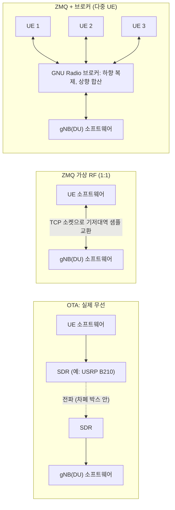
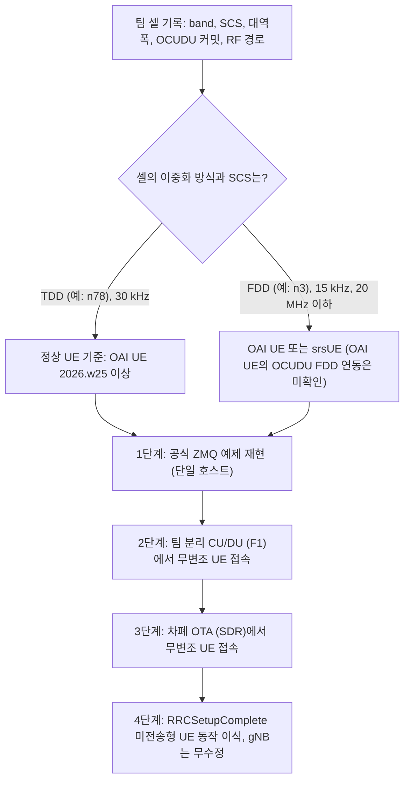

# 정상 UE 연결 경로와 RRCSetupComplete 미전송형 공격 코드의 재사용 범위

| 항목 | 내용 |
|---|---|
| 갱신 | 2026-10-13. 인용한 웹 자료의 접근일도 모두 같다. 이전 판(2026-10-09)의 사실은 모두 유지했다. [rss-landscape.md](rss-landscape.md) 부록 A의 지적에 따라 고친 세 곳은 §4.4, §4.5, §5에 '(정정)'으로 표시했다 |
| 문서 역할 | 팀 OCUDU 테스트베드에서 RRCSetupComplete 미전송형 재현기를 만들 때 출발점이 될 정상 단말(UE) 구현과 공개 공격 코드가 **실제로** 무엇을 제공하는지 1차 자료로 확인하고, 다음 결정과 검증 순서를 정한다 |
| 선행 지식 | [rss-theory.md](rss-theory.md) §2(5G 접속의 기초), §3(시그널링 스톰과 절차 기반 설명형 이름), §4(RRCSetupComplete 미전송형 공격의 진행 과정), §6(고갈 동역학: 보유시간과 채움 시간). 이 문서도 필요한 용어는 처음 쓸 때 짧게 풀이하고, 핵심 원리는 §1.1에 요약한다 |
| 관련 문서 | [methodology.md](methodology.md)(실험 시나리오·관측·합격 기준), [rss-landscape.md](rss-landscape.md)(변종·논문·도구의 전체 지형), [design.md](design.md)(재현기 설계) |

## 요약

본 문서는 RF(무선 주파수) 차폐 랩에서 팀의 무수정 OCUDU 기지국을 상대로 RRCSetupComplete 미전송형 RRC(Radio Resource Control, 무선 자원 제어) 시그널링 스톰(RSS, RRC Signaling Storm)을 재현하려 할 때, 어떤 정상 단말(UE, User Equipment) 구현에서 출발할 수 있고 공개된 공격 코드를 어디까지 재사용할 수 있는지를 묻는다 [1]. RRCSetupComplete 미전송형은 3GPP 공식 공격 분류명이 아니라 표준 메시지명과 중단 지점을 나타내는 설명형 이름으로, 단말이 접속 절차의 네 번째 메시지(Msg4)를 받고 수신 확인(HARQ ACK)까지 보낸 뒤 연결을 끝내는 마지막 메시지 `RRCSetupComplete`를 보내지 않고 처음부터 다시 접속하기를 반복하는 공격이다 [1]. 이를 위해 OCUDU·srsRAN 공식 튜토리얼, 공개 리포지토리와 패치 파일, 관련 논문을 직접 열어 읽었으며, 어떤 도구도 실행하거나 팀 장비에서 시험하지는 않았다. 첫째, OCUDU 공식 문서가 정상 접속을 보여 준 오픈소스 UE는 두 가지다. OAI(OpenAirInterface) UE 2026.w25 릴리스 이상은 3.5 GHz 대역(n78)의 시분할(TDD) 셀에서 가상 RF(ZMQ, ZeroMQ)로 단일 호스트에서 접속했고 [2], srsUE는 주파수분할(FDD) 셀(n3)에서 가상 RF로 중앙 장치(CU)와 분산 장치(DU)를 나눈 분리 배치에 접속했다 [3]. 분리 배치를 실제 무선(OTA)으로 운영한 공식 예는 상용폰을 단말로 쓴 것뿐이어서, 팀 구성인 '분리 CU/DU + 차폐 OTA'에 오픈소스 UE가 접속한 공식 사례는 없다 [3], [2]. 둘째, 조사 범위(2026-10-13)에서 RRCSetupComplete 미전송형을 구현한 공개 코드는 KAUST(King Abdullah University of Science and Technology) 연구진의 5gattacks 패치 하나뿐이다. 이 패치는 2025-11-16의 OAI 커밋에 고정돼 있고, gNB 변경을 함께 담고 있으며, 실행 중 바꿀 수 있는 제어 변수(노브)와 라이선스가 없다 [4], [5], [6]. 따라서 이 패치는 그대로 적용할 도구가 아니라 최신 OAI UE에서 다시 구현할 동작의 참고 자료다. 셋째, RRCSetupComplete 미전송형 외의 공개 공격 포크 2건은 다른 변종을 구현한다 [7, §5.1]. UCD(University College Dublin) 데모는 UE 재시작 반복(UE 재시작 반복형)을 다루며, 그 스크립트는 논문 PDF, 연구실 GitHub 계정(NetsLab-Demo)의 공개 리포, 관련 Kaggle 데이터셋에서 찾지 못했다 [8], [9], [10]. 이 결론은 문서와 코드 판독에 근거하므로, 팀 셀 설정에서의 상호운용성과 OCUDU 대상 공격 효과는 실험으로 따로 확인해야 한다.

## 1. 서론

### 1.1 배경과 질문

팀 프로젝트는 O-RAN(Open RAN) 기지국을 위한 침입 탐지·방지 시스템(IDS/IPS) 테스트베드를 만드는 일이며, 본 서브태스크는 그 탐지기를 검증할 "외부자 UE(공격자) 측 RRC signaling storm 재현 도구"를 맡는다 [1]. 설계 목표는 강한 공격이 아니라 파라미터가 통제되는 재현기다 [1]. 이 절은 그 도구를 이해하는 데 필요한 최소한의 용어를 먼저 설명한다. 더 자세한 배경은 [rss-theory.md](rss-theory.md) §2에 있다.

UE(User Equipment, 단말)는 휴대폰처럼 이동통신망에 접속하는 쪽이다 [11, §2.1]. gNB(next generation NodeB)는 UE 쪽으로 5G 무선(NR)의 사용자평면·제어평면 프로토콜을 종단하고 5G 코어(5GC)에 연결되는 노드, 곧 5G 기지국이다 [12, §3.2]. 이동통신 표준화 단체인 3GPP(3rd Generation Partnership Project) [13, Foreword]의 구조에서 gNB는 RRC 같은 상위 프로토콜을 맡는 CU(Central Unit, 중앙 장치)와 RLC·MAC·PHY 같은 하위 계층을 맡는 DU(Distributed Unit, 분산 장치)로 나눌 수 있으며, 두 장치는 F1이라는 인터페이스로 연결된다 [13, §3.1]. 다른 기지국이나 5G 코어에서 보면 CU와 그에 붙은 DU들은 하나의 gNB로 보인다 [13, §6.1.1]. 팀은 OCUDU(srsRAN 계열의 오픈소스 CU/DU)를 gNB로 쓴다 [1]. OCUDU 문서는 OCUDU가 5G CU/DU 솔루션이며 UE 애플리케이션을 포함하지 않는다고 밝힌다 [2]. 그래서 공격용이든 정상용이든 UE는 다른 프로젝트의 구현을 가져와야 하고, 이것이 이 문서가 존재하는 이유다.

RRC(Radio Resource Control, 무선 자원 제어)는 단말과 gNB 사이의 연결을 맺고 관리하는 제어 프로토콜이다 [14, §4.4]. 연결을 맺는 절차는 UE가 보내는 `RRCSetupRequest`, gNB가 답하는 `RRCSetup`, UE가 마무리로 보내는 `RRCSetupComplete`의 세 메시지로 이루어진다 [14, §5.3.3.1]. 그보다 앞서 UE는 랜덤 액세스(RA, Random Access)로 기지국에 처음 신호를 보내고 상향 전송 자원을 받는다 [15, §5.1], [16, §II-A]. 4단계(4-step) RA는 네 메시지로 이루어지며 문헌은 이를 Msg1–Msg4라고 부른다 [16, §II-A]. Msg1은 UE가 PRACH(Physical Random Access Channel)로 보내는 프리앰블(preamble, 미리 정해진 신호 패턴)이고, Msg2는 gNB의 RAR(Random Access Response, 랜덤 액세스 응답)이다 [15, §5.1.3], [15, §5.1.4]. Msg3는 RAR이 허락한 상향 자원으로 보내는 UE의 첫 메시지이고, Msg4는 Msg3에 담긴 식별자를 되돌려 확인해 줌으로써, 여러 UE가 Msg1에서 같은 프리앰블을 골랐을 때 누가 선택됐는지 가리는 경합 해소(contention resolution)를 수행한다 [16, §II-A], [15, §5.1.5]. 이 RA 절차를 RACH(Random Access Channel) 절차라고도 부른다 [12, §3.1], [16, §II-A]. `RRCSetupRequest`는 Msg3에, `RRCSetup`은 Msg4에 실리고, 문헌은 그다음의 `RRCSetupComplete`를 흔히 'Msg5'라고 부른다 [16, §II-A]. 'Msg5'는 논문의 약칭일 뿐 표준 용어가 아니다 [17, §3].

**RRCSetupComplete 미전송형**은 Msg4(`RRCSetup`)를 받고 하위 계층의 수신 확인(HARQ ACK, Hybrid Automatic Repeat reQuest acknowledgement)까지 보낸 뒤 `RRCSetupComplete`를 보내지 않고 새 RA를 시작하는 동작을 반복하는 것이다 [17, §2]. RRCSetupComplete 미전송형, UE 재시작 반복형 같은 이름은 3GPP 공식 공격 분류명이 아니라 절차를 직접 설명하는 이름이다 [11, §3].

이 동작이 왜 공격이 되는지를 요약하면 다음과 같다. KAUST 논문은 gNB가 Msg4를 보내는 시점에 그 연결 시도를 위한 UE 컨텍스트, 곧 연결을 추적하기 위한 내부 메모리와 예약 자원을 할당한다고 설명한다 [16, §II-A]. 팀의 OCUDU는 이보다 앞선 Msg3(`RRCSetupRequest`) 수신 시점에 컨텍스트와 전용 자원을 잡는다 [11, §4.1]. 그리고 `RRCSetupComplete`를 기다린다. 마지막 메시지가 끝내 오지 않는 연결을 KAUST 논문은 미완료(half-open) 연결이라고 부른다 [16, §III]. gNB가 미완료 연결을 해제하기 전까지 붙잡아 두는 시간을 본 프로젝트는 보유시간이라고 부른다 [11, §4.1]. gNB가 동시에 받을 수 있는 UE 수에는 상한이 있다. 예를 들어 KAUST 실험에 쓴 OAI gNB의 기본 상한은 16 UE였다 [16, §VI-A]. 공격자가 첫 컨텍스트가 해제되기 전에, 즉 보유시간 안에 상한만큼 미완료 연결을 만들면 상한이 차고 [16, §VI-A], 그 뒤에 오는 정상 단말은 거절될 수 있다 [16, §III].

> "If the attacker repeats this process, the number of half-open connections grows until the gNB reaches its supported UE capacity. At that point, new legitimate UEs may be rejected because the gNB cannot allocate additional UE contexts." [16, §III]
> (번역) 공격자가 이 과정을 반복하면 미완료 연결의 수가 gNB가 지원하는 UE 용량에 이를 때까지 늘어난다. 그 시점부터 gNB는 UE 컨텍스트를 더 할당할 수 없으므로 새로 오는 정상 UE가 거절될 수 있다.

(비유) TCP SYN flood에서 서버가 SYN-ACK를 보낸 뒤 마지막 ACK를 기다리며 반열린 연결을 보관하는 것과 비슷하다. 다만 이 비유는 한 지점에서 깨진다. RRCSetupComplete 미전송형의 공격자는 마지막 RRC 메시지만 생략할 뿐, 그 아래 계층의 Msg4 수신 확인(HARQ ACK)까지는 보내야 미완료 연결이 쌓인다 [16, §V-B]. 단계별 자원 할당과 고갈 동역학의 자세한 설명은 [rss-theory.md](rss-theory.md) §4와 §6에 있다.

이 문서는 그 동작을 **어떤 소프트웨어로 만들 수 있는가**를 다루며, 다음 세 질문에 답한다.

- **Q1.** 무수정 OCUDU에 정상 접속하는 UE 구현은 무엇이고, 공식 사례는 팀 구성과 얼마나 같은가? (§3)
- **Q2.** 공개된 RRCSetupComplete 미전송형 공격 코드는 실제로 무엇을 바꾸며, 우리 재현기에서 어디까지 재사용할 수 있는가? (§4)
- **Q3.** 그 밖의 공개물(데모 논문, 데이터셋, 커뮤니티 테스트베드)은 어떤 역할을 하고 무엇을 제공하지 않는가? (§5)

이 질문이 중요한 이유는 프로젝트 원칙에 있다. 본 프로젝트는 기지국(OCUDU)을 수정하지 않고 UE 측만 변조하기로 정했다 [1]. 따라서 재현기의 바탕이 될 UE는 무수정 OCUDU와 먼저 정상적으로 연결돼야 한다. 정상 연결이 확인되지 않은 상태에서는 공격이 실패했을 때 그것이 공격 동작의 문제인지 단순한 상호운용(interop) 문제인지 구별할 수 없다(추론, [17, §6]의 1단계 호환성 기준에 근거).

### 1.2 범위와 읽는 법

§2는 팀의 결정을 좌우하는 사실과 현재 우선순위를 한 번에 정리한다. 시간이 없는 독자는 §2만 읽어도 된다. §3은 정상 UE 후보를, §4는 RRCSetupComplete 미전송형 공격 코드인 5gattacks 패치를, §5는 그 밖의 공개물을 자세히 검토한다. §6은 다음 결정과 검증 순서를 정한다.

변종·논문·도구의 전체 지형은 [rss-landscape.md](rss-landscape.md)가, 실험 시나리오와 관측 조건은 [methodology.md](methodology.md) §2·§4가, 재현기의 구조·베이스 선택·수정 지점은 [design.md](design.md) §3·§6·§7이 다룬다. 이 문서는 그 내용을 반복하지 않는다. 모든 공격 재현은 RF 차폐 박스 안에서 팀 소유 장비만을 대상으로 한다는 것이 본 프로젝트의 격리 전제다 [1].

### 1.3 확인 방법

공식 튜토리얼(OCUDU, srsRAN)과 리포지토리의 README·스크립트·패치 파일, 논문 본문을 직접 열어 읽었다. 5gattacks 리포는 복제(clone)해 커밋 `0e71f7a`(2026-06-09) 기준으로 읽었고, 공격 패치는 이 저장소에 [보관본](sources/5gattacks_storm-attack.patch)을 두었다 [4], [5]. 리포지토리의 라이선스 표시와 최근 활동 시각(마지막 push 시각)은 GitHub API가 제공하는 리포 메타데이터로 확인했고, 값은 §4.6에 적었다 [18]. 이전 판의 조사일은 2026-10-09이며, 이번 개정에서 공개 여부와 라이선스에 관한 결론을 2026-10-13에 다시 확인했다.

어떤 도구도 실행하지 않았다. 팀 장비에서의 상호운용성, OCUDU를 대상으로 한 공격 효과, 공개 예제의 재현 여부는 모두 확인하지 않았다. 본문에서 우리 판단은 "(추론)"으로, 확인하지 못한 사항은 "(미확인)"으로 표시한다.

## 2. 팀의 선택을 좌우하는 사실

### 2.1 후보 도구와 무선 경로의 기초

이 문서가 검토하는 대상은 두 종류다. 하나는 재현기의 바탕이 될 정상 UE 구현(OAI UE, srsUE)으로 Q1에 해당하고, 다른 하나는 공격 동작을 참고할 공개물(5gattacks 패치, UCD 데모)로 Q2·Q3에 해당한다. 판단에 앞서 각각이 무엇인지 먼저 설명한다. 아래에 나오는 TDD·FDD·SCS 같은 셀 설정 용어는 이 절 뒷부분에서 설명한다.

- **OAI UE.** OpenAirInterface(OAI) 프로젝트가 만드는 오픈소스 5G UE 소프트웨어다. OCUDU 문서는 이를 Duranta OpenAirInterface 프로젝트의 UE로 소개하며, 활발히 개발 중이고 TDD를 지원한다고 설명한다 [2]. 일반 PC에서 `nr-uesoftmodem`이라는 프로그램으로 실행된다 [2]. 이 문서는 OAI 소스를 GitHub의 duranta-project 저장소 [6]와 EURECOM GitLab 저장소 [19]에서 인용한다. 두 호스트의 `2026.w40` 태그가 같은 커밋 `f8f7695`를 가리킨다는 점은 2026-10-13에 `git ls-remote`로 확인했다. OAI는 '연도.w주차' 형식의 태그로 릴리스를 낸다. 예를 들어 `2026.w40` 태그의 커밋 날짜는 2026-10-04로 2026년 40주차에 속하므로, '2026.w25'는 2026년 25주차 릴리스로 읽으면 된다(추론, [19]의 태그 커밋 `f8f7695`). 버전이 중요한 이유는 §3.1에서 보듯 2026.w25 이전 OAI UE가 OCUDU와 상호운용되지 않았기 때문이다 [2].
- **srsUE.** srsRAN은 두 저장소로 나뉜다. srsRAN Project는 5G CU/DU 솔루션이고 UE를 포함하지 않으며, srsRAN 4G가 시제품(prototype) 5G UE인 srsUE를 포함한다 [20]. 팀이 쓰는 OCUDU는 srsRAN 계열의 별도 CU/DU이고 역시 UE를 포함하지 않는다 [1], [2]. srsUE는 5G SA(Standalone) 모드에서 기능 제약이 있다 [20]. SA 모드는 LTE 반송파 없이 5G NR 반송파만으로 접속하는 방식으로, srsRAN 문서의 설정 예도 LTE(E-UTRA) 반송파 수를 0으로 두어 UE가 5G NR 반송파만 쓰게 한다 [20].
- **5gattacks/5g-rrc-storm.** KAUST 논문은 공격·탐지·완화 구현 전체가 공개돼 있다며 이 리포를 저자 A. Abou Hasna의 저작으로 인용한다 [16, §V-D]. 리포는 OAI 소스에 적용하는 공격 패치와 완화 패치, 실행 스크립트, 웹 대시보드인 NMS(Network Management System)를 담고 있다 [4]. 패치(patch)는 원본 소스에 대한 변경분(diff) 파일이며, 특정 커밋의 OAI에 적용해 다시 빌드하는 방식으로 쓴다 [4].
- **UCD 데모.** University College Dublin NetsLab이 IFIP Networking 2026에 낸 데모 논문으로, srsRAN 기지국과 여러 srsUE를 가상 RF로 묶은 테스트베드에서 공격과 탐지를 시연한다 [8]. 정상 UE 후보가 아니라, UE 재시작 반복형 공격을 어떻게 실행했는지 참고하는 자료다(§5).

UE와 기지국을 잇는 **무선 경로**도 선택 대상이다. 그림 1은 세 경로를 보여 주며, 셋째 경로의 브로커는 §3.3에서 설명한다. 그림의 세 상자는 'OTA: 실제 무선', 'ZMQ 가상 RF (1:1)', 'ZMQ + 브로커 (다중 UE)'다. 실선은 소프트웨어 사이의 데이터 흐름이고 점선은 실제 전파다. 기지국 쪽을 'gNB(DU)'로 표시한 것은 무선 신호와 하위 계층(PHY·MAC·RLC)을 다루는 쪽이 DU이기 때문이다 [13, §3.1].

그림 1. 이 문서에 나오는 세 가지 무선 경로. 실선 화살표는 소프트웨어 사이의 데이터 흐름이고, 점선은 실제 전파다.

- **OTA(Over-The-Air, 실제 무선).** SDR(Software-Defined Radio)은 PC 소프트웨어가 만든 신호를 실제 전파로 송수신하는 장치이며, KAUST 실험은 Ettus Research의 SDR 제품인 USRP B210 [20] 두 대를 각각 gNB와 UE에 썼다 [16, §V-A]. OCUDU의 CU/DU 분리 튜토리얼도 B210을 무선 전단으로 쓰는 OTA 구성을 보여 준다 [3].
- **ZMQ 가상 RF.** ZeroMQ(ZMQ) 메시징 라이브러리의 TCP 소켓으로 gNB와 UE가 기저대역(baseband) 샘플을 직접 주고받는 방식이다 [3]. 한쪽의 송신 포트가 다른 쪽의 수신 포트가 되도록 짝지어야 하며, 무선 하드웨어 없이 시험할 수 있다 [3], [2]. 비유하자면 공기 대신 파이프로 신호를 흘리는 셈이다. 이 비유는 전파 전파(propagation)·잡음·타이밍이 실제와 다르다는 점에서 깨진다. 실제로 KAUST는 에뮬레이션보다 실제 무선 테스트베드에서 추가 타이밍 제약이 나타난다고 보고했고 [16, §I], OCUDU 문서는 ZMQ로는 송신 신호가 그대로 UE 입력에 도달해 신호 크기를 따로 맞춰야 한다고 설명한다 [2].
- **rfsim(OAI RF simulator).** OAI 고유의 가상 RF로, 그림 1의 'ZMQ 가상 RF (1:1)' 자리에 들어가지만 OCUDU와는 맞지 않는다. OCUDU 문서는 두 프로젝트의 가상 무선 인터페이스(OCUDU의 ZMQ와 OAI의 RFSim)가 원래 서로 호환되지 않았고, OAI 2026.w17 릴리스가 OCUDU와 호환되는 ZMQ 라디오를 도입했다고 설명한다 [2]. 따라서 OAI UE를 OCUDU에 가상으로 붙일 때는 rfsim이 아니라 OAI의 ZMQ 라디오를 쓴다(추론, [2]).

UE는 기지국이 운영하는 **셀(cell)의 설정**과도 맞아야 한다. OCUDU 문서도 OAI UE 설정의 자원 블록 수(PRB)·대역폭, 부반송파 간격(numerology·SCS), 주파수 대역, 반송파 주파수를 gNB와 맞추라고 안내한다 [2]. PRB와 SCS는 아래에서 설명한다. 이중화 방식이 대표적이다. TDD(Time Division Duplex, 시분할 이중화)와 FDD(Frequency Division Duplex, 주파수분할 이중화)는 규격의 약어 목록에 있는 용어다 [13, §3.2]. TDD는 하나의 주파수를 시간 슬롯으로 나눠 하향(DL, downlink: 기지국→단말)과 상향(UL, uplink: 단말→기지국)에 번갈아 쓰고, FDD는 하향과 상향에 서로 다른 주파수를 쓴다. 이 차이는 아래 공식 예제의 주파수 설정에서 그대로 드러난다 [2], [3]. OAI UE 튜토리얼의 n78(3.5 GHz 대역) 셀은 DL과 UL 주파수가 모두 3489.42 MHz이고 하향 3슬롯·상향 1슬롯 등을 정한 TDD 패턴을 쓴다 [2]. CU/DU 분리 튜토리얼의 n3 셀은 DL 1842.5 MHz, UL 1747.5 MHz로 주파수가 갈라진 FDD다 [3].

SCS(Subcarrier Spacing, 부반송파 간격)도 맞아야 한다. 5G 신호는 하나의 대역을 여러 좁은 부반송파로 나눠 쓰며, 그 간격이 SCS다. SCS는 2^μ × 15 kHz로 정해지고 이 μ를 numerology라고 부른다. μ=0이면 15 kHz, μ=1이면 30 kHz다 [12, §5.1, Table 5.1-1]. 연속한 부반송파 12개가 하나의 PRB(Physical Resource Block, 주파수 자원 블록)를 이루고, 시간은 10 ms 프레임과 그 안의 슬롯으로 나뉜다 [12, §5.1]. 단말이 셀과 다른 SCS를 가정하면 신호를 해석할 수 없으므로 두 값이 맞아야 한다(추론). srsRAN 문서는 srsUE가 15 kHz SCS로 제한되므로 FDD 대역만 쓸 수 있다고 명시한다 [20]. 규격은 30 kHz 등 다른 SCS도 지원하므로 [12, Table 5.1-1], 이 제약은 srsUE 구현에 대한 서술이다. 15 kHz 제한이 왜 FDD 대역 전용으로 이어지는지는 문서에 설명돼 있지 않다 [20]. 팀 셀의 band·SCS·대역폭은 아직 기록되지 않았다(미확인, [1]).

### 2.2 후보별로 확인된 범위와 남은 검증

표 1은 네 후보 각각에 대해 공개물로 확인된 범위와 팀 테스트베드에서 아직 남은 검증을 나란히 놓는다. '종류' 열은 정상 UE 기반(Q1)인지 공격 동작 참고 자료(Q2·Q3)인지를 구분한다. '확인된 범위' 열은 '문서나 코드로 확인한 사실'이고, 오른쪽 열은 '우리 구성에서 아직 아무도 보여 주지 않은 것'으로 읽으면 된다.

표 1. 정상 UE 기반·공격 참고 후보별 확인 범위와 남은 검증

| 후보 | 종류 | 공개물로 확인된 범위 | 팀의 OCUDU 테스트베드에서 남은 검증 |
|---|---|---|---|
| **최신 OAI UE** | 정상 UE 기반 | OCUDU 공식 OAI UE 튜토리얼은 OAI 2026.w25 이상으로 **n78 TDD·30 kHz·ZMQ** 정상 접속을 보여 준다 [2] | 예제는 단일 호스트의 일체형 gNB와 가상 RF다 [2]. 팀의 분리 CU/DU·F1·차폐 OTA와 실제 설치 버전은 별도로 확인해야 한다(미확인) |
| **srsUE** | 정상 UE 기반 | srsRAN 공식 문서상 5G SA srsUE는 **15 kHz SCS·FDD·5/10/15/20 MHz**로 제한되고 핸드오버를 지원하지 않는다 [20]. OCUDU CU/DU 분리 예제의 ZMQ 구성은 이에 맞춰 n3 FDD를 쓴다 [3] | 팀 셀이 n78 TDD라면 같은 셀 설정으로 srsUE를 쓸 수 없다(추론, [20]). FDD 셀을 별도로 운영할 수 있는지와 정상 접속을 먼저 확인해야 한다 |
| **5gattacks/OAI 패치** | 공격 참고 | KAUST 논문의 **RRCSetupComplete 미전송형(Msg4 수신·HARQ ACK 후 `RRCSetupComplete` 생략)** 구현을 공개한다 [16, §V-B], [4] | 오래된 OAI 커밋용 공격 로직의 참고 자료다 [6]. 최신 OAI UE에 이식하고 검증해야 하며, OCUDU용 완성 도구가 아니다(§4) |
| **UCD/srsUE 데모** | 공격 참고 | IFIP 2026 데모는 여러 정상 srsUE의 **재시작 반복(UE 재시작 반복형)**을 기술한다 [8, §III-B] | RRCSetupComplete 미전송형 공격 패치가 아니다. 데모의 재시작 스크립트와 15 UE용 mux(multiplexer: 여러 UE의 가상 RF 샘플을 gNB의 ZMQ 포트 한 쌍에 묶어 주는 GNU Radio 흐름도로, §3.3의 브로커와 같은 역할 [8, §II-A])는 논문 PDF와 연구실의 공개 리포·데이터셋에서 찾지 못했다 [8], [9], [10] (§5) |

### 2.3 현재 우선순위

본 프로젝트의 열린 결정 중 첫째는 베이스 UE이고, 둘째는 차폐 SDR OTA와 ZMQ 가상 RF 중 어느 경로를 쓸지(병행 가능)다 [1]. 표 1의 사실에 따라 현재 우선순위는 다음과 같다. 먼저 팀 셀의 band·SCS·대역폭을 확인한다. 셀이 n78 TDD이면 OCUDU가 문서화한 최신 OAI UE를 정상 연결 기준으로 삼고, 그 위에 RRCSetupComplete 미전송형 로직을 이식할 수 있는지 판단한다 [1], [2]. srsUE는 FDD 설정이 가능한 경우의 별도 후보로 남긴다 [1], [20]. 공개 사례가 팀 구성의 성공을 보증하지는 않는다. 그림 2는 이 판단 순서를 흐름도로 정리한 것이며, 위에서 아래로 따라가면 §6의 검증 단계와 같아진다.

그림 2. 정상 UE 기준을 정하고 RRCSetupComplete 미전송형 이식으로 넘어가는 판단 순서. 각 단계가 실패하면 다음 단계로 넘어가지 않는다는 뜻이다.

## 3. OCUDU와 연결할 정상 UE 기준

정상 UE 기준이 먼저 필요한 이유는 §1.1에서 설명했다. 본 프로젝트의 합격 기준도 첫 단계로 실제 팀 셀의 band·SCS·대역폭·RF 경로와 설치 커밋을 확인하고, 무변조 UE가 정상 접속하는지 보도록 정한다 [17, §6]. 이 절은 그 기준으로 쓸 수 있는 공식 사례를 검토한다.

### 3.1 OAI UE: 공식 ZMQ 경로

OCUDU 튜토리얼은 OAI 2026.w25 릴리스를 기준으로 하며, 그 이전 OAI UE에 상호운용 문제가 있었다고 명시한다 [2].

> "However, the OAI UE prior to 2026.w25 had interoperability issues with OCUDU. Without support for UCI on PUSCH, in particular for multiplexing CSI on PUSCH, the OAI UE could not operate with the OCUDU gNB in UL with CSI RS enabled." [2]
> (번역) 그러나 2026.w25 이전의 OAI UE는 OCUDU와 상호운용 문제가 있었다. PUSCH 위의 UCI, 특히 CSI를 PUSCH에 다중화하는 기능이 없어서, OAI UE는 CSI-RS가 켜진 상태에서 OCUDU gNB와 상향링크로 동작할 수 없었다.

여기서 UCI(Uplink Control Information)는 상향 제어 정보이고 CSI(Channel State Information)는 채널 상태 정보다 [15, §3.2]. PUSCH(Physical Uplink Shared Channel)는 상향 공유 채널로, 상향 전송 채널의 데이터가 실리는 물리 채널이다 [12, §3.1], [12, §5.3.2]. 즉 인용문은 단말이 채널 상태 보고를 데이터 채널에 함께 실어 보내야 하는 상황을 구버전 OAI UE가 처리하지 못했다는 뜻이다 [2]. 같은 문서는 CSI 측정용 참조 신호(CSI-RS)를 끄면 하향 동작에 고정 MCS(Modulation and Coding Scheme, 변조·부호화 방식)가 필요했다고도 적는다 [2]. 이 사실은 버전 선택이 곧 상호운용 여부를 가른다는 점을 보여 준다.

공식 예제의 구성은 다음과 같다. 코어는 오픈소스 5G 코어 구현인 Open5GS이고, OCUDU gNB 셀은 band 78, 대역폭 20 MHz, SCS 30 kHz이며 n78이므로 TDD가 기본으로 켜진다 [2]. OAI UE 쪽은 같은 셀에 맞춰 PRB 51개, numerology 1(gNB의 SCS 30 kHz에 대응하는 값), band 78, 반송파 3489.42 MHz를 설정하고, 셀 동기 신호 블록(SSB)의 위치를 자동으로 찾는 반송파 스캔을 켠다 [2]. 30 kHz 부반송파 12개 × 51 PRB ≈ 18.4 MHz이므로 PRB 51개는 20 MHz 대역 안에 들어간다(추론, [12, §5.1]). 문서는 제3자 gNB와 상호운용하려면 UE capability(단말이 지원하는 기능 목록) 파일이 필요하다고 명시하고, OCUDU gNB와 동작하는 예시 파일을 OAI 소스 트리에서 지정한다 [2]. 정상 접속의 증거로 UE가 PDU(Protocol Data Unit) 세션 수락과 IPv4 주소를 받는 로그, 그리고 ping·iPerf3 결과를 보여 준다 [2], [14, §3.2]. PDU 세션은 코어가 단말에 IP 주소와 데이터 경로를 열어 주는 단위이므로, 이 로그는 무선 접속부터 코어 등록까지 전 과정이 정상이었다는 뜻이다(추론).

이 UE capability 파일, 무선 파라미터, 아래의 ZMQ 송신 레벨이 팀 정상 접속 스모크 테스트의 기준값이다 [2], [1].

ZMQ 구성에는 실제 무선과 다른 설정이 하나 있다. OCUDU gNB 설정 파일의 SDR 무선부 블록(`ru_sdr`)에서 송신 이득(`tx_gain`)을 -12로 낮춘다. 설정 줄의 주석은 이것을 'backoff from full scale, required by OAI fixed point FFT'로 설명하고, 문서는 OCUDU PHY가 만드는 신호의 크레스트 팩터(첨두 대 평균 비)가 12 dB라고 적는다 [2]. 따라서 단위는 dB로 보인다(추론, [2]).

> "OAI uses fixed point FFT, so it requires an input signal with peak well below full scale or there will be saturation in the internal FFT calculation. With radio hardware and channel in the loop, the input signal to the OAI FFT will most certainly have peak well below full scale." [2]
> (번역) OAI는 고정소수점 FFT(고속 푸리에 변환)를 쓰므로 입력 신호의 첨두값이 최대 범위보다 충분히 낮아야 하며, 그렇지 않으면 내부 FFT 계산이 포화한다. 무선 하드웨어와 채널이 경로에 있으면 OAI FFT 입력의 첨두값은 거의 확실히 최대 범위보다 충분히 낮다.

따라서 이 값은 가상 RF를 위한 조정이며, 차폐 OTA 설정에 그대로 복사할 값이 아니다 [2].

공식 예제의 범위는 좁다. 문서는 네트워크를 단일 호스트에서 구성하며, gNB도 CU와 DU가 합쳐진 일체형 `gnb` 프로그램으로 실행한다 [2]. 하드웨어 목록에는 USRP B210 두 대가 적혀 있지만, 본문이 보여 주는 것은 ZMQ 사용 사례뿐이다 [2].

> "The ZMQ-based virtual radio use case is shown here. Various use cases such as over-the-air hardware setup and multi-UE emulation will be added later." [2]
> (번역) 여기서는 ZMQ 기반 가상 무선 사용 사례만 보여 준다. 실제 무선 하드웨어 구성과 다중 UE 에뮬레이션 같은 사례는 나중에 추가할 예정이다.

그러므로 팀의 분리 CU/DU·F1·SDR OTA에서 같은 OAI UE가 붙는지는 아직 아무도 보여 주지 않았다(미확인). 예제 콘솔에 찍힌 OCUDU 커밋(`76a15775c9`)도 팀 설치본과 다를 수 있으므로 [2], 팀은 실행마다 실제 커밋을 기록해야 한다 [17, §5].

### 3.2 srsUE: FDD 셀 전용 후보

srsRAN 공식 srsUE 튜토리얼은 5G SA 모드의 핵심 제약을 다음처럼 명시한다 [20].

> "Limited to 15 kHz Sub-Carrier Spacing (SCS), which means only FDD bands can be used." / "Limited to 5, 10, 15 or 20 MHz Bandwidth (BW)" / "Handover is not supported" [20]
> (번역) 15 kHz SCS로 제한되므로 FDD 대역만 쓸 수 있다. / 대역폭은 5, 10, 15, 20 MHz로 제한된다. / 핸드오버는 지원하지 않는다.
> (원문은 세 항목의 글머리표 목록이다.)

따라서 팀 셀이 n78 TDD라면 srsUE는 그 셀에 접속할 수 없으므로, RRCSetupComplete 미전송형 로직을 srsUE에 구현하는 대안은 그 셀에서는 성립하지 않는다(추론, [20]).

OCUDU의 CU/DU 분리 튜토리얼은 두 가지 구성을 보여 준다 [3]. 첫째는 USRP B210을 쓰는 OTA 구성으로, 셀은 n78·20 MHz·30 kHz이고 단말은 상용폰(Xiaomi 12 5G)이다 [3]. 둘째는 ZMQ 구성으로, srsUE에 맞추기 위해 셀을 **n3 FDD·15 kHz·10 MHz**로 바꾸고 srsRAN 4G 23.11 이상의 srsUE가 접속해 PDU 세션까지 수립하는 것을 보여 준다 [3]. 즉 OCUDU 공식 문서에는 분리 CU/DU를 OTA로 운영한 예가 있지만 그 단말은 상용폰이고, srsUE 예는 ZMQ뿐이며, OAI UE를 분리 CU/DU와 OTA에 함께 쓴 예는 없다(추론, [3], [2]). 이 예제들도 팀의 OTA 설정과는 별개다. 같은 튜토리얼은 CU와 DU를 다른 호스트에서 돌릴 때 단일 호스트 예제의 루프백 주소를 쓰지 말고 실제로 도달 가능한 IP를 쓰라고 안내한다 [3]. 이는 노트북 A(CU)와 노트북 B(DU)를 나누는 팀 구성 [1]에 직접 해당하는 주의 사항이다.

### 3.3 다중 UE 구성의 공개 기준

여러 UE를 하나의 gNB에 붙이려면 ZMQ의 1:1 연결만으로는 부족하다 [20]. srsRAN 튜토리얼의 다중 UE 절은 gNB의 하향 신호를 각 UE에 복사해 주고 각 UE의 상향 신호를 합쳐 gNB에 넘기는 **브로커**를 두는 방법을 설명한다 [20]. 브로커는 GNU Radio Companion(신호처리 블록을 연결해 흐름도를 만드는 오픈소스 도구)의 흐름도로 구현되며, 공식 문서는 흐름도 파일과 UE별 설정, 코어 가입자 DB 파일을 제공한다 [20], [21]. 이 흐름도는 UE 세 개를 연결하도록 돼 있다 [20]. 공식 문서는 이 예제의 한계를 분명히 경고한다.

> "The Multi-UE scenario outlined here is not inteded to be an optimized, performant, or scalable solution. It is a simple example to demonstrate how to connect multiple UEs to a single gNB using ZMQ and srsUE." [20]
> (번역) 여기 설명한 다중 UE 시나리오는 최적화되거나 성능이 좋거나 확장 가능한 해법을 의도한 것이 아니다. ZMQ와 srsUE로 여러 UE를 하나의 gNB에 연결하는 방법을 보여 주는 단순한 예다.

또한 이 흐름도는 기본값으로 샘플 전달 속도를 1/4로 늦춘다. 11.52 MHz로 생성되는 샘플 1초 분량을 흐름도에 통과시키는 데 4초가 걸린다 [20]. 따라서 이 경로에서 잰 초당 시도율은 실시간 OTA 속도와 직접 비교할 수 없다(추론, [20]; 가상 RF의 벽시계 속도에 관한 같은 주의는 [rss-theory.md](rss-theory.md) §7). UCD 데모의 mux도 gNB의 ZMQ 포트 한 쌍과 UE별 ZMQ 포트 쌍 사이에서 샘플을 다중화하는 GNU Radio 흐름도로, 브로커와 같은 역할을 한다 [8, §II-A]. 그러나 UCD 데모가 쓴 15 UE용 mux가 이 공식 3 UE 브로커와 같은 구현인지는 데모 논문에 근거가 없다 [8].

OAI UE 쪽 다중 UE 경로는 더 제한적이다. OCUDU 튜토리얼은 다중 UE 에뮬레이션을 나중에 추가하겠다고만 적는다 [2]. OAI의 ZMQ 드라이버 문서는 다음 제약을 명시한다.

> "You cannot reconnect a device once the simulation has started. The simulation has to be restarted from scratch in order to add devices or restart a process." [19, L15–L16]
> (번역) 시뮬레이션이 시작된 뒤에는 장치를 다시 연결할 수 없다. 장치를 추가하거나 프로세스를 재시작하려면 시뮬레이션을 처음부터 다시 시작해야 한다.

따라서 UE 프로세스를 재시작하는 UE 재시작 반복형 실험은 OAI ZMQ 경로에서 매번 전체 시뮬레이션 재시작을 요구할 수 있다(추론, [19]). 반면 RRCSetupComplete 미전송형은 UE 프로세스 안에서 RA를 다시 시작하는 경로를 쓰므로 이 제약과 직접 부딪히지 않을 것으로 본다(추론, [22, §6]).

## 4. RRCSetupComplete 미전송형 공격 코드: 5gattacks의 실제 재사용 범위

### 4.1 무엇이 공개돼 있는가

KAUST 논문과 5gattacks/5g-rrc-storm 리포는 OAI UE가 Msg4를 받고 HARQ ACK를 보낸 뒤 Msg5를 생략하고 재시도하는 RRCSetupComplete 미전송형을 다룬다 [16, §V-B], [4]. 논문은 Msg4 수신과 ACK가 왜 필요했는지를 이렇게 설명한다.

> "After Msg3, the attacker still had to receive Msg4 and acknowledge it at the lower layer. This behavior is consistent with the standard, which requires the UE to send a hybrid automatic repeat request (HARQ) acknowledgment upon successful reception of the contention resolution message […]. Otherwise, the gNB quickly releases the temporary context, and half-open connections do not accumulate." [16, §V-B]
> (번역) Msg3 뒤에도 공격자는 Msg4를 받고 하위 계층에서 이를 확인 응답해야 했다. 이는 경합 해소 메시지를 성공적으로 받으면 UE가 HARQ 확인 응답을 보내도록 요구하는 규격과 일치한다. 그렇지 않으면 gNB가 임시 컨텍스트를 빠르게 해제해 미완료(half-open) 연결이 쌓이지 않는다.
> ('[…]'는 원문 논문의 참고문헌 번호를 생략한 자리다.)

즉 gNB는 이 ACK를 받아야 해당 UE가 Msg4를 받았다고 보고 임시 컨텍스트를 유지한다(추론, [16, §V-B]).

논문은 또 공격 UE가 `RRCReject`를 받았을 때 정상 UE라면 시작할 T302 대기 동작을 꺼서 요청이 끊기지 않게 했다고 밝힌다 [16, §V-B]. T300은 UE가 `RRCSetupRequest`를 보낼 때 시작해 `RRCSetup`이나 `RRCReject`를 받으면 멈추는 UE 쪽 타이머다 [14, §7.1.1]. T302는 UE가 받은 `RRCReject`에 waitTime이 들어 있을 때 그 값으로 시작하는 재시도 대기 타이머다 [14, §5.3.15.2]. 둘 다 UE의 타이머이며 gNB가 미완료 연결을 얼마나 붙잡을지를 정하는 값이 아니다(자세한 설명은 [rss-theory.md](rss-theory.md) §2.6).

실험은 OAI gNB와 OAI UE, USRP B210 두 대(gNB용·UE용), 정상 사용자 확인용 상용폰 Nothing Phone (3a)로 이루어졌다 [16, §V-A]. 논문의 수치(기본 16 UE 한도가 약 0.65초, 90 UE 한도가 약 3.61초 만에 가득 참, 약 25 요청/초, 미완료 대기 5초)는 그 실험 조건의 값이다 [16, §VI-A]. 한도가 차면 gNB 로그는 UE 컨텍스트를 더 할당할 수 없다고 기록했고, 새 접속 시도는 `RRCReject`로 거절됐다 [16, §VI-A]. 공격 UE가 `RRCReject` 뒤의 T302 대기를 끈 이유가 이것이다. 거절당해도 쉬지 않고 요청을 이어 가야 빈 자리가 생기는 즉시 다시 차지할 수 있다 [16, §V-B]. 논문은 두 채움 시간으로부터 요청률을 약 25 요청/초로 추정했다 [16, §VI-A]. 즉 채움 시간은 한도를 요청률로 나눈 값에 가깝다(16 ÷ 25 ≈ 0.64초, 90 ÷ 25 = 3.6초; 추론, [16, §VI-A]). 이 수치를 채움 시간과 보유시간으로 구별해 읽는 방법은 [rss-theory.md](rss-theory.md) §6에 있다.

리포 최상위에는 `storm-attack.patch`(14,208 B), `storm-mitigation.patch`(23,308 B), 빌드·실행 스크립트, NMS가 있다 [4]. 공격 UE 실행 스크립트는 n78, PRB 106개, numerology 1, 반송파 3619.2 MHz로 설정돼 있고, B210용과 rfsim용(`--rfsim`) 두 가지가 있다 [4, scripts/run-attacker-ue.sh·run-attacker-ue-rfsim.sh].

### 4.2 기준 OAI 커밋: 왜 그대로 쓸 수 없는가

README는 공격과 완화가 모두 OAI 커밋 `92980ceb`에 기반한다고 명시한다 [4, README]. 이 커밋은 2025-11-16에 OAI `develop` 브랜치로 병합된 `integration_2025_w46` 통합 커밋이다 [6]. 'w46'은 §2.1에서 설명한 주차 표기로, 2025-11-16이 2025년 46주차에 속한다는 점과도 맞는다(추론, [6]). 반면 OCUDU 공식 상호운용 사례는 OAI 2026.w25 이상을 요구하고, OCUDU와 호환되는 ZMQ 라디오는 2026.w17에 도입됐다 [2]. 따라서 2025.w46 시점의 공격 UE는 OCUDU용 ZMQ 경로도, w25의 상호운용 수정도 갖지 않았을 것이다(추론, [6], [2]). 그러므로 **패치를 그대로 적용하거나 OCUDU interop를 기대할 근거가 없다**. 현행 OAI(2026.w40)에서 같은 동작을 다시 구현하는 계획은 [design.md](design.md) §7에 있다.

### 4.3 패치가 실제로 바꾸는 것

공격 패치는 UE 쪽 RRC·MAC 코드만이 아니라 gNB 쪽 PHY·MAC 코드와 설정 파일도 바꾼다 [5]. 따라서 패치 파일 전체가 UE 전용은 아니다. 표 2는 보관 패치의 변경을 파일별로 나누고, 최신 OAI로 옮길 때 주의할 점을 적는다. 왼쪽 열의 L 번호는 [보관 패치](sources/5gattacks_storm-attack.patch)의 줄 범위다.

표 2. 5gattacks 공격 패치의 파일별 변경과 이식 시 주의

| 보관 패치의 읽기 지점 | 실제 변경 | 이식 시 주의 |
|---|---|---|
| UE `rrc_UE.c` (L180–L236) | `RRCSetup`을 받으면 정상 처리 함수 `nr_rrc_process_rrcsetup`(Msg5 송신 경로) 호출을 지우고 T300을 멈춘 뒤 `attack_rach_timer`를 시작한다. `RRCReject`를 받으면 `nr_rrc_process_rrcreject` 대신 T300을 멈추고 `handle_t300_expiry`로 새 `RRCSetupRequest`를 준비한다 [5, L204–L217] | 최신 OAI의 동등 호출부를 다시 추적해야 한다 [22, §7] |
| UE `rrc_timers_and_constants.c`·`rrc_defs.h` (L237–L284) | 짧은 `attack_rach_timer`를 추가한다(`nr_timer_setup(..., 10, 10)`). 만료되면 `handle_t300_expiry`를 호출하고, T302 만료 처리(`handle_302_expired_stopped`)는 주석 처리한다 [5, L245, L257–L262, L270–L271, L280]. 값의 뜻은 표 아래에서 설명한다 | UE의 T300/T302 및 gNB의 완료 대기 시간과 구별해야 한다 |
| UE `nr_ra_procedures.c` (L36–L51) | MAC의 `nr_Msg3_transmitted()` 끝에서 Msg3 송신 직후 `ra->Msg3_buffer`를 해제하고 NULL로 만든다 [5, L45–L48]. 정상 코드(2026.w40 기준)는 이 버퍼를 Msg3 재전송에 다시 쓰려고 보관하다가 RA 성공, 경합 해소 실패, 새 RA 초기화 때 비운다 [23, L779, L1026–L1028, L1044–L1045, L1078, L1099]. 따라서 패치 후에는 다음 Msg3가 매번 새로 만들어지는 것으로 보이나(추론), 정확한 목적은 패치나 README에 적혀 있지 않다(미확인) | 이 변경은 MAC 계층에 있으므로, RRC 함수 하나만 옮기는 포팅으로는 재현되지 않는다 |
| UE `nr_ue_scheduler.c` (L52–L63) | Msg4 HARQ ACK를 싣는 PUCCH(Physical Uplink Control Channel, 상향 제어 채널) 스케줄 지점에 로그를 추가한다 [5, L58–L60] | 동작 변경은 아니다 |
| gNB `gNB_scheduler_primitives.c` (L86–L140) | UL failure(상향 신호가 끊긴 UE를 해제하는 gNB 타이머) 상수를 `UL_FAILURE_REQ_GRACE` 10000→1000, `UL_FAILURE_TIMEOUT` 30000→5000으로 바꾸고 [5, L124–L127], UE 상한 도달과 release 요청 로그에 시각을 남긴다 [5, L107, L115–L116, L136–L137] | 우리 OCUDU 대상에는 옮기지 않는다 [1] |
| gNB 기타 (L1–L35, L64–L85, L141–L179, L285–L305) | PRACH 수신, 경합 해소(ConRes) 타이머, Initial UL RRC(DU가 UE의 첫 RRC 메시지를 CU로 넘기는 F1AP 절차 'Initial UL RRC Message Transfer' [24, §8.4.1]), PUCCH 용량 계산에 로그를 더하고, B210 설정 파일의 물리 셀 ID(PCI, 0→2)와 SDR 일련번호를 바꾼다 [5] | 측정용 로그와 장비 설정이므로 OCUDU에는 해당하지 않는다 |

`attack_rach_timer`의 값은 사람이 읽는 단위로 옮기면 약 10 ms다(추론). 근거는 세 가지다. OAI의 `nr_timer_setup(타이머, target, step)`은 매 tick마다 카운터에 step을 더하고 카운터가 target에 이르면 만료로 본다 [25, L252–L257]. 같은 패치 문맥에서 T300을 설정하는 바로 위 줄에 `nr_timer_setup(&tac->T300, k, 10); // 10ms step` 주석이 있어 RRC 타이머의 한 tick이 10 ms임을 보여 준다 [5, L278]. 따라서 target 10, step 10인 이 타이머는 시작 후 한 tick, 약 10 ms 뒤에 만료된다(추론, [5, L278, L280]). README는 이 타이머가 공격 UE의 접속 반복 속도를 정하며, SDR 구성에서 확인 응답(ACK)을 보낼 시간을 주기 위해 필요하다고 설명한다 [4, README §11]. 이는 §5에서 인용하는 KAUST의 OTA 관찰과 같은 내용이다 [16, §V-B]. 다만 KAUST가 잰 약 25 요청/초는 요청당 약 40 ms에 해당하며 [16, §VI-B], 이 시간에는 RA 한 바퀴가 포함되므로 이 타이머만으로 정해지지 않는다(추론).

### 4.4 gNB 변경과 KAUST '5초'의 관계 (정정)

KAUST 논문은 미완료 연결의 대기 시간을 5초로 설정했다고 적는다 [16, §VI-A]. 3GPP 규격에는 이 대기 시간을 정하는 전용 타이머가 없으므로 [16, §III], 이 값은 구현이 정한다. §1.1에서 보았듯 이 대기 시간(보유시간)이 길수록 같은 요청률로 더 많은 미완료 연결이 쌓인다 [16, §VI-A]. 그래서 이 5초가 어느 gNB 바이너리의 값인지 알아야 KAUST 수치를 OCUDU 기대치와 비교할 수 있다. 아래 세 근거로 출처를 좁힌다.

첫째, README는 OAI 소스를 두 디렉터리에 따로 받아 패치한다. 완화 패치를 적용한 '완화 트리'(`~/openairinterface5g`)와 공격 패치를 적용한 '공격 트리'(`~/rrc-storm-attack`)다 [4, README §2–§3]. 이 리포는 공격과 그 완화를 함께 시연하므로, 실행 안내는 완화 트리의 **gNB**('Run the mitigated gNB')와 공격 트리의 **UE**를 띄운다 [4, README §7–§9]. 그러나 공격 트리를 만드는 `build-attacker.sh`는 README가 "공격 UE를 빌드한다"고 설명하는 것과 달리 `--nrUE --gNB` 옵션으로 gNB도 함께 빌드한다 [4, scripts/build-attacker.sh L21], [4, README §3]. README §11의 공격 쪽 재빌드 명령에도 `--gNB`가 있으므로 README 자체도 이 사실을 드러내고 있다 [4, README §11]. 즉 공격 트리에도 UL failure 상수가 바뀐 gNB 실행 파일이 생긴다.

둘째, 논문의 대기 시간은 공격 패치의 상수와 같다.

> "The waiting time for incomplete connections was configured to 5 seconds." [16, §VI-A]
> (번역) 미완료 연결의 대기 시간은 5초로 설정했다.

공격 패치는 `UL_FAILURE_TIMEOUT`을 5000으로 바꾸고 [5, L127], OAI 소스는 이 상수를 `// UL_FAILURE_TIMEOUT ms till triggering release request`(release 요청까지의 ms)라는 주석으로 정의한다 [26, L4168]. 이 주석은 2026.w40 기준이며, 패치 문맥에 보이는 기본값(30000/10000)이 같으므로 `92980ceb`에서도 의미가 같다고 본다(추론, [5, L124–L125]).

셋째, 완화 패치는 이 상수를 건드리지 않으므로 완화 트리 gNB는 기본값 30000 ms(30초)를 유지한다 [27].

이 세 사실을 합치면 논문의 5초는 공격 트리에서 빌드한 gNB의 상수였을 가능성이 크다(추론). 그러나 논문은 무완화 실험에 어느 gNB 바이너리를 썼는지 밝히지 않으므로, 저자 확인 전에는 단정하지 않는다(미확인). 이 구분이 중요한 이유는 KAUST 스스로 3GPP 규격에 이 대기 시간을 위한 전용 타이머가 없어 구현 의존 동작으로 다룬다고 밝혔기 때문이다 [16, §III]. 즉 5초는 표준값도 OCUDU 값도 아니며, OCUDU의 보유시간은 [rss-theory.md](rss-theory.md) §8에서 따로 다룬다.

(정정) 2026-10-09 판은 패치에 gNB 변경이 있다는 사실만으로 논문 결과에 그 변경이 적용됐다고 단정하지 않는다고만 적었다. 이번 개정은 그 판단을 유지하되 위의 세 근거를 더해 판단을 좁혔다 [7, 부록 A].

### 4.5 노브: 공개 코드가 통제하지 못하는 것 (정정)

노브(knob)는 실험자가 바꾸는 제어 변수다. 본 프로젝트는 노브를 **실행 시작 인자**(프로세스를 띄울 때 주는 값), **실행 중 변경**(실행 도중 OAI telnet 등으로 바꾸는 값), **빌드 상수**(소스를 고쳐 다시 빌드해야 바뀌는 값)로 구분한다 [22, §5].

5gattacks의 재시도 간격은 `attack_rach_timer`의 빌드 상수다 [5, L280]. README도 일부 상수는 OAI를 다시 빌드하기 전에 바꿀 수 있다고만 안내한다 [4, README §11]. 실행 중 요청률, 정상 완료율(일부 시도는 Msg5를 정상 송신하는 비율), 초기 UE identity 정책을 바꾸는 노브는 없다 [5]. 초기 UE identity는 `RRCSetupRequest`에 담는 39비트 값으로, 5G-S-TMSI(5G 코어가 단말에 부여한 임시 식별자 [11, §2.6])의 일부(ng-5G-S-TMSI-Part1)나 무작위 값(randomValue) 중 하나다 [14, §6.2.2], [16, §II-A]. 리포의 rfsim 스크립트는 **OAI gNB ↔ OAI 공격 UE**의 자체 재현 경로이며 [4, scripts/run-attacker-ue-rfsim.sh], OCUDU를 대상으로 하지 않는다. §2.1에서 보았듯 OCUDU는 rfsim과 호환되지 않기 때문이다 [2].

그렇다면 다른 공개 공격 코드에는 이런 노브가 있을까? 실제 Uu(단말–기지국 무선 구간)로 gNB를 공격하는 공개 OAI UE 포크는 5gattacks 외에 두 건이 더 있다 [7, §5.1]. 표 3은 세 포크의 변종과 노브를 비교한다. RRCSetupComplete 미전송형을 구현한 것은 첫 행뿐이라는 점에 주의해 읽어야 한다. 표의 RRCSetupRequest 후 중단형과 NAS Authentication Response 미전송형은 공개 지형 문서가 붙인 변종 이름으로 표준 용어가 아니다 [7, §3]. RRCSetupRequest 후 중단형은 Msg4를 기다리지 않고 Msg3 직후 재시작하는 변종이고, NAS Authentication Response 미전송형은 RRC 연결을 완료한 뒤 NAS(Non-Access Stratum, 단말–코어 사이 제어 계층) [13, §3.2]의 인증 단계에서 멈추는 변종이다 [7, §3]. 마지막 열의 'NOASSERTION'은 §4.6에서 설명한다.

표 3. 실제 Uu 공격 코드를 공개한 OAI UE 포크 세 건의 비교

| 포크 | 구현한 변종 | 기반 OAI | 노브 | GitHub 라이선스 표시 |
|---|---|---|---|---|
| 5gattacks/5g-rrc-storm | **RRCSetupComplete 미전송형**: Msg4 HARQ ACK 뒤 Msg5 생략 [5] | `92980ceb`(2025.w46 통합) [6] | 빌드 상수(`attack_rach_timer`) [5, L280] | 없음 [4] |
| salam-ai-learning/5g-rrc-storm-attack | **RRCSetupRequest 후 중단형**: Msg3 송신 직후 MAC을 프리앰블 생성 상태로 되돌리고, `RRCSetup` 처리를 주석 처리하며 T300을 끈다. gNB에서 Msg4 단계 RA 실패 시 UE를 해제하는 UL failure 타이머 인자도 2→2700 ms(로그 문구가 'Started timer for 2ms'이므로 ms 단위, 즉 2.7초)로 바꾼다 [28]. 2.7초는 Nguyen 등(§5 표 4)이 실험에 쓴 대기 시간과 같은 값이다 [29, §IV-A] | Firecell 계열 'v3.3.0'(upstream OAI 태그 아님) [7, §5.1] | 빌드 상수 [28] | NOASSERTION [28] |
| 5GSEC/OAI-5G `nr.attack.v2.1.0` | **NAS Authentication Response 미전송형**(Msg5와 등록 요청까지 보낸 뒤 인증 요청을 받으면 RA 재시작)와 **Blind DoS**(피해 UE의 TMSI(임시 가입자 식별자)를 사용해 그 UE의 연결을 끊는 표적 공격) [7, §5.1] | OAI v2.1.0 [7, §5.1] | 실행 시작 인자: `--bts-attack`, `--bts-delay`(기본 188 ms), `--blind-dos-attack`, `--RRC-TMSI` [30, L26–L29] | NOASSERTION [30] |

정리하면, 5GSEC 포크에는 지연과 TMSI를 정하는 실행 시작 인자가 있지만 RRCSetupComplete 미전송형용이 아니며, 완료율 노브는 세 포크 어디에도 없다 [7, §5.1]. 따라서 우리 재현기의 노브와 라벨은 별도로 설계하고 검증해야 한다 [22, §5], [17, §5].

(정정) 2026-10-09 판은 "공개 도구에는 빌드 시 바꾸는 재시도 타이머가 있지만 런타임 요청률·정상 완료율·초기 UE identity 정책 노브는 없다"고 적었다. 이 말은 5gattacks에는 정확하지만, 위 표처럼 실행 시작 인자를 가진 5GSEC 포크가 있으므로 공개 공격 코드 전체로 일반화하면 틀린다 [7, 부록 A].

### 4.6 라이선스와 사용 조건

5gattacks 리포에는 LICENSE 파일이 없고 GitHub 라이선스 표시도 없다(2026-10-09 조회, 2026-10-13 재확인) [4]. 공개 열람과 재배포 허용은 다르므로, 코드를 포크하거나 재배포하기 전에 저자의 허가나 인용 조건을 확인해야 한다 [1]. README는 사용 범위를 다음처럼 제한한다.

> "This repository is intended only for controlled experiments in a private 5G testbed. Do not run the attack against public networks or systems you do not own or have explicit permission to test." [4, README Disclaimer]
> (번역) 이 리포지토리는 사설 5G 테스트베드에서의 통제된 실험만을 위한 것이다. 공용 망이나, 소유하지 않았거나 시험 허가를 명시적으로 받지 않은 시스템에 공격을 실행하지 말라.

salam과 5GSEC 포크는 GitHub 표시가 NOASSERTION이고 LICENSE 파일은 OAI Public License v1.1이다 [7, §5.1]. GitHub는 오픈소스 Licensee로 리포의 LICENSE 파일을 알려진 라이선스의 짧은 목록과 비교한다 [31]. 두 포크에 대해 GitHub API는 라이선스를 'Other'(spdx_id `NOASSERTION`)로 보고하고, 5gattacks에 대해서는 라이선스 값이 비어 있다(null) [18]. 즉 NOASSERTION은 'LICENSE 파일은 있지만 목록의 표준 라이선스로 판정되지 않았다'는 뜻으로 읽히고(추론, [31], [18]), 5gattacks의 '없음'은 LICENSE 파일 자체가 없다는 뜻이다 [4]. 같은 API가 보고한 마지막 push 시각은 5gattacks 2026-06-09, salam 2025-07-14, 5GSEC 2024-12-02다 [18]. 이런 사정 때문에 공개 지형 문서는 코드를 복사하지 않고 동작을 재구현하며, 인용하고 필요하면 저자 허가를 받는 방향을 요구사항으로 정했다 [7, §7].

### 4.7 재사용 범위 정리

5gattacks에서 가져올 것은 **UE 쪽 동작의 설계**다. 구체적으로 Msg4 수신과 HARQ ACK 뒤 Msg5를 생략하고, 짧은 대기 뒤 새 접속을 시작하며, 거부 처리를 바꾸는 흐름이다 [5], [16, §V-B]. 가져오지 않을 것은 gNB 쪽 변경 전부(UL failure 상수, 로그, 장비 설정)와 구형 커밋 자체다 [1], [5]. 우리가 새로 만들어야 할 것은 실행 시작 인자나 실행 중 변경으로 바꾸는 노브와 시도별 정답 라벨이다 [7, §7], [22, §5]. 정답 라벨은 재현기가 시도마다 언제 어떤 단계까지 진행했고 무엇을 생략했는지 남긴 기록으로, 실제로 무슨 일이 일어났는지를 확정해 탐지기의 판정을 채점하는 기준이 된다 [17, §4], [17, §5]. 이 프로젝트의 목표는 강한 공격이 아니라 탐지기를 검증할 통제된 재현기이므로 [1], 노브와 라벨이 없는 공개 코드는 그대로 쓸 수 없다. 레코드 형식은 [design.md](design.md) §8이 정한다 [22, §8]. 구체적인 수정 지점은 [design.md](design.md) §7에 있다.

## 5. 다른 공개물의 역할과 한계

RRCSetupComplete 미전송형 공격 코드 말고도 RSS를 다룬다고 알려진 공개물이 여럿 있다. 표 4는 각 자료가 무엇인지, 직접 열어 확인한 결과, 이 프로젝트에서의 위치를 정리한다. 마지막 열이 '이 자료를 어디에 쓰고 어디에 쓰지 않는가'에 대한 결론이다.

표 4. 그 밖의 공개물의 확인 결과와 위치

| 자료 | 무엇인가 | 확인 결과 | 이 프로젝트에서의 위치 |
|---|---|---|---|
| [UCD IFIP 데모 PDF](sources/IFIP-Networking2026_Demo_UCD-NetsLab_srsRAN-ZMQ.pdf) | 소프트웨어만으로 만든 O-RAN 테스트베드에서 공격과 다층 IDS xApp(near-RT RIC 위에서 도는 응용)을 시연한 데모 논문 [8]. near-RT RIC(near-Real-Time RAN Intelligent Controller)는 기지국을 준실시간으로 관찰·제어하는 O-RAN 컨트롤러다 [8, Abstract], [11, §2.8] | srsRAN gNB와 srsUE 15개로 구성한 ZMQ 테스트베드에서 UE 재시작 반복(UE 재시작 반복형)을 시연한다. 공격 스크립트와 mux의 URL은 없다 [8]. 자세한 내용은 표 아래 'UCD 데모' 문단에 있다 | **UE 재시작 반복형 실험 구상**. RRCSetupComplete 미전송형 코드나 같은 라벨로 취급하지 않는다 |
| [NetsLab-Demo 5G-ORAN-IDD](https://github.com/NetsLab-Demo/NetsLab-Demo-Netslab-5G-ORAN-IDD) | 같은 연구실이 공개한 다층 침입 탐지 데이터 리포 [32] | 공개 트리에는 분석 노트북 2개, 데이터 파일, MIT LICENSE만 있고 데모 공격 스크립트와 mux는 없다 [32] | 탐지 데이터 참고. 공격 실행 도구가 아니다 |
| [Kaggle RRC storm 데이터셋](https://www.kaggle.com/datasets/farahabedzadeh/rrc-signalling-storm-dataset-5g-o-ran-testbed) | 같은 저자의 별도 논문 *RadioShield*에 딸린 데이터셋 [10] | 설명상 **물리 5G O-RAN 테스트베드**에서 수집했고 UE reboot storm과 handover storm을 포함한다 [10]. 라이선스는 Unknown, 크기는 7.47 GB다 [10] | IFIP ZMQ 데모의 실행 기록이나 RRCSetupComplete 미전송형 정답(ground truth)으로 추정하지 않는다 |
| [Nguyen et al., arXiv 2504.15738](https://arxiv.org/html/2504.15738) | OAI로 RSS를 구현하고 xApp 탐지를 제안한 IEEE ISCC 2025 논문 [29] | OAI UE를 고쳐 **Msg3를 보내면 Msg4를 기다리지 않고 새 RA 절차(RACH, Random Access Channel 절차)를 시작**하고 Msg4 수신과 T300 만료를 무시한다 [29, §V-A]. OAI UE와 gNB는 RF 시뮬레이션 무선 구간으로 연결됐다 [29, §III-C]. 이 방식으로 132.07 Msg3/s를 냈고, gNB 자원 16개와 대기 2.7초 조건에서 gNB를 약 95%의 시간 동안 사용 불가로 만들었다고 보고한다 [29, §V-B]. KAUST는 이 구현이 오픈소스로 공개되지 않았다고 적는다 [16, §I] | 초기접속 공격과 탐지 특징의 참고 자료다. 우리 RRCSetupComplete 미전송형의 Msg4 ACK 요구를 대체하지 않는다. KAUST 결과와의 차이는 표 아래에서 다룬다 |
| [b-akhil-reddy ZMQ 구성](https://github.com/b-akhil-reddy/5G-RAN-srsRAN-Open5gs) | srsRAN Project·srsRAN 4G·Open5GS를 docker-compose로 묶은 ZMQ 시뮬레이션 리포 [33] | 다중 UE 예제는 UE마다 CU와 DU를 하나씩 두며, 병렬로 실행하면 시험에서 UE 하나만 연결됐다고 README가 명시한다 [33] | 공식 OCUDU/srsRAN 예제를 재현한 뒤의 설정 참고 |
| [gckopper 테스트베드](https://github.com/gckopper/5G-testbed) | 한 대학의 srsRAN 테스트베드 구성 리포 [34] | README상 '상용 UE + srsRAN'과 '단일 srsUE + ZMQ' 모드만 동작하고, srsUE를 B210으로 붙이는 모드는 동작하지 않는다 [34] | 위와 같다 |

**UCD 데모.** 데모는 srsRAN Project gNB(O-RAN의 CU·DU 모사), Open5GS, near-RT RIC 구현인 FlexRIC, GNU Radio ZMQ mux로 구성한다 [8, §II-A]. 배치 스크립트로 srsUE 15개를 띄운다 [8, §IV]. 공격은 동기화된 bash 스크립트로 **여러 srsUE를 빠르게 재시작**해 PRACH 프리앰블과 `RRCSetupRequest`를 쏟아내는 방식이다 [8, §III-B]. 재시작한 UE 수와 Msg5 도달 여부는 명시하지 않는다 [8]. 기여 항목은 공격 스크립트와 mux 제공을 주장하지만 PDF에 URL이 없다 [8]. 논문 Table I의 탐지 성능(Radio IDS 정확도 99.43% 등)은 이전 실험 배치에서 얻은 결과라고 밝힌다 [8, §V]. 이 데모는 UE 프로세스 재시작을 반복하므로 UE 재시작 반복형 실험 구상의 참고 자료로 쓴다.

**Nguyen 등과 KAUST의 결과 차이.** 두 논문은 Msg4를 기다리지 않는 방식(RRCSetupRequest 후 중단형)에 대해 서로 다른 결과를 낸다. Nguyen 등은 RF 시뮬레이션 환경에서 이 방식으로 gNB를 대부분의 시간 동안 사용 불가로 만들었다고 보고한다 [29, §V-B].

> "Using a total of 16 resources at the gNB and a waiting time of 2.7 seconds, the attacker can render the gNB unavailable for around ≈95% of the time." [29, §V-B]
> (번역) gNB 자원 총 16개와 대기 시간 2.7초 조건에서 공격자는 gNB를 약 95%의 시간 동안 사용 불가로 만들 수 있다.

반면 KAUST는 자기 구현에서 같은 방식으로는 충분하지 않았다고 보고한다 [16, §V-B].

> "Prior work describes the attack as repeatedly cycling through Msg1, Msg2, and Msg3 without waiting for Msg4 […]. In our implementation, this was not sufficient." [16, §V-B]
> (번역) 선행 연구는 Msg4를 기다리지 않고 Msg1, Msg2, Msg3를 반복하는 공격으로 설명한다. 우리 구현에서는 이것으로 충분하지 않았다.
> ('[…]'는 원문의 참고문헌 번호를 생략한 자리다. 원문에서 이 번호는 arXiv HTML판의 11번, 보관 PDF판의 6번 참고문헌이며 둘 다 Nguyen 등의 논문 [29]을 가리킨다. 이 문서의 참고문헌 번호와는 관계가 없다.)

KAUST는 이 실패를 OTA 환경으로 한정하지 않았다. 에뮬레이션과 실제 무선의 차이를 말한 문장은 따로 있으며, 그 대상은 RRCSetupRequest 후 중단형이 아니라 Msg4 직후의 즉시 재시작이다.

> "In an emulated setup, restarting the RACH procedure from the RRC layer immediately after receiving Msg4 was sufficient. However, on the real radio testbed, this immediate restart was unreliable because the lower layers did not always have enough time to complete the Msg4 acknowledgment." [16, §V-B]
> (번역) 에뮬레이션 구성에서는 Msg4를 받은 직후 RRC 계층에서 RACH 절차를 다시 시작하는 것으로 충분했다. 그러나 실제 무선 테스트베드에서는 하위 계층이 Msg4 확인 응답을 마칠 시간이 항상 충분하지 않아 이 즉시 재시작이 불안정했다.

정리하면 "KAUST 구현에서는 RRCSetupRequest 후 중단형으로 축적되지 않았다"가 정확한 표현이고, "OTA에서는 Msg4 직후 짧은 대기가 필요했다"는 그와 별개의 관찰이다. 두 논문의 결과가 갈리므로 RRCSetupRequest 후 중단형이 OCUDU에서 통하는지는 실험으로 정해야 한다(추론, [29, §V-B], [16, §V-B]). 또한 OCUDU에서는 RRCSetupRequest 후 중단형도 CU 타임아웃까지 DU 자원을 붙잡을 수 있다는 코드 판독 결과가 있으나 실행으로 검증하지 않았으므로, KAUST 결과를 OCUDU 기대치로 옮기지 않는다 [11, §7–§8].

(정정) 2026-10-09 판은 Nguyen 행에 관해 "KAUST §V-B는 해당 방식으로 자기 OTA 환경의 half-open 축적이 되지 않아 Msg4 ACK가 필요했다고 보고한다"고 적었다. 원문을 다시 읽으면 KAUST는 실패를 OTA로 한정하지 않았으므로 위와 같이 고쳤다 [7, 부록 A].

마지막으로, 논문이 코드를 제공한다고 서술하더라도 실제 URL과 파일 내용을 확인해야 한다 [1]. UCD 데모는 스크립트와 mux 제공을 기여로 주장하지만 [8], 조사한 NetsLab-Demo 계정의 공개 리포 두 개(5G-ORAN-IDD, armor)에는 노트북과 데이터, README만 있었고 [9], 위 데이터셋에도 생성기가 없었다 [10]. 따라서 IFIP 데모의 재시작 스크립트와 15 UE mux는 찾지 못했다. **공개 여부에 대한 이 결론은 2026-10-09 조사(2026-10-13 재확인) 범위에 한정한다.**

## 6. 다음 결정과 검증

§2–§5의 사실을 바탕으로 다음 순서를 제안한다. 각 단계는 그림 2의 상자에 대응하며, 단계별 합격 판정은 [methodology.md](methodology.md) §6, 구현 일정은 [design.md](design.md) §9가 정한다.

1. **팀 셀 기록.** 팀 OCUDU의 실제 band·SCS·대역폭, 설치 커밋, RF 경로를 기록한다 [17, §6]. n78 TDD이면 최신 OAI UE가, n3 같은 FDD이면 srsUE도 정상 UE 후보가 된다 [2], [20], [3].
2. **정상 연결 확인.** [OCUDU OAI UE 공식 예제](https://docs.ocudu.org/tutorials/oaiue/)의 정상 ZMQ 연결을 기준으로 재현한 뒤, 팀의 분리 CU/DU(F1)와 차폐 OTA에서 **변조 없는 UE**의 연결을 차례로 확인한다 [2], [1]. 분리 배치에서는 루프백 대신 실제 호스트 주소를 쓴다 [3].
3. **RRCSetupComplete 미전송형 이식.** RRCSetupComplete 미전송형은 5gattacks 패치의 **UE 쪽 동작**만 참고하고 대상 OCUDU는 무수정으로 둔다 [1]. Msg4 ACK, Msg5 생략, 미완료 컨텍스트의 생성과 해제를 실제 로그로 확인한 뒤에 요청 간격 제어를 추가한다 [17, §5], [17, §6].
4. **UE 재시작 반복형과 다중 UE.** UE 재시작 반복인 UE 재시작 반복형은 별도 실행·라벨·탐지 기대치로 다룬다 [17, §2]. 다중 UE가 필요하면 공식 3 UE 브로커의 한계(확장성 미보장, 기본 1/4 속도)를 먼저 검증하고 [20], OAI ZMQ 경로에서는 프로세스 재시작이 전체 시뮬레이션 재시작을 요구한다는 제약을 고려한다 [19].
5. **재사용 권한.** 5gattacks 코드를 포크하거나 재배포하기 전에 저자 허가와 인용 조건을 확인한다 [1].

아직 확인하지 못한 사항은 다음과 같다. 팀 셀 설정(미확인), OAI UE와 분리 CU/DU·차폐 OTA의 상호운용(미확인), 5gattacks 패치의 최신 OAI 이식 가능성(미확인), KAUST 5초의 실제 출처(미확인), UCD 데모 스크립트의 공개 여부(조사 범위에서 찾지 못함)다. 어떤 항목도 하드웨어에서 실행해 확인하지 않았다.

## 참고문헌

[1] 내부 문서, [AGENTS.md](AGENTS.md) — '이 디렉토리는 무엇인가', '내 서브태스크', '열린 결정', '미확인/리스크', '작업 원칙'.  
[2] OCUDU Documentation, "Building a 5G network with the OpenAirInterface UE," accessed 2026-10-13. https://docs.ocudu.org/tutorials/oaiue/  
[3] OCUDU Documentation, "Deploying a CU/DU split over F1," accessed 2026-10-13. https://docs.ocudu.org/tutorials/cu_du_split/  
[4] 5gattacks, "5g-rrc-storm" (README, scripts/), commit 0e71f7a (2026-06-09), accessed 2026-10-13. https://github.com/5gattacks/5g-rrc-storm  
[5] 5gattacks, "storm-attack.patch," commit 0e71f7a. 보관본 [sources/5gattacks_storm-attack.patch](sources/5gattacks_storm-attack.patch) (줄 번호는 보관본 기준). https://github.com/5gattacks/5g-rrc-storm/blob/main/storm-attack.patch  
[6] OpenAirInterface, commit 92980ceb725a94dbfe97c509d16f1313eee083e0, "Merge branch 'integration_2025_w46' into 'develop'," 2025-11-16, accessed 2026-10-13. https://github.com/duranta-project/openairinterface5g/commit/92980ceb725a94dbfe97c509d16f1313eee083e0  
[7] 내부 문서, [rss-landscape.md](rss-landscape.md).  
[8] F. Abed Zadeh, B. Siniarski, S. Wang, and M. Liyanage, "Demo: Attack Execution and Multi-Layer xApp-based Intrusion Detection in an O-RAN Environment," IFIP Networking 2026 (Demo), 2026. 보관본 [sources/IFIP-Networking2026_Demo_UCD-NetsLab_srsRAN-ZMQ.pdf](sources/IFIP-Networking2026_Demo_UCD-NetsLab_srsRAN-ZMQ.pdf)  
[9] NetsLab-Demo, GitHub 계정의 공개 리포 목록(NetsLab-Demo-Netslab-5G-ORAN-IDD, armor), accessed 2026-10-13. https://github.com/NetsLab-Demo  
[10] F. Abed Zadeh, "RRC Signalling Storm Dataset (5G O-RAN Testbed)," Kaggle, accessed 2026-10-13. https://www.kaggle.com/datasets/farahabedzadeh/rrc-signalling-storm-dataset-5g-o-ran-testbed  
[11] 내부 문서, [rss-theory.md](rss-theory.md).  
[12] 3GPP TS 38.300 V16.22.0, "NR; NR and NG-RAN Overall description; Stage-2," ETSI, 2026. https://www.etsi.org/deliver/etsi_ts/138300_138399/138300/16.22.00_60/ts_138300v162200p.pdf  
[13] 3GPP TS 38.401 V19.3.0, "NG-RAN; Architecture description," ETSI, 2026. https://www.etsi.org/deliver/etsi_ts/138400_138499/138401/19.03.00_60/ts_138401v190300p.pdf  
[14] 3GPP TS 38.331 V16.21.0, "NR; Radio Resource Control (RRC); Protocol specification," ETSI, 2025. https://www.etsi.org/deliver/etsi_ts/138300_138399/138331/16.21.00_60/ts_138331v162100p.pdf  
[15] 3GPP TS 38.321 V16.18.0, "NR; Medium Access Control (MAC) protocol specification," ETSI, 2025. https://www.etsi.org/deliver/etsi_ts/138300_138399/138321/16.18.00_60/ts_138321v161800p.pdf  
[16] A. Abou Hasna and A. El Falou, "Experimental Validation and Mitigation of RRC Storm Attacks in 5G Cellular Networks," arXiv:2608.16441v2, 2026. https://arxiv.org/html/2608.16441 (보관 PDF: [sources/2608.16441_Experimental-Validation-RRC-Storm_OAI_KAUST.pdf](sources/2608.16441_Experimental-Validation-RRC-Storm_OAI_KAUST.pdf))  
[17] 내부 문서, [methodology.md](methodology.md).  
[18] GitHub REST API, "Get a repository" 응답의 license·pushed_at 필드(5gattacks/5g-rrc-storm, salam-ai-learning/5g-rrc-storm-attack, 5GSEC/OAI-5G), accessed 2026-10-13. https://docs.github.com/en/rest/repos/repos#get-a-repository  
[19] OpenAirInterface source, tag 2026.w40 (f8f7695), radio/zmq/README.md. https://gitlab.eurecom.fr/oai/openairinterface5g/-/blob/2026.w40/radio/zmq/README.md#L15-16  
[20] srsRAN Project Documentation, "srsRAN gNB with srsUE" (Limitations, Multi-UE Emulation 절), accessed 2026-10-13. https://docs.srsran.com/projects/project/en/latest/tutorials/source/srsUE/source/index.html  
[21] srsRAN Project Documentation, "multi_ue_scenario.grc" (GNU Radio 흐름도), accessed 2026-10-13. https://docs.srsran.com/projects/project/en/latest/_downloads/0e089ea8fa3a22bf1eec673ab3dffd94/multi_ue_scenario.grc  
[22] 내부 문서, [design.md](design.md).  
[23] OpenAirInterface source, tag 2026.w40 (f8f7695), openair2/LAYER2/NR_MAC_UE/nr_ra_procedures.c. https://gitlab.eurecom.fr/oai/openairinterface5g/-/blob/2026.w40/openair2/LAYER2/NR_MAC_UE/nr_ra_procedures.c#L1026  
[24] 3GPP TS 38.473 V17.13.0, "NG-RAN; F1 Application Protocol (F1AP)," ETSI, 2025. https://www.etsi.org/deliver/etsi_ts/138400_138499/138473/17.13.00_60/ts_138473v171300p.pdf  
[25] OpenAirInterface source, tag 2026.w40 (f8f7695), common/utils/nr/nr_common.h. https://gitlab.eurecom.fr/oai/openairinterface5g/-/blob/2026.w40/common/utils/nr/nr_common.h#L252-257  
[26] OpenAirInterface source, tag 2026.w40 (f8f7695), openair2/LAYER2/NR_MAC_gNB/gNB_scheduler_primitives.c. https://gitlab.eurecom.fr/oai/openairinterface5g/-/blob/2026.w40/openair2/LAYER2/NR_MAC_gNB/gNB_scheduler_primitives.c#L4168  
[27] 5gattacks, "storm-mitigation.patch," commit 0e71f7a. https://github.com/5gattacks/5g-rrc-storm/blob/main/storm-mitigation.patch  
[28] salam-ai-learning, "5g-rrc-storm-attack" repository (branch storm_attack) 및 diff 3d70c14f...b8d303cd, accessed 2026-10-13. https://github.com/salam-ai-learning/5g-rrc-storm-attack/compare/3d70c14f...b8d303cd  
[29] D. K. Nguyen, R. El Malki, and F. Rebecchi, "RRC Signaling Storm Detection in O-RAN," arXiv:2504.15738v1 (IEEE ISCC 2025 게재 승인), 2025. https://arxiv.org/html/2504.15738  
[30] 5GSEC, "OAI-5G" repository (branch nr.attack.v2.1.0; 줄 번호는 common/attacks/attack_cliopts.h 기준), accessed 2026-10-13. https://github.com/5GSEC/OAI-5G/blob/nr.attack.v2.1.0/common/attacks/attack_cliopts.h  
[31] GitHub Docs, "Licensing a repository" (Detecting a license 절), accessed 2026-10-13. https://docs.github.com/en/repositories/managing-your-repositorys-settings-and-features/customizing-your-repository/licensing-a-repository  
[32] NetsLab-Demo, "NetsLab-Demo-Netslab-5G-ORAN-IDD," accessed 2026-10-13. https://github.com/NetsLab-Demo/NetsLab-Demo-Netslab-5G-ORAN-IDD  
[33] b-akhil-reddy, "5G-RAN-srsRAN-Open5gs" (README), accessed 2026-10-13. https://github.com/b-akhil-reddy/5G-RAN-srsRAN-Open5gs  
[34] gckopper, "5G-testbed" (README), accessed 2026-10-13. https://github.com/gckopper/5G-testbed
